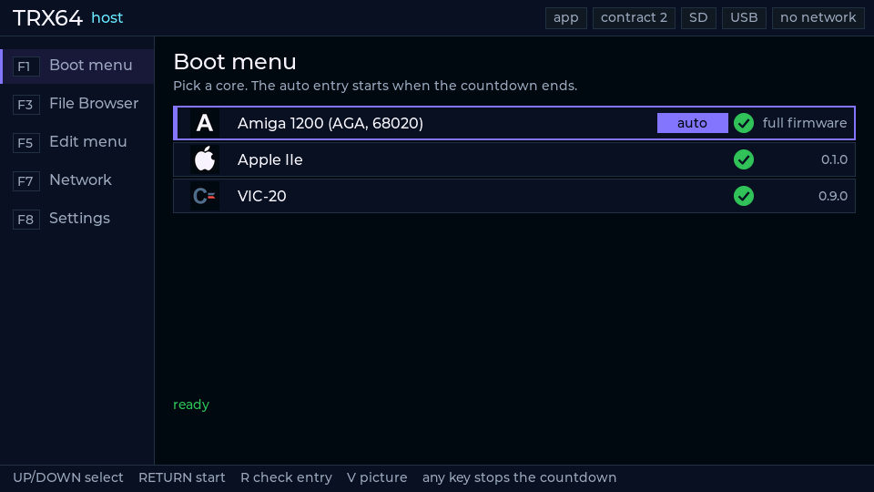

# TRX64U MultiCore

TRX64U MultiCore is a firmware for the Ultimate 64 Elite II and the C64 Ultimate. It runs different FPGA cores.

> **DISCLAIMER.** This is a hobby project. You install it at your own risk. We give no support. We accept no
> liability for bricked boards or for any other damage.

## 1. Description

The package contains the host firmware and a set of cores. The host starts and shows the boot menu.

A core is a complete machine in the FPGA. The host loads the core from a `.cor` file on a USB stick or an SD
card.

The release contains these cores: C64 (`trx64u`, `trx64g`), VIC-20, Commodore PET, Commodore 16/Plus/4,
Commodore 128, Amiga 500, Amiga 1200, Atari 800 XL, NES, Super Nintendo, Neo Geo, Apple IIe, ZX Spectrum 48K/128K,
ZX Spectrum Next, Amstrad CPC, two demo cores from DDT and a port diagnostics core.

All cores are experimental. The state of each core is in the
[core table on GitHub Discussions](https://github.com/Jondalar/TRX64U-MultiCore/discussions/66) and in
[manual chapter 11](docs/manual/11-cores.md). The host, the core application and each core have their own version
number (SemVer). All version numbers are below 1.0. The boot menu shows the version of each core.

The video output is HDMI only. Analogue video (S-video, composite) is in development.

The original firmware stays available. You start its `.cfw` file from the boot menu
([manual chapter 13](docs/manual/13-full-firmwares-cfw.md)).

The source code of the TRX64 bitstream is in the [TRX64 Ultimate project](https://github.com/Jondalar/TRX64-Ultimate).
This repository packs the bitstream into `trx64u.cor` and `trx64g.cor`. It also builds the core menu of `trx64u`.

> **NOTE.** The release contains no ROM, Kickstart or disk image. You must supply them
> ([manual chapter 12](docs/manual/12-roms.md)).

## 2. Applicability

The firmware is for the C64 Ultimate and the Ultimate 64 Elite II. The two boards have the same mainboard and the same
FPGA. It is not known yet whether the C64C works.

The C77 (Artix-7 100T) and the other Ultimate boards (Cyclone based) are not supported. The installer checks the FPGA
and the flash chip. On a different board it refuses to install.

## 3. Installation

Download the release from [Releases](https://github.com/Jondalar/TRX64U-MultiCore/releases).

1. Copy the installer and all `.cor` files into the same folder on a USB stick. Use the `.ue2` installer if the board
   has the Commodore firmware 1.1.0. Use the `.cfw` installer if the file browser of the board takes a `.cfw`.
2. Put the stick into the board. Switch the board on.
3. Open the file browser of the firmware. Select the installer. Select **Run Update**.
4. The installer asks two questions about the warranty. Answer **Yes** to both.
5. The installer saves the flash to the stick. Then it writes the new firmware and switches the board off.
6. Switch the board on. The original firmware starts: direct boot is on, and the default entry is the backup of the
   original firmware.
7. To open the boot menu, hold **C=** while you switch the board on. To show the boot menu at every start, set
   `Direct boot` to `off` in F8 Settings ([manual 8.2](docs/manual/08-settings.md)).

> **NOTE.** [Manual chapter 2](docs/manual/02-installation.md) shows each step with its screens. Updates come as a
> `.txu` file ([manual chapter 9](docs/manual/09-update-restore-package.md)).

## 4. Risks

> **WARNING.** The installer writes the flash of the board. A power loss during the write can leave the board unable
> to start. Do not remove the power while the installer runs.

- Before the write, the installer saves the flash to the stick. It also keeps the original firmware as a `.cor`
  file. To restore the original firmware, select this file in the file browser of the host and press **R**
  ([manual 14.2](docs/manual/14-recovery-and-way-back.md)).
- If the screen shows no picture, press **V**, **DOWN**, **RETURN**. The host then sets the next video mode
  ([manual 3.6](docs/manual/03-first-start.md)).
- If the board does not start, you need a USB-Blaster cable ([manual 14.5](docs/manual/14-recovery-and-way-back.md)).
- The updater of the original firmware replaces the host. To get the host back, run the installer of this release
  again ([manual 14.4](docs/manual/14-recovery-and-way-back.md)).
- By default, FTP and the web page ask for no password. Use the board only in a network that you trust.

Read the warnings in [manual chapter 1](docs/manual/01-safety-and-applicability.md) before you start.

## 5. Documentation

- [Manual](docs/manual/00-index.md)
- [Bug report](docs/manual/10-bug-report.md)
- For developers: [Writing a core application](docs/dev/core-app-guide.md),
  [Building your own core](docs/dev/core-guide.md). The same pages are in the
  [project wiki](https://github.com/Jondalar/TRX64U-MultiCore/wiki).

## 6. Licence

- Our own code is under GPL-3.0-or-later (`LICENSE`, `LICENSING.md`).
- Third-party parts keep their licences. [PROVENANCE.md](PROVENANCE.md) lists the origin and the licence of each
  part.
- If you hold the rights to a part and see a problem, contact us. We then remove that part.
