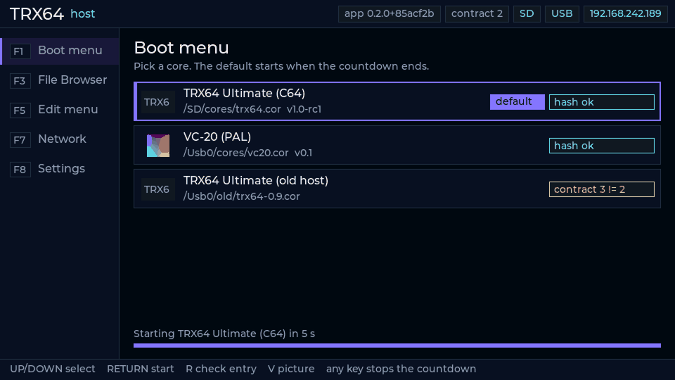
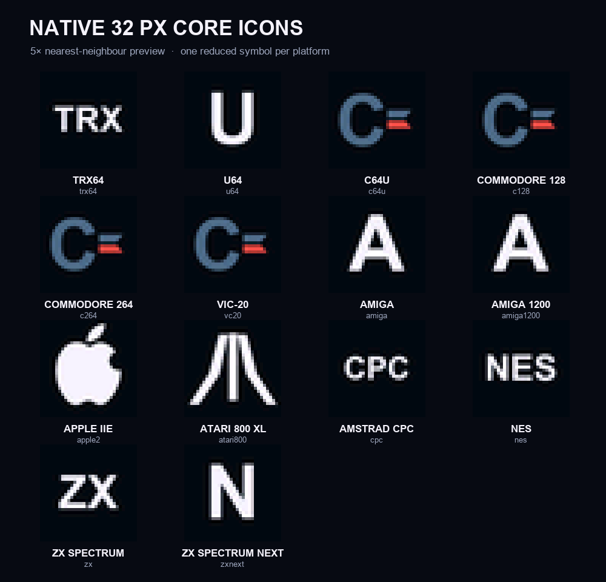
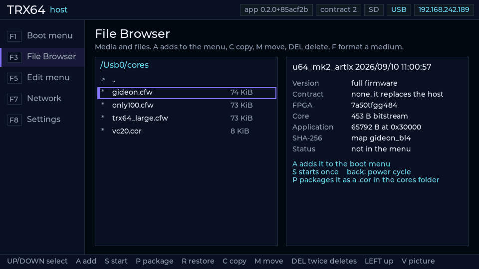
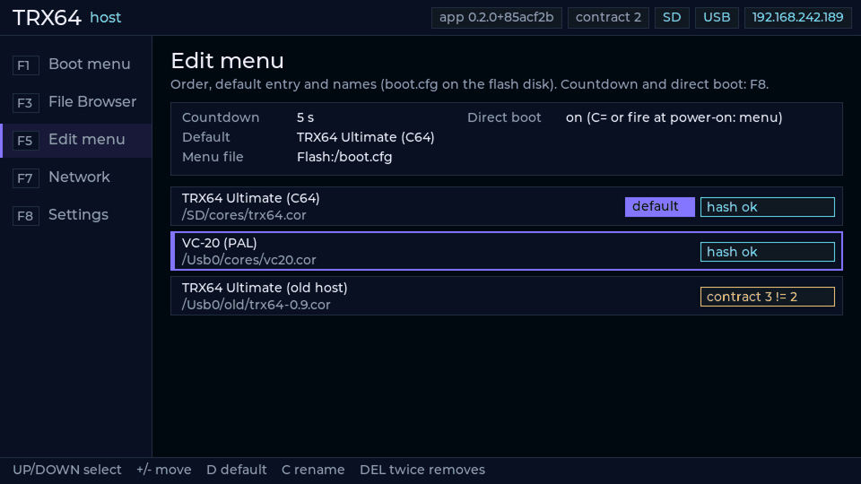
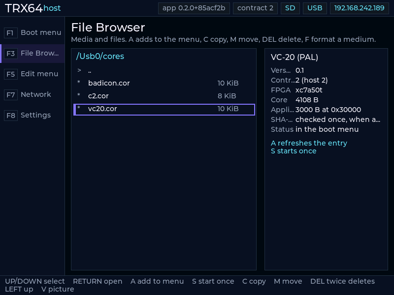

# TRX64U MultiCore

**Multi-core FPGA firmware for the Ultimate 64 Elite II (and so the C64 Ultimate, same board)**

*Figure 1. The boot menu of the host (F1). The cores are bundles (`.cor`) on a USB stick or an SD card.*

---

## 1. GENERAL

### A. Purpose

1.A.1 This firmware turns the FPGA of the Ultimate 64 Elite II into a host with exchangeable cores.

1.A.2 The host starts first. The user adds the cores from a USB stick or an SD card to the boot menu and picks one. The host
loads it into the FPGA and starts its application.

1.A.3 A core is a complete machine: a C64, a VIC-20, a Commodore PET, 264 or 128, an Amiga, an Atari 800 XL, a NES, a Super Nintendo, a Neo Geo,
an Apple IIe, a ZX Spectrum, a ZX Spectrum Next or an Amstrad CPC. Two further cores are demos of the host, and one (`diag`) is a measuring tool with no machine (5.2).

### B. Applicability

1.B.1 This firmware is for the Ultimate 64 Elite II and the C64 Ultimate. Both boards have the same mainboard with the
XC7A50T FPGA.

1.B.2 The firmware does not install on other boards. The updater refuses a board with another FPGA and writes nothing.

1.B.3 The picture is HDMI. Composite and S-video stay black, except in the C128 core, whose analogue output is in development.

### C. Description

1.C.1 The firmware has two layers.

| Layer | What it is | Where it lives |
|---|---|---|
| 1. Host | Floorplan, boot ROM, boot menu, loader, network (web page, FTP) | The board's flash |
| 2. Core | One machine with its application | One `.cor` file on the stick or the card |

1.C.2 The host image in the flash holds the host and a null core (no machine). Every machine is a `.cor` file. There are two kinds. A **partial** core
(VIC-20, Atari 800 XL, Apple IIe, the two demos) is loaded into the core region under the running host and fits only the host it was routed against. A **large** core (all
others, including the C64 cores `trx64u` and `trx64g`) is a full bitstream of the FPGA that the host starts with the core application; it carries its own copy of the host. How to build either
kind is in [docs/dev/core-guide.md](docs/dev/core-guide.md).

1.C.3 A full firmware (`.cfw`) is not a core. The host starts it as a whole and hands the FPGA over to it (see 4).

---

## 2. CAPABILITIES

2.1 **Core selection.** The user adds the cores in the File Browser to a boot menu, sets a default and starts one with
RETURN. With direct boot on, the host starts the default at power-on; **C=** at power-on shows the menu.

2.2 **Cores.** The TRX64 reference core and thirteen more machines are built, with two showcase demos and the Port Diagnostics core (see 5). All cores except `trx64g` (it runs the Ultimate application) run on the common core application: file browser, media
mount, settings, reset, return to the host menu, a bug report, USB gamepads (NES, SNES, Neo Geo). How to write the descriptor of a core for it is in [docs/dev/core-app-guide.md](docs/dev/core-app-guide.md).

2.3 **Full firmwares.** A `.cfw` is added to the boot menu like a core. The host starts it.

2.4 **Picture.** The host asks the screen (EDID) what it can do, offers only the modes the screen names and uses 1080p, else 720p, else 576p/480p. The key **V**
steps through the modes; a change asks for a key within 8 s, else it goes back. Modes narrower than 960 px (480p, 576p, 800 x 600) get a compact layout of the host
menu and of the core menus. Every core has its own Picture, Scale and Smoothing settings.

2.5 **Network.** With an address, the board serves a web page (port 80) and JSON (`/v1/status`). It serves FTP
on port 21.

2.6 **Install with a way back.** The installer saves the flash to the stick before it writes, and packs the old firmware as a
`.cor`. The host restores it with **R** (manual chapter 14). An installed host is updated with a `.txu` (manual 9.3).

---

## 3. LIMITATIONS

3.1 The known limits follow. Table 5 gives the state of each core.

3.2 **Experimental cores.** `core.toml` marks every core `experimental` except the Apple IIe. The TRX64 core comes from the TRX64 Ultimate project and has no descriptor here. Expect rough edges. See table 5.

3.3 **ROMs.** This firmware contains no ROM, Kickstart or disk image. The user supplies them (manual chapter 12).

3.4 **HDMI.** The analogue video of the C128 core is in development and has not been seen on the board.

3.4a **Recovery boot.** If the host menu stays black, the way back today is the installer of the release or the cable (manual chapter 14). A recovery boot is decided and not built (T177): RESTORE held, then F1,
at power-on starts `recovery.cor` or the installer's backup without a picture and without writing the flash.

3.5 **Back to the host.** A core on the common application returns to the host menu from its own menu when it can give the FPGA back to the host. A core without the entry (the TRX64 core)
and a full firmware need a power cycle.

3.6 **Shipped build.** The shipped bitstreams are the debug build. reSID8, UCI, streams, REU, sampler and turbo
are off in them.

3.7 **No password.** FTP and the web page ask for no password. Use a network you trust. The backup on the stick holds the
configuration pages of the flash.

3.8 **Gideon's firmware is not part of this release.** It is linked, not shipped (see 4).

3.9 **Known core problems.**

- Amiga 1200: after a change of Slow and Fast RAM and **Reset Amiga**, the board hung once with a black picture. It
  was not repeated. Fast RAM and the picture position are not fully checked on the board.
- Atari 800 XL: one executable (a trainer demo, board 2026-10-19) showed a broken scroller and ignored input; not retested.
- Apple IIe: swapping the disk in D1: while a game runs is not tested on the board.
- Commodore 264: BASIC V3.5 runs as a C16. The Plus/4 model and cartridges are not tested. The 1541 drive (`.d64`, `.g64`) is built into the VIC-20, the C264 and the C128.
- NES: the picture fills about 93 % of the height (T95, picture per core).
- SNES: games run on the board; the sound was fixed and heard correct on 2026-11-02. Neo Geo: plays on the board; dark stripes in the sprites were fixed in the bench and need a new look on the board.
- USB gamepads (NES, SNES, Neo Geo) work on the board (2026-11-02). The floppy LED (case LED 1) works on the Amiga 1200. On `main` every core with a drive has the same *LED Load Indicator* row (Amiga 500, Atari 800 XL, Apple IIe, CPC, VIC-20, Commodore 264, Commodore 128); that is not in the tester release and has not been seen on the board.
- Commodore 128: black picture on the board of 2026-11-02. The cause is found and fixed on `main` (the RAM in the DDR2 never started, T140 section 11); it is not in the tester release and not yet seen on the board. ZX Spectrum 48K: black picture; the fix is a branch that is not merged (T119).
- Amstrad CPC: no tape SAVE, no snapshot.
- ZX Spectrum Next: passed on the board (2026-10-28) with an SD image named `next.img` in `cores/zxnext/roms/`. The board issue `Auto` (read from the image's `TBBLUE.FW`) is the default on `main` (T116 D11) and not in the tester release; an older release stops at issue 5. Speed below the real machine for
  programs that do not fit the cache.

3.10 A core that misses a required ROM stays held. The screen says so after about 10 seconds.

> **WARNING.** Flashing the host replaces the firmware of the board. Follow manual chapter 2 exactly. The installer saves
> the flash to the stick before it writes.

> **NOTE.** This firmware needs no ROM files from us and ships none (see 3.3).

---

## 4. ORIGINAL FIRMWARE COMPATIBILITY

4.1 **The original firmware stays usable.** The original `.cfw` (for the file browser) and `.ue2` (stock updater)
formats stay valid. This repository does not replace them.

4.2 **Install.** The installer of this firmware exists as `.ue2` (for the Commodore firmware 1.1.0) and as `.cfw`. Both run
with **Run Update** in the file browser of the firmware that runs on the board.

4.3 **Run the original firmware from the host.** Add the original `.cfw` to the boot menu (**A** in the File
Browser, F3). RETURN asks "Start full firmware?". The host keeps the bitstream as one file in `/Flash/legacy` and hands
over. A power cycle returns to the host.

4.4 **The original updater.** With `Protect Flash from updates` off, the updater of that firmware replaces this host. The way
back is the installer of the release or the cable (manual chapter 14).

4.5 **Not shipped.** The original firmware is not part of this release. Get it from https://ultimate64.com.

---

4.6 **Tester release.** The tester release is [`t164-c83a83c2`](https://github.com/Jondalar/TRX64U-MultiCore/releases/tag/trx64mc-t164-c83a83c2) (pre-release, 2026-11-02): the installer as `.cfw` and `.ue2`, the cores and `INSTALL.md`. The Commodore 128 is not in it (black picture). The first installer of that release carried
a host bitstream without the pixel layer and left the host menu black; it was replaced the same day. The release script now builds the installer only from the tested flash image and stops otherwise
(`tools/release_mc.sh`, `tools/check_release_flash.py`). Fixes on `main` since then come with the next build.

4.7 **Install in short.** Copy the `.ue2` and the `.cor` files of the release to one folder of a stick. In the file browser of
the Commodore firmware 1.1.0 select the `.ue2`, pick **Run Update**, answer the two questions about the warranty with Yes.
The installer writes the backup, the old firmware as a `.cor`, the cores and `boot.cfg` to `cores` on the stick, then the
flash, and switches the board off. Switch the power on: the old firmware starts. Hold **C=** to get the host menu. The
full procedure with every screen is in [manual chapter 2](docs/manual/02-installation.md). The way back is
[manual chapter 14](docs/manual/14-recovery-and-way-back.md): **R** on the backup `.cor` in the File Browser.

---

## 5. CORE STATUS

5.0 The overview for testers (short description, top features, what does not work, level, state, and what we support) is [CORES.md](CORES.md).

5.1 States: **Works** = used on the board. **Testing** = runs on the board, known open items.
**PoC** = built and benched; the board result is partial or not good yet. No state is higher than its evidence.

| Core | Machine | Kind | State | Evidence |
|---|---|---|---|---|
| `trx64` | C64 (TRX64 reference core; `trx64u.cor` with our application, `trx64g.cor` with the Ultimate application) | Large | Works | Board 2026-10-10: update, backup and restore, cartridges EF1, MegaByter, GMod2, EF3 (release candidate of the same gateware). The core is built in the TRX64 Ultimate project; its `.cor` files are packed here |
| `vc20` | VIC-20 (PAL) | Partial | Testing | Board 2026-11-01 (Alex): runs. Board 2026-10-23: picture, sound, `.d64` on the 1541 with autostart; the start click stays. Floppy LED row on `main` (2026-11-02), not seen on the board |
| `pet` | Commodore PET (all models, 8032, SuperPET, IEEE drive; large core, experimental) | Large | Testing | Board 2026-11-11 (Alex): starts, demos from zimmers.net run (T134). Models and cassette not checked yet |
| `c264` | Commodore 264 (C16, Plus/4) | Large | Testing | Board 2026-10-28 (Alex): sound, 64K default, 1541 ROM, F7 reset. Plus/4 model not tested |
| `c128` | Commodore 128 (large core: flat bitstream) | Large | Testing | Board 2026-10-26: picture and sound in C128 and C64 mode. Board 2026-11-02: black picture with the tester package; fixed on `main` (T140 section 11), board retest open. 1541/1581 drive built. Analogue output (S-video, composite) built, not seen on the board; cartridge port, REU not in the core |
| `c64scpu` | C64 with SuperCPU (65816, SuperRAM; large core; build only, not in a release) | Large | PoC | T182: the C64 with its 6510 and the core application (ROM check, speed and JiffyDOS settings, drive A) are built and benched; the 65816 is not built yet, no board run. Needs the person's SuperCPU ROM |
| `amiga` | Amiga 500 (OCS/ECS, 68000) | Large | Testing | Board 2026-10-30 and 2026-11-01 (Alex): runs; Kickstart 1.3 boots, disk change from the menu boots, sound. Floppy LED row on `main` (2026-11-02), not seen on the board |
| `amiga1200` | Amiga 1200 (AGA, 68020) | Large | Testing | Board 2026-10-30 (Alex): done; 2026-10-31: keyboard and floppy LED; 2026-11-02: Scale, Smoothing, picture modes, volume, floppy LED. Turrican 2 `.adf`, Workbench and AmigaVision `.hdf` |
| `atari800` | Atari 800 XL | Partial | Testing | Board 2026-11-01 (Alex): runs (start with **S** in the File Browser); `.atr` boots. Floppy LED row on `main` (2026-11-02), not seen on the board |
| `nes` | Nintendo Entertainment System | Large | Testing | Board 2026-10-16: Zelda; Sam's Journey demo. Picture about 93 % of the height. USB pad worked on the board 2026-11-02 |
| `apple2` | Apple IIe | Partial | Testing | Board 2026-11-01 (Alex): runs; 2026-10-30: `.dsk`, `.nib`, WOZ, saves, ProDOS from the hard disk. Floppy LED row on `main` (2026-11-02), not seen on the board; disk swap while running not tested |
| `cpc` | Amstrad CPC 464 / 664 / 6128 | Large | Testing | Board 2026-10-22: BASIC 1.1 boots and takes typing. Board 2026-11-02: `CAT` works, a game starts with sound (GitHub issue 17). Tape, 464/664 not tried; the floppy LED row is on `main`, not seen on the board |
| `zx` | ZX Spectrum 48K / 128K | Large | Testing | Board: 48K and 128K run (Alex, 2026-11-09; the 48K picture was black until the `ula.sv` rewrite, T119 5.15) |
| `zxnext` | ZX Spectrum Next | Large | Testing | Board 2026-10-28 (Alex): boots from an SD card image. Older `TBBLUE.FW` images stop at board issue 5; `Auto` is the default on `main` (T116 D11) |
| `snes` | Super Nintendo (large core: flat bitstream) | Large | Testing | Board 2026-10-29 to 10-31: games run, keys work. Board 2026-11-02: sound correct after the BRR sign fix, USB pad works. No ROM needed. Open: menu verdict text |
| `neogeo` | SNK Neo Geo (MVS / AES), large core | Large | Testing | Board 2026-10-31 (Alex): playable, speed and sound fine; Board 2026-11-02: sprites without the dark stripes, USB pad works |
| `ddt_mandel`, `ddt_novic` | DDT's C64U demos (mandelbrUlt, Look Ma No VIC) as showcase cores | Partial | Testing | Board 2026-10-31 (Alex): both run |
| `diag` | Port Diagnostics: no machine; a timed probe engine measures the joystick and paddle ports from TOML test files on the SD card and writes the results back | Large | PoC | Merged on `main` 2026-11-02 (T175): gateware, core application, benches; first Vivado build green in CI run 1142 (11,949 LUT, 22.5 BRAM tiles). No board step yet |

5.2 The core `diag` (Port Diagnostics, T175) is merged on `main` and experimental. The Vivado run and the board steps are open, so it is in no release. A second C64 core with the feature set of the original firmware (`c64u`) was dropped (T103).

5.3 The core logos:

*Figure 2. The exact native 32 x 32 boot-menu icons, enlarged 5x without smoothing.*

---

## 6. SCREENSHOTS

6.1 The pictures below are rendered from the real application code (the host application and the core application, with LVGL) by the render benches of the repository. The board shows the same
screen. More figures, one per page of the manual, are in [docs/manual/img/](docs/manual/img/).

*Figure 3. F3 File Browser. **A** adds the selected file to the boot menu, **S** starts it once, **P** packages a firmware as a core.*

*Figure 4. F5 Edit menu. Order, default entry, countdown. Stored in `/Flash/boot.cfg`.*

*Figure 5. The first question of an update (`U` on a `.txu`): what the write replaces and what it means for the cores.*

*Figure 6. The menu of a core (here the Amiga 1200): settings, Picture, Scale, Smoothing, the floppy LED.*

*Figure 7. The host menu at 800 x 600. Modes narrower than 960 px get a compact layout.*

---

## 7. DOCUMENTATION

7.1 The manual is in [docs/manual/](docs/manual/00-index.md). For developers: [Writing a core application](docs/dev/core-app-guide.md) and [Building your own core](docs/dev/core-guide.md); the same pages are in the
[project wiki](https://github.com/Jondalar/TRX64U-MultiCore/wiki).

| Chapter | Content |
|---|---|
| [00 Index](docs/manual/00-index.md) | Contents |
| [01 Safety and applicability](docs/manual/01-safety-and-applicability.md) | Warnings, boards, what is needed |
| [02 Installation](docs/manual/02-installation.md) | The installer, the backup, the first power cycle |
| [03 First start](docs/manual/03-first-start.md) | Host menu, first core, no picture |
| [04 Boot menu](docs/manual/04-boot-menu.md) | F1: badges, start, countdown, direct boot |
| [05 File Browser](docs/manual/05-file-browser.md) | F3: add, start, copy, move, delete, format |
| [06 Edit menu](docs/manual/06-edit-menu.md) | F5: order, default, rename, remove |
| [07 Network, web page, colour test](docs/manual/07-network-web-colours.md) | F7: FTP, web page, JSON, colour test |
| [08 Settings](docs/manual/08-settings.md) | F8: direct boot, picture, flash protection, cores and ROMs, `boot.cfg` |
| [09 Update, restore, package](docs/manual/09-update-restore-package.md) | U, R, P: `.txu`, vendor firmware, `.cor` from a firmware |
| [10 Bug report](docs/manual/10-bug-report.md) | The report of a fault |
| [11 Cores](docs/manual/11-cores.md) | Per core: ROMs, media, keys, state |
| [12 ROMs](docs/manual/12-roms.md) | What to bring, where to put it |
| [13 Full firmwares](docs/manual/13-full-firmwares-cfw.md) | `.cfw` and `.ue2` from the host |
| [14 Recovery and the way back](docs/manual/14-recovery-and-way-back.md) | Restore, restore bundle, cable |
| [15 Troubleshooting](docs/manual/15-troubleshooting.md) | Symptoms and actions |
| [16 Glossary](docs/manual/16-glossary.md) | Terms |

---

## 8. LICENCE

8.1 Our own code is GPL-3.0-or-later (`LICENSE`, `LICENSING.md`).

8.2 Third-party parts keep their licences. The list per part, with origin, licence as the files state it and what we
changed, is in [PROVENANCE.md](PROVENANCE.md). Dag Lem's reDIP SID and CIA stay CERN-OHL-S-2.0, our changes to them too.

8.3 We publish the host installer (`.ue2` and `.cfw`, the host with the null core) and the cores (`.cor`) as built files together
with the source; no ROM image is part of either. This project combines third-party gateware and software under several
licences, and we have recorded every origin and licence as the files state it. Rights holders who see a problem: please
contact us, and we remove the part concerned.
