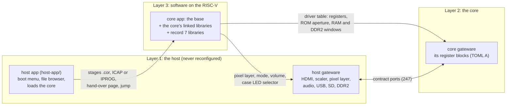
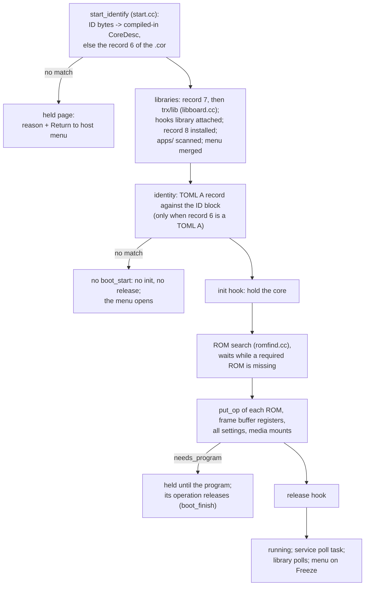

# Writing a core application

This guide is for a developer who adds a core to the generic core application, inside this repository or outside it with the TRX64 SDK, or who
changes what that application offers a core. It is read off the code of branch `t239.3` at `e61ed6b88` (the SDK of the coming 0.4.6, base API 3.4)
and off the first core built outside this repository, TRX64-Ultimate's `trx64u`, which is still on SDK 0.4.5 (base 3.3), as of 2026-11-24. Where a
comment says something else than the code does, the code is followed and the difference is named in section 12.

Paths without a prefix are this repository's. `SDK:` is a path inside the unpacked SDK package. `TRX64-Ultimate:` is a path in that repository, the
worked example of an outside core owner (sections 13 to 26).

**Two ways to a core application.**

- **In-tree core** (sections 1 to 11). The descriptor is C++ in `coreapp/cores/<name>.cc` and is compiled into the shared app: one image,
  `coreapp.bin`, linked with `coreapp/libs/shared.toml` and `coreapp/gateware/shared.toml`; `ci/trxapps.sh` copies it to
  `dist/coreapps/<core>.app` for every name in `BLUEPRINT_CORES`. The VIC-20 is in-tree with an app of its own (T239.3 V-4, V-5): its code is the
  library `cores/vc20/app/lib/vc20.cc`, and its app is linked from the SDK package by its TOML B `cores/vc20/app/sdk.toml` (`tools/sdk_core_app.sh`).
- **SDK core** (sections 13 to 26). Nothing of the core is compiled into a shared image. The core is its description record (record 6 of its `.cor`:
  a UI TOML and an API TOML); its code is a library that exports the core hooks; its app is linked from the SDK's base archive with the core's own
  TOML A (the gateware) and TOML B (the linked libraries); the owner packs, tests and delivers the `.cor`. The SDK ships no app image (SDK:
  `README.md`, "The app of a core").

**Words** (T239.3 D49). A *library* runs with the core from its start: a `.u2a` of kind lib in record 7, or a library the TOML B links into the
app. An *app* is started deliberately, by the person or over the API (`app.open`): a `.u2a` of kind app in the core's `apps/` folder.

The companion guide for the gateware side is [Building your own core](core-guide.md).

## 1. What runs where



- The host application (`host-app/software/hostapp/`) always starts first. It is the boot menu, the file browser, the updater and the loader. It has no
  descriptor and nothing in it is written for a particular core (section 11).
- The core application starts when the host has loaded the core. It runs on the same RISC-V processor, replaces the host application in memory and is
  the only software that talks to the core while it runs. A partial core lives in layer 2; a large core (`cor_pack.py pack-large`: records 1, 3, 5,
  4 with an icon, and 6, 7, 8 when it carries a description, libraries or files) is one full bitstream started by IPROG, such as TRX64-Ultimate's
  `c64_basic`, and has no layer 2.
- The base reaches the core through `CoreIo` (`coreapp/src/io.h`; the board implementation is `coreapp/src/hw.cc`; `tests/coreapp/` puts a model of the
  core behind the same interface, so descriptor hooks run natively on a Mac). A library reaches it through `LibApi`: `api->io` (`SvcIo`, SDK: `api.md`
  4.15) and the driver table of the TOML A (section 16).

## 2. The start sequence



`boot_start` (`coreapp/src/boot.cc`) does the steps with the core held: the descriptor's `init`, the ROM search and wait (it never leaves the loop with a
required ROM missing), the ROMs into the core, `video->init` (the frame-buffer registers), every setting (`boot_apply_settings(c, true)`), the media of the
last run (`mounts_restore`), then `release`, unless the core waits for a program (`needs_program`: `BOOT_WAITING_PROGRAM`). It waits no `reset_ms`
(`boot_finish`, `boot_cold_reset` and the reload do), and the run loop hands the pixel layer to the core after it. Before it, `run.cc` reads the bundle
(`bundle_read`), loads the libraries of record 7 and then those of `<root>/trx/lib/` (`lib_board_load`; the bundle's copy of a name wins), takes the core
hooks of the library the record names (`hooks_attach_lib`), installs record 8 (`core_files_install`, before the scan of `apps/` since SDK 0.4.2), scans the
apps, merges the menu, installs the application host and the machine groups (`set_machine_groups`), and checks the identity (`bundle_check_identity`).
When that check fails, `boot_start` is not called at all: no `init`, no `release`, and the menu opens. The control hooks of a compiled-in descriptor are
plain functions `int hook(CoreCtx *, char *msg, int msglen)` (0 = ok, otherwise the reason on screen); the same hooks of a library (`CoreHooks`,
`core_hooks.h`) take no context: `int (*init)(char *msg, int msglen)`.

| Hook | Job | Rule |
|---|---|---|
| `init` | hold the machine for the application | the host's power-up hold stays until `release` |
| `release` | let the machine run | the only place the application's own hold is removed |
| `warm_reset` | a reset that keeps RAM (optional) | without it a warm reset is the cold one |
| `cold_start` | what a restart needs when the core is not loaded again from a partial bitstream: a large core, a flat build, a start without a `.cor` (optional) | a partial `.cor` on a host with the ICAP loader is loaded again instead (`reload_is_dfx`) |

A cold reset is the shared sequence "hold, reset-time settings, wait `reset_ms`, release" (`boot_cold_reset`). `reset_ms` must cover the core's own RAM
sweep. `cold_ram_bytes` tells "Restart core" how much RAM to clear through the RAM window.

**Identity (T239.3 P1-4).** When record 6 is a TOML A record (version 7), the base compares its `id` and `build` with the ID block of the running
bitstream (`bundle_check_identity`, `bundle.cc`; SDK: `api.md` 6.14.13). A core that does not match is not started (above), and every later release
refuses too (`release_core`, `CoreCtx::identity_refused`). A description record (version 6) carries no map, and the check returns at once: a core
described by its record gets no identity check until a TOML A record can ride beside the description (section 26).

## 3. The descriptor

The descriptor is one `const CoreDesc` in `coreapp/cores/<name>.cc`, or the data sections of record 6 (section 6, last bullets; section 19). Fields that do not
apply are null or zero. The ones every core fills:

| Field | Meaning |
|---|---|
| `id[4]` | the four bytes at register offsets 0..3. **Must equal what the gateware answers** (section 8) |
| `cor_name` | `name` of `cores/<id>/core.toml` (an SDK core: `[core] name`). The `.cor` manifest and the hand-over must agree |
| `title`, `short_title` | menu title; the name on the navigation rail (148 px, so short) |
| `folder`, `store` | `roms/<folder>` for developer starts; the `[section]` of `<name>.cfg` |
| `min_contract` | 1; `desc_check` only checks that it is 1 or more. The contract is checked by the host app: it refuses a partial `.cor` whose manifest `contract` is not its own (`COR_HOST_CONTRACT`, `cor.cc`; `contract/VERSION` = 2); a large `.cor` carries none |
| `roms`, `settings`, `tasks`, `filetypes`, `media` | the menu content (sections 4 to 6) |
| `video` | `VideoDesc`: source size, scale, position, DDR2 frame-buffer base and stride, the four registers of the frame writer |
| `freeze` | `FreezeDesc`: the status register and the PAUSED bit, the timeout (200 ms) |
| `init`, `release`, `warm_reset`, `reset_ms` | section 2 |
| `service_op`, `service_period_ms`, `poll_when_frozen` | an operation called by a task of its own every period (SIO frames, a PRG waiting for READY, write-back) |
| `needs_program`, `program_ext` | a core that waits for a file before it can start (the NES) |
| `register_ops` | the core's contributor: registers the names the descriptor uses |
| `caps`, `ncaps` | what the machine has (`iec`, `drive_a`, `cartridge`...): a library can be refused for lack of it, and a linked library's operations are registered only for a core that names its capability (`libtab_register_ops`, `libtab.cc`) |

Optional records (each is a pointer to a spec struct): `romset`, `window_media`, `sector_media`, `mouse`, `fbwin`, `rawkeys`, `pad`, `report_regs`,
`menu_rec`. Their headers (`romset.h`, `winslot.h`, `sectors.h`, `mousesink.h`, `fbwin.h`, `rawkeys.h`, `pad.h`, `corereport.h`, `descrec.h`) say what each
one does. `own_volume` removes the generic Volume item for a core with a mixer of its own; `live_ms` and `menu_first` are for a core with no picture (the
diag core).

**The id also selects base services.** `appsvc_c64()` gives `api->c64` and the base's `c64` table only when the descriptor's id is `TRX2`. The
cartridge-port service of the `c64cart` library needs that and the capability `cartridge` in the caps (`cart_port`, `c64cart_exports.cc`); apps that need
`cart_port` are offered on the id alone (`app_index.set_cart_port(appsvc_c64() != 0)`, `run.cc`). `appsvc_trx()` gives `api->trx` only when the ID block
of the running bitstream reads `TRX2` (`appsvc.cc`).

**Everything the descriptor makes the machine do is an operation by name.** A ROM's `put_op`, a setting's `apply`, a task's `op`, a file action's `op`, a
media slot's `eject_op` are strings. The core's `register_ops` registers them (`OpRegistry::add_op`, `coreapp/src/ops.h`), and `desc_check`
(`coreapp/src/desc_check.cc`, run over the compiled-in table by `tests/coreapp/test_desc.cc`) refuses a descriptor whose name is not registered or whose
bindings do not fit the operation's arguments (`bindcheck.cc`). A record is checked by `cor_pack.py --ops` against a list of what the app exports
(section 19). So a typo is a failed check, not a dead menu item.

### Operations, states, events

```cpp
r.contributor("vc20");                                   // the owner of the names that follow
r.add_op("vc20.put_basic", rom_arg, 1, op_put_basic);    // typed arguments: ARG_INT, ARG_ENUM, ARG_STRING, ARG_PATH, ARG_BLOB ...
r.add_state("vc20.program", prg_name);                   // a value the menu and REST can read (what is in a slot)
```

A handler is `int fn(CoreCtx *c, const OpArgs &a, OpOut &o)`. It returns `OPE_OK` or `OPE_FAILED` with the reason in `o.msg`. It may set `o.more` to be
called again at once (a poll). A name has one owner; a second registration of it is refused. The arguments are checked against their `ArgSpec` before the
handler runs, so a handler never sees an enum out of range. A library registers the same way through its `LibRecord` (`LibOpDecl`, `LibStateDecl`; SDK:
`api.md` chapter 6).

An entry that calls an operation fills its arguments with `OpBind` records: `B_FILE("path")` (the file the menu is on), `B_INT`, `B_STR`, `B_ASK` (a hex
address the person typed, `FileAction::ask`), `B_TEXT` (a name, `Task::ask`). Every argument is bound exactly once.

The base registers itself, so a descriptor can name them without registering anything: `machine.cold_reset`, `machine.warm_reset`, `machine.reload_roms`,
`machine.restart` (`boot.cc`), `settings.*`, `menu.browse`, `app.open`, `picture.apply`, `scale.apply`, `smooth.apply`, `follow.apply`, `volume.apply`,
`tone.apply`, `pad.*` and `led.load` (`engines.cc`). Not the base's: `disk.create` is registered by the library `newdisk` for a core whose caps name
`floppy` or `sio` (SDK: `api.md` 9.5.13), so an app whose TOML B does not link `newdisk` has no such operation; the memory operations
`machine.read_mem` and `machine.write_mem` are the macro `MEM_OPS` (`memops.h`) that a core's own contributor calls (`cores/atari800/app/lib/atari800.cc`; trx64u
registers them in its library).

## 4. Settings

```cpp
struct Setting { key, values, nvalues, def, when, apply, bind, base, group, kind, show_state, label, lock_state, pick };
```

- `key` is the item text and the key in `<name>.cfg`. It never changes with a label (`label` is the text shown if it differs).
- `values` are the labels, also the values in the file. `def` is the index of the default.
- **`when`**: `WHEN_LIVE` applies the value at once; `WHEN_RESET` is written while the core is held, at the next reset. `boot_apply_settings(c, all)` writes
  every `WHEN_RESET` item (core held) or every item (`all`: at the start, in `boot_finish`, at a restart and when a config is loaded); a `kind` 3 item
  never.
- The value gets into the machine in one of three ways, exactly one per setting (`desc_check` enforces it):
  1. `apply` names an operation with one `value` argument (an int or enum). For a range setting (`kind` 0 with `base` != 0) the operation gets `base + index`.
  2. `bind` is a `RegBind { reg, shift, mask, bytes }`: the setting is bits of a register byte (`coreapp/src/regset.h`). Several settings can share a
     register; the byte written is the OR of what all bound settings contribute, computed from the settings and never read back (these registers are
     write-only commits). `reset_writes` are bytes no setting owns, written at the end of every settings pass (`regset_apply`: start, reset, restart),
     not when a live change commits a register.
  3. neither: the item that chooses the member of the core's `romset` (`choice_key`); the reload applies it.

The VIC-20 (`cores/vc20/app/lib/vc20.cc`, excerpt) binds three settings to register bits and one to an operation; the 1541 rows come from a shared macro:

```cpp
static const RegBind b_exp  = { VC20_RAM_EXT, 0, 0x1F, exp_bytes };     // value -> byte through a table
static const Setting settings[4 + CBM1541_NSETTINGS] = {
    { "Memory Expansion (at next reset)", exp_names,  7, 0, WHEN_RESET, 0, &b_exp, 0, 0, 0, 0, "Memory Expansion" },
    { "Block 5 ($A000), when expanded",   blk5_names, 2, 0, WHEN_RESET, 0, &b_blk5 },
    { KEY_JIFFY, jiffy_names, 2, 0, WHEN_RESET, "vc20.set_jiffy" },
    { "Datasette port", dset_names, 2, 0, WHEN_LIVE, 0, &b_dset },
    CBM1541_SETTINGS,
};
```

**Three layers decide the value** (`coreapp/src/settings.h`): the core's `<name>.cfg` if the item is set there, else the host's flash settings (read only),
else the descriptor default. Every change goes into the `.cfg` at once (or with Auto Save Config off, when saved). Nothing in the application can write the
flash: `FlashLayer` has no write method, and a test counts the flash accesses of a whole session.

**Added by the framework, never declared by you.** `picture_extend` adds *Picture* (`PICTURE_KEY`, operation `picture.apply`; the list is described in
section 7); for every frame-buffer core on a host whose gateware scales, *Scale* (`SCALE_KEY`) and *Smoothing* (`SMOOTH_KEY`) follow, and, where the
gateware has the Frame follow register (`PictureEnv::follow`, 0x4F02) and the core has a frame buffer (`video.w != 0`), *Frame follow* (`FOLLOW_KEY`,
`Off`/`On`, default `Off`, live, group `video`, operation `follow.apply`). `volume_extend` adds *Volume* (`VOLUME_KEY`, 0 to 200 % in steps of 5, the
host's master gain) and `tone_extend` adds *Tone* (`TONE_KEY`: Flat / Bass boost / Treble boost, the host's shelf filter) right after it, **only when the
app is linked against a TOML A with the base block `audio_master`** (T239.3 D36: `volume.cc` and `tone.cc` return at once under `#ifndef
DRV_HAS_audio_master`; SDK: `api.md` 6.17.5.7). The VIC-20's app names the block in its `base_blocks` (`cores/vc20/app/sdk.toml`) and has both rows.
trx64u's TOML A has no such block, because `c64_basic` decodes no master volume or tone, so trx64u has neither row (a decided gap). Where the block is
linked, nothing is refused: a descriptor that declares `Volume` or sets `own_volume` gets no generic Volume row, one that declares `Tone` or sets
`no_tone` no Tone row; `own_volume` does not remove *Tone*. SHIFT+ and SHIFT- on the menu run the operation `volume.change` (`volume.cc`; the key rows
in `menukeytab.cc`): it steps the item `Volume` when that is the base's row or bound to a register, else the key goes on to the next row. The volume
hotkeys with the menu closed step the item `[hotkeys] vol_key` names, else `Volume` (`hk_step_volume`, `hotkeys.cc`).

`desc_check` refuses a descriptor that declares *Picture*, *Scale*, *Smoothing* or *Frame follow* (`picture_extend` refuses the keys too) or names
`picture.apply`, `scale.apply`, `smooth.apply` or `follow.apply` as a setting's `apply`.

`baseset_extend` (base 3.3, `baseset.h`) adds up to six more, last of all, and only where the code can do what the row says (T228 R20): *Joystick Input* (only for a core whose `caps` name
`kbd_joystick`) and, for a core whose descriptor has a `mouse`, *Mouse Sensitivity* and *Mouse Acceleration* (*Mouse Mode*, *Mouse Wheel Sensitivity* and
*Mouse Wheel Direction* need the capability `mouse_driver`). A menu TOML's top-level `hide` list holds the keys it does not want.
Their operations are `base.*`. A descriptor or menu TOML does not declare one: `desc_check` refuses the keys, except *Mouse Sensitivity* and *Mouse
Acceleration* with the core's own operations `mouse.sens` and `mouse.accel`. A library of the core reads them by key and hears a change through the core
hook `base_setting_changed` (`core_hooks.h`).

Settings can also carry `group`, `show_state` (show the row only while a state value holds), `kind` 1/2 (a text the person types, shown plain or as stars)
or 3 (a file the person selects: the row shows its path, `apply` takes one text `path`, and no reset applies it), `lock_state` (a state whose text stands in
place of the value while it has one; the menu then refuses a change) and `pick` (a value list filled at run time: `hotkeys.keys`, `hotkeys.modifiers`).

## 5. ROMs

`RomSpec { role, names[], sizes[], required, check, put_op, set, shared }` (a record: `[[rom]]`). The names are tried in order (case-insensitive), the first
file of an allowed size whose `check` accepts it wins. `put_op` is called with the bytes (one `ARG_BLOB`) once the file is chosen, the core held. A required
ROM that is missing keeps the core held and the screen says so after about ten seconds.

Where the file is looked for is the **core folder** (T148, `coreapp/src/corefolder.h`): every core has one folder beside its `.cor`, `<dir>/<name>/`, holding
`<name>.cfg`, `roms/`, `saves/` and `configs/` (`corefolder_ensure` makes the three folders; `apps/` is made by `instfiles` when a file of record 8 lies in
it). With a `.cor` path, `rom_scan` reads `roms/` of that folder **alone** (`own_dir`); files elsewhere get there by a verified copy
(`corefolder_copy_verified`, size and SHA-256 read back). Only a developer start without a `.cor` path searches `/flash`, `/usb0..3`, `/sd` under
`roms/<folder>`. `set` groups ROMs of machine variants (Spectrum 48K/128K, CPC 464/664/6128): the core starts when one set is complete. `shared` is for a
ROM of a shared device (the 1541) that is searched in the core folder and then in the shared folder.

**The host reads the ROM requirements too.** The host's page *Cores and ROMs* (F8, `coremaint.cc`, the table's only user) shows what a core misses from a
generated table, `host-app/software/hostapp/romreq_table.inc`, made by `tests/coreapp/gen_romreq.cc` from the core table. A changed `RomSpec` without a
regenerated table is a red test run. A core described by its record names its ROMs in record 6, and the host reads them there (T239.3 P1-6;
`CmFs::core_roms`, `host-app/software/hostapp/hostfs.cc`).

## 6. The Library: file types, actions, tasks, media, libraries

The F3 *Library* area is a file browser. What happens to a file depends on its extension:

```cpp
static const OpBind file_bind[] = { B_FILE("path") };
static const FileAction prg_actions[] = {
    { "Run PRG", "vc20.run_prg", file_bind, 1, true, 0, 0 },                          // closes_menu = true
    { "Load PRG (no reset, no start)", "vc20.load_prg", file_bind, 1, false, 0, 0 },
};
static const FileType filetypes[2 + CBM1541_NFILETYPES] = {
    { ".prg", prg_actions, 2 },
    { ".p00", prg_actions, 2 },
    { ".d64", c1541_d64_actions, 5, ".prg", c1541_inner_actions, 2 },   // CBM1541_FILETYPES written out, with the VIC-20's
    { ".g64", c1541_g64_actions, 4, 0, 0, 0 },                           // own .rom action (vc20.set_drive_rom)
    { ".rom", rom_actions, 1, 0, 0, 0 },
};
```

- `FileAction` may `ask` for a 16-bit address first (`ask_off` = the offset of the file's own load address, so RETURN alone takes it), may be restricted by
  `size_in`, and has a `key` letter for the action sheet (the same letters in the host and every core).
- `FileType::inner_ext`/`inner` make a disk image a folder: the browser lists the files inside and offers `inner` actions (`menu.browse` enters the image).
- `Task` is an entry of the *Actions* area: `{ "Reset", "machine.cold_reset", 0, 0, true }`. `ask` prompts for a name; `pick_dir` first opens a folder browser
  and runs the operation in steps with a progress display (`CoreCtx::job_step`; `newdisk.cc` is the pattern).
- `MediaSlot { name, state, eject_op, ... }` is a row on the status page: `state` names the state value that says what is in the slot.
- Libraries come in two forms. A **linked library** is named by the app's TOML B (`coreapp/libs/shared.toml` for the shared app) and compiled into the app
  (T239.3 D31): `cbm1541`, `c64cart`, `sid`, `tempdisk`, `cbmprg`, `newdisk`, `mouse`, `pad` and the others of the catalog; its entries (`bind`,
  `register_ops` with `capability`, `init`, `start`, `freeze_request`, `table`, `core`) are called by the generic part through `libtab_table`
  (`libtab.h`). In a compiled-in descriptor the drive rows are spliced in by macros (`cores/cbm1541_desc.h`). A **`.u2a` library** (`libfmt.h`,
  `libload.*`, `libboard.cc`) loads at start from record 7 of the `.cor` and then from `<root>/trx/lib` (`LIB_FOLDER`, `libscan.h`), and adds operations,
  states, settings, tasks, file actions, menu nodes and tabs at run time.
- A library may declare one poll, in its record (`LibRecord::poll`, `libapi.h`) or in the `[poll]` of its menu record, not in both: an operation without
  arguments that the service layer calls every `period_ms` while the library is loaded and the machine runs (`LibPolls`, `service.h`; never while the menu
  has frozen the machine, unless `when_frozen`). A poll that cannot be served refuses a library that loads after the core has started (one that loads
  before the start stays loaded, its poll is dropped and the log says why). A library with a poll, menu nodes, file actions, settings or tabs is never
  evicted when an application is opened with a short heap (`AppIndex::prepare_open`); the application is refused with "Not enough memory for ...". The base
  API has a version (`U2A_ABI_MAJOR.U2A_BASE_MINOR` in `libfmt.h`, `base_api` in `coreapp/version.toml`, 3.4 on `t239.3`): a `.u2a` that `needs base>=x.y`
  is refused on a lower base with both numbers named. The public headers are locked per version in `coreapp/api_lock.toml` (`python3 tools/sdk_api.py
  update`, `check`); one base minor per SDK release, so members are appended under the coming minor until it ships (section 18).
- A library exports tables under names (`LibRecord::export_list`, `LibExportDecl`; `LIB_EXPORTS` in `lib.mk`, `--export` of `u2a_pack.py`):
  `api->lib->find(name, version, &size)` searches export names first, a `needs` entry resolves against them too, and `lib_load_folder` orders a folder by
  them; `c64_api.h` is the table `c64` of the C64 family, which the base answers itself (for a `TRX2` core) until a library exports it. `u2a_pack.py`
  refuses constructors and destructors (D19). See `app/sdkpkg/api.md` section 9.
- A library or application may declare a budget (`LIB_BUDGET` in `app/lib/lib.mk`, `APP_BUDGET` in `app.mk`, `u2a_pack.py --budget key=number`): ceilings
  for the image, the registrations and the peak of the heap held through `api->mem`, and the permanent figure of that heap (`heap_keep`). The packer refuses
  an image over `image` (image and bss); `LibLoader::load` refuses an image over any other figure, or over the room left in a table, with a sentence that
  names the image, the figure and the limit; nothing of it stays. See `app/sdkpkg/api.md` section 8 and section 17.
- The heap of a core's app (T239.3 D15, P4-1): `tools/cor_pack.py --heap` (an in-tree core: the word `heap` of its `core.toml`) writes the `TRXHEAP:`
  record of the app (`coreapp/src/heapcfg.c`). Absent: 0x7A0000 (`HEAPCFG_DEFAULT`). `0`: the region that is left, `heap = 0xE70000 - align16(image end)`
  (the application region ends at 0xE90000, less the stack reserve 0x20000). `cor_pack` prints the figures and the heap each library keeps (`heap_keep`,
  `heap_peak` of a `[[library]]` of the TOML B given as `--sizes`, and of the budget of each `--lib` file), and fails the pack when the libraries keep more
  than the heap.
- A core can describe its menu as data instead of C++ tables: a UI TOML (`menu.toml`), compiled by `tools/descrec.py` into the `.cor`'s record 6
  (`descrec.h`).
- A core can also describe the rest of its descriptor as data (T239.3 D17, record version 6): identity, ROMs, video and freeze, hotkeys, mount slots,
  the register bits of a setting (`reg_bind`) and the name of the library that is its code (`hooks`). `cores/vc20/app/desc.toml` and TRX64-Ultimate:
  `software/trx64u/base/desc.toml` are examples; `descrec_core` (`descrec.cc`) makes the `CoreDesc` of the record and `BundleDescSource` (`bundle.h`) finds
  it in the bundle when no descriptor is compiled in (`start_identify`). Function hooks (`init`, `release`, `register_ops`, the media write-back, the
  mount slot's three functions) are code: from `DescCode` (`descrec.h`) for an in-tree core, from the library `hooks` names (`CoreHooks`, `core_hooks.h`)
  for an SDK core. Every data field of `CoreDesc` has a place in the record:

  | section | TOML | `CoreDesc` field |
  |---|---|---|
  | 1 core | `[core]` | id, cor_name, title, short_title, folder, store, min_contract, reset_ms, service_op/period, flags (poll_when_frozen, board_caps, id_shared, own_volume, no_tone, menu_first), needs_program, program_ext, type_op, run_op, core_id, live_ms, caps, hooks |
  | 2 video | `[video]`, `[freeze]` | video, freeze |
  | 3 roms | `[[rom]]` | roms (`check = true`: the content check is a hook) |
  | 4 setting register bits | `reg_bind` in a `[[core_setting]]` | Setting::bind |
  | 5 hotkeys | `[hotkeys]` | hotkeys |
  | 6 mount slots | `[mount]` | mount_slots (names; the functions are hooks) |
  | 7 reset writes | `[[reset_write]]` | reset_writes |
  | 8 id feature | `[id_feature]` | id_feat_reg, id_feat_mask, id_feat_val |
  | 9 report registers | `[[report_reg]]` | report_regs |
  | 10 raw keys | `[rawkeys]` | rawkeys (`held = true`: the keys-down function is a hook) |
  | 11 alternative video | `[alt_video]` | alt_video |
  | 12 picture window | `[fbwin]` | fbwin |
  | 13 mouse | `[mouse]` | mouse |
  | 14 rom set | `[romset]` | romset (`version`, `pick`: hooks) |
  | 15 window media | `[window_media]` | window_media |
  | 16 sector media | `[sector_media]` | sector_media |
  | 17 media replace | `replace` in a `[[media]]` | MediaSlot::replace |
  | 18 key rows | `[[key]]` | none: the key table (`CoreKey`, `menuintent.h`) |
  | 19 windows | `[[window]]` | none: the register windows `io.window` hands out |

  The menu tables (tasks, media, file types, settings), the pad (`[pad]`), the restart (`[restart]`) and `machine_info` are the older record parts. The keys of
  every table are listed at the top of `tools/descrec.py`. While a descriptor is compiled in for the core, it is the core, and a record with data sections
  beside it changes nothing at run time (`descrec_applies`); only a core with no compiled-in descriptor is made of the record (`CoreDesc::from_record`).
  **One record 6, several files:** `cor_pack.py --desc` is repeatable and `descrec.compile_files` merges a core's UI TOML and API TOML into one description
  record, refusing a table or key that is in both (trx64u: `--desc menu.toml --desc desc.toml`). What cannot share record 6 with a description is a TOML A
  record (version 7, section 15).

The golden menu `tests/coreapp/golden/menu_vc20.txt` shows what the whitelist menu builds out of such a descriptor: a tab or area with no entry is dropped.

## 7. Picture, Freeze, USB pads, volume, bug report, the way back

**Picture.** `VideoDesc` says where the core's frame buffers are: the app writes `fb_base` and `fb_stride` into `reg_fb_base`/`reg_fb_stride`, reads
`reg_latest`/`reg_seq`, and puts the layer at `x0,y0` with `scale`. `bpp` 0 or 2 is RGB565; 4 is the A1200's own 32-bit layer. The HDMI mode, Scale and
Smoothing are the person's choice (section 4), not the descriptor's. A core that draws its own picture (`video.w == 0`, the C64 family on the VIC scaler
path; trx64u's `[video]` is all zero) leaves the whole record zero; `desc_check` refuses `h`, `fb_base`, `fb_stride` or `nbuf` set with `w == 0`, and a
`fb_base` below the DDR2 window (0x01000000).

**The Picture list (T235).** On the gateware path outside the VIC scaler (`full_list()` in `picture.cc`) the item's values are `Auto` and the 9 rows of the
host's mode table (`576p`/`480p`, `1280 x 720`, `1920 x 1080`, each at 50 and 60 Hz; the PC modes `800 x 600`, `1024 x 768`, `1280 x 1024` at 60 Hz only),
whether or not the screen's EDID names the row; `picture_modes` marks the rows the EDID names. On the VIC-scaler path and with firmware video only, the list
stays the resolutions the screen names, at the machine's rate (`video_modes_hdmi_list`), no marks.

**Freeze.** `FreezeDesc { reg_status, mask, timeout_ms, word }`. Opening the menu stops the machine (`CoreIo::stop`, the host's `C64_STOP`), waits until the
core reports PAUSED in its status register (200 ms), switches the pixel layer to the menu, and on leaving gives the machine back exactly (`freeze.h`). The
core must honour the stop: ddt_novic halts on `c64_halt_req | mc_halt_s[1] | machine_ctl[1] | CTRL.b1` and reports `halted_q` in STATUS bit 1.
`reg_status` is a register number of the core window, read with `io->rd` (`freeze.cc`); it is not a name of the TOML A.

**Overlay.** A library or app draws over the running picture through `api->overlay` (`SvcOverlay`, T256): elements, `frame` (the frame the machine drew last,
into a surface of the caller, since SDK 0.4.3), `still_palette`, `canvas` (SDK 0.4.5); base 3.4 appends `exit_to_machine` and `goto_screen` (T256 D13; SDK:
`api.md` 4.17.18, 4.17.19). A `goto_screen` with the menu closed opens the menu, and the place waits until it is open (`MenuCtl::goto_when_open`).

**USB pads (T156).** A `PadSpec { reg[2], nbuttons, names, def_map }` opts the core in. `pad.cc` keeps two pads in plug order, turns a report into the core's
button word through the map (the default is the SNES layout, resolved per pad by VID:PID) and writes it as a 16-bit pair, low byte first, to the register of the
player; a pad that leaves writes zero. "Map buttons" records a custom map into the `.cfg`. A menu TOML declares a pad with `[pad]` (`tools/descrec.py`
documents the keys): `output = "joystick"` writes the host's joystick lines (`CoreIo::joy_lines`, merged with the mouse's in `JoystickOutput`) instead of a
register pair, and the operation `pad.port` picks port 1 or 2; trx64u uses it with `per_pad = true`.

**Volume.** Generic (section 4), only with `audio_master` in the TOML A. **LED Load Indicator.** The setting `{ "LED Load Indicator", ..., WHEN_LIVE,
"led.load" }` selects case LED 1 = drive A activity once (`ledload.h`). The 1541 rows carry it (`cbm1541_desc.h`); `atari800`, `apple2`, `cpc` and
`amiga` declare it themselves. The core must put its floppy/hard-disk activity on `drive_leds_n` (contract README).

**Bug report.** *System, Bug report* writes `<date>.txt` to `/sd/report` (else the first USB medium): software versions, the core's settings, the registers
named in `report_regs` (`ReportReg { name, reg, bytes }`; only registers whose read changes nothing, never a FIFO or a mailbox) and the application log
(`corereport.h`).

**Return to host.** *System, Return to host menu* (`EK_RETURN_HOST`) is a fixed entry, present when the board profile is the host's
(`board.can_return_host`). Since T239.3 D37 (SDK 0.4.4) the profile is the host's when the ICAP loader's ID byte reads 0x7A **and** the app links the block
`partition` or the hand-over page is valid; any other answer is the standalone (monolith) profile (`board_detect`; SDK: `api.md` 6.17.5.5, 6.17.5.6). An
app linked without the block `icap` has no ICAP access at all. `hw_return_to_host` (`hw.cc`) writes the hand-over "menu requested" marker, then the ICAP
sequence `WBSTAR := 0; IPROG`: the FPGA reconfigures from flash address 0 (the host with the null core). It works for a layer-2 core and for a large core
whose bitstream has the loader: `c64_basic` has one since D37 (block `icap`, no `partition`), so trx64u offers the row when the host started it and not
when it runs standalone at flash 0x0. On a bitstream without the loader (a stock firmware) the way back is a power cycle. The same call is offered on the
held page of a core that cannot be started (`held_offers_return`).

## 8. The register window (the contract between app and core)

A layer-2 core is seen as byte registers at `IOBASE + 0x1A0000 + reg`; in the gateware these are the ports `cw_addr[16:0]`, `cw_wdata`, `cw_rdata`, `cw_we`,
`cw_re`, `cw_ack`, `cw_irq`. Offset 0 to 3 is the ID, byte 0 first. A generic layout, as implemented in `cores/ddt_mandel/trx/ddt_regs.v` (each core's block
follows it for the part the application uses):

| Offset | Meaning |
|---|---|
| 000-003 | ID (four ASCII bytes; the descriptor's `id`) |
| 004-005 | CAPS, CAPS2 (b6 page 6 = pixel layer, b7 RGB565 layer; b1 of CAPS2: BUILD present) |
| 006 | CONTRACT, the layer-2 contract the core was written for |
| 008-00B | BUILD, the bitstream's stamp |
| 0A0 / 0A4 | CTRL (b0 reset hold, b1 halt) / STATUS (b0 in reset, b1 held) in the DDT cores; every core chooses its own |
| 0C0-0CB | FB_LATEST (b7 valid, b1:0 buffer), FRAME_SEQ, FB_BASE, FB_STRIDE of the frame writer |
| page 6 (0x6000) | forwarded to the host's pixel layer (`px_we`, `px_re`, `px_rdata`) |
| anything else | reads 0 and is acknowledged |

An access must be acknowledged: an unknown register answers 0 with `ack`, never silence. The bits of status registers the application reads for Freeze must be
stable (the DDT block samples them through two flops and accepts a value when two reads agree).

The register headers of a core become its **TOML A** (section 15): one block per register range and driver, each register a property, and the code takes
every address from the generated driver table (section 16). A large core decodes its own I/O space: `c64_basic`'s ID block is `ident` at 0x101A0000, and its
other blocks lie in the pages of `trx_io.v`, `ultimate_sys.vhd`'s own decode and the U64 and C64 pages (TRX64-Ultimate: `software/trx64u/gateware/c64_basic.toml`).

**`tools/check_core_id.py`** compares the four bytes the gateware answers with the `{ 'D', 'D', 'T', 'N' }` in the descriptor. It reads several forms
(`32'h` constants, the VHDL form, the `.ID(...)` parameter, byte-wise `q <= "C"`), and its `selftest` shows that a swapped constant is refused. Add the
pair to `PAIRS`. (The ZX core once answered `XZSP` instead of `ZXSP`: that is why the check exists.)

The ID is also how two descriptors are told apart: `desc_check_table` refuses two cores with the same ID block unless both set `id_shared` (the A500 and the A1200
share a gateware ID and are told apart by the bundle's name).

## 9. A worked example: ddt_novic

The smallest descriptor in the tree. No ROMs, no settings, no program, one task. `coreapp/cores/ddt_regs.h`:

```c
#define DDT_CTRL        0x0A0          // b0 reset hold, b1 halt (Freeze)
#define DDT_STATUS      0x0A4          // b0 in reset, b1 held (Freeze)
#define DDT_ST_HELD     0x02
#define DDT_FB_LATEST   0x0C0
#define DDT_FRAME_SEQ   0x0C1
#define DDT_FB_BASE     0x0C4
#define DDT_FB_STRIDE   0x0C8
#define DDT_FB_ADDR          0x01D00000u    // the reset value of FB_BASE: the host's REU block
```

`coreapp/cores/ddt_novic.cc`:

```cpp
static int ddt_init(CoreCtx *c, char *, int)    { c->io->wr(DDT_CTRL, DDT_CTRL_HOLD); c->io->mode_reset(true);  return 0; }
static int ddt_release(CoreCtx *c, char *, int) { c->io->wr(DDT_CTRL, 0);             c->io->mode_reset(false); return 0; }
static const Task tasks[] = { { "Reset", "machine.cold_reset", 0, 0, true } };

const CoreDesc ddt_novic_desc = {
    { 'D', 'D', 'T', 'N' },                   // id
    "DDT Look Ma, No VIC", "DDT Look Ma, No VIC", "NOVIC",
    "ddt_novic", "DDT Look Ma, No VIC Settings", 1,
    0, 0,  0, 0,  tasks, 1,  0, 0,  0, 0,     // roms, settings, tasks, filetypes, media
    { 352, 200, 3, 432, 240, DDT_FB_ADDR, DDT_FB_STRIDE_BYTES, 4, DDT_FB_LATEST, DDT_FRAME_SEQ, DDT_FB_BASE, DDT_FB_STRIDE },
    { DDT_STATUS, DDT_ST_HELD, 200 },         // freeze
    ddt_init, ddt_release, 0, 20,             // init, release, warm_reset, reset_ms
    0, 0, false,  0, 0,  ddt_register,  0, 0,
};
```

`ddt_register` registers only the memory operations (`MEM_OPS`, with a map that says the core has no memory the application can reach). The positional
initialiser follows the order of `CoreDesc` in `desc.h`; fields added later (the end of the struct) stay zero. The picture is 352 x 200 at scale 3 =
1056 x 600, centred on 1920 x 1080 (x0 = 432, y0 = 240).

The gateware half is `cores/ddt_novic/layer2_ddt_novic.v`: it passes `.ID(32'h4E544444)` (bytes `D D T N`, byte 0 first) to the register block, builds
`status = {6'd0, halted_q, hold | cpu_rst}`, and writes the picture as RGB565 into the DDR2 through the `e_*` port.

### Registering an in-tree core: the checklist

| Step | File |
|---|---|
| descriptor and register header | `coreapp/cores/<name>.cc`, `<name>_regs.h` |
| declare it | `coreapp/cores/cores.h` (`extern const CoreDesc <name>_desc;`) |
| put it in the table | `coreapp/src/table.cc` (one line per core) |
| compile it | `SRCS_CC` of `host-app/target/u64ii/riscv/coreapp/Makefile` (the render bench takes its source list from the same variable) |
| identity check | `PAIRS` of `tools/check_core_id.py` (gateware file, descriptor file) |
| `app = "blueprint"` | the core's `core.toml` (a large core: `cores/<id>/mono/core.toml`) |
| name of the image per core | `BLUEPRINT_CORES` in `tools/build_coreapp.sh` and in `ci/trxapps.sh`: both copy the same `coreapp.bin` to `dist/coreapps/<core>.app`, which `tools/pack_cores_mc.sh` packs into a partial core's `.cor`. A large core's `.cor` is packed from `coreapp.bin` directly (`ci/package.sh`, `tools/pack_large_cor.sh`) |
| ROM table for the host | regenerate `romreq_table.inc` with `gen_romreq` if the `RomSpec`s changed |
| tests | `tests/coreapp/run.sh` (a `run` line; a control only for a test of flash or persistence, `ci/controls.allow.d/coreapp.allow`), the table in `tests/coreapp/test_desc.cc` and its `golden(&<name>_desc, "<name>")`, the golden menu |
| icon, release text | `tools/core_logos/build.py`, `tools/release_notes_mc.py` |

Note: `tools/build_coreapp.sh`'s default `BLUEPRINT_CORES` and `ci/trxapps.sh`'s differ (the first lists `c128` and `c64scpu`, the second `ddt_novic`);
they only decide which file names get a copy of the same image. An SDK core has none of these steps: its checklist is section 13.

## 10. Tests

`tests/coreapp/run.sh` compiles the logic of `coreapp/src` natively against stubs, no board. **Negative controls exist only for the tests of flash
operations and of persistence** (settings, saves, mounts, write-back): the product source is copied, one expression is broken with `sed`, the same test is
built against the broken copy, and it must fail. `tools/check_controls.py` fails a control that `ci/controls.allow.d/coreapp.allow` does not allow, and
`run.sh` refuses a control whose `sed` changes nothing as vacuous. Results are cached by the dependency list of each test and control (`tests/ctlcache.sh`).

- **Test programs** `tests/coreapp/test_*.cc`, one per concern (`test_desc`, `test_settings`, `test_romfind`, `test_menuctl`, `test_pad`, `test_vc20`, `test_ddt`...),
  run with `run <name> test_x.cc <sources>`. They use the fakes and models in the folder as the core: `fakes.h`; `c64_model.h` (`C64Model : FakeIo`, the
  C64 core behind `CoreIo`: the RAM window with its bus-cycle rule (MEMONLY, the `C64_STOP` gate), the ROM aperture with its mirrors, reset and READY, the
  CPU state bus, the debug block's CMD/STATUS; `test_c64_cart.cc`, `test_media_mounts_engines.cc` and `test_writeback.cc` run on it); `amiga_model.h`,
  `drive_model.h`, `sio_model.h`, `model_grid.h`. `tests/drv_fake.h` takes the registers of a driver table (section 16).
- **Descriptor test of a core** (`test_ddt.cc` is a good one to copy): reads the numbers from the **gateware source** and compares: the ID against the
  `.ID(32'h...)` of the layer-2 file, every register offset against the case labels in `ddt_regs.v`, the picture size against the `GEOM_LINES`/`PIX_W` parameters,
  the name against `core.toml`; then runs the start sequence against a register model and checks that the core is held first and released last.
- **Table checks** `test_desc.cc` runs `desc_check` over the whole table (every name registered, every binding fits, no two cores share an ID, video record
  complete, at most `REPORT_REGS_MAX` report registers).
- **Golden menus** `tests/coreapp/golden/menu_<name>.txt` is the menu `menu_build` makes from the descriptor. `UPDATE_GOLDEN=1 tests/coreapp/run.sh` rewrites it
  (a control never rewrites a golden); read the diff, it is the menu the person will see.
- **Render bench** `tests/coreapp/render/run.sh` draws the menu with the real `ui.cc`, `MenuCtl` and LVGL (board stubbed) at 1080p and the compact 576p layout.
- **Menu simulator** (T236) `tools/menusim/run.sh <core>` runs the same build in a window on the Mac; `--keys F3,DOWN,RETURN --shot out.png` runs without a
  window. The SDK ships it as `bin/menusim --desc <desc.toml>`. A tool, not a test: the core's own code is not in it (a hook does nothing).
- An application is finished when it builds for RISC-V in the `u64-build-env` image and `ci/apptests.sh` is green.

None of this is a test rig of the SDK: the package carries the stubs, fakes and models of `tests/coreapp` and `tests/drv_fake.h` only in the tree the menu
simulator is built from (`menusim/`, `tools/sdk_pack.sh`), without the test programs, and the list tool for `--ops` not at all; its `README.md` lists both
under "Not in this package yet". An SDK core is tested as section 22 says.

## 11. How the host app differs

`host-app/software/hostapp/` is the **host menu**, one program for all cores. It is the application that always starts on the board (the boot ROM runs it
from flash), shows the boot menu (F1), the file browser (F3), the edit menu (F5), network (F7) and settings (F8), and does what a core application never
does: reads `.cor` bundles (`cor.cc`), stages and verifies them (`coreboot.cc`: `core_stage`), cuts the old core off with the decoupler, streams the partial
bitstream through the ICAP, writes the hand-over page and jumps; starts full bitstreams (`cfw.cc`, `legacy*.cc`); updates the host and the host app from a
`.txu` package (`txu.cc`); restores a backup (`fwrestore.cc`); reports and cleans what the media hold of cores and ROMs (`coremaint.cc`, the page *Cores
and ROMs*); sets the flash lock before a large core gets the machine (`flashlock.cc`); makes the host's HDMI picture (`hostvideo.cc`).

It has no `CoreDesc`. A core reaches it only as data: the `.cor` manifest (name, version, contract, host key, icon), the `boot.cfg` entry, the generated ROM
table, and the hand-over page (`handover.h`: magic `TRXH`, the `.cor` path, name, version, host key, core id, the video mode the host put up). The core
application reads that page first and the host reads a "menu requested" marker the core application leaves before it returns. The view layer is shared:
both applications draw with the same LVGL code in `app/view`, which is why a menu looks the same in the host and in every core.

## 12. Where a comment and the code disagree

None known at t239.3 (2026-11-24). The ones this guide's fact check found (`desc.h` on `folder` and `reset_writes`, `volume.h`,
`tools/descrec.py`'s TOML A key list, `ddt_novic.cc`, the SDK's README and `lib.mk`) were corrected in the code for SDK 0.4.6. Where you find
another, the code is right and the comment is the bug.

## 13. An SDK core: who owns what, and the checklist

For `trx64u` and `trx64g` the contract `docs/contracts/trx64u-firmware-handover.md` (the same text in both repositories; a `diff` of the two copies is the
check) splits the work: TRX64-Ultimate builds the bitstream, `trx64u`'s API TOML and UI TOML, the core's libraries and apps, both `.cor` files, tests them
and delivers them as files of one version of its generic package; this repository owns the host, the base, the SDK and its schemas, and its package takes
each `.cor` by SHA-256 and changes no byte (§1, §2, §9, §10). A change that moves the other side's ground is announced before it is pushed (§9).

| Step | trx64u (TRX64-Ultimate) | Section |
|---|---|---|
| pin and fetch the SDK | `software/trx64u/sdk.pin`, `fetch_sdk.sh`, `build.sh --check` | 14 |
| describe the gateware | `software/trx64u/gateware/c64_basic.toml` (TOML A) | 15 |
| take addresses from the driver table | `drvtab.h`, made by each library's Makefile | 16 |
| the core's code and services as libraries | `base/` (library `trx64u`, the hooks), `ring/`, `monitor/`; `uci/` linked by the TOML B; `app/toml_b.toml` | 17 |
| use the base's services | `LibApi`, `SVC_HAS`, `api->ops->call`, `api->lib->find` | 18 |
| the description record | `base/menu.toml` (UI TOML), `base/desc.toml` (API TOML), the golden `base/ops_trx64u.txt` | 19 |
| link and pack | `pack_cor.sh` | 20 |
| apps | `apps/trex_crt` (record 8); MultiCore's `online.u2a` (record 7, a library) | 21 |
| test | `pack_cor.sh --emu`, `tools/emu_ops.py`, lint | 22 |
| CI and delivery | `ci/cor.sh`, `.gitea/workflows/cor.yml`, the five pin fields | 23 |
| a foreign application on the same bitstream | `software/trx64g/` | 24 |

## 14. Pin and fetch the SDK

The core owner builds against one pinned SDK tarball and refuses any other.

- **The pin** (TRX64-Ultimate: `software/trx64u/sdk.pin`): `sdk_version`, `sdk_tarball`, `sdk_tarball_sha256`, `source_branch`, `source_commit`, `base_api`,
  `abi_major`, `api_headers_sha256`, `base_archive_sha256` (the hash of `lib/libtrxbase.a` as the package's `VERSION` names it), `sdk_package` (the owner's
  copy in its own generic package registry), and for an extra file the owner carries (here MultiCore's `online.u2a`, section 21): `online_u2a`,
  `online_package`, `online_u2a_sha256`, `online_source_commit`.
- **The fetch**: `fetch_sdk.sh <tarball> [<online.u2a>]`, or `fetch_sdk.sh --download` from the owner's registry. Each file is checked against its sha256
  first; the tarball must unpack to `trx64-sdk-<sdk_version>/` whatever its own name (dev builds and the release of a version unpack to the same folder);
  then `build.sh --check` compares the unpacked `VERSION` (`sdk`, `base_api`, `abi_major`, `api_headers_sha256`, `commit`, `base_archive_sha256`) with the
  pin, so a release unpacked over a dev build is not taken for it.
- **Why the owner keeps a copy:** this repository's SDK builds live in `.ci/dev/<branch>/` of a developer's checkout (`tools/dev.sh` unpacks them there)
  and in the pipeline artifact `handoff-trxapps`, which expires after a day; T239.3 D26 lets the owner take the SDK from `t239.3` and keep it.
- **The build folders carry a stamp.** Each folder (`build/<lib>/`, `build/app/`) keeps the sha256 of the tarball it was built with in `.sdk`, and starts
  clean under another (`build.sh`, `pack_cor.sh`). Without it, make keeps objects of the old SDK: their `.d` files name the old SDK's headers, which stay in
  `.sdk/`, so they look up to date (found 2026-11-24: the first builds after a pin change linked 0.4.1's base).
- **Compiler:** `riscv32-unknown-elf-` of the `u64-build-env` image. A Mac's `riscv64-elf-` has no newlib headers; `build.sh` and `pack_cor.sh` re-run
  themselves in the container when the compiler is missing.

## 15. TOML A: describe the gateware

TOML A (record version 7; SDK: `api.md` 6.14) holds `[io]`, `[identity]` and `[[block]]` and nothing else. Write it from what the RTL decodes, not from a
header or a comment, and name the RTL lines above each block.

- **A block** is one register range of one driver (D34): `name`, `module`, `owner` (`base`: the base or a shared driver library of the SDK drives it;
  `core`: only the core's own code), `address`, `size`, and either `map = "<name>"` (a map of the SDK's `maps/`, for a block a shared driver serves) or its
  properties inline (`[[block.property]]`: `name`, `offset`, `width`, `dir`, `count`, `stride`, fields, states). A core block carries its properties itself:
  an SDK map belongs to the shared driver and is written against this repository's gateware. Where a map differs from your RTL, write the properties inline
  (trx64u: `cart_regs` and `drive_a`, because the maps `c64cart_regs` and `cbm1541` did not match `c64_basic`).
- **Undecoded bytes (D40).** A block with properties may have gaps between them: `rtl_check` checks the bytes of its properties. A block without
  properties (a window) needs every byte decoded. `c64_basic`'s speaker gains are written at 0x40, 0x41, 0x44 and 0x45 of 0x101005xx
  (`ultimate_sys.vhd`); trx64u's TOML A has them as two blocks, `speaker_mixer` (0x10100540, 2 bytes) and `speaker_mixer_b` (0x10100544, 2 bytes), which
  on `t239.3` can be one block.
- **A block of the core** lies inside the I/O span of the TOML A's `[io]` (`iobase` to `iobase` + 16 MiB) and covers no block of the base of that TOML A
  (the blocks of one TOML A do not overlap). A core block outside the span is refused when it is handed out (`io.window`, `descrec_in_io_span`), not when
  the record is read. `rtl_check` checks a core block like a base block (D43): one with properties is first checked as a base block, and where that fails
  and the RTL hands every byte to a core port, only the hand-over is checked. `--own-core` and `--core-in-design` are accepted and do nothing.
- **`[identity]`** names the four characters `id` and the `block` that holds them. A block of the base needs the readable properties `id` and `build`
  (trx64u: `ident` at 0x101A0000); a block of the core needs none (D39: the host's `gateware/host.toml` names `core_trx_io`, a block of layer 2).
- **Check it against the RTL:** `python3 -I <SDK>/tools/rtl_check.py check --design designs/c64_basic --toml-a software/trx64u/gateware/c64_basic.toml
  --maps <SDK>/maps`. An RTL pattern the tool does not know is an error, never a pass. The tool of SDK 0.4.5 stops at the first (`trx_sys.v`'s genvar);
  on `t239.3` it stops that block only, lists every such block, and knows the patterns of `c64_basic`: trx64u's whole TOML A passes with no option
  (`rtl_check: 39 block(s), 168 properties agree with the RTL of designs/c64_basic`, exit 0, about 100 s). trx64u's own lint has `lint-src` only until it
  pins 0.4.6.
- **The reverse lint:** `rtl_check.py lint-src` refuses a literal that lies in the I/O space or in a block of the TOML A in C/C++ sources (comments and
  strings are not read; `--allow FILE:LITERAL` for a hash constant). trx64u's lint stage runs, in `software/trx64u`:

  ```
  python3 -I <SDK>/tools/rtl_check.py lint-src base ring monitor uci --toml-a gateware/c64_basic.toml --maps <SDK>/maps \
      --allow trx_sha256.c:0x106aa070u
  ```

  (`rtl_check: no literal I/O address in 59 file(s)`). Record 6 is not linted: `[freeze] reg_status` and `[[report_reg]] reg` are register numbers of the
  core window, not names of the TOML A.
- **No TOML A record in the `.cor` yet.** Record 6 holds a description (version 6) or a TOML A (version 7), never both, and `cor_pack.py` compiles
  `--desc` without maps; so trx64u carries its TOML A only in the link of its app (driver table, I/O linker fragment), and the run-time identity check of
  section 2 does not run for it.

## 16. The driver table

`descrec.py drivers <toml_a> <out_dir> --maps <SDK>/maps` writes `drvtab.h` and `drvtab.c` (SDK: `api.md` 6.17; it rewrites a file only when its text
changes). `app_build.py build` makes it for the app; a `.u2a` library's Makefile makes its own (TRX64-Ultimate: `base/Makefile`, `ring/Makefile`:
`drvtab.h: $(GATEWARE)/c64_basic.toml` and `$(LIB_OBJS): drvtab.h`). What `tools/descrec.py` (`drivers_files`) generates:

| Macro | For |
|---|---|
| `DRV_IOBASE`, `DRV_U2P_IO_BASE`, `DRV_IDENT_ID`, `DRV_IDENT_BLOCK` | `[io]`, `[identity]` |
| `DRV_HAS_<b>`, `DRV_<b>_ADDR`, `_SIZE`, `_OWNER` (0 base, 1 core) | each block; `#ifdef DRV_HAS_<b>` for a block only some bitstreams have |
| `DRV_<b>_<p>_ADDR`; `_RD()` for `r`/`rw`, `_WR(v)` for `w`/`rw` | each property, as wide as it is; a write to a read-only property has no macro, so it does not compile |
| `_COUNT`, `_STRIDE`, `_RD(i)`, `_WR(i, v)` | a run (`count` > 1) |
| `DRV_<b>_<p>_<f>_SHIFT`, `_MASK`; `DRV_<b>_<p>_<state>`, `DRV_<b>_<p>_<f>_<state>` | fields and states |
| `DRV_PTR(type, addr)` | the access; `-DDRV_PTR_HEADER='"drv_fake.h"'` redirects it for a native test (`tests/drv_fake.h`) |

**Who writes what (T239.3 D53).** Every source writes every block of its table: `drvtab.h` gives the `_WR` macros of the base's blocks like
those of the core's (`app/sdkpkg/api.md` 6.17.9). D53 replaced D50's read-only define `DRV_BASE_READ_ONLY`, which SDK 0.4.6 still has.
The `c64cart` table now drops the cartridge's cached lines itself after `ram_write` and `image_write` (`c64_cart_drop_cache`, `c64cart_exports.cc`).

trx64u's form (TRX64-Ultimate: `software/trx64u/base/trx64u_lib.h`, `ring/ringsys.h`): `HW_RD(block_prop)`, `HW_WR(block_prop, v)` and `HW_WR_I` touch a
register only once `api->io` is set (it is null while a start-loaded library registers, SDK: `api.md` 3.2.11, 4.15.1), and `DRV_OFF(b, p)` =
`DRV_<b>_<p>_ADDR - DRV_<b>_ADDR` is the offset for the io calls (`CART_RD(p)` = `c64_cart_rd(DRV_OFF(cart_regs, p))`). On SDK 0.4.5 the ring library still
writes one base register itself, `c64cart.cmd` = inval after a cartridge RAM write (`ring/ring.cc`, three places); those writes go with trx64u's move to the
0.4.6 pin, where the driver does it. A 16- or 32-bit register is one access: the bus converter splits it into bytes, byte 0 first, and `trx_sys.v`'s 32-bit
registers commit on byte 3 (two byte writes never commit).

## 17. The core's services: libraries

An SDK core has two kinds of library (section 6), and decides per function which one.

**Linked by the TOML B** (TRX64-Ultimate: `software/trx64u/app/toml_b.toml`, as SDK: `example/app/toml_b.toml`). `[app]`: `name`; `desc` only for a core
compiled into the app (an SDK core has none, so the core table is empty and the start makes the descriptor from record 6); `base_sources`, files of the
package's `coreapp/cores` the base needs (trx64u: `portdiag.cc`, because `run.cc` calls `portdiag_attach`); `sources`, the core's own. A core whose
TOML A holds only its own blocks also names `toml_a`, and in `base_blocks` the blocks of the package's `gateware/<base_toml_a>` (default `shared.toml`)
that its link takes in (the VIC-20: `cores/vc20/app/sdk.toml`, with `host.toml`). `[[library]]` entries are copied from the catalog `libs/shared.toml`
for the shared libraries the core uses, or name the core's own sources found in `--src` directories. `[sizes]` sets the registry and record maxima
(`python3 tools/app_build.py table` lists the keys and defaults). An app has none of the code of a library its TOML B does not name: `api->lib->find`
finds no table for it and its operations are not registered. trx64u links `c64cart`, `cbm1541` (`capability = "drive_a"`: keep `drive_a` in the caps or
the drive's operations are missing), `newfile`, `uci` (its own sources, `uci/`), `sid`, `tempdisk`, `cbmprg`, `dma`, `t64`, `mouse`, `pad`, `padkeys`,
`fastseek`, `ftp`. UCI is the example of a core's own linked library: it needs an entry LibApi does not offer (`freeze_request`, called only for linked
libraries, `libtab_freeze_request`) and the base's C++ objects, so it cannot be a `.u2a` (D49).

**`.u2a` in record 7** (`lib.mk`). A library is resident, its entry `lib_register` fills a `LibRecord`; it loads at every start before the core's hooks
run. trx64u has three: `trx64u` (the core's code: operations, settings, the core hooks; `LIB_EXPORTS = corehooks=1`), `ring` (needs `trx64u>=1`, exports
`ring`, `ringsteps`, `ringstill`) and `monitor` (needs `ring>=1`, exports `textgrid`). Rules that bind:

- The record names its code library: `[core] hooks = "trx64u"`; `cor_pack.py` refuses a bundle whose named library is missing or does not list
  `corehooks=1` (`check_hooks`). A library that exports `corehooks` is never unloaded to make room.
- No constructors or destructors (D19): `u2a_pack.py --check-objects` and the packer refuse `.init_array`, `.fini_array`, `__cxa_atexit`; set state up in
  `lib_register`.
- `lib_register` of a library loaded at start sees `api->ops` answer `OPE_UNSUPPORTED`, `api->fs` fail, `api->dlg`, `api->trx`, `api->c64` and `api->io`
  null (SDK: `api.md` 3.2.5 to 3.2.11). Start engines in the core's `start` hook or the first poll, and read the groups at each use.
- Strings handed to the base (names, labels, tables) stay valid while the image is loaded (SDK: `api.md` 1.4.4); every allocation is on the image's account.
- **Budget** (`LIB_BUDGET`): `image` is payload plus bss of the linked image (`u2a_pack.py` compares `len(img) + bss`); measure it from the build and set it,
  not a guess. `heap_keep` and `heap_peak` are measured from the allocations (trx64u's ring: 1,486,893 B kept, peak 3,968,668 B = kept + the Timewarp
  still 1,036,800 + a `.trxring` save 1,444,975, derived in `ring/Makefile`); the counts are what `lib_register` returns. An SDK change can move `image`
  (0.4.5's `canvas()` added 200 B to the ring): the packer then refuses the build, and the figure is measured again.
- **Make tracks too little:** `lib.mk`'s `.u2a` depends on the `.elf` and the menu only, not on the Makefile's budget, needs or exports, so trx64u's
  `build.sh` deletes `<lib>.elf` and `<lib>.u2a` before each build; `app.mk` tracks no header, so an app is built from a clean copy each time.

**The symbol check.** After the link, `libtab.py symcheck <toml_b> <obj_dir> <SDK>/base/src` (with `NM=riscv32-unknown-elf-nm`) refuses a generic object
that uses a symbol a library object defines. It reads every object in the folder, so an object whose source left the link stays and fails it (trx64u's
old `uci*.o` after UCI became its own library): `pack_cor.sh` deletes every `obj/*.o` without a `LOAD obj/<name>` line in `app.map` first.

## 18. The base's services

- **The groups of `LibApi`** (SDK: `api.md` 3.2): `sys`, `mem`, `ops`, `fs` always; `dlg` with a screen; `job`, `net` after the start; `trx` when the ID
  block reads `TRX2`; `c64` when the descriptor's id is `TRX2`; `lib`; `sync`, `settings`, `ctx`, `board` (base 3.3); `io` once the core is handed over and
  only on a core with a register window; `overlay` after the start; `wb` after the start (base 3.4, D51).
- **Selection by the description:** the id (`TRX2` gives `c64` and the `c64` table, and with the capability `cartridge` the cartridge-port service,
  section 3); the caps (`drive_a` registers `cbm1541`'s operations; `board_caps = true` lets the board strike what its probes deny); `own_volume`,
  `no_tone`, `hide`; `hooks`.
- **The core hooks** (`core_hooks.h`, export `corehooks` major 1): `init`, `release`, `warm_reset`, `cold_start`, `media_flush`, `media_pending`, `start`,
  `menu_closed`, `base_setting_changed`, `slot_spec`, `slot_mount`, `slot_eject`, `menu_video`. A null member is a call the base makes itself. trx64u:
  `base/c64core.cc`.
- **Newer members:** a table carries its `size`; a member exists when `size` covers it and the pointer is set (SDK: `api.md` 3.2.2, 4.11). Base 3.3 grew
  between dev SDKs (`frame` and `still_palette` with 0.4.3, `canvas` with 0.4.5), so `needs base>=3.3` does not prove a member. `LIB_API_COVERS(api,
  member)` tests `LibApi`; for a call table trx64u defines `SVC_HAS(T, t, m)` (`t && t->size >= offsetof(T, m) + sizeof(t->m) && t->m`) in each library
  (`u2p_app.h` has the same test as `U2P_HAS` for apps).
- **Operations of others:** `api->ops->call(name, in, nin, &r)` runs the handler on the calling task, without the core lock and without the executor's
  queue (SDK: `api.md` 4.3.1.6, 4.3.1.7); `api->ops->state(name, &rev)` reads a state. trx64u calls `settings.set`, `drive.mount_run`, `drive.set_rom`, the
  ROM `put_op`s this way.
- **Tables of other libraries:** `api->lib->find(name, U2A3_VERSION(1, 0), &size)` for the shared libraries the TOML B links (`c64cart`, `cbm1541`, `sid`,
  `tempdisk`, `cbmprg`; on `t239.3` no `uci`, D48) and for exports of `.u2a` libraries; keep the table once found and check its `size` before each
  member (trx64u: `x_table` in `base/lib_trx64u.cc`). `mouse`, `pad`, `padkeys` are not found this way: their `table` entry hands them to the generic part
  (SDK: `api.md` 9.5.12). `api->lib->need(n, &size)` returns the provider of the `n`-th `LIB_NEEDS` entry without a lookup.
- **Write-back** (`api->wb`, `SvcWb`, base 3.4, D51; `app/sdkpkg/api.md` 4.18): a library registers a writable medium, reports changes (`mark`, `mark_aux`)
  and asks for the write; the base writes it the safe way as the setting "Save Changed Cartridge" says. Only a `.u2a` of kind lib registers a medium:
  `register_medium` from an app, or from code of no loaded image, gets `SVCWB_E_APP` (`libsvc.cc`); an app asks for the write with the operation
  `writeback.flush`. `c64cart`'s `ram_write` and `image_write` report nothing: a Timewarp rewind or a state load is no cartridge change (`trx_ring.cc`
  in TRX64-Ultimate's firmware writes RAM and flash image, then invalidates; only the C64's own programming marks one), and a library that changes a
  medium on purpose reports it itself.

## 19. The description record and the operations list

Record 6 of an SDK core is compiled from its UI TOML and its API TOML (D7) against the `[sizes]` of its TOML B: `cor_pack.py pack-large --desc menu.toml
--desc desc.toml --sizes toml_b.toml`, and before the link the same files through `descrec.apply_sizes` and `descrec.compile_files`, handed to
`app_build.py build --record`, so the compiler and the app refuse the same record. trx64u's `menu.toml` (UI) has the areas, tabs, nodes, settings, tasks,
media, file types, the key table and `hide`; `desc.toml` (API) the data sections (`[core]` with `hooks`, `caps`, `own_volume`, `no_tone`; `[video]`,
`[freeze]`, `[hotkeys]`, `[mount]`, `[[report_reg]]`, `[mouse]`, `[[rom]]`). It has no `[[window]]`: since the owner split every register the core writes
is a block of its TOML A. The base's own rows land by the SDK's base UI TOML (`[[group_route]]`, `[[place]]`, SDK: `api.md` 6.15). `bin/menusim --desc`
shows the menu on a Mac.

**The operations list.** `cor_pack.py --ops <list>` checks every operation, state and binding the record names against what the app exports
(`descrec.check_ops`). The SDK's link makes no operation table: the base, the linked libraries and the `.u2a` of record 7 register at run time. So the
list is measured on the running app: TRX64-Ultimate's `tools/emu_ops.py` runs the packed `.cor` in ue2emu and writes `GET /v1/ops` and `GET /v1/state` as
`tests/ui/export.py` does (`op<TAB>name<TAB>arg:type:lo:hi:maxlen:label...`, then `state<TAB>name`). The golden is the owner's
(`software/trx64u/base/ops_trx64u.txt`, 204 operations and 188 states), and it changes only with a measured reason.

## 20. Link and pack

`software/trx64u/pack_cor.sh --bit <c64_basic.bit> --bit-commit <commit8> --version <v> [--out <file>] [--no-build] [--emu <ue2emu>]` does, in order:

1. `build.sh --check`, then `build.sh` (the three libraries and the app `trex_crt`, each in `build/<name>/` from copies of its sources).
2. Record 6 against the TOML B's `[sizes]` (above), then
   `python3 -I <SDK>/tools/app_build.py build --sdk <SDK> --toml-a gateware/c64_basic.toml --toml-b app/toml_b.toml --out build/app --record build/app/desc.bin --src uci`:
   `appsizes.h`, the driver table, `libtab_table.cc`, the I/O linker fragment, the link with the package's `mk/appbuild.mk` (base archives, the sized
   sources of `base/SIZED.txt`, the libraries of the TOML B).
3. The stale objects out, then `libtab.py symcheck` (section 17).
4. Record 8 (`build/cor/files/`): the SID player's three programs and `apps/trex_crt.u2a`; record 7's `online.u2a` checked against the pin again.
5. `python3 -I <SDK>/tools/cor_pack.py pack-large -o <out> --id trx64u --name TRX64U --version <v> --bit <bit> --app build/app/app.bin --heap 0 --sizes
   app/toml_b.toml --icon base/icon.rgb565 --desc base/menu.toml --desc base/desc.toml --lib trx64u.u2a --lib ring.u2a --lib monitor.u2a --lib online.u2a
   --files build/cor/files --ops base/ops_trx64u.txt --bit-commit <commit8> --app-commit <SDK source_commit>`, then `cor_pack.py check`.
6. The heap check (P4-1): the `TRXHEAP:` record's image end must be the ELF's `_end`, and the reported heap `0xE70000 - align16(_end)`.
7. With `--emu`: section 22.

The `.cor` is one large core: records 1 (manifest), 3 (app), 4 (icon), 5 (bitstream), 6, 7, 8. A partial core (`cor_pack.py pack`) cannot be built from
the package alone: the host's routing inputs are not in it (SDK: `README.md`). **The version string:** trx64u's CI stamps the package version
`<branch>-<commit8>`; by hand the README asks for `<x.y.z>-dev+<commit8>`, the contract's §2 form that `trx64g.cor` carries (section 26).

## 21. Apps, and the files a core installs

- **An app in record 8.** `--files DIR` packs every file below `DIR`; at start the base writes each missing one into `<core folder>/<path>`
  (`instfiles.cc`) and then scans `<core folder>/apps/` and the shared `<dir>/apps/` (`AppIndex::folders`). trx64u ships `apps/trex_crt.u2a` (kind app,
  transient, `APP_NEEDS = cart_port>=1.0`, built with `mk/app.mk`): its menu record adds Dump, Inspect and Flash to F7 and "Write to Cartridge" to `.crt`
  files, and each starts the app through `app.open` (from the menu or over REST). It costs heap only while it runs.
- **Record 8 never overwrites a file** unless the file on the card is byte for byte a version the entry lists as earlier (`instfiles.cc`; `cor_pack.py
  --files-old DIR` with `<name>.v<N>.<ext>`). A new build of an app has to list every shipped one there, or the card keeps the old.
- **`cart_port`:** the base offers such an app only where `appsvc_c64()` is set, that is on a `TRX2` descriptor (section 3).
- **`online.u2a` is a library, not an app.** This repository calls it the online sub-app (SDK: `api.md` 9.5.11), but its header says kind lib, resident;
  it rides in record 7, loads at every start, registers `online.*`, exports `online` and its menu record brings the F3 tab Online. A core without it has
  no `/Online`. trx64u pins it (`sdk.pin` `online_*`), fetches it beside the SDK (`fetch_sdk.sh`), checks it in `pack_cor.sh` and packs it with `--lib`.
  The SDK does not carry it: the owner rebuilt it byte for byte from `apps/online` and keeps a copy.

## 22. Test before delivery

- **ue2emu** (TRX64-Ultimate: `pack_cor.sh --emu <ue2emu>`, which calls `tools/emu_ops.py --cor <cor> --app build/app/app.elf --check
  base/ops_trx64u.txt`): the packed `.cor` on a stick, the hand-over naming it; it waits for `READY.` from the C64 the app started (a `READY.` before the
  core's start is ue2emu's own C64 and proves nothing), prints the log lines of the start (core identified, libraries loaded and refused, files written,
  the monitor's server), reads the operations and states and compares them with the golden as sets (exit 0 equal, 1 different, 2 no list). Proof of
  2026-11-24 on SDK 0.4.5: READY after 3.6 s, 4 libraries loaded, 0 refused, missing 0, not in the golden 0.
- **Host checks** where the board or ue2emu cannot see: native builds of a library's code against `tests/drv_fake.h` (`DRV_PTR_HEADER`) or a model;
  trx64u checked the register writes of `u64cfg.cc` before and after the owner split that way (every write at the same board address with the same value)
  and the Timewarp bar against a model of the firmware's drawing. These harnesses are not in its tree yet.
- **Lint:** `lint-src` (section 15); `cor_pack.py --ops` at every pack.
- **The board** is the owner's (for trx64u, Alex's).

## 23. CI and delivery

- **TRX64-Ultimate's stage `cor`** (`ci/cor.sh`, `.gitea/workflows/cor.yml`, after `package`; a branch without `software/trx64u` ends green with
  "cor SKIPPED"): fetches `manifest.json`, `c64_basic.bit` and `ultimate.app` of the package version `<branch>-<commit8>` and checks both files against the
  manifest; `fetch_sdk.sh --download`; `pack_cor.sh` without `--emu` (CI has no emu stage, so only `--ops` checks the record); `trx64g.cor` (section 24);
  `SHA256SUMS` rewritten with both `.cor` lines; older `.cor` files of either core deleted from the version and from `<branch>-latest`; both published as
  `trx64u_<commit8>.cor` and `trx64g_<commit8>.cor`.
- **The pin** (contract §2; this repository's `release/imports/trx64u.pin` and `trx64g.pin`): per green build the owner names five fields, and this
  repository moves its pin:

  ```
  PACKAGE=trx64-ultimate
  VERSION=u18-975aa59b
  COR_FILE=trx64u_975aa59b.cor
  COR_SHA256=03239331813447d00af5e1e367b586dcf67bfd68478cecec49c0bb539aa66d66
  COR_SIZE=3984896
  ```
- **The fetch (D45):** the builder gives `ci/imports.py pack` the base URL of the owner's generic packages in `TRX_FW_PKG_URL`; `pack` fetches
  `<base>/<PACKAGE>/<VERSION>/<COR_FILE>` without a token and keeps it only when size and SHA-256 are the pin's; `finish` checks it again in
  `ci/package.sh`. The package holds the file byte for byte. The goal is the core registry of T239.4.
- **The package namespace** (contract §1): each side writes only its own generic package and its own `<branch>-latest`; the other side's state is read
  as `<branch>-<sha8>`.

## 24. A foreign application on the same bitstream (trx64g)

`trx64g.cor`, "TRX64 Ultimate (Gideon app)", is `c64_basic` with TRX64-Ultimate's Gideon-based firmware application instead of the base (D46).
TRX64-Ultimate: `software/trx64g/` holds this repository's packer as it is (`pack_import_cor.sh`, `pack_large_cor.sh`, `core_toml.py`, `version.sh`,
`pkg.env`, `trx64g.pin`, the icon), each file with a PROVENANCE header; only paths, the pinned SDK's `cor_pack.py` and the pin values differ.

- **The `.app` header:** an `ultimate.app` is the image with a 12-byte record header in front: load address, length, entry, little endian
  (`hex2bin.c` `write_record`, `hex2bin -r`). `pack_import_cor.sh` cuts it (`tail -c +13`) after the sha256 check; record 3 is the raw image at 0x30000.
  `cor_pack.py pack-large` refuses an image that still starts with the header (load and entry 0x30000, length = the rest).
- **The version:** TRX64-Ultimate's `ci/cor.sh` writes the pin of the run with `SEMVER=<manifest "version">` (x.y.z); `pack_import_cor.sh` checks
  it against the manifest, and the copied `version.sh with` makes the version inside `x.y.z-dev+<commit8>` (`x.y.z` on a tag build). By hand, give
  `SEMVER` in the dev form, or `version.sh` takes the commit of the checkout. `bit_commit` is the package's commit8, `app_commit` the application's.
- **Records 1, 3, 4, 5 only:** no description, no libraries, no files. The application starts as it does from flash.
- **Licence:** of the Commodore ROMs, a `.cor` may hold only what the rule allows; `ci/prerelease.sh` runs `tools/check_public_tree.py --allow-trx` on the
  bundle (only `trx64u.cor` and `trx64g.cor` may carry the files `ci/private.txt` lists for them). `trx64g.cor` holds what `ultimate.app` links: the BASIC ROM
  901226-01, `roms/chars.bin` and `software/u64/default_chars.bin` (glyphs of 901225-01), `module.bin` (TRX64-Ultimate: `software/trx64g/README.md`).
- **Known gap:** the base waits for the `.cor`'s medium before it reads the settings (`mediumwait.h`); Gideon's application does not, and its one-time
  question "import the settings from /Flash?" fails under the base. Started from the card, a settings page written during the start writes the whole
  `.cfg` and closes the question before it is asked, so the flash settings are taken unasked. Started from a stick, it looks for its `.cfg` before the
  stick is mounted, and the question goes to the C64 menu while the C64 is not frozen, so it is neither shown nor answered. Seen in ue2emu and followed
  in the firmware's code; the fix is TRX64-Ultimate's.

## 25. Pitfalls the first outside core met

| What happened | Fix | Where it is enforced |
|---|---|---|
| After a pin change the first builds linked the old SDK's base | the `.sdk` stamp per build folder | `build.sh`, `pack_cor.sh` |
| A stale object failed the symbol check | objects without a `LOAD` line in `app.map` are deleted | `pack_cor.sh` |
| `fetch_sdk.sh` given `.sdk/online.u2a` by a relative path deleted it before the copy | same-file test (`-ef`) | `fetch_sdk.sh` |
| A changed budget, needs or exports did not reach the `.u2a` | relink every library each build | `build.sh` |
| An SDK change grew an image over its budget | measure and set `image` again | `u2a_pack.py` refuses |
| `rtl_check` of SDK 0.4.5 stopped at the first RTL pattern it did not know | `t239.3` knows the patterns: trx64u's whole TOML A passes (section 15) | `rtl_check`; trx64u's lint has `lint-src` only until it pins 0.4.6 |
| An SDK map did not match the RTL | inline properties on the block | `rtl_check`, `descrec.py` |
| Register writes through a window at 0xA0xxxxxx went to the memory path (bit 28 clear) | every address from the driver table | `lint-src` |
| Byte writes to a 32-bit `trx_sys` register never committed | one 32-bit access | review; no tool |
| A new app showed only from the second start | record 8 before the scan of `apps/` | the base, SDK 0.4.2 |
| A rebuilt app did not reach the card | list shipped versions with `--files-old` | `instfiles.cc` |
| The first ue2emu run found five base defects (M1 no medium wait, M2 a record core without the base's groups, M3 hooks before the groups, M4 the base's monitor on the core's port, M5 the heap) | fixed in `t239.3`; the record's caps must keep `drive_a` | the base |
| The menu took seconds per step | a bitstream with the RISC-V caches (TRX64-Ultimate U19) | board, by hand |
| A contract text was based on an older copy and dropped §7 and §8 | edit on the newest text; `diff` both copies | review |
| `lib.mk` with its default prefix stops at `stdlib.h` | `RV_PREFIX=riscv32-unknown-elf-` | `build.sh` |
| Global objects with destructors (`__cxa_atexit`) | state set up in `lib_register` | `u2a_pack.py` refuses |
| `api->io` null in `lib_register`; the engine could not start | start in the `start` hook or the first poll; guard every access | `HW_RD`/`HW_WR` |
| A member of base 3.3 missing on an older dev SDK | `SVC_HAS` before each newer member | review |

## 26. New on t239.3, and open

**On `t239.3` at `e61ed6b88` (the SDK of 0.4.6, base 3.4); trx64u, still on 0.4.5, takes them with its 0.4.6 pin:**

- D48, D49: UCI is no code of the base and no library of the SDK; the server core (`command_intf.cc`, `network_target.cc` and their headers) is handed
  over once in the package's `handover/uci/`, nothing links it. trx64u adds it to its `uci/` and keeps UCI a linked library.
- D50: `DRV_BASE_READ_ONLY` for `--src` and `[app]` sources; `c64cart` drops its cached lines after `ram_write` and `image_write`. trx64u's ring drops
  its three `c64cart.cmd` writes with the 0.4.6 pin.
- D51: `api->wb` for libraries; `register_medium` from a caller that is no library image gets `SVCWB_E_APP` (section 18).
- T256 D13: `api->overlay->exit_to_machine` and `goto_screen`; a `goto_screen` with the menu closed opens it, and the place waits until it is open.
- D43: `rtl_check` checks core blocks like base blocks; `--own-core` and `--core-in-design` are accepted and do nothing. D40: a block may have gaps
  between its properties. D39: the identity block of `host.toml` is `core_trx_io`, a block of the core. The RTL patterns of `c64_basic` are known:
  trx64u's whole TOML A passes (P1-3, section 15); its own lint has `lint-src` only until it pins 0.4.6.

**On `t239.3` for 0.4.7:**

- D53: everything is open. `drvtab.h` has no `#ifndef DRV_BASE_READ_ONLY` any more, `app_build.py` and `lib.mk` set no define: every
  source has the `_WR` macros of every block, the base's (`itu`, `c64cart`, ...) and the core's (`cmd_if`).

**Open:**

- A TOML A record beside the description in the `.cor` (`cor_pack.py --maps`, the reader), so that the identity check runs for a record core.
- P2-6: LibApi major 4 takes `trx`, `ring`, `c64` and `lib->find` out of the API. trx64u's libraries call `find` (`x_table`, `ringsys.cc`), resolve
  `needs` on names, and its monitor engine reaches the TRX block through `api->trx->regs`; what replaces `find` for a record-7 library is not written yet.
- `SvcBoard` gives no board family; trx64u's `.cfw` run uses the constant `U64MK2` (asked for P2-6).
- The list tool for `--ops` and the test rig (R9) are not in the SDK; the trx64u tests this repository dropped (D22) are to be rewritten by their owner.
- Record 6 takes register numbers in `[freeze]` and `[[report_reg]]`, not names of the TOML A, and no tool checks them.
- The version inside trx64u's `.cor` (`<branch>-<commit8>`) and the contract's §2 form that `trx64g.cor` carries.
