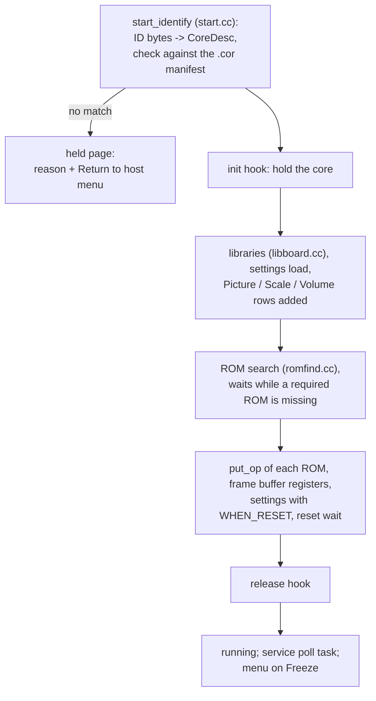

# Writing a core application

This guide is for a developer who adds a core to the generic core application (`coreapp/`) or changes what that application offers a core. It
is read off the code of `main` (2026-11-02). Where a comment in the tree says something else than the code does, the code is followed and the
difference is named in section 12.

A core application is **not written per core**. There is one program, `coreapp/`, linked once into one image (`coreapp.bin`). At start it reads the
four ID bytes at the core's register window and picks a **descriptor** (`CoreDesc`, `coreapp/src/desc.h`) out of a table. What you write for a core is
that descriptor, its hooks and its operations: a few hundred lines of C++ in `coreapp/cores/<name>.cc` plus a register header. Everything else (menus,
settings file, ROM search, picture, volume, Freeze, pads, bug report, the way back to the host) is the framework's.

The companion guide for the gateware side is [Building your own core](core-guide.md).

## 1. What runs where


- The host application (`host-app/software/hostapp/`) always starts first. It is the boot menu, the file browser, the updater and the loader. It has no
  descriptor and nothing in it is written for a particular core (section 11).
- The core application starts when the host has loaded the core. It runs on the same RISC-V processor, replaces the host application in memory and is
  the only software that talks to the core while it runs.
- The core application reaches the core through `CoreIo` (`coreapp/src/io.h`): byte registers at the core window, a 32 KB ROM aperture, a base RAM
  window, a DDR2 window, and optionally the drive window. The board implementation is `coreapp/src/hw.cc`; the tests in `tests/coreapp/` put a model of the
  core behind the same interface, so descriptor hooks run natively on a Mac.

## 2. The start sequence



`boot_start` (`coreapp/src/boot.h`) does the steps with the core held: descriptor `init`, ROM search and wait (it never leaves the loop with a required ROM
missing), the ROMs into the core, the frame-buffer registers and the pixel layer, the settings into the registers, then `release`. The control hooks in
the descriptor are plain functions with the signature `int hook(CoreCtx *, char *msg, int msglen)` (0 = ok, otherwise the reason on screen):

| Hook | Job | Rule |
|---|---|---|
| `init` | hold the machine for the application | the host's power-up hold stays until `release` |
| `release` | let the machine run | the only place the application's own hold is removed |
| `warm_reset` | a reset that keeps RAM (optional) | without it a warm reset is the cold one |
| `cold_start` | what a restart needs when the core has no partial bitstream to load again (optional) | large core only |

A cold reset is the shared sequence "hold, reset-time settings, wait `reset_ms`, release" (`boot_cold_reset`). `reset_ms` must cover the core's own RAM
sweep. `cold_ram_bytes` tells "Restart core" how much RAM to clear through the RAM window.

## 3. The descriptor

The descriptor is one `const CoreDesc` in `coreapp/cores/<name>.cc`. Fields that do not apply are null or zero. The ones every core fills:

| Field | Meaning |
|---|---|
| `id[4]` | the four bytes at register offsets 0..3. **Must equal what the gateware answers** (section 8) |
| `cor_name` | `name` of `cores/<id>/core.toml`. The `.cor` manifest and the hand-over must agree |
| `title`, `short_title` | menu title; the name on the navigation rail (148 px, so short) |
| `folder`, `store` | `roms/<folder>` for developer starts; the `[section]` of `<name>.cfg` |
| `min_contract` | the layer-2 contract version the core needs (1) |
| `roms`, `settings`, `tasks`, `filetypes`, `media` | the menu content (sections 4 to 6) |
| `video` | `VideoDesc`: source size, scale, position, DDR2 frame-buffer base and stride, the four registers of the frame writer |
| `freeze` | `FreezeDesc`: the status register and the PAUSED bit, the timeout (200 ms) |
| `init`, `release`, `warm_reset`, `reset_ms` | section 2 |
| `service_op`, `service_period_ms`, `poll_when_frozen` | an operation called by a task of its own every period (SIO frames, a PRG waiting for READY, write-back) |
| `needs_program`, `program_ext` | a core that waits for a file before it can start (the NES) |
| `register_ops` | the core's contributor: registers the names the descriptor uses |
| `caps`, `ncaps` | what the machine has (`iec`, `drive_a`, `cartridge`...) so a library can be refused for lack of it |

Optional records (each is a pointer to a spec struct): `romset`, `window_media`, `sector_media`, `mouse`, `fbwin`, `rawkeys`, `pad`, `report_regs`,
`menu_rec`. Their headers (`romset.h`, `winslot.h`, `sectors.h`, `mousesink.h`, `fbwin.h`, `rawkeys.h`, `pad.h`, `corereport.h`, `descrec.h`) say what each
one does. `own_volume` removes the generic Volume item for a core with a mixer of its own; `live_ms` and `menu_first` are for a core with no picture (the
diag core).

**Everything the descriptor makes the machine do is an operation by name.** A ROM's `put_op`, a setting's `apply`, a task's `op`, a file action's `op`, a
media slot's `eject_op` are strings. The core's `register_ops` registers them (`OpRegistry::add_op`, `coreapp/src/ops.h`), and `desc_check`
(`coreapp/src/desc_check.cc`) refuses a descriptor whose name is not registered or whose bindings do not fit the operation's arguments (`bindcheck.cc`).
So a typo is a failed test, not a dead menu item.

### Operations, states, events

```cpp
r.contributor("vc20");                                   // the owner of the names that follow
r.add_op("vc20.put_basic", rom_arg, 1, op_put_basic);    // typed arguments: ARG_INT, ARG_ENUM, ARG_STRING, ARG_PATH, ARG_BLOB ...
r.add_state("vc20.program", prg_name);                   // a value the menu and REST can read (what is in a slot)
```

A handler is `int fn(CoreCtx *c, const OpArgs &a, OpOut &o)`. It returns `OPE_OK` or `OPE_FAILED` with the reason in `o.msg`. It may set `o.more` to be
called again at once (a poll). A name has one owner; a second registration of it is refused. The arguments are checked against their `ArgSpec` before the
handler runs, so a handler never sees an enum out of range.

An entry that calls an operation fills its arguments with `OpBind` records: `B_FILE("path")` (the file the menu is on), `B_INT`, `B_STR`, `B_ASK` (a hex
address the person typed, `FileAction::ask`), `B_TEXT` (a name, `Task::ask`). Every argument is bound exactly once.

The base contributor already provides (so a descriptor can name them without registering anything): `machine.cold_reset`, `machine.warm_reset`,
`machine.reload_roms`, `machine.restart` (`boot.cc`), `settings.*`, `menu.browse`, `app.open`, `picture.apply`, `scale.apply`, `smooth.apply`,
`volume.apply`, `pad.*`, `disk.create` (`newdisk.cc`), the memory operations (`MEM_OPS`, `memops.h`), and `led.load` (`engines.cc`).

## 4. Settings

```cpp
struct Setting { key, values, nvalues, def, when, apply, bind, base, group, kind, show_state, label };
```

- `key` is the item text and the key in `<name>.cfg`. It never changes with a label (`label` is the text shown if it differs).
- `values` are the labels, also the values in the file. `def` is the index of the default.
- **`when`**: `WHEN_LIVE` applies the value at once; `WHEN_RESET` is written while the core is held, at the next reset. `boot_apply_settings(c, all)` writes
  every `WHEN_RESET` item (core held) or every item (`all`, at a restart).
- The value gets into the machine in one of three ways, exactly one per setting (`desc_check` enforces it, control `desc_one_form`):
  1. `apply` names an operation with one `value` argument (an int or enum). For a range setting (`kind` 0 with `base` != 0) the operation gets `base + index`.
  2. `bind` is a `RegBind { reg, shift, mask, bytes }`: the setting is bits of a register byte (`coreapp/src/regset.h`). Several settings can share a
     register; the byte written is the OR of what all bound settings contribute, computed from the settings and never read back (these registers are
     write-only commits). `reset_writes` are bytes written with every commit that no setting owns.
  3. neither: the item that chooses the member of the core's `romset` (`choice_key`); the reload applies it.

The VC-20 declares two register-bound settings; the 1541 rows come from a shared macro:

```cpp
static const RegBind b_exp = { VC20_RAM_EXT, 0, 0x1F, exp_bytes };      // value -> byte through a table
static const Setting settings[2 + CBM1541_NSETTINGS] = {
    { "Memory Expansion (at next reset)", exp_names, 7, 0, WHEN_RESET, 0, &b_exp, 0, 0, 0, 0, "Memory Expansion" },
    { "Block 5 ($A000), when expanded",   blk5_names, 2, 0, WHEN_RESET, 0, &b_blk5 },
    CBM1541_SETTINGS,
};
```

**Three layers decide the value** (`coreapp/src/settings.h`): the core's `<name>.cfg` if the item is set there, else the host's flash settings (read only),
else the descriptor default. Every change goes into the `.cfg` at once (or with Auto Save Config off, when saved). Nothing in the application can write the
flash: `FlashLayer` has no write method, and a test counts the flash accesses of a whole session.

**Added by the framework, never declared by you.** `picture_extend` adds *Picture* (`PICTURE_KEY`, operation
`picture.apply`; the list is described below); for every frame-buffer core on a host whose gateware scales, *Scale* (`SCALE_KEY`) and *Smoothing* (`SMOOTH_KEY`) follow, and, where the gateware has the Frame follow register (`PictureEnv::follow`, 0x4F02) and the core has a frame buffer (`video.w != 0`), *Frame follow* (`FOLLOW_KEY`, `Off`/`On`, default `Off`, live, group `video`, operation `follow.apply` = `FOLLOW_OP`: `follow_apply` writes the register, `picture_start` applies the stored value before the mode);
`volume_extend` adds *Volume* (`VOLUME_KEY`, 0 to 200 % in steps of 5, the host's master gain in `trx_gain.v`). A descriptor that declares one of these keys is
refused, except a core with its own Volume or `own_volume = true`. SHIFT+ and SHIFT- on the menu step the item named `Volume` (`change_volume` in `menuctl.cc`).
`tone_extend` (T189) adds *Tone* (`TONE_KEY`: Flat / Bass boost / Treble boost, the host's shelf filter in `trx_tone.v`, register `U64_AUDIO_MIXER + 0x51`) right after Volume in the same Audio group; `own_volume` does not remove it, a descriptor with its own *Tone* keeps it, `CoreDesc::no_tone` (neogeo, whose build has no filter) removes it.

Settings can also carry `group`, `show_state` (show the row only while a state value holds) and `kind` 1/2 (a text the person types, shown plain or as stars).

## 5. ROMs

`RomSpec { role, names[], sizes[], required, check, put_op, set, shared }`. The names are tried in order (case-insensitive), the first file of an allowed size
whose `check` accepts it wins. `put_op` is called with the bytes (one `ARG_BLOB`) once the file is chosen, the core held. A required ROM that is missing keeps the
core held and the screen says so after about ten seconds.

Where the file is looked for is the **core folder** (T148, `coreapp/src/corefolder.h`): every core has one folder beside its `.cor`, `<dir>/<name>/`, holding
`<name>.cfg`, `roms/` and `saves/`. With a `.cor` path, `rom_scan` reads `roms/` of that folder **alone** (`own_dir`); files elsewhere get there by a verified
copy (`corefolder_copy_verified`, size and SHA-256 read back). Only a developer start without a `.cor` path searches `/flash`, `/usb0..3`, `/sd` under
`roms/<folder>`. `set` groups ROMs of machine variants (Spectrum 48K/128K, CPC 464/664/6128): the core starts when one set is complete. `shared` is for a
ROM of a shared device (the 1541) that is searched in the core folder and then in the shared folder.

**The host reads the ROM requirements too.** The boot menu shows what a core misses from a generated table, `host-app/software/hostapp/romreq_table.inc`,
made by `tests/coreapp/gen_romreq.cc` from the core table. A changed `RomSpec` without a regenerated table is a red test run.

## 6. The Library: file types, actions, tasks, media

The F3 *Library* area is a file browser. What happens to a file depends on its extension:

```cpp
static const OpBind file_bind[] = { B_FILE("path") };
static const FileAction prg_actions[] = {
    { "Run PRG", "vc20.run_prg", file_bind, 1, true, 0, 0 },                          // closes_menu = true
    { "Load PRG (no reset, no start)", "vc20.load_prg", file_bind, 1, false, 0, 0 },
};
static const FileType filetypes[] = { { ".prg", prg_actions, 2 }, { ".p00", prg_actions, 2 }, CBM1541_FILETYPES };
```

- `FileAction` may `ask` for a 16-bit address first (`ask_off` = the offset of the file's own load address, so RETURN alone takes it), may be restricted by
  `size_in`, and has a `key` letter for the action sheet (the same letters in the host and every core).
- `FileType::inner_ext`/`inner` make a disk image a folder: the browser lists the files inside and offers `inner` actions (`menu.browse` enters the image).
- `Task` is an entry of the *Actions* area: `{ "Reset", "machine.cold_reset", 0, 0, true }`. `ask` prompts for a name; `pick_dir` first opens a folder browser and runs
  the operation in steps with a progress display (`CoreCtx::job_step`; `newdisk.cc` is the pattern).
- `MediaSlot { name, state, eject_op, ... }` is a row on the status page: `state` names the state value that says what is in the slot.
- Libraries (`.u2a`, `libfmt.h`, `libload.*`, `libboard.cc`) add settings, tasks, file actions and menu nodes at run time from `<root>/trx/lib` or from the
  `.cor` itself (record 7); the drive library `cbm1541` is built in and spliced into a descriptor by macros (`cores/cbm1541_desc.h`).
- A library may declare one poll, in its record (`LibRecord::poll`, `libapi.h`) or in the `[poll]` of its menu record, not in both: an operation without arguments that the service layer calls every `period_ms` while
  the library is loaded and the machine runs (`LibPolls`, `service.h`; never while the menu has frozen the machine). The loader adds it when the library registers and ends it when
  the library is unloaded or the application is released; a poll that cannot be served refuses a library that loads after the core has started (one that loads before the start
  stays loaded, its poll is dropped and the log says why: the menu merge, 12 polls; `LibPolls` takes 16). A library with a poll, menu nodes, file actions, settings or tabs is never evicted when
  an application is opened with a short heap (`AppIndex::prepare_open`); the application is refused with "Not enough memory for ...". The base API has a version (`U2A_ABI_MAJOR.U2A_BASE_MINOR`
  in `libfmt.h`, `base_api` in `coreapp/version.toml`): a `.u2a` that `needs base>=x.y` is refused on a lower base with both numbers named. The public headers of the SDK
  are locked per version in `coreapp/api_lock.toml` (one base minor per SDK release: an entry says `released = true` and is fixed, or `released = false` and follows the headers; `python3 tools/sdk_api.py update`); `python3 tools/sdk_api.py check` (lint) says what to do after a change.
- A library exports tables under names (`LibRecord::export_list`, `LibExportDecl`; `LIB_EXPORTS` in `lib.mk`, `--export` of `u2a_pack.py`, the file's list `U2A3_FLAG_EXPORTS`): `api->lib->find(name, version, &size)` searches
  export names first, a `needs` entry resolves against them too, and `lib_load_folder` orders a folder by them (`LibMeta::exp_name`); `c64_api.h` is the table `c64` of the C64 family (D20), which the base
  answers itself until a library exports it. `u2a_pack.py` refuses constructors and destructors (D19). See `app/sdkpkg/api.md` section 9.
- A library or application may declare a budget (`LIB_BUDGET` in `app/lib/lib.mk`, `APP_BUDGET` in `app.mk`, `u2a_pack.py --budget key=number`; `U2a3Budget` in `libfmt.h`, header flag
  `U2A3_FLAG_BUDGET`, base 3.2): ceilings for the image, the registrations and the peak of the heap held through `api->mem`, and the permanent figure of that heap (`heap_keep`, checked against the room of the heap before the image is placed). `LibLoader::load` refuses an image over a figure, or over the room
  left in a table (`OPS_MAX`, `STATES_MAX`, `EVENTS_MAX`, the contributed settings, file actions and nodes, the tab strip), with `LIB_BUDGET` and a sentence that names the image, the
  figure and the limit; nothing of it stays. A figure left open is the platform's limit. Every heap block of an image is on its account (`LibLoader::held_bytes`): the blocks of
  its operations too (`OpScope`, `opscope.h`), so unloading it gives the heap back. The `[lib]` line of `libboard.cc` prints the images, the accounts and the heap free. See `app/sdkpkg/api.md` section 8.
- A core can describe its menu as data instead of C++ tables: `menu.toml`, compiled by `tools/descrec.py` into the `.cor`'s record 6 (`descrec.h`).
- A core can also describe the rest of its descriptor as data (T239.3 D17, record version 6, sections behind the string table): identity, ROMs, video and freeze,
  hotkeys, mount slots and the register bits of a setting (`reg_bind`). `cores/vc20/app/desc.toml` is the example; `descrec_core` (`descrec.cc`) makes the
  `CoreDesc` of the record and `BundleDescSource` (`bundle.h`) finds it in the bundle when no descriptor is compiled in (`start_identify`). Function hooks
  (`init`, `release`, `register_ops`, the media write-back, the mount slot's three functions) are code and come from `CoreHooks`, not from the record.
  Every data field of `CoreDesc` has a place in the record, so any core can be described: the sections are

  | section | TOML | `CoreDesc` field |
  |---|---|---|
  | 1 core | `[core]` | id, cor_name, title, short_title, folder, store, min_contract, reset_ms, service_op/period, flags (poll_when_frozen, board_caps, id_shared, own_volume, no_tone, menu_first), needs_program, program_ext, type_op, run_op, core_id, live_ms, caps |
  | 2 video | `[video]`, `[freeze]` | video, freeze |
  | 3 roms | `[[rom]]` | roms (`check = true`: the content check is a hook) |
  | 4 setting register bits | `reg_bind` in a `[[core_setting]]` | Setting::bind |
  | 5 hotkeys | `[hotkeys]` | hotkeys |
  | 6 mount slots | `[mount]` | mount_slots (names; the functions are hooks) |
  | 7 reset writes | `[[reset_write]]` | reset_writes |
  | 8 id feature | `[id_feature]` | id_feat_reg, id_feat_mask, id_feat_val |
  | 9 report registers | `[[report_reg]]` | report_regs |
  | 10 raw keys | `[rawkeys]` | rawkeys (`held = true`: the keys-down function is a hook) |
  | 11 alternative video | `[alt_video]` | alt_video |
  | 12 picture window | `[fbwin]` | fbwin |
  | 13 mouse | `[mouse]` | mouse |
  | 14 rom set | `[romset]` | romset (`version`, `pick`: hooks) |
  | 15 window media | `[window_media]` | window_media |
  | 16 sector media | `[sector_media]` | sector_media |
  | 17 media replace | `replace` in a `[[media]]` | MediaSlot::replace |

  The menu tables (tasks, media, file types, settings), the pad (`[pad]`), the restart (`[restart]`) and `machine_info` are the older record parts. The keys of every
  table are listed at the top of `tools/descrec.py`. `menu_rec` is the record itself, not a field of it. Hooks that sit inside these tables come from `CoreHooks`
  (`rom_check[i]`, `romset_version`, `romset_pick`, `rawkeys_held`, `pad_id_loaded`); a hook the record names and the code lacks refuses the record with a sentence.
  Which description wins: while a descriptor is compiled in for the core, it is the core, `start_identify` uses it and a record with data sections beside it changes nothing at
  run time (`descrec_applies`); only a core with no compiled-in descriptor is made of the record (`CoreDesc::from_record`). The packers (`tools/pack_cores_mc.sh`,
  `tools/pack_large_cor.sh`) put `cores/<id>/app/desc.toml` into record 6, and a core cannot also hand a menu description (one record 6). `cores/*/app/` moves no bitstream key.

The golden menu `tests/coreapp/golden/menu_vc20.txt` shows what the whitelist menu builds out of such a descriptor: a tab or area with no entry is dropped.

## 7. Picture, Freeze, USB pads, volume, bug report, the way back

**Picture.** `VideoDesc` says where the core's frame buffers are: the app writes `fb_base` and `fb_stride` into `reg_fb_base`/`reg_fb_stride`, reads
`reg_latest`/`reg_seq`, and puts the layer at `x0,y0` with `scale`. `bpp` 0 or 2 is RGB565; 4 is the A1200's own 32-bit layer. The HDMI mode, Scale and
Smoothing are the person's choice (section 4), not the descriptor's. A core that draws its own picture (`video.w == 0`, the C64 family on the VIC scaler path) leaves the whole record zero; `desc_check` refuses `h`, `fb_base`,
`fb_stride` or `nbuf` set with `w == 0`, and a `fb_base` below the DDR2 window (0x01000000).

**The Picture list (T235).** On the gateware path outside the VIC scaler (`full_list()` in `picture.cc`: the host's status register answers and the core is not on the VIC scaler) the item's values are `Auto` and the 9 rows of the host's mode table (`576p`/`480p`, `1280 x 720`, `1920 x 1080`, each at 50 and 60 Hz, the machine's rate first within a resolution; the PC modes `800 x 600`, `1024 x 768`, `1280 x 1024` at 60 Hz only), labelled `<name> (<50|60> Hz)`, whether or not the screen's EDID names the row. `picture_modes` marks the rows the EDID names (`PictureModeRow::named`, shown as `*`) and the foot line says so; `picture_apply` takes a row as it stands and starts the 8-second confirm. On the VIC-scaler path (a core with no frame buffer) and with firmware video only, the list stays the resolutions the screen names, at the machine's rate (`video_modes_hdmi_list`; the VIC path drops 1024 x 768 and 1280 x 1024), no marks.

**Freeze.** `FreezeDesc { reg_status, mask, timeout_ms, word }`. Opening the menu stops the machine (`CoreIo::stop`, the host's `C64_STOP`), waits until the
core reports PAUSED in its status register (200 ms), switches the pixel layer to the menu, and on leaving gives the machine back exactly (`freeze.h`). The
core must honour the stop: ddt_novic halts on `c64_halt_req | mc_halt_s[1] | machine_ctl[1] | CTRL.b1` and reports `halted_q` in STATUS bit 1.

**USB pads (T156).** A `PadSpec { reg[2], nbuttons, names, def_map }` opts the core in. `pad.cc` keeps two pads in plug order, turns a report into the core's
button word through the map (the default is the SNES layout, resolved per pad by VID:PID) and writes it as a 16-bit pair, low byte first, to the register of the
player; a pad that leaves writes zero. "Map buttons" records a custom map into the `.cfg`. NES, SNES, Neo Geo and PET use it; the Amiga's `by_id` spec (T225)
drives one port from the first pad plugged and keeps its map per pad (VID:PID). A menu TOML declares a pad with `[pad]` (T228 R10, record version 5,
`descrec.h`; `tools/descrec.py` documents the keys): `output = "joystick"` writes the host's joystick lines (`CoreIo::joy_lines`, `C64_JOY1/2_SWOUT`, merged
with the mouse's in `JoystickOutput`) instead of a register pair, and the operation `pad.port` picks port 1 or 2; trx64u uses it with `per_pad = true`.

**Volume.** Generic (section 4). **LED Load Indicator.** The setting `{ "LED Load Indicator", ..., WHEN_LIVE, "led.load" }` selects case LED 1 = drive A activity once
(`ledload.h`); every core with a drive splices it in with the 1541 rows. The core must put its floppy/hard-disk activity on `drive_leds_n` (contract README).

**Bug report.** *System, Bug report* writes `<date>.txt` to `/sd/report` (else the first USB medium): software versions, the core's settings, the registers
named in `report_regs` (`ReportReg { name, reg, bytes }`; only registers whose read changes nothing, never a FIFO or a mailbox) and the application log
(`corereport.h`).

**Return to host.** *System, Return to host menu* (`EK_RETURN_HOST`) is a fixed entry, present when the board has an ICAP loader (`board.can_return_host`, from the
ICAP ID byte 0x7A). `hw_return_to_host` (`hw.cc`) writes the hand-over "menu requested" marker, then the ICAP sequence `WBSTAR := 0; IPROG`: the FPGA
reconfigures from flash address 0 (the host with the null core) and nothing runs on. It works for a layer-2 core and for a large core, because a large core's
flat build keeps the host's top. It does not exist on a bitstream without that ICAP (the TRX64 monolith, a stock firmware): there the way back is a power cycle.
The same call is offered on the held page of a core that cannot be started (`held_offers_return`).

## 8. The register window (the contract between app and core)

The application sees the core as byte registers at `IOBASE + 0x1A0000 + reg`; in the gateware these are the ports `cw_addr[16:0]`, `cw_wdata`, `cw_rdata`,
`cw_we`, `cw_re`, `cw_ack`, `cw_irq`. Offset 0 to 3 is the ID, byte 0 first. A generic layout, as implemented in `cores/ddt_mandel/trx/ddt_regs.v`
(each core's block follows it for the part the application uses):

| Offset | Meaning |
|---|---|
| 000-003 | ID (four ASCII bytes; the descriptor's `id`) |
| 004-005 | CAPS, CAPS2 (b6 page 6 = pixel layer, b7 RGB565 layer; b1 of CAPS2: BUILD present) |
| 006 | CONTRACT, the layer-2 contract the core was written for |
| 008-00B | BUILD, the bitstream's stamp |
| 0A0 / 0A4 | CTRL (b0 reset hold, b1 halt) / STATUS (b0 in reset, b1 held) in the DDT cores; every core chooses its own |
| 0C0-0CB | FB_LATEST (b7 valid, b1:0 buffer), FRAME_SEQ, FB_BASE, FB_STRIDE of the frame writer |
| page 6 (0x6000) | forwarded to the host's pixel layer (`px_we`, `px_re`, `px_rdata`) |
| anything else | reads 0 and is acknowledged |

An access must be acknowledged: an unknown register answers 0 with `ack`, never silence. The bits of status registers the application reads for Freeze must be
stable (the DDT block samples them through two flops and accepts a value when two reads agree).

**`tools/check_core_id.py`** compares the four bytes the gateware answers with the `{ 'D', 'D', 'T', 'N' }` in the descriptor. It reads several forms
(`32'h` constants, the VHDL form, the `.ID(...)` parameter, byte-wise `q <= "C"`), and its `selftest` shows that a swapped constant is refused. Add the
pair to `PAIRS`. (The ZX core once answered `XZSP` instead of `ZXSP`: that is why the check exists.)

The ID is also how two descriptors are told apart: `desc_check_table` refuses two cores with the same ID block unless both set `id_shared` (the A500 and the A1200
share a gateware ID and are told apart by the bundle's name).

## 9. A worked example: ddt_novic

The smallest descriptor in the tree. No ROMs, no settings, no program, one task. `coreapp/cores/ddt_regs.h`:

```c
#define DDT_CTRL        0x0A0          // b0 reset hold, b1 halt (Freeze)
#define DDT_STATUS      0x0A4          // b0 in reset, b1 held (Freeze)
#define DDT_ST_HELD     0x02
#define DDT_FB_LATEST   0x0C0
#define DDT_FRAME_SEQ   0x0C1
#define DDT_FB_BASE     0x0C4
#define DDT_FB_STRIDE   0x0C8
#define DDT_FB_ADDR          0x01D00000u    // the reset value of FB_BASE: the host's REU block
```

`coreapp/cores/ddt_novic.cc`:

```cpp
static int ddt_init(CoreCtx *c, char *, int)    { c->io->wr(DDT_CTRL, DDT_CTRL_HOLD); c->io->mode_reset(true);  return 0; }
static int ddt_release(CoreCtx *c, char *, int) { c->io->wr(DDT_CTRL, 0);             c->io->mode_reset(false); return 0; }
static const Task tasks[] = { { "Reset", "machine.cold_reset", 0, 0, true } };

const CoreDesc ddt_novic_desc = {
    { 'D', 'D', 'T', 'N' },                   // id
    "DDT Look Ma, No VIC", "DDT Look Ma, No VIC", "NOVIC",
    "ddt_novic", "DDT Look Ma, No VIC Settings", 1,
    0, 0,  0, 0,  tasks, 1,  0, 0,  0, 0,     // roms, settings, tasks, filetypes, media
    { 352, 200, 3, 432, 240, DDT_FB_ADDR, DDT_FB_STRIDE_BYTES, 4, DDT_FB_LATEST, DDT_FRAME_SEQ, DDT_FB_BASE, DDT_FB_STRIDE },
    { DDT_STATUS, DDT_ST_HELD, 200 },         // freeze
    ddt_init, ddt_release, 0, 20,             // init, release, warm_reset, reset_ms
    0, 0, false,  0, 0,  ddt_register,  0, 0,
};
```

`ddt_register` registers only the memory operations (`MEM_OPS`, with a map that says the core has no memory the application can reach). The positional
initialiser follows the order of `CoreDesc` in `desc.h`; fields added later (the end of the struct) stay zero. The picture is 352 x 200 at scale 3 =
1056 x 600, centred on 1920 x 1080 (x0 = 432, y0 = 240).

The gateware half is `cores/ddt_novic/layer2_ddt_novic.v`: it passes `.ID(32'h4E544444)` (bytes `D D T N`, byte 0 first) to the register block, builds
`status = {6'd0, halted_q, hold | cpu_rst}`, and writes the picture as RGB565 into the DDR2 through the `e_*` port.

### Registering the core: the checklist

| Step | File |
|---|---|
| descriptor and register header | `coreapp/cores/<name>.cc`, `<name>_regs.h` |
| declare it | `coreapp/cores/cores.h` (`extern const CoreDesc <name>_desc;`) |
| put it in the table | `coreapp/src/table.cc` (one line per core) |
| compile it | `SRCS_CC` of `host-app/target/u64ii/riscv/coreapp/Makefile` (the render bench takes its source list from the same variable) |
| identity check | `PAIRS` of `tools/check_core_id.py` (gateware file, descriptor file) |
| `app = "blueprint"` | the core's `core.toml` (a large core: `cores/<id>/mono/core.toml`) |
| name of the image per core | `BLUEPRINT_CORES` in `tools/build_coreapp.sh` and in `ci/trxapps.sh`: both copy the same `coreapp.bin` to `dist/coreapps/<core>.app`, which `tools/pack_cores_mc.sh` packs into a partial core's `.cor`. A large core's `.cor` is packed from `coreapp.bin` directly (`ci/package.sh`, `tools/pack_large_cor.sh`) |
| ROM table for the host | regenerate `romreq_table.inc` with `gen_romreq` if the `RomSpec`s changed |
| tests | `tests/coreapp/run.sh` (a `run` line and controls), the table in `tests/coreapp/test_desc.cc` and its `golden(&<name>_desc, "<name>")`, the golden menu |
| icon, release text | `tools/core_logos/build.py`, `tools/release_notes_mc.py` |

Note: `tools/build_coreapp.sh`'s default `BLUEPRINT_CORES` and `ci/trxapps.sh`'s differ (the first lists `c128`, the second the DDT cores); they only decide
which file names get a copy of the same image, so a name missing from one list matters only for a partial core packed from that script's output.

## 10. Tests

`tests/coreapp/run.sh` compiles the logic of `coreapp/src` natively against stubs, no board. **Every test has a negative control**: the product source is
copied, one expression is broken with `sed`, the same test is built against the broken copy, and it must fail (a control whose `sed` changes nothing is
refused as vacuous). Results are cached by the dependency list of each test and control (`tests/ctlcache.sh`).

- **Test programs** `tests/coreapp/test_*.cc`, one per concern (`test_desc`, `test_settings`, `test_romfind`, `test_menuctl`, `test_pad`, `test_vc20`, `test_ddt`...),
  run with `run <name> test_x.cc <sources>`. They use the models in the folder (`fakes.h`, `c64_model.h`, `drive_model.h`...) as the core.
- **Descriptor test of a core** (`test_ddt.cc` is a good one to copy): reads the numbers from the **gateware source** and compares: the ID against the
  `.ID(32'h...)` of the layer-2 file, every register offset against the case labels in `ddt_regs.v`, the picture size against the `GEOM_LINES`/`PIX_W` parameters,
  the name against `core.toml`; then runs the start sequence against a register model and checks that the core is held first and released last. The controls in
  `run.sh` break the ID, the width, the y position, the status register, the hold write and the release write, one each:

  ```
  control ddt_id      ddt_novic.cc "s/'D', 'D', 'T', 'N'/'D', 'D', 'N', 'T'/"  test_ddt.cc ddt_mandel.cc ddt_novic.cc $BASEL
  control ddt_release ddt_novic.cc 's/    c->io->wr(DDT_CTRL, 0);//'            test_ddt.cc ddt_mandel.cc ddt_novic.cc $BASEL
  ```
- **Table checks** `test_desc.cc` runs `desc_check` over the whole table (every name registered, every binding fits, no two cores share an ID, video record
  complete, at most `REPORT_REGS_MAX` report registers).
- **Golden menus** `tests/coreapp/golden/menu_<name>.txt` is the menu `menu_build` makes from the descriptor. `UPDATE_GOLDEN=1 tests/coreapp/run.sh` rewrites it
  (a control never rewrites a golden); read the diff, it is the menu the person will see.
- **Render bench** `tests/coreapp/render/run.sh` draws the menu with the real `ui.cc`, `MenuCtl` and LVGL (board stubbed) at 1080p and the compact 576p layout.
  Run it when screens change.
- **Menu simulator** (T236) `tools/menusim/run.sh <core>` runs the same build (the bench's sources and stubs, `tests/coreapp/menu_rig.h`) in a window
  on the Mac: the keys drive the menu, the core's `menu.toml` is reloaded when it is saved, `--mode 480p|720p|1080p` places the canvas as the app does,
  `--keys F3,DOWN,RETURN --shot out.png` runs without a window. `--host` runs the host app's menu the same way. A tool, not a test: it proves nothing
  the bench does not.
- An application is finished when it builds for RISC-V in the `u64-build-env` image and `ci/apptests.sh` is green; the CI reuses the by-change cache.

## 11. How the host app differs

`host-app/software/hostapp/` is the **host menu**, one program for all cores. It is the application that always starts on the board (the boot ROM runs it
from flash), shows the boot menu (F1), the file browser (F3), the edit menu (F5), network (F7) and settings (F8), and does what a core application never
does: reads `.cor` bundles (`cor.cc`), stages and verifies them (`coreboot.cc`: `core_stage`), cuts the old core off with the decoupler, streams the partial
bitstream through the ICAP, writes the hand-over page and jumps; starts full bitstreams (`cfw.cc`, `legacy*.cc`); updates the host (`txu.cc`, `coremaint.cc`);
restores a backup; sets the flash lock before a large core gets the machine (`flashlock.cc`); makes the host's HDMI picture (`hostvideo.cc`).

It has no `CoreDesc`. A core reaches it only as data: the `.cor` manifest (name, version, contract, host key, icon), the `boot.cfg` entry, the generated ROM
table, and the hand-over page (`handover.h`: magic `TRXH`, the `.cor` path, name, version, host key, core id, the video mode the host put up). The core
application reads that page first and the host reads a "menu requested" marker the core application leaves before it returns. The view layer is shared:
both applications draw with the same LVGL code in `app/view`, which is why a menu looks the same in the host and in every core.

## 12. Where a comment and the code disagree

- `coreapp/README.md` said the library loader is "not wired to the board yet". `run.cc` calls `lib_board_load` at every start and `libboard.cc` is in the
  Makefile: it is wired. The README line is corrected with this guide.
- `desc.h` documents `CoreDesc::folder` as `roms/<folder>` "on the three roots". With a `.cor` path the code reads the core folder alone (`own_dir`, T148); the
  roots are the developer-start path only.
- `ddt_novic.cc` says the picture is "1056 x 18"; with scale 3 and height 200 the code gives 1056 x 600 and the test checks `y0 = (1080 - 200 * 3) / 2`.
