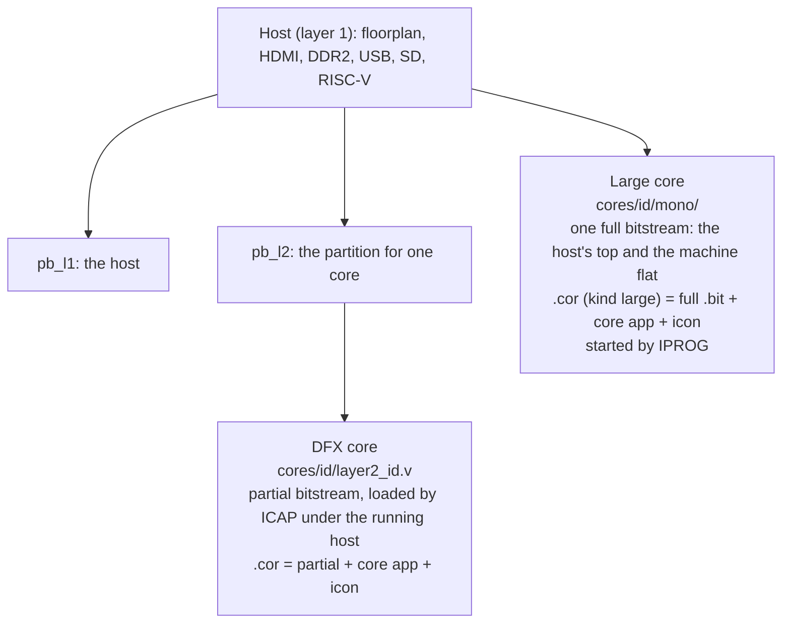
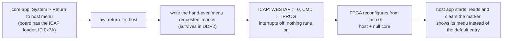

# Building your own core

This guide is for a developer who adds a machine to the TRX64 MultiCore line: what a core is, which of the two kinds to build (a partial **DFX core**
or a **large core**), what the host already does for it, what can be taken over, how it gives the machine back, and how it gets into the CI and a
release. It is read off the code of `main` (2026-11-02). Where a comment and the code disagree, the code is followed and the difference is named at the end.

The software half (the menu, settings, ROM search, pads) is described in [Writing a core application](core-app-guide.md). A core is both halves: the
gateware in `cores/<id>/` and the descriptor in `coreapp/cores/<name>.cc`.

## 1. The two kinds of core



| | DFX core | Large core |
|---|---|---|
| Directory | `cores/<id>/core.toml`, `layer2_<id>.v`, `core_sources.tcl` | `cores/<id>/mono/core.toml`, `build_mono.tcl`, `build.sh`, `host/` |
| Build | implemented against the host's cached, routed static (`host/core.tcl`) | one flat design of the whole device (`cores/<id>/mono/build_mono.tcl`) |
| What is built | a **partial** bitstream for the pblock `pb_l2` | a **full** bitstream of the XC7A50T |
| Size limit | must route inside `pb_l2` | the device |
| Host changes | reach the core only through a new host key (the core is rebuilt against it) | none: the core builds from **its own copy** of the host files |
| Start | the host application stages the `.cor`, decouples the partition, streams the partial through the ICAP | the host application writes the `.bit` as a scratch file on the flash drive and starts it with IPROG (ADR-0058) |
| Flash protection | not needed (the host stays) | the host sets the status-register lock over the first 4 MiB before it hands the machine over (`flashlock.h`, T152) |
| Delivery field | `delivery = "cor"` (the default) | `delivery = "cfw"` (the word means "a flat build"; the package ships a large `.cor`, no `.cfw`) |

**When must a core become large?** When it no longer routes in `pb_l2` (ADR-0063, accepted in principle by the project owner on 2026-10-31): the host block
grew with the video path, `pb_l2` shrank (about 13 k LUT), and "a core that no longer routes in the smaller `pb_l2` becomes a large core". The CI shows
which, one core at a time: it is a routing result, not a guess. On 2026-11-01 the NES, the A500, the CPC, the ZX Spectrum and the C16/Plus-4 moved; the VIC-20,
the Atari 800 XL, the Apple IIe and the two DDT demos are still partial. The other large cores (Neo Geo, Port Diagnostics, the C128, the ZX Next, the SNES) never had a
partial build; a large core has only a `mono/core.toml` (the Neo Geo and Port Diagnostics were large from the start).

## 2. The tree

```
cores/<id>/
  core.toml              the descriptor of a DFX core (a large core has it in mono/)
  layer2_<id>.v          the module with exactly the contract's ports (DFX)
  core_sources.tcl       the core's own synthesis recipe (DFX); must set l2_dcp
  rtl/  trx/  sim/  gen/ the machine, our glue (register block, frame writer), the benches
  logo/icon.rgb565       32 x 32 RGB565 icon of the boot menu
  NOTICE                 where vendored code came from (section 7)
  mono/                  large core only: core.toml, build_mono.tcl, build.sh, host/ (+ FROM)
```

### core.toml

One flat table (`tools/core_toml.py` is the whole parser: strings, integers, flags and arrays of strings, no tables). `core_toml.py --check` validates every
descriptor against this schema.

| Field | Required | Meaning |
|---|---|---|
| `id` | yes | the folder name and the core's id |
| `name`, `version` | yes | the name in the `.cor` manifest. **`name` must equal the application descriptor's `cor_name`** |
| `contract` | yes | the layer-2 contract version the core was written for (now 2) |
| `app` | yes | `"blueprint"` (the generic core application), `"ultimate"` (the Ultimate firmware's application, not built here) or `"none"` |
| `order` | yes | build order; the reference core is 0 |
| `experimental` | yes | see below |
| `sources` | yes | git pathspecs: the core's files. They are what the cache keys hash, so a file not listed here cannot trigger a rebuild |
| `ooc`, `features`, `roms`, `top`, `place`, `route` | no | options of the out-of-context synthesis; host switches (`TRX_FEATURES=jtag`); ROM **names** only, never files; the partition top when it is not `layer2_<id>.v`; Vivado directives for this core only |
| `flash_filler`, `build_only` | no | the null core (never a `.cor`, in the host update file) and the reference core (only to route against; never shipped) |
| `delivery`, `mono_env` | no | `"cor"` or `"cfw"`; the environment of the flat build (`TRX_FEATURES=jtag`, `TRX_DEFS=NO_NET ...`) |

**`experimental = true`** keeps the core out of the claim "works". It is built, benched and reported like any other. A failed Vivado build of an experimental
core turns the run red (T100 D9.6; the earlier exemption is gone). A failed **bench** of an experimental core's lane is reported and not fatal
(`ci/sims.sh`, the `EXPERIMENTAL (reported, not fatal)` line).

### core_sources.tcl and `l2_dcp`

`host/core.tcl` sources `cores/<id>/core_sources.tcl` from `host/` (Vivado's working directory, so paths are relative to it) with `$part` and `$bdir` set. The
script synthesizes the core **out of context** and must set `l2_dcp`, the checkpoint that goes into the partition. The smallest recipe is
`cores/ddt_novic/core_sources.tcl`:

```tcl
set l2_dcp [file join $bdir layer2_ddt_novic_ooc.dcp]
create_project -in_memory -part $part
read_verilog [concat [lsort [glob $d/trx/*.v]] [list $m/trx/ddt_regs.v ...]]
read_verilog $d/layer2_ddt_novic.v
synth_design -top layer2_ddt_novic -part $part -mode out_of_context
write_checkpoint -force $l2_dcp
```

A core with an inner cell of its own (the reference core's `c64`) also sets `core_dcp`.

## 3. The DFX core

### What the host fixes: the contract

The partition is the cell `l2` of `host/top.v`. Its port list is the **contract**: `contract/layer2_ports.txt` (247 ports, generated from the reference core by
`tools/contract_ports.py`), version in `contract/VERSION` (2). Every `cores/<id>/layer2_<id>.v` has exactly these ports; the lint stage runs
`tools/contract_ports.py --check` and a core that drifts fails. A core that does not use a port leaves it unused and ties its outputs to the idle value.
Changing the list is a host change: it raises the version, invalidates every published core and rebuilds everything. The port groups that matter to a new core:

| Group | Ports (some) | What it is for |
|---|---|---|
| clocks, reset | `sys_clk`, `cpu_clk`, `mclk`, `ui_clk`, `c64_gclk`, `sid2x_clk`, `*_rst` | all clocks come from the host's MMCMs; the core owns none. a clock port with no load inside the partition fails Vivado's DRC (the DDT cores' comment names HDPR-72), so the DDT cores put one toggle flop (kept by `DONT_TOUCH`) on every clock (`ddt_clk_load.v`) |
| register window | `cw_addr[16:0]`, `cw_wdata/rdata`, `cw_we/re/ack`, `cw_irq` | the application's view of the core: ID at 0..3 (guide 1, section 8) |
| debug, DMA window | `dbg_*`, `dma_*`, `port_*`, `win_*`, `ram_rdata`, `cram_*`, `trx_j_*`, `tx_view` | the host's JTAG and the application's RAM window into the machine |
| picture | `pix_color[3:0]`, `pix_x`, `pix_y`, `px_we/re/rdata`, `px_ev_*`, and the DDR2 port `e_*` | section 4 |
| audio | `audio_l`, `audio_r` (signed 24 bit), `audio_sample_en`, `adc_*` | section 4 |
| input | `c64_keys[63:0]`, `c64_joy1/2[4:0]`, `c64_restore`, `paddle_*` | the key matrix and joysticks the host scans |
| machine control | `app_stop`, `app_pause`, `c64_halt_req`, `mc_halt_s`, `machine_ctl`, `core_reset_req`, `c64_halted` | Freeze and reset (guide 1, section 7) |
| DDR2 clients | `c_*`, `e_*` (128-bit, 27-bit address), `drv_*`, `reu_*`, `smp_*`, `snp_*` | the core's access to the host's memory |
| cartridge port, IEC, tape | `SLOT_*`, `slot_*`, `IEC_*`, `c2n_*` | raw pins with `i`, `o`, `oe`; the host owns the buffers |
| drive windows | `drv_io_*`, `gcr_io_*` | the built-in 1541 (section 6) |
| packet port | `pp_*` | a core's UDP/Ethernet frames; the host keeps the MAC (section 4) |
| LEDs, caps | `c64_leds`, `drive_leds_n[2:0]`, `host_caps` | `drive_leds_n`: bit 0 floppy, bit 1 hard disk (contract README) |

### What crosses the edge, and the decoupler

While a partial bitstream loads, the partition's outputs are undefined. `host/top.v` therefore sets `core_decouple` (`dc_jtag | app_dc_sys`), synchronises it
into `cpu_clk`, `mclk` and `ui_clk` (`dfx_sync`) and holds **every** core output that reaches the host or a pin at its idle value
(`assign X = core_decouple ? <idle> : l2_X;`). The toggle handshakes get their own helpers in `host/dfx_decouple.v` (`dfx_h2c_tgl`, `dfx_c2h_tgl`,
`dfx_drv_port`): they offset a toggle so that at release the new core, whose toggle starts at 0 after its reset, and the host agree without a spurious edge.
Requirements this puts on a core: reset to a defined state, idle its DDR2 requests, and no output that the host does not gate.

`tools/check_layer2_pins.py` checks that a non-C64 core ties every gated output to the host's idle value, ties all `SLOT_*`, `slot_*` and `IEC_*` outputs to constants, uses
none of the slot or IEC inputs and instantiates no C64 part (benches `ddt_novic_pins` and the like). The host's pblock plan is in `host/build.tcl`
(`pb_l1`, `pb_l2`, `pb_cpu`; the `l2` cell is `HD.RECONFIGURABLE`).

### Host pin and the null core

`contract/host_pin.txt` lists a content id for every file of the host, the shared files and the reference core. The lint stage fails on **any** change (updated
by `tools/host_pin.sh --update` after an approved host change). The rule of `host/layers.txt`: a core never edits a host or shared file to get a core-specific
behaviour; it gets its own copy under `cores/<id>/`. `layers_check.sh` requires every tracked file under `host/`, `cores/` and `vendor/` to be in exactly one section.

`cores/null` is the contract's own implementation: a layer-2 module that drives every output to idle and answers every window as absent (`flash_filler = true`). The host
update file writes a full bitstream with the host and this core, so the flash holds the host and no machine. It is never a `.cor`, never in a release set or the boot menu.

### How a DFX core is built

Stage `bit-host` routes the host together with the reference core `c64ref` (a slim C64U copy, `build_only`). Stage `bit-<id>` runs `host/core.tcl` for each core against
the cached result: `update_design -cell l2 -black_box`, `lock_design -level routing`, `read_checkpoint -cell l2 $l2_dcp`, place and route only the partition,
`pr_verify` against the host, then `write_bitstream -cell l2 <id>_partial.bit` (only if the setup slack is not negative). Output: `<id>_partial.bit`, utilisation
reports (`utilization_pb_l2.rpt` is the number that decides whether the core fits), timing.

## 4. What the host brings

A core does not see the board. It sees the contract. What the host does for it:

- **HDMI.** Nine modes (`host/hdmi_modes.vh`, generated by `tools/hdmi_modes.py`): 576p/480p, 720p and 1080p at 50 and 60 Hz, and 800x600, 1024x768, 1280x1024 at 60 Hz.
  The application reads the screen's EDID, offers only what the screen names and asks "keep this picture?" (8 s). The core never makes a sync or a TMDS word.
- **Two ways to deliver a picture** (ADR-0059: the picture path is the host's for every core). (a) A **frame buffer**: the core writes RGB565 lines into four buffers
  in the DDR2 through the `e_*` port and reports `FB_LATEST`/`FRAME_SEQ`; the host's pixel layer (`pix_layer.v`, up to 960 x 1080 source pixels, nearest or bilinear, integer or
  fit) reads them and the application sets size and position (`VideoDesc`). The frame writer is the core's (`ddt_pixw.v`, `cpc_pixw.v`, `c264_pixw.v`, `c128_pixw.v`, `a8_pixw.vhd`...); the core also drives
  a dummy raster on `pix_color`/`pix_x`/`pix_y` that the scaler locks to. (b) The **VIC path**: a 4-bit colour index with raster x/y goes into `vic_scaler.v`, frame-locked to the
  core (the C64 family). Page 6 of the register window is forwarded to the pixel layer's registers.
- **Overlay and menu.** The menu is drawn by the application into the pixel layer and the text overlay (`overlay.v`) over the core's picture; Freeze stops the machine while it is open.
- **Audio.** The core delivers signed 24-bit samples on `audio_l`/`audio_r` with `audio_sample_en`. The host applies the master volume (`trx_gain.v`, 128 = unity,
  255 = +6 dB, saturating), and feeds HDMI audio and the I2S codec. A core with a mixer of its own sets `own_volume`.
- **Input.** The host scans the keyboard and joysticks and offers `c64_keys[63:0]`, `c64_joy1/2` and `c64_restore`. USB keyboards and gamepads are handled by the
  application and reach the core as registers (the pad words of guide 1, section 7; raw key events with `rawkeys`).
- **Storage.** The contract has no SD or USB port. The application reads the files (FatFS on SD and USB) and gives the core the data: ROMs through the 32 KB aperture,
  RAM through the RAM window, images through the DDR2 window (`window_media`: floppies in the window with a dirty-track log; `sector_media`: a hard disk served sector by sector through a
  mailbox, `sectors.h`), the 1541 through its windows. A core never opens a file.
- **DDR2.** `c_*` and `e_*` are general 128-bit client ports of the host's arbiter (`mig_arb` in `host/ddr2_port.v`); `drv_*` is the drive's, `reu_*` and `smp_*` the REU's and the
  sampler's. The application's DDR2 window starts at 0x01000000 (a `video.fb_base` below it is refused); the REU block at 0x01D00000 is what the small cores use as their frame buffers.
- **Network.** The host keeps the MAC; a core's frames go through the packet port `pp_*` (a crossing FIFO, `pktport_host.v`). Whether a core has the network is a host build switch (`NO_NET`).
- **LEDs.** The case LEDs follow a source selector (`host/case_leds.v`: on, off, drive activity, USB activity, IRQ...); the application writes it (the *LED Load Indicator* setting).
  `drive_leds_n` feeds LED 1 and the keyboard's lamp (`bling_io`).
- **Flash protection.** A write gate in front of the configuration flash (`flash_gate.vhd`, T44) passes only checked commands, and the host application sets the status-register lock before
  it hands a large core the machine. A core cannot write the flash.

## 5. The large core

A large core builds **host and machine flat in one design**: `cores/<id>/mono/build_mono.tcl` reads the host's `top.v` and its dependencies, takes the core's `layer2_<id>.v` and renames
the module to `layer2` (`regsub {module layer2_nes } ... {module layer2 }`) so `top.v` instantiates it unchanged. There is no `HD.RECONFIGURABLE`, no `pb_l1`/`pb_l2`, no out-of-context
checkpoints, no ICAP swap. The contract's ports are the same, so the machine and the application are written the same way. `mono_env` carries the host switches of the build (for example
`TRX_FEATURES=jtag`, `TRX_DEFS=NO_NET NO_C64VIDEO`). A core with pins the contract does not carry has its own top (`cores/diag/mono/top.v`: the joystick pins as open-drain outputs).

**The host copy.** Since 2026-11-01 (T164 3a Q1: "Copies instead.") a large core builds from **its own copy** of the host files, `cores/<id>/mono/host/`. A change in `host/` neither moves the core's cache
key nor its build; a host fix reaches it only by copying it in on purpose. `mono/host/FROM` names the source commit, lists exactly the files of the folder and states the edits.
`tools/check_large_copies.py` (lint) enforces the rule: `FROM` exists and lists the folder, `build_mono.tcl` defines `set hd ../cores/<id>/mono/host` and names no live `host/` file by its bare name, and the
descriptor's `sources` cover the copy. The copies are not compared with `host/`. The `shared:` files that are not under `host/` (`cores/common`, the TRX register files) still count.

**Build and pack.** `cores/<id>/mono/build.sh` (inside the `vivado-env` image) builds `host/build_mono_<id>/<id>_mono.bit`; `--pack-cor --bit ... --app-bin coreapp.bin` calls
`tools/pack_large_cor.sh`, which makes a large `.cor` with `tools/cor_pack.py pack-large`. The CI lane is `large-<id>` (it does not wait for the host lane). Add the core to the `ignore:` section of `host/layers.txt`
(the large cores are listed there, so the layer check finds each file in exactly one section).

**The start.** The host stages the `.bit` (up to 8 MiB) and the application (loaded at 0x30000), writes the `.bit` as a scratch file on the flash drive (rewritten only when it differs), sets the flash lock
and starts it with `WBSTAR` + `IPROG` (`cfw_iprog_seq`). The DDR2 keeps the hand-over page across the reconfiguration. The manifest names the FPGA by IDCODE; the host refuses another.

## 6. What can be taken over

| Building block | Where | Use |
|---|---|---|
| IEC bus and the 1541 | `cores/common/` (`iec_bus.v`, `drive_l2.vhd`, `drive_unit.vhd`, `drive_mem.vhd`, `drive_l2_empty.v`) | in the `shared:` section of `host/layers.txt`: a change moves the host key **and** every core key. Several cores use it (C64 family, VIC-20, C264, C128). The application half is the built-in drive library `cbm1541` (capability `drive_a`) |
| Register block | `cores/ddt_mandel/trx/ddt_regs.v` | ID, caps, contract, build stamp, frame-buffer registers, page-6 forward; read by `ddt_novic` too. A file may be in two cores' `sources` when one owner passes `ci/layers_check.sh` |
| Frame writers | `ddt_pixw.v`, `cpc_pixw.v`, `c264_pixw.v`, `c128_pixw.v`, `a8_pixw.vhd` | one per core family; copy and adapt, do not edit the other core's |
| Dummy raster, clock load | `ddt_dots.v`, `ddt_clk_load.v` | the raster the scaler locks to; the clock-load flops |
| The host (large cores) | `cores/<id>/mono/host/` | a copy, section 5 |
| The reference core | `cores/c64ref`, `cores/c64u`, `cores/trx64` | `c64ref` is the host's routing partner; `trx64` supplies the TRX register files in `shared:` |
| The application | `coreapp/` | one image for every core (guide 1) |

**Vendored third-party machines.** The MiSTer-derived cores (NES, SNES, Neo Geo, ZX, CPC, C264, Amiga and others) are copied unchanged by a script in `tools/` (`vendor_nes_mister.sh`, `vendor_snes.sh`, ...) into
`cores/<id>/rtl/` with a `SHA256SUMS`, and described in `cores/<id>/rtl/NOTICE`: upstream, commit, header terms, what was left out, what was changed. Anything the build needs in another form is **generated**
from the pristine copy (`tools/nes_gen.py` makes `cores/nes/gen/`) and lint checks that `gen/` is what the generator makes, so only the generated tree is built and the pristine copy stays out of the cache key. The
licence stays the upstream's: the NES, SNES and several others are GPL, the SID and CIA of the C64 cores CERN-OHL-S-2.0; our own code is GPL-3.0-or-later. Every origin and licence is a row of `PROVENANCE.md` and the
core's `NOTICE` (a core that adds a vendored part adds the row in the same commit). The licences meet per bitstream, so check what your core combines. No ROM, Kickstart or disk image goes into a core, a `.cor` or a
release; `core.toml` `roms` lists names only.

## 7. Return to the host



There is **one way back and it is the same for both kinds**: the core application reconfigures the whole FPGA from flash address 0, where the host bitstream (with the null core)
lives. The host starts, finds the marker in the hand-over page and shows its menu. For a DFX core this replaces the partial swap in the other direction: nothing loads "the host back" into
the partition; the host is simply reloaded. For a large core it is the only way, because the flat build has no partition. The entry exists only where the ICAP loader is (`board.can_return_host`): a
large core built from the host's top has it. A **foreign** full firmware and the TRX64 monolith have no loader behind that address: they return by a power cycle. The held page of a core that cannot be started offers
the same way back. A core must therefore leave the flash alone and leave the ICAP registers to the host; and it must survive being stopped at any moment by an IPROG.

"Reload core" / "Restart core" in a DFX core is different: it reloads the same core's partial through the ICAP (checked first, then hold, decouple, stream, release), and for a core with no partial the descriptor's
`cold_start` hook runs.

## 8. CI registration

- **Derived, not listed** (`ci/targets.txt`): the targets `dfx:<id>`, `large:<id>`, `simscope:<id>` follow the descriptors. Only paths that map to the applications (`coreapp`, `host-app`, `app`) are listed
  there, with the time limits (`limit host 150`, `limit core 45`, `limit large 120` minutes). A new core needs no line.
- **Lanes** (`ci/lanes.py`): one job per core, `bit-<id>` for a DFX core (needs `bit-host`), `large-<id>` for a large core (needs only lint and plan). The job block in the pipeline file is generated: run
  `ci/lanes.py write` after adding a core and `ci/lanes.py check` to prove it matches (it also checks that every bench has exactly one owner).
- **Benches**: three files, one line each per bench. `ci/sims.txt` is `tier|name|timeout|command`; `ci/sims.deps` lists the files the bench reads (a spec per line; the bench is cached by their content and
  `ci/sims.sh --check-deps` runs it in a copy that holds only those files, so a missing input fails); `ci/sims.lane` names the one lane that owns it (`host`, `core:<id>`, `large:<id>`, `none`). The ddt_novic
  benches are the pattern: `ddt_novic_pix` (the DDR2 buffer equals a model pixel for pixel) and `ddt_novic_pins` (the pin check).
- **Benches are not in the push pipeline.** They run nightly on `main` and before a merge (`tools/benches.sh`).
- **Lint** runs `contract_ports.py --check`, `layers_check.sh`, `core_toml.py --check`, `check_large_copies.py`, `check_core_id.py` and the host pin.

### Benches with negative controls

A bench that cannot fail proves nothing. Every bench of a core has controls that **must** fail. `cores/ddt_novic/sim/run.sh` is the pattern: the `pix` mode builds the layer-2 module at the partition's real edge
(`tb_ddt_novic.v`) in Verilator and compares the DDR2 buffer with a Python model of the picture written from the machine's code; `ctl_hue` and `ctl_pixw` rebuild the **same bench** against a core with one line
broken (`-DDDT_MUT_HUE`: the colour vector the other way; `-DDDT_MUT_PIXW`: the frame writer one word to the right), and the script fails if the bench does **not** fail.

```sh
if grep -q "^FAILED ddt_novic pix" "$out/$md.log" && ! grep -q "^PASS ddt_novic" "$out/$md.log"; then echo "=== control $md failed the pix bench as it must"
else echo "FAIL control $md did not fail the pix bench"; exit 1; fi
```

The same rule holds for the application side (guide 1, section 10): a `sed` control per test.

## 9. Release

- **`.cor`** (`tools/cor_pack.py`, magic `TRXCOR01`): record 1 manifest (compact JSON: name, version, contract, fpga, partial and application sizes and SHA-256, load and entry address, icon), 2 partial, 3 application
  (the raw `coreapp.bin`, never the `.app` with its 12-byte header; `cor_pack.py` refuses a header), 4 icon (32 x 32 RGB565), and the optional 6 menu description and 7 libraries. A **DFX** `.cor` also carries the
  **host key** (the first 8 hex of the host's key, written into the bitstream's AXSS register) and the contract: the boot app refuses a bundle built for another host, so a `.cor` fits only the host it was routed against.
  A **large** `.cor` (`pack-large`, `kind = "large"`) has record 5, the whole `.bit`, and the FPGA's IDCODE; no contract, no host key.
- **Packing in the CI**: `ci/package.sh` packs one `.cor` per core (`tools/pack_cores_mc.sh` against the package's own host `c64_basic.bit`) and one large `.cor` per large core (`tools/pack_large_cor.sh`). The package
  carries `.cor` files only, never a core folder (the folder is the user's).
- **Release**: made by hand on GitHub, never by the CI (`tools/release_mc.sh`, `tools/make_release_mc.sh`); the host installer is built from the tested `.txu` flash image, never from a bitstream built for another purpose
  (`check_release_flash`). Release text per core: `tools/release_notes_mc.py`.

## 10. Checklist for a new core

1. Decide the kind (section 1). Start as DFX unless the machine is known not to fit `pb_l2`.
2. `cores/<id>/core.toml`, `layer2_<id>.v` with the contract's ports (copy the ports from `cores/null/layer2_null.v` or a small core), `core_sources.tcl`; a register block whose ID is four ASCII bytes; Freeze (`app_stop`, `c64_halt_req`, `mc_halt_s`) and a status bit.
3. Tie unused outputs to idle (`tools/check_layer2_pins.py` for a non-C64 core); load every clock.
4. `tools/contract_ports.py --check`, `tools/core_toml.py --check`.
5. The descriptor and its registration (guide 1, section 9), `tools/check_core_id.py`.
6. Benches with negative controls; their lines in `ci/sims.txt`, `sims.deps`, `sims.lane`; `ci/lanes.py write`.
7. A logo (`cores/<id>/logo/`, `tools/core_logos/build.py`), a NOTICE and a `PROVENANCE.md` row for anything vendored.
8. Keep `experimental = true` until the core has run on the board.

## 11. Where a comment and the code disagree

- `contract/README.md` says the null core is "not here yet". `cores/null` exists, is built by the CI and is the flash filler.
- `tools/core_toml.py` says a `delivery = "cfw"` core "has no .cor". `ci/package.sh` packs a large `.cor` for every large core and ships no `.cfw` for it.
- The size of `pb_l2` is quoted as 13,600 LUT in the comments of `host/build.tcl`, and as 13,200 LUT in ADR-0063 and the NES descriptor. Neither comment is evidence: the pblock ranges in `host/build.tcl` and the CI's `utilization_pb_l2.rpt` are the numbers that count.
- The argument "DFX swap back vs power cycle" for the way back does not appear in the code: both kinds return by IPROG to flash address 0; only a foreign firmware or the monolith needs a power cycle.
