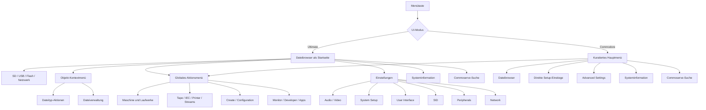

# Gideon-Menübaum und LVGL-Zielbild

**Stand:** 2026-10-03  
**Gegenstand:** die Gideon-basierte Oberfläche im aktuellen `software/ultimate-app`
auf `trx64/main`  
**Zweck:** UX-/UI-Grundlage für M2, insbesondere T24 und T32

## 1. Umfang

Dieses Dokument beschreibt:

1. welche Menüs, Funktionsgruppen und Bedienpfade die heutige Oberfläche besitzt,
2. welche UX-Probleme aus ihrer gewachsenen Struktur entstehen,
3. wie derselbe Funktionsumfang in eine eigenständige LVGL-Oberfläche überführt werden
   sollte.

Es beschreibt bewusst **nicht**, wie LVGL technisch an `Action`, `SubsysCommand`,
`ConfigStore`, REST, JSON-RPC oder die Hardware angebunden wird. Diese Verdrahtung ist
ein eigener zweiter Schritt.

Die Oberfläche ist dynamisch. Einzelne Einträge hängen unter anderem von Boardmodell,
Build, vorhandener Hardware, eingelegten Medien, Schreibbarkeit des aktuellen Pfads und
laufenden Funktionen ab. Der Baum zeigt daher das vollständige UX-Inventar, nicht einen
in jedem Zustand identischen Screenshot.

## 2. Bezug zu M2

Für die UX sind vor allem drei M2-Aufgaben relevant:

- **T24:** eigene LVGL-Oberfläche und Boot-Erlebnis,
- **T32:** eigenes TRX64U-Einstellungsmenü,
- **T36:** eine eigene, konsistente Oberfläche für Gerät und spätere Web-Bedienung.

T30 und T31 liefern später Architektur-Dokumentation und Testabdeckung. T45 erweitert
die mögliche Trace-Tiefe, verändert aber nicht die grundlegende Informationsarchitektur.

Von T24 ist derzeit nur Phase 1 vorhanden: LVGL-Grundlage, Pixel-Layer-Port und
Boot-Splash. Navigation, Eingabemodell, Theme und echte Anwendungsscreens sind noch
offen. Das ist für die UX günstig: Die neue Struktur muss nicht auf bereits gebaute
Screens Rücksicht nehmen.

## 3. Zusammenfassung

Gideons Oberfläche besitzt einen großen und wertvollen Funktionsumfang, aber kein
einheitliches Informationsmodell. Sie besteht aus vier gleichzeitig wirksamen
Navigationssystemen:

1. Dateibrowser als Startoberfläche,
2. alternativ ein kuratiertes Commodore-Hauptmenü,
3. dateiabhängige Kontextmenüs,
4. ein globales Aktionsmenü und ein separater Settings-Baum.

Für LVGL sollte deshalb der **Funktionsumfang**, nicht der alte Bildschirmaufbau
übernommen werden. Das Ziel ist eine einzige Shell mit sechs stabilen Hauptbereichen:
Home, Bibliothek, C64, Timewarp, Werkzeuge und Einstellungen.

## 4. Heutiges Navigationsmodell

Die Einstellung „User Interface“ entscheidet, was die Menütaste öffnet:

- **Ultimate:** der Dateibrowser ist die Startoberfläche.
- **Commodore:** ein kuratiertes Hauptmenü ist die Startoberfläche; der Dateibrowser
  ist darin ein Unterpunkt.

Beide Varianten existieren sowohl auf dem HDMI-Overlay als auch auf dem C64-eigenen
Bildschirm.



### 4.1 Commodore-Hauptmenü

Das kuratierte Hauptmenü enthält derzeit 18 gleichwertig dargestellte Einträge:

```text
Commodore Main Menu
├── DISK FILE BROWSER
├── COMMOSERVE FILE SEARCH
├── MEMORY & ROMS
├── TURBO BOOST
├── VIDEO SETUP
├── AUDIO SETUP
├── JOYSTICK & CONTROLLERS
├── LED LIGHTING
├── NETWORK SERVICES & TIMEZONE
├── WIRED NETWORK SETUP
├── WI-FI NETWORK SETUP
├── MODEMS
├── PRINTERS
├── USER INTERFACE
├── BUILT-IN DRIVE A
├── BUILT-IN DRIVE B
├── ADVANCED SETTINGS
└── SYSTEM INFORMATION
```

Die Liste mischt Ziele, Einstellungen, Geräte, Funktionen und Diagnose. Alle Einträge
sehen gleich wichtig aus, obwohl sie sehr unterschiedlich häufig benutzt werden.

### 4.2 Dateibrowser

Der Browser ist gleichzeitig:

- Speicherauswahl,
- Verzeichnisnavigation,
- Programmstarter,
- Disk-, Tape- und Cartridge-Launcher,
- Dateimanager,
- Einstieg in Apps und Updates.

Seine Wurzel kann enthalten:

- SD-Karte,
- USB-Medien,
- Flash-Inhalte,
- dynamische Mounts,
- FTP- beziehungsweise Netzwerkquellen,
- Netzwerkinterfaces.

Allgemeine Kontextaktionen:

```text
Verzeichnis oder Datei
├── Enter
├── View
├── Hex View
├── Copy to…
├── Move to…
├── Rename
├── Delete
└── Run with App
```

Zusätzliche Aktionen hängen vom Dateityp ab:

| Dateityp | Wesentliche Aktionen |
|---|---|
| PRG | Run, Load, DMA, teilweise Mount & Run / Real Run |
| D64/D71/D81/G64 | Run, Mount, Read-only, Unlinked, Drive B, MP3-Ramdrive |
| CRT | Run Cartridge, Copy to Flash |
| TAP | Index öffnen, Run, Start, Write, Start ab Position |
| SID | Haupttune spielen, Info, Subtune wählen |
| REU | laden, als Startup-Preload setzen, teilweise MOD abspielen |
| T64 | öffnen |
| CFG | Einstellungen laden |
| VPL | Palette anwenden oder als Standard setzen |
| U2A | App starten |
| U2P/U2U | Update starten |
| BIN | ROM-, EEPROM- und Laufwerks-ROM-Aktionen abhängig von Größe und Kontext |

Das kontextabhängige Prinzip ist grundsätzlich gut. Problematisch ist, dass der Benutzer
die mögliche Wirkung einer Datei erst nach Öffnen des Kontextmenüs erfährt und Aktionen
je nach Zustand ihre Position verändern.

### 4.3 Globales Aktionsmenü

Das Aktionsmenü wird dynamisch aus Kategorien aufgebaut. Typische Kategorien und Inhalte:

```text
Action Menu
├── Assembly 64
│   └── New Search
├── Create
│   ├── Directory
│   ├── D64 / G64
│   ├── D71 / G71
│   ├── D81 / D81 81 Tracks
│   └── DNP
├── C64 Machine
│   ├── Reset / Reboot / Clear Memory
│   ├── Power Cycle / Power Off
│   ├── Pause / Resume
│   ├── Save C64 Memory / REU / Cartridge
│   ├── Save MP3 Ramdrives
│   └── Timewarp
├── Built-in Drive A / B
│   ├── Turn On / Turn Off / Reset
│   ├── Switch 1541 / 1571 / 1581
│   ├── Remove Disk / Insert Blank
│   └── Save as Binary / GCR
├── Software IEC
│   ├── Turn On / Turn Off / Reset
│   ├── Show Partitions
│   ├── Set Partition Here
│   └── Save Partitions
├── UltiCopy
│   └── Drive 8 / 9 / 10 / 11
├── Tape
│   ├── Pause / Resume / Stop Playback
│   ├── Sample Tape to TAP
│   ├── Capture Save to TAP
│   └── Finish Recording
├── Printer
│   ├── Flush / Eject
│   ├── Reset
│   └── Turn On / Turn Off
├── Streams
│   └── VIC / Audio Stream Start or Stop
├── Configuration
│   ├── Save to Flash / File
│   ├── Reset from Flash / Defaults
│   └── Clear Flash Config
├── Developer
│   ├── Machine Code Monitor
│   ├── Debug Log / Debug Stream
│   ├── Save EDID
│   └── weitere buildabhängige Werkzeuge
├── dynamische App-Kategorien
└── Return to Main Menu
```

Viele Aktionen werden abhängig vom momentanen Zustand verborgen oder ersetzt. Dadurch
bleibt das Menü kurz, aber seine räumliche Ordnung ist nicht stabil.

### 4.4 Einstellungen

Der vollständige Settings-Baum wird aus registrierten Konfigurationsseiten und
zusammengestellten Gruppen aufgebaut. Seine sichtbaren Hauptabschnitte sind:

```text
Advanced Settings
├── Audio / Video
│   ├── Video Configuration
│   ├── Audio Mixer
│   ├── Speaker Mixer / Speaker Settings
│   ├── LED Settings
│   └── Clock Settings
├── System Setup
│   ├── Memory Configuration
│   ├── Cartridge and ROM Settings
│   ├── Turbo Settings
│   ├── Machine Tweaks
│   └── Power Settings
├── User Interface
│   └── User Interface Settings
├── SID Related
│   ├── SID Sockets Configuration
│   ├── SID Addressing
│   ├── UltiSID Configuration
│   ├── SID Player Behavior
│   └── gerätespezifische SID-Seiten
├── Peripherals
│   ├── Drive A / B Settings
│   ├── SoftIEC Drive Settings
│   ├── Tape Settings
│   ├── Printer Settings
│   ├── Modem Settings
│   └── Joystick Settings
└── Network
    ├── Ethernet Settings
    ├── Wi-Fi Settings
    ├── Network Services and Timezone
    └── Data Streams
```

Ein Teil der häufigen Einstellungen wird zusätzlich direkt im Commodore-Hauptmenü
angeboten. „Advanced Settings“ enthält daher sowohl kuratierte Gruppen als auch
vollständige Subsystemseiten.

### 4.5 Spezialisierte Ansichten

Außerhalb dieser Bäume existieren weitere eigenständige Bedienoberflächen:

- Systeminformation,
- Text- und Hex-Viewer,
- Commoserve-/Assembly64-Suche,
- Formulare und Dateiauswahl,
- SID-Player beziehungsweise SID-Information,
- Timewarp-Timeline,
- Machine Code Monitor,
- Fortschrittsanzeigen, Popups und Texteingaben.

### 4.6 Funktionstasten

Die Bedeutung mehrerer Tasten hängt vom gewählten UI-Stil ab:

| Funktion | Ultimate-Stil | Commodore-Stil |
|---|---|---|
| Action Menu | F5 | F1 |
| Page Up | F1 | F3 |
| Page Down | F7 | F5 |
| Help | F3 | F7 |
| Settings | F2 | F2 |
| Systeminformation | F4 | F4 |
| Suche | F6 | F6 |

Damit ist dieselbe sichtbare Oberfläche nicht immer gleich bedienbar. Die Zuordnung muss
erlernt oder in der Fußzeile nachgelesen werden.

## 5. UX-Bewertung

### 5.1 Stärken

- Sehr großer Funktionsumfang auf engem Raum.
- Kontextaktionen passen sich Datei, Hardware und Zustand an.
- Der Dateibrowser behält seine Position.
- Fast alles ist ohne Maus erreichbar.
- Hardwareunterschiede werden dynamisch berücksichtigt.
- Timewarp, Monitor und andere komplexe Werkzeuge sind als eigene Ansichten abgrenzbar.

### 5.2 Hauptprobleme

#### Zwei konkurrierende Startmodelle

Dateibrowser und Commodore-Hauptmenü vermitteln unterschiedliche Vorstellungen davon,
was die „Startseite“ des Geräts ist. Einstellungen und Funktionstasten verändern zudem
das Verhalten desselben Produkts.

#### Technische statt aufgabenbezogene Gruppierung

Bezeichnungen wie „Data Streams“, „Memory Configuration“ oder „Software IEC“ folgen der
internen Architektur. Ein Benutzer denkt eher in Aufgaben: Spiel starten, Disk wechseln,
C64 zurücksetzen, Ton einstellen oder einen früheren Zustand wiederherstellen.

#### Ein Objekt an mehreren Orten

Ein Laufwerk besitzt:

- Einstellungen im Settings-Baum,
- Zustandsaktionen im globalen Aktionsmenü,
- Mount-Aktionen im Datei-Kontextmenü,
- Statusinformationen auf einer separaten Systeminfoseite.

Der Benutzer muss wissen, welche Art von Änderung er vornehmen möchte, bevor er weiß,
wo sie liegt.

#### Instabile Menüs

Ausgeblendete und eingeblendete Aktionen verkürzen die Listen, verändern aber ständig
die Position anderer Einträge. Routine entsteht dadurch nur schwer.

#### Zustand ist nicht permanent sichtbar

Maschinenstatus, eingelegte Medien, Netzwerk, Timewarp und ungespeicherte Änderungen
liegen auf unterschiedlichen Seiten oder erscheinen erst beim Ausführen einer Aktion.

#### Gleichbehandlung ungleicher Aktionen

„Reset“, „Power Off“, „Clear Flash Config“ und „Delete“ erscheinen in ähnlichen Listen wie
alltägliche, reversible Aktionen. Bestätigungen erklären teilweise nur, dass etwas
gefährlich ist, nicht was konkret verloren geht.

#### Funktionstasten als notwendiges Wissen

Wichtige Bereiche sind leichter über F-Tasten als durch sichtbare Navigation erreichbar.
Die Belegung wechselt zusätzlich zwischen den UI-Stilen.

## 6. Empfohlenes LVGL-Zielbild

Die neue Oberfläche sollte eine einzige, stabile Shell besitzen. Empfohlen werden sechs
Hauptbereiche:

```mermaid
flowchart TD
    R["TRX64 UI"] --> H["Home"]
    R --> L["Bibliothek"]
    R --> C["C64"]
    R --> T["Timewarp"]
    R --> W["Werkzeuge"]
    R --> S["Einstellungen"]

    H --> H1["Maschinenstatus"]
    H --> H2["Eingehängte Medien"]
    H --> H3["Timewarp und Netzwerk"]
    H --> H4["Warnungen und laufende Vorgänge"]
    H --> H5["Letzte und häufige Aktionen"]

    L --> L1["SD / USB / Flash / Netzwerk"]
    L --> L2["Zuletzt verwendet"]
    L --> L3["Favoriten"]
    L --> L4["Commoserve-Suche"]
    L --> L5["Kontextuelles Action-Sheet"]

    C --> C1["Start / Pause / Reset / Power"]
    C --> C2["Drive A / B"]
    C --> C3["Tape / Cartridge / REU"]
    C --> C4["SoftIEC / UltiCopy / Printer"]
    C --> C5["Controller und Eingabe"]

    T --> T1["Timeline"]
    T --> T2["Scrub / Play / Pause"]
    T --> T3["Marker und Checkpoints"]
    T --> T4["Speichern / Laden"]

    W --> W1["Machine Monitor"]
    W --> W2["Trace"]
    W --> W3["Apps"]
    W --> W4["Streams"]
    W --> W5["Logs und Diagnose"]

    S --> S1["TRX64"]
    S --> S2["Video"]
    S --> S3["Audio und SID"]
    S --> S4["Controller"]
    S --> S5["Netzwerk"]
    S --> S6["Drives und Peripherie"]
    S --> S7["System und Erweitert"]
```



### 6.1 Home

Home beantwortet ohne weitere Navigation:

- Läuft oder pausiert der C64?
- Was ist in Drive A und B eingelegt?
- Ist ein Tape oder Cartridge aktiv?
- Läuft Timewarp beziehungsweise eine Aufzeichnung?
- Besteht Netzwerkverbindung?
- Gibt es ungespeicherte Daten, Warnungen oder laufende Vorgänge?

Von hier aus sind die wenigen häufigsten Aktionen direkt erreichbar, beispielsweise
Pause/Fortsetzen, Disk wechseln, Timewarp öffnen und Reset.

### 6.2 Bibliothek

Die Bibliothek ersetzt den Dateibrowser als universelle Startoberfläche, bewahrt aber
seine Stärken:

- Speicherquellen,
- Ordnernavigation,
- letzte Dateien,
- Favoriten,
- Suche,
- Dateityp-Aktionen.

Beim Öffnen eines Objekts erscheint ein konsistentes Action-Sheet:

1. empfohlene Hauptaktion,
2. alternative Start- oder Mountvarianten,
3. Informationen und Vorschau,
4. Dateiverwaltung,
5. räumlich getrennte destruktive Aktionen.

### 6.3 C64

Dieser Bereich bündelt Zustand und Bedienung der emulierten Maschine und ihrer direkten
Peripherie. Drive-Status, Mount, Eject, Modus und Einstellungen werden nicht mehr auf
vier verschiedene Orte verteilt.

Die Hauptseite zeigt zunächst den Zustand. Selten benötigte Konfiguration liegt jeweils
unter „Einstellungen“ des betreffenden Geräts.

### 6.4 Timewarp

Timewarp ist ein unterscheidendes Kernmerkmal und erhält deshalb einen eigenen
Hauptbereich. Timeline, Scrub, Marker und Wiederherstellung bilden eine visuelle Aufgabe
und sollten nicht als Einträge im allgemeinen Aktionsmenü erscheinen.

### 6.5 Werkzeuge

Hier liegen spezialisierte und eher technische Funktionen:

- Monitor,
- Trace,
- Apps,
- Streams,
- Logs und Diagnose.

Normale Benutzer werden damit nicht im Hauptfluss belastet; erfahrene Benutzer finden
alle Werkzeuge an einem stabilen Ort.

### 6.6 Einstellungen

Die Einstellungen werden nach Benutzerzielen statt nach internen Subsystemen gruppiert.
Unter **TRX64** liegen insbesondere die für T32 genannten eigenen Funktionen:

```text
TRX64 Settings
├── Overlay und Transparenz
├── Splash
├── Freeze- und Pause-Verhalten
├── Cartridge-Writeback
├── Ring und Timewarp
├── Monitor und Trace
└── Turbo
```

„Erweitert“ enthält seltene Hardware- und Entwickleroptionen, ohne sie aus der Oberfläche
zu entfernen.

## 7. Globale Bedienmuster

### 7.1 Layout

Für 960 × 540 wird empfohlen:

- stabile Hauptnavigation links,
- kompakte Statusleiste oben,
- großer Inhaltsbereich,
- kontextabhängige Tastenhinweise unten,
- Action-Sheets und Details von rechts.

Listen und Einstellungen können als Zweispaltenansicht dargestellt werden: links
Kategorie oder Quelle, rechts Inhalt beziehungsweise Details.

### 7.2 Eingabe

Die vollständige Standardbedienung benötigt nur:

- Richtungstasten beziehungsweise Joystick,
- Bestätigen,
- Zurück,
- Menütaste.

Funktionstasten bleiben optionale Abkürzungen. Ihre Kenntnis darf für keine normale
Aufgabe erforderlich sein.

Der Fokus ist jederzeit deutlich sichtbar. Beim Zurückkehren bleiben Scrollposition,
Auswahl und zuvor geöffneter Ort erhalten.

### 7.3 Statusleiste

Die Statusleiste zeigt nur dauerhaft relevante Zustände:

- C64 läuft oder pausiert,
- Drive A/B belegt,
- Timewarp aktiv,
- Netzwerkstatus,
- ungespeicherte Änderungen oder Warnungen.

Sie ist anklickbar beziehungsweise fokussierbar und führt direkt zum betreffenden
Bereich.

### 7.4 Quick Actions

Von jedem Screen aus ist ein kurzes Quick-Action-Panel erreichbar. Es enthält nur wenige,
häufige und situationsbezogene Aktionen. Das heutige vollständige Task-Menü wird nicht
als lange Liste kopiert.

Beispiel:

```text
Quick Actions
├── Pause / Fortsetzen
├── Disk wechseln
├── Timewarp öffnen
├── Reset
└── Oberfläche schließen
```

### 7.5 Verfügbarkeit

Es werden zwei Fälle unterschieden:

- **Nicht unterstützt:** Funktion existiert auf dieser Hardware nicht und wird nicht
  angezeigt.
- **Momentan nicht möglich:** Funktion bleibt sichtbar, ist deaktiviert und erklärt den
  Grund, etwa „Kein Medium eingelegt“ oder „Ziel ist schreibgeschützt“.

Damit bleiben Positionen stabil und die Oberfläche erklärt ihre Möglichkeiten.

### 7.6 Rückmeldung und längere Vorgänge

- Kurze erfolgreiche Aktionen: Toast.
- Fehler: verständliche Meldung mit Ursache und nächster Handlung.
- Längere Vorgänge: sichtbarer Job mit Fortschritt und Ergebnis.
- Hintergrundvorgänge: Status bleibt abrufbar, auch wenn der Benutzer weiter navigiert.
- Ungespeicherte Medien oder Settings: dauerhafte, eindeutige Warnung.

### 7.7 Destruktive Aktionen

Destruktive Aktionen stehen getrennt von Routineaktionen. Die Bestätigung nennt:

1. das konkrete Ziel,
2. die konkrete Folge,
3. ob Daten verloren gehen,
4. ob die Aktion rückgängig gemacht werden kann.

Nicht „Are you sure?“, sondern beispielsweise:

> Drive A auswerfen? Änderungen an `game-save.d64` wurden noch nicht gespeichert.

### 7.8 Einstellungen

Jeder Settings-Screen zeigt eindeutig:

- aktuellen Wert,
- geänderten Wert,
- gespeicherten oder noch ungespeicherten Zustand,
- ob eine Änderung sofort wirkt,
- ob ein Neustart erforderlich ist.

„Apply“, „Discard“ und „Defaults“ behalten überall dieselbe Bedeutung und Position.

## 8. Abbildung der alten auf die neue Struktur

| Heutiges Konzept | LVGL-Ziel |
|---|---|
| Ultimate-Dateibrowser als Startseite | Bibliothek |
| Commodore-Hauptmenü | Home plus sichtbare Hauptnavigation |
| Datei-Kontextmenü | Kontextuelles Action-Sheet |
| Globales Task-Menü | Quick Actions plus fachlich passende Bereichsseiten |
| Advanced Settings | Einstellungen mit klaren Kategorien |
| Commoserve File Search | Bibliothek → Suche |
| C64 Machine Actions | C64 → Maschine |
| Drive Actions und Drive Settings | C64 → Drive A/B |
| Tape / IEC / Printer | C64 → Peripherie |
| Timewarp-Task | eigener Bereich Timewarp |
| Machine Code Monitor | Werkzeuge → Monitor |
| Streams und Debug Log | Werkzeuge |
| System Information | Home-Status plus Einstellungen → System/Diagnose |
| Apps und Updates aus dem Dateibrowser | Werkzeuge → Apps beziehungsweise Einstellungen → System |

## 9. Kritische Nutzerabläufe für das UX-Design

Die ersten Wireframes beziehungsweise Prototypen sollten mindestens diese Abläufe
vollständig zeigen:

1. D64 finden, Drive A auswählen, mounten und starten.
2. PRG finden und starten.
3. Zwischen zuletzt verwendeten Spielen wechseln.
4. Disk mit Änderungen sicher auswerfen oder speichern.
5. Cartridge aktivieren und einen Writeback-Hinweis verstehen.
6. C64 pausieren, Timewarp öffnen, zurückspulen und fortsetzen.
7. Overlay-Transparenz ändern, prüfen und speichern.
8. Netzwerkstatus prüfen und WLAN auswählen.
9. Monitor öffnen und sicher zur laufenden Maschine zurückkehren.
10. Systeminformation, Logs und Update finden.

## 10. UX-Abnahmekriterien

Die neue Struktur ist erst dann tragfähig, wenn:

- jede heutige Funktion einem neuen Ort zugeordnet oder bewusst ausgeschlossen ist,
- normale Aufgaben ohne Wissen über Funktionstasten möglich sind,
- jede normale Aufgabe mit Joystick/D-Pad, Bestätigen, Zurück und Menü ausführbar ist,
- häufige Aufgaben höchstens zwei Navigationsebenen von Home entfernt sind,
- Maschinen- und Medienzustand vor einer Aktion sichtbar ist,
- temporär deaktivierte Funktionen ihren Grund erklären,
- destruktive Aktionen Ziel und Datenverlust konkret benennen,
- Zurück-Navigation Auswahl und Kontext bewahrt,
- dieselbe Aktion überall dieselbe Bezeichnung verwendet,
- alle Screens aus üblicher TV-Entfernung bei 960 × 540 lesbar sind.

## 11. Noch offene UX-Entscheidungen

Diese Fragen sollten vor dem visuellen Design entschieden werden:

1. Deutsche oder englische Oberfläche; gegebenenfalls Terminologieliste für beide.
2. Welche vier bis sechs Informationen Home dauerhaft zeigt.
3. Exaktes Verhalten von kurzem und langem Druck auf die Menütaste.
4. Ob ein Dateiklick die empfohlene Aktion direkt ausführt oder zunächst das Action-Sheet
   öffnet.
5. Ob „Monitor“ ein eigener Hauptbereich oder Teil von „Werkzeuge“ bleibt.
6. Ob Drives und Medien zusammen unter „C64“ bleiben oder später einen eigenen Bereich
   erhalten.
7. Visuelle Sprache: funktional-technisch, C64-inspiriert oder eine zurückhaltende Mischung.
8. Dichte und Mindestschriftgröße für Bedienung am Fernseher.

## 12. Quellen im aktuellen Quellstand

- M2-Aufgaben: [`../TODO.md`](../TODO.md)
- T24-Spezifikation: [`specs/T24-lvgl-ui.md`](specs/T24-lvgl-ui.md)
- Auswahl Ultimate-/Commodore-Startoberfläche:
  [`../software/ultimate-app/software/application/ultimate/ultimate.cc`](../software/ultimate-app/software/application/ultimate/ultimate.cc)
- Commodore-Hauptmenü:
  [`../software/ultimate-app/software/userinterface/commodore_menu.cc`](../software/ultimate-app/software/userinterface/commodore_menu.cc)
- Dateibrowser und Tastenbelegung:
  [`../software/ultimate-app/software/userinterface/tree_browser.cc`](../software/ultimate-app/software/userinterface/tree_browser.cc)
- Datei-Kontextaktionen:
  [`../software/ultimate-app/software/userinterface/user_file_interaction.cc`](../software/ultimate-app/software/userinterface/user_file_interaction.cc)
- Globales Aktionsmenü:
  [`../software/ultimate-app/software/userinterface/task_menu.cc`](../software/ultimate-app/software/userinterface/task_menu.cc)
- Settings-Baum:
  [`../software/ultimate-app/software/userinterface/config_menu.h`](../software/ultimate-app/software/userinterface/config_menu.h)
- C64-Aktionen:
  [`../software/ultimate-app/software/io/c64/c64_subsys.cc`](../software/ultimate-app/software/io/c64/c64_subsys.cc)
- Laufwerksaktionen:
  [`../software/ultimate-app/software/drive/c1541.cc`](../software/ultimate-app/software/drive/c1541.cc)
- Dateityp-Aktionen:
  [`../software/ultimate-app/software/filetypes/`](../software/ultimate-app/software/filetypes/)


---

## 13. Abgleich mit dem Code (Stand trx64/06de2ea3)

**Methode.** Verglichen wurde mit `software/ultimate-app` auf `trx64/main` (06de2ea3). Geprüft wurde der Code, nicht die Kommentare darin. Alle Pfade in den Tabellen gelten relativ zu `software/ultimate-app/software/`. Referenz ist der u64ii-Build (`target/u64ii/riscv/ultimate/Makefile`): `-DU64=2`, `-DCLOCK_FREQ=100000000`, kein `-DDEVELOPER`. Was dort nicht gebaut wird, steht als „nicht im u64ii-Build“ in der Spalte Hinweis.

Die Spalte „im Dokument?“ heißt: **ja** (steht da und stimmt), **teilw.** (steht da, aber unvollständig oder ungenau), **fehlt**, **falsch**.

**Ergebnis in Zahlen.** 122 geprüfte Zeilen: 75 ja, 11 teilw., 33 fehlt, 3 falsch. Das Dokument trifft die Struktur des Menübaums gut. Es verfehlt vor allem alles, was nicht im Aktionsmenü oder Einstellungsbaum steht: Tasten, Dateioperationen im Browser, versteckte Stores und die TRX-Seite.

### Was das Dokument falsch macht

1. **Pause, Resume und Measure Cart Bus** (§4.3) stehen als normale „C64 Machine“-Aktionen. Sie gibt es nur bei `DEVELOPER > 0` (`io/c64/c64_subsys.cc:456-460`). Im u64ii-Build sind sie nicht im Menü. Pause und Resume gibt es dort nur per REST.
2. **„Cartridge and ROM Settings“** (§4.4) gibt es nicht. Der Code hat die Seite „C64 and Cartridge Settings“ (`io/c64/c64.cc:216`) und die Gruppe „Memory Configuration“ (`c64.cc:2239`).
3. **„Clock Settings“** (§4.4) ist im u64ii-Build nicht vorhanden. Das Makefile baut `rtc_dummy.cc`, nicht `rtc.cc`.

### Was das Dokument ungenau darstellt

- §4: Die Einstellung „User Interface“ bestimmt das Wurzelobjekt nur beim Start (`application/ultimate/ultimate.cc:147,168`). Zur Laufzeit wechseln nur Theme und Tasten (`userinterface/userinterface.cc:339-366`). Welcher Schirm das Menü zeigt, bestimmt eine zweite Einstellung, „Interface Type“ (`userinterface.cc:151`). Sie fehlt im Dokument.
- §4.2: „Run with App“ ist der alte Weg über `/Flash/apps/<ext>.prg`. Die Aktionen der U2A-Apps kommen aus der Registry (`app_loader/app_registry.cc:321-337`). Die steht nicht im Dokument.
- §4.4: „Network Services and Timezone“ ist die Seite „Network Settings“ (`network/network_config.cc:15-34`). Sie enthält auch Hostname und Passwort.
- §7.8: Es gibt kein Apply und kein Discard. Eine Einstellung wirkt beim Verlassen der Seite (`userinterface/config_menu.h:178-190,233-262`). Gespeichert wird nach „Auto Save Config“ (`userinterface/config_menu.cc:169-203`).

### Was das Dokument ganz auslässt

- **Tasten und Gesten:** langer Druck auf die Menütaste tauscht die Disk (`userinterface.cc:464-467`); F10 und Rollen-Taste öffnen das Menü, Strg-D tauscht die Disk (`ultimate.cc:195-202`); C=R, C=Z, C=B, C=K wirken in jedem Menü (`userinterface/machine_hotkeys.h:25-55`); C=O, C=L, C=J, C=I. Damit ist §11 Frage 3 aus dem Code beantwortet.
- **Dateioperationen im Browser:** Mehrfachauswahl, Kopieren und Einfügen, Löschen der Auswahl, Quick-Seek, Home-Verzeichnis, Pfadwähler (`userinterface/tree_browser.cc:381-389,558-735,884-960`).
- **Boot-Hotkeys** für Videomodus und Modell (`u64/u64_config.cc:965-990`).
- **Telnet-Menü** als dritter Host (`network/socket_gui.cc:189`).
- **WLAN im Browser:** AP-Liste, Connect, Forget stehen im Kontextmenü des Netzwerk-Eintrags (`io/network/network_esp32.cc:211-232`).
- **Aktionen aus App-Manifesten** (softboot, unzip, trex_crt, c64re, trxmon). Sie erscheinen erst, nachdem die App in dieser Sitzung einmal lief (`APP_REGISTRY_RAM_ONLY`, `app_registry.cc:150-151,267-271`).
- **Versteckte Stores** („C64U Specific Settings“, „LED Strip Settings“, „Keyboard Lighting“, „Monitor Bookmarks“) und **vier Items ohne Menüweg**: UserPort Power Enable, Adjust Color Clock, VIC Test Colors, C64U Model (`u64_config.cc:354,371,374,391,959`; Gruppeneintrag auskommentiert `2954-2955`).
- **IEC-Partitionen:** Add, Edit, Remove und IPR-Dateien (`io/iec/iec_ui.h:18,39-40`; `io/iec/iec_drive.cc:520`).
- **Popup „Cartridge changed. Save it to …?“** beim Öffnen des Menüs (`io/c64/c64_subsys.cc:244-280`).
- **TRX-Seite:** Es gibt heute keinen Store für Ring, Splash, Freeze-Verhalten, Turbo oder Monitor. §6.6 plant sie. Vorhanden sind nur Overlay Transparency, Interface Type, Save Changed Cartridge und der Task „Timewarp“.
- **Lücke im Code, nicht nur im Dokument:** Für `.c64re` gibt es keine Dateityp-Aktion. Laden geht nur per REST `timewarp:load` (`api/route_timewarp.cc:323-335`).

### 13.1 Menü, Tasten, Hosts

| Funktion (Pfad in Gideons UI) | Quelle | im Dokument? | Hinweis |
|---|---|---|---|
| Menütaste kurz: Menü öffnen oder schließen | `application/ultimate/ultimate.cc:192-193,221-223`; `userinterface/userinterface.cc:457-516` | ja | §4 |
| Menütaste lang (über 1 s): Disk tauschen (Swap) | `userinterface.cc:464-467,545-558` | fehlt | Beantwortet §11 Frage 3 aus dem Code. |
| USB-Tastatur F10 / Rollen-Taste: Menü; Strg-D: Disk tauschen | `ultimate.cc:195-202` | fehlt | |
| Einstellung „User Interface“ (Automatic / Ultimate / Commodore) | `userinterface.cc:158,339-366`; `ultimate.cc:147,168` | teilw. | Das Wurzelobjekt wird nur beim Start gewählt. Zur Laufzeit ändern sich nur Theme und Tastenbelegung. |
| Einstellung „Interface Type“ (Freeze / Overlay on HDMI) und C=I zum Wechseln | `userinterface.cc:42-56,151`; `tree_browser.cc:490`; `ultimate.cc:206-211` | fehlt | Sie bestimmt, auf welchem Schirm das Menü läuft. §4 nennt nur, dass beide existieren. |
| Boot-Hotkeys: Ctrl-P / Ctrl-N (PAL / NTSC), Ctrl-B / S / F (Modell) beim Einschalten halten | `u64/u64_config.cc:965-990` | fehlt | Das Modell-Item ist ausgegraut (`u64_config.cc:959`). Gesetzt wird es hier und per REST. |
| Telnet-Menü (eigenes `UserInterface` je Verbindung) | `network/socket_gui.cc:189,306`; `network/network_config.cc:23` | fehlt | Dritter Host neben Overlay und C64-Schirm. |
| Commodore-Hauptmenü, 18 Einträge | `userinterface/commodore_menu.cc:80-97` | ja | Zahl und Namen stimmen. |
| Commodore-Menü: F2, F4, F6, C=J, C=L, HOME | `commodore_menu.cc:155-185` | teilw. | C=J und C=L fehlen. |
| „Return to Main Menu“ im Aktionsmenü (nur Commodore) | `commodore_menu.cc:224-229` | ja | |
| F-Tasten je Stil (F1, F3, F5, F7; F2, F4, F6 gleich) | `userinterface.cc:191-210,1023-1049` | ja | Tabelle §4.6 stimmt. Zusätzlich Menü-Tasten RUN/STOP, `<-`, F8, Esc (`tree_browser.cc:453-462`). |
| Hilfe-Text (F3 / F7) | `userinterface.cc:66-120,1064-1075` | teilw. | Die Taste steht im Dokument, der Inhalt nicht. |
| Reset C=R, Reboot C=Z, Power-Cycle C=B, Power Off C=K in jedem Menü | `userinterface/machine_hotkeys.h:25-55` | fehlt | Gilt im Browser, im Commodore-Menü und in den Einstellungen. |
| C=O Monitor, C=L Debug-Log anzeigen, C=J Joystick-Ports tauschen | `tree_browser.cc:504-520,546-551,574-576`; `u64_config.cc:2424` | fehlt | |

### 13.2 Dateibrowser

| Funktion | Quelle | im Dokument? | Hinweis |
|---|---|---|---|
| Wurzel: Mounts, Netzwerk-Interfaces, FTP-Hosts | `userinterface/browsable_root.h:272-310` | ja | §4.2 |
| Netzwerk-Eintrag mit WLAN-Aktionen: Show APs, Connect, Connect to.., Forget APs, Disconnect, Enable, Disable | `io/network/network_esp32.cc:211-232`; `io/wifi/wifi.cc:429` | fehlt | Die AP-Wahl liegt im Browser und auf der Wi-Fi-Seite, nicht in „Wi-Fi Settings“ allein. |
| FTP-Server: New Host, Edit, Remove (Formular) | `filesystem/filesystem_ftp.h:49,64-66`; `filesystem_ftp.cc:604,665` | teilw. | Nur „FTP-Quellen“ genannt. |
| Enter | `userinterface/user_file_interaction.cc:33` | ja | |
| View, Hex View (nur Dateien bis 256 KiB) | `user_file_interaction.cc:18,36-38` | ja | Grenze fehlt. |
| Copy to… | `user_file_interaction.cc:43` | ja | Zielwahl über Pfadwähler (siehe unten). |
| Move to…, Rename, Delete (nur wenn Pfad beschreibbar) | `user_file_interaction.cc:46,52-53` | ja | |
| Run with App | `user_file_interaction.cc:61-75,211-300` | teilw. | Nur wenn `/Flash/apps/<ext>.prg` existiert. Das ist nicht die U2A-Registry. |
| Mehrfachauswahl: Leertaste, C=A, C=N | `tree_browser.cc:558-565` | fehlt | |
| Zwischenablage: C=C kopieren, C=V einfügen (mit Fortschritt und Fehlerfrage) | `tree_browser.cc:567-572,641-688` | fehlt | Die Logik liegt in `TreeBrowser`, nicht in einem Dienst. |
| Auswahl löschen (INST), mit Rückfrage und Fortschritt | `tree_browser.cc:592-594,691-735` | fehlt | |
| Quick-Seek: Namen tippen, `?` als Platzhalter | `tree_browser.cc:381-389,555,608-636` | fehlt | |
| Home-Verzeichnis: HOME, C=HOME setzt es, „Enter Home on Startup“ | `tree_browser.cc:440-447,596-604`; `ultimate.cc:156-159,179-182` | fehlt | Im Commodore-Stil abgeschaltet (`userinterface.cc:351-352`). |
| Pfadwähler „Select Path“ für Copy, Move, Speichern | `tree_browser.cc:884-960` (`pick_path`) | fehlt | Freie Funktion, kein virtueller Aufruf. |
| PRG / P00-P99: Run, Load, DMA | `filetypes/filetype_prg.cc:70-72,102-112` | ja | |
| PRG in einem Disk-Image: Mount & Run, Real Run | `filetype_prg.cc:93-95` | ja | |
| D64, D71, D81, DNP: Run Disk, Mount Disk, Read Only, Unlinked, Mount auf B, Load into MP3 Drv A-D | `filetypes/filetype_d64.cc:101-124,129-138` | ja | DNP fehlt in der Typliste. |
| G64, G71: dieselben Mount-Aktionen | `filetypes/filetype_g64.cc:63-81,105-110` | ja | |
| CRT: Run Cart, Copy to Flash | `filetypes/filetype_crt.cc:50-51` | ja | |
| TAP: Enter (index), Run Tape, Write to Tape, Start Tape | `filetypes/filetype_tap.cc:153-159` | ja | Nur mit `CAPAB_C2N_STREAMER`. |
| TAP-Indexeintrag: Start / Run / Write From Here | `filetype_tap.cc:176-178` | teilw. | Nur „Start ab Position“ genannt. |
| SID / MUS / STR: Play Main Tune, Show Info, Play Song n | `filetypes/filetype_sid.cc:405-412` | ja | |
| REU / MOD: Play MOD, Load into REU, Preload on Startup | `filetypes/filetype_reu.cc:43-47` | ja | |
| T64: Enter | `filetypes/filetype_t64.cc:57` | ja | |
| CFG: Load Settings | `filetypes/filetype_cfg.cc:54` | ja | |
| VPL: Apply Palette, Set as Default | `filetypes/filetype_vpl.cc:58-59` | ja | |
| U2A: Run App | `filetypes/filetype_u2a.cc:36` | ja | |
| CFW / U2P: Run Update | `filetypes/filetype_u2p.cc:68,78-86` | ja | `filetype_u2u.cc` und `filetype_esp.cc` sind nicht im u64ii-Build. |
| BIN / ROM / 64C: Set as Char / Kernal / Basic ROM, Load Kernal, Load Drive ROM, Set as 1541 / 1571 / 1581 ROM | `filetypes/filetype_bin.cc:87-122` | ja | Je nach Dateigröße. „Write EEPROM“ nur bei `DEVELOPER == 2`. |
| IPR: Load (SoftIEC-Partitionen) | `io/iec/iec_drive.cc:520` | fehlt | |
| Aktionen aus App-Manifesten: softboot (cfw, ue2, u64), unzip (zip, 3 Aktionen), trex_crt (CRT: Write to Cartridge) | `app_loader/app_registry.cc:321-337`; `apps/*/manifest.json` | fehlt | Erscheinen erst, wenn die App in dieser Sitzung einmal lief (`APP_REGISTRY_RAM_ONLY`, `target/u64ii/riscv/ultimate/Makefile:299`; `app_registry.cc:150-151,267-271`). |
| .c64re: keine Dateityp-Aktion | `api/route_timewarp.cc:323-335`; `io/c64/trx_c64re.cc:808` | fehlt | Lücke im Code: Laden geht nur per REST. Die App `c64re` hat nur „Save .C64RE Dump“. |

### 13.3 Aktionsmenü (Task-Menü)

| Funktion | Quelle | im Dokument? | Hinweis |
|---|---|---|---|
| Assembly 64: New Search (auch F6) | `userinterface/assembly_search.h:272-307`; `tree_browser.cc:539-544` | ja | Braucht Netzwerk-Link. Bibliothek Assembly64 oder CommoServe (`network/assembly.h:24-29`; `userinterface/assembly_search.cc:449-453`). |
| Create: Directory | `user_file_interaction.cc:80-86` | ja | |
| Create: D64, G64, D71, G71, D81, D81 (81 Tr.), DNP | `drive/disk_image.h:167-180` | ja | |
| C64 Machine: Reset C64, Reboot C64 | `io/c64/c64_subsys.cc:428-429,447-448` | ja | |
| C64 Machine: Reboot (Clr Mem), Power OFF | `c64_subsys.cc:430,432,450-451` | ja | Nur U64. |
| C64 Machine: Power Cycle | `c64_subsys.cc:431,453-455` | ja | Nur U64-II. |
| C64 Machine: Pause, Resume, Measure Cart Bus | `c64_subsys.cc:433-434,456-460` | falsch | Nur bei `DEVELOPER > 0`. Der u64ii-Build setzt das nicht (`Makefile:285-306`). Pause und Resume gibt es nur per REST. |
| C64 Machine: Save C64 Memory, Save REU Memory, Save Cartridge, Save MP3 Drv A-D | `c64_subsys.cc:435-441,462-469,627,675,704,829-832` | ja | Schreiben in den Pfad des Browsers. Im Commodore-Menü ist der Pfad leer, die Einträge sind ausgegraut (`task_menu.cc:37`, `commodore_menu.cc:158`). |
| C64 Machine: Timewarp | `io/c64/trx_timewarp_ui.cc:318-330` | ja | Nur mit CAPS-Bit „Engine“. Geht nur über eingefrorener Maschine (`:291-299`). |
| Developer: Machine Code Monitor (an erster Stelle) | `monitor/monitor_init.cc:48-56`; `u64_config.cc:1710` | ja | |
| Built-in Drive A / B: Turn On, Turn Off, Reset, Switch to 1541 / 1571 / 1581, Remove Disk, Save as Binary, Save as GCR, Insert Blank | `drive/c1541.cc:131,240-260,265-320` | ja | Sichtbarkeit nach Zustand. |
| Drive: Swap Disk, Unlink | `drive/c1541.h:32-33`; `userinterface.cc:545-558`; `api/route_drives.cc:260` | fehlt | Kein Menüeintrag. Nur Strg-D, Langdruck oder REST. |
| 1581-Laufwerk (eigene Kategorie, eigene Seite) | `drive/c1581.cc:78,146-154` | fehlt | Nicht im u64ii-Build (`c1581.cc` fehlt im Makefile). |
| Software IEC: Turn On, Turn Off, Reset, Show Partitions, Set Partition here, Save Partitions | `io/iec/iec_drive.cc:209-214` | ja | |
| IEC-Partitionen: Add Partition, Edit, Remove (Formular) | `io/iec/iec_ui.h:18,39-40`; `iec_ui.cc:23,112` | fehlt | |
| UltiCopy: Drive 8, 9, 10, 11 | `io/iec/iec_ulticopy.cc:45-49` | ja | Eigenes Fenster `UltiCopyWindow` (`iec_ulticopy.h:62`) fehlt im Dokument. |
| Tape: Pause, Resume, Stop Playback | `io/tape/tape_controller.cc:77-79` | ja | |
| Tape: Sample tape to TAP, Capture save to TAP, Finish Rec. | `io/tape/tape_recorder.cc:109-111` | ja | |
| Printer: Flush/Eject, Reset, Turn On, Turn Off | `io/printer/iec_printer.cc:191-200` | ja | |
| Streams: VIC Stream, Audio Stream (Start / Stop) | `io/network/data_streamer.cc:258-264` | ja | |
| Developer: Debug Stream (Start / Stop) | `data_streamer.cc:265-266` | ja | |
| Configuration: Save to Flash, Save to File, Reset from Flash, Reset to Defaults, Clear Flash Config | `userinterface/configio.cc:26-31,34-39` | ja | |
| Developer: Clear Debug Log, Save Debug Log | `configio.cc:31-32,41-43` | ja | §4.3 nennt „Debug Log“. Anzeigen geht nur mit C=L. |
| Developer: Save EDID to file | `u64_config.cc:1710,1717` | ja | |
| Developer (nur `DEVELOPER > 0`): Poke, Detect SIDs, Disable ESP32, Enable ESP32, Enable ESP32 Boot | `u64_config.cc:1708-1724` | ja | „weitere buildabhängige Werkzeuge“. Im u64ii-Build nicht vorhanden. |
| App-Aufgaben: trxmon „TRX64 Monitor (RPC 4312)“, c64re „Save .C64RE Dump“, trex_crt „Dump Cartridge“, „Cart Inspector“, „Flash Cartridge“ (alle Kategorie C64 Machine) | `app_registry.cc:349-376`; `apps/*/manifest.json` | teilw. | Nur „dynamische App-Kategorien“. Gleiche Einschränkung wie oben: erst nach einem Lauf der App. |
| Kategorie mit genau einer Aktion führt sie ohne Untermenü aus | `userinterface/task_menu.cc:103-108` | fehlt | |
| Kategorien nur mit mindestens einer aktiven, sichtbaren Aktion | `task_menu.cc:43`; `tasks_collection.h:31-37` | ja | §4.3 letzter Absatz. |

### 13.4 Spezialansichten und Popups

| Funktion | Quelle | im Dokument? | Hinweis |
|---|---|---|---|
| Systeminformation (F4): reiner Text | `userinterface/system_info.cc:160-218` | ja | Keine strukturierten Daten. |
| Text- und Hex-Viewer, Debug-Log | `userinterface/editor.cc`; `hex_editor.cc`; `user_file_interaction.cc:149-190` | ja | |
| Formulare (FTP, IEC-Partition) | `userinterface/form.h:12-72` | ja | |
| Assembly64: Suchformular, Ergebnisliste, Download | `userinterface/assembly_search.h:66-246`; `network/assembly.h:34-39` | ja | |
| Visueller SID-Adresseditor (Item „Visual SID Address Editor“) | `u64_config.cc:427`; `u64/sid_editor.h:15` | fehlt | |
| Machine Code Monitor (Vollbild-Ansicht) | `monitor/machine_monitor.h:205` | ja | |
| Timewarp-Leiste | `io/c64/trx_timewarp_ui.cc:40-290` | ja | |
| Popup beim Menü-Öffnen: „Cartridge changed. Save it to …?“ | `c64_subsys.cc:244-280` | fehlt | Hängt am Menü-Enter-Hook (`userinterface.h:153`). |
| Fortschrittsbalken, Popups, Textfeld, Auswahlbox | `userinterface.cc:829-967` | ja | §4.5 |

### 13.5 Einstellungen

Der u64ii-Build ist die Referenz. Die Spalte „Items“ zählt die Zeilen der Definitionstabelle ohne die `#if`-Zweige für andere Boards und ohne Trenner.

| Seite oder Gruppe | Quelle | Items | im Dokument? | Hinweis |
|---|---|---|---|---|
| User Interface Settings | `userinterface.cc:149-174,247` | 12 | ja | Mit Interface Type, Overlay Transparency (TRX), User Interface, Navigation, Colour, Home, Auto Save Config, Ulticopy-Name, Squeeze, Temp-Ordner (2). |
| Video Configuration (Gruppe) | `u64_config.cc:2944-2956` | 6 | ja | System Mode, HDMI Scan Resolution, Scan lines, Palette, Analog Video Mode, Digital Video Mode. |
| Audio Mixer | `u64_config.cc:441-462,494` | 21 | ja | |
| Speaker Mixer | `u64_config.cc:465-476,516` | 11 | ja | |
| SID Sockets Configuration | `u64_config.cc:407-415` | 8 | ja | |
| SID Addressing | `u64_config.cc:418-427` | 9 | ja | Mit „Visual SID Address Editor“. |
| UltiSID Configuration | `u64_config.cc:430-438` | 8 | ja | |
| SID Player Behavior (Gruppe) | `u64_config.cc:3020-3022` | 2 | ja | |
| SID-Geräteseiten, je Sockel dynamisch: FPGASID (25), ARMSID (6), SwinSID (3), PDsid (1), SIDKick (1) | `u64/sid_device_*.cc` | 36 | teilw. | Entstehen erst nach der SID-Erkennung. |
| LED Lighting (Gruppe, mit Power-LED-Ausgängen) | `u64_config.cc:2958-2962`; `u64/led_strip.cc:506`; `bling_board.cc:840` | – | ja | Die Stores „LED Strip Settings“ und „Keyboard Lighting“ sind versteckt (`led_strip.cc:153`, `bling_board.cc:165`). |
| Joystick Settings (Gruppe: Joystick, Paddle, Maus, USB-Geräte) | `u64_config.cc:2964-2987` | 12 | ja | |
| Turbo Settings (Gruppe) | `u64_config.cc:2994-2998` | 4 | ja | |
| Machine Tweaks (Gruppe) | `u64_config.cc:3000-3006` | 4 | ja | Das Modell ist ausgegraut (`u64_config.cc:959`). |
| Power Settings (Gruppe, nur U64-II) | `u64_config.cc:3008-3018` | 2 | ja | |
| Memory Configuration (Gruppe, mit ROMs beider Laufwerke) | `io/c64/c64.cc:2239-2253`; `drive/c1541.cc:1281-1288` | 15 | ja | |
| C64 and Cartridge Settings (ganze Seite) | `io/c64/c64.cc:154-216` | 21 | falsch | Das Dokument nennt „Cartridge and ROM Settings“. Den Namen gibt es nicht. Enthält Save Changed Cartridge (TRX), Bus-Modi, REU und ROM-Dateien. Die Timing-Items fehlen im u64ii-Build (`CLOCK_FREQ=100000000`). |
| Drive A / B Settings | `drive/c1541.cc:45-66,127` | 14 | ja | |
| SoftIEC Drive Settings | `io/iec/iec_drive.cc:26-28,136` | 2 | ja | |
| Tape Settings | `io/tape/tape_controller.cc:27-29` | 1 | ja | |
| Printer Settings | `io/printer/iec_printer.cc:87-99` | 11 | ja | |
| Modem Settings | `io/acia/modem.cc:68-90` | 16 | ja | |
| Ethernet Settings | `io/network/network_interface.cc:26-37` | 8 | ja | |
| WiFi Settings (Aktions-Items Enable, Disable, Connect, Select AP, Enter AP, Forget) | `io/network/network_esp32.cc:34-57` | 16 | ja | Sieben Items sind Funktionen mit `UserInterface*`. |
| Network Settings (Hostname, Passwort, 5 Dienste, Syslog, SNTP, Zeitzone) | `network/network_config.cc:15-34` | 14 | teilw. | Im Dokument „Network Services and Timezone“. Eine eigene Zeitzonen-Seite gibt es nicht. |
| Data Streams | `io/network/data_streamer.cc:28-32,43` | 4 | ja | |
| Clock Settings | `io/rtc/rtc.cc:27`; `rtc_i2c.cc:33` | 7 | falsch | Nicht im u64ii-Build. Dort baut das Makefile `rtc_dummy.cc`. |
| Versteckter Store „C64U Specific Settings“ (alle Hardware-Items) | `u64_config.cc:352-404,963` | 33 | fehlt | Nur über Gruppen erreichbar. |
| Versteckter Store „Monitor Bookmarks“ | `monitor/monitor_bookmarks.cc:43-55,583` | 11 | fehlt | |
| Items ohne Menüweg: UserPort Power Enable, Adjust Color Clock, VIC Test Colors, C64U Model | `u64_config.cc:371,374,391,354`; Gruppe `2954-2955` auskommentiert | 4 | fehlt | Nur per REST (`/v1/configs`) erreichbar. Das Modell setzt der Boot-Hotkey. |
| Item-Arten: Value, Enum, String, Func, Trenner, Info, Dropdown-Funktion, Passwort | `components/config.h:73-80`; `userinterface/config_menu.h:98-130` | – | fehlt | Func- und Info-Items fehlen in der REST-Antwort (`api/route_configs.cc:17-24`). |
| Wirkung beim Verlassen der Seite, nicht beim Ändern; „Auto Save Config“ fragt beim Verlassen | `config_menu.h:178-190,233-262`; `config_menu.cc:169-203` | – | fehlt | Es gibt kein Apply und kein Discard. „Reset from Flash“ ist das Zurücknehmen. §7.8 beschreibt das Ziel, nicht den Ist-Zustand. |

### 13.6 TRX-Erweiterungen auf trx64/main

| Funktion | Quelle | im Dokument? | Hinweis |
|---|---|---|---|
| Boot-Splash | `io/c64/trx_ui.cc:168-226` | ja | §2 |
| Overlay Transparency (0 / 25 / 50 / 75 %) und Interface Type | `userinterface.cc:151,155`; `io/c64/trx_video.h:38` | teilw. | §6.6 nennt „Overlay und Transparenz“ als Ziel. Heute liegt es auf der Gideon-Seite „User Interface Settings“. |
| Freeze-Menü auf dem Pixel-Layer | `io/c64/c64.cc:1288`; `trx_video.cc` | teilw. | §6.6 nennt „Freeze- und Pause-Verhalten“. Eine Einstellung dafür gibt es nicht. |
| Save Changed Cartridge (Off / Ask / Auto) | `c64.cc:156`; `c64_subsys.cc:244-280` | fehlt | Ziel §6.6 „Cartridge-Writeback“. |
| Timewarp-Ring: startet 6 s nach dem Boot, keine Einstellung | `io/c64/trx_ring.cc:1606-1612` | fehlt | §6.6 nennt „Ring und Timewarp“. Es gibt nur REST `timewarp:start` und `timewarp:stop`. |
| REST `timewarp:` status, frame, start, stop, rewind, dump, ringdump, load | `api/route_timewarp.cc:54,95,149,167,185,241,286,323` | fehlt | §1 schließt REST bewusst aus. |
| trxmon (WebSocket JSON-RPC, Port 4312) | `apps/trxmon/src/rpc.c:913-928` | fehlt | Läuft nur, solange die App läuft. |
| Splash-, Ring-, Turbo-, Monitor-Einstellungen | – | fehlt | Es gibt keinen Store dafür. §6.6 listet sie als Ziel. |

### 13.7 Nur per REST erreichbar (kein Menüweg)

`machine:pause`, `machine:resume`, `machine:measure`, `machine:heap`, `machine:debugreg`, `machine:readmem`, `machine:writemem`, `drives:unlink`, `drives:load_rom`, `drives:set_mode`, `runners:*`, `streams:*`, `files:create_*` (je mit eigenem Pfad), alle Items aus 13.5 „ohne Menüweg“. Quelle: `api/route_machine.cc`, `route_drives.cc`, `route_runners.cc`, `route_streams.cc`, `route_files.cc`, `route_configs.cc`.
