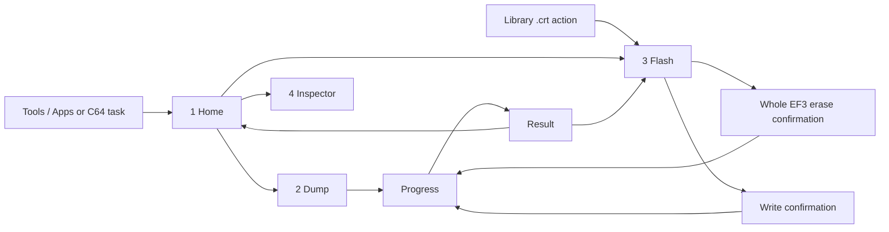

# TREX CRT application UI

This document defines the declarative UI for the `trex_crt` application in
T104.3. The existing C implementation in
`vendor/gideon/apps/trex_crt/` remains the behavioral reference: cartridge
detection, dump and flash algorithms, EasyFlash 3 slot handling, file I/O and
all safety rules stay unchanged. This prototype replaces only the old 40 x 24
character presentation.

The graphical XML lives in this project and uses the established graphite LVGL
theme. TREX CRT has no parallel terminal-theme implementation.

## App mode

TREX CRT opens as a transient full-screen application. It does not retain the
global F-key rail because its established operation keys are F1, F3, F5 and F7.
Keeping both sets visible would make one physical key mean two things.

The app therefore has its own stable navigation grammar:

| Input | Meaning |
| --- | --- |
| `1` | Home / choose a tool |
| `2` | Dump cartridge |
| `3` | Flash cartridge |
| `4` | Cart Inspector |
| Cursor keys | Move focus; in Inspector, scroll memory or change bank |
| Return | Activate the focused action |
| C64 left-arrow | Back to the previous app screen; from Home, return to the caller |
| `R/S` | Close the app; a non-interruptible flash step may refuse it with a visible reason |
| Freeze/Menu | Toggle the complete firmware UI as usual |

Number shortcuts are suspended while an address, byte value, name or path
editor owns keyboard focus. The app's F-key labels always appear in the footer
of the operational screen that owns them.

## Screen flow

| XML screen | Purpose | Dominant decision |
| --- | --- | --- |
| `crt_home.xml` | Choose Inspector, Dump or Flash and see the current target | Which tool? |
| `crt_dump.xml` | Cartridge, slot, destination file and ROML/ROMH bank maps | Save this cartridge where? |
| `crt_flash.xml` | Source image, exact physical target and compatibility | Is source and target correct? |
| `crt_confirm.xml` | Destructive boundary with source, target and erase impact | Write this exact slot? |
| `crt_erase_confirm.xml` | Final boundary for the F7 whole-EF3 erase action | Erase system area, directory and every slot? |
| `crt_progress.xml` | Current phase, bank and progress; close lock is explicit | Wait or request cancellation |
| `crt_result.xml` | Program/verify result and safe next actions | Verify again, another slot, or leave |
| `crt_inspector.xml` | Memory, ASCII, selected bank and cartridge registers | Inspect or deliberately edit one value |

The bank map remains the app's primary visual evidence. It is not decorative:
each cell will bind to the existing `BANK_EMPTY`, `BANK_FILLED`,
`BANK_ERASING`, `BANK_WRITING`, `BANK_VERIFIED` or `BANK_ERROR` state. The XML
uses representative preview fills; the runtime renderer supplies the 64 or 256
live cells.

## Safety hierarchy

1. Read-only inspection is cyan and requires no confirmation.
2. Dumping is reversible and violet; the destination is visible before F3.
3. Flashing is amber. The selected source, cartridge type and EasyFlash 3 slot
   remain visible together.
4. The write confirmation names the exact slot and erase scope. It never asks a
   generic `Are you sure?` question.
5. While a sector cannot safely stop, `R/S LOCKED` replaces `R/S CLOSE` and the
   reason remains on screen.
6. Whole-EF3 erase remains a secondary Flash/F7 menu action, never a tab. Its
   final confirmation names all 8 MB, the system area, directory and every
   slot, plus the required type 90 recovery image.
7. Completion distinguishes programming from verification. An unsuccessful
   save keeps the existing retry-without-redump behavior and uses the same
   confirmation pattern.

## Declarative bindings

The app description binds widgets to registry operations and state; the app
does not call LVGL (T104.3 D0).

| UI element | State or operation |
| --- | --- |
| target summary | cartridge type, size, port state, EasyFlash 3 slot and name |
| source / destination | selected file and folder state |
| bank maps | per-chip bank-state arrays and active bank |
| F1 Scan | `cart.scan` |
| F3 Dump | `cart.dump.start` |
| F3 Write | `cart.write.start` after `cart.write.confirm` |
| F5 Inspect | open Inspector with the current cartridge state |
| F5 Verify | `cart.verify.start` |
| F7 Slot / full / erase | `cart.ef3.choose_target_or_erase` |
| Erase whole EF3 | `cart.ef3.erase_all`, after the existing two confirmations |
| Inspector Go To / Write Byte | `cart.inspect.goto`, `cart.inspect.write` |
| Inspector `$01` / `$DE00` | focused numeric editors bound to their write operations |
| progress and close lock | job phase, value, total, cancellable and refusal reason |
| result | programmed, verified, EEPROM and slot-name outcomes |

Names above are the UI contract for the eventual descriptor. The port may map
them to the current C functions without changing the algorithms.

## Prototype files

- `components/crt_shell.xml`: standalone app chrome, numbered tabs, operation
  keys and close state
- `components/crt_bank_map.xml`: representative bank-map component
- `screens/crt_*.xml`: the eight visual states
- `screens/tools_apps.xml`: preview route from the installed-app catalogue

The XML is presentation evidence. Firmware wiring and the compiled declarative
record remain part of T104.3.
