# TRX64 M2 UI coverage

This document is the traceability layer between the code-audited inventory in
[`../gideon-menu-tree.md`](../gideon-menu-tree.md), the UX structure, and the
LVGL XML prototype. It deliberately does **not** duplicate every registered
parameter as handwritten XML.

The target is complete functional reachability with a small, stable UI:

- permanent navigation and task hierarchy are explicit in XML;
- settings rows come from `ConfigManager` and `ConfigGroupCollection`;
- global actions come from `TasksCollection`;
- selected-file actions come from `Browsable::fetch_context_items()` and the
  app registry;
- unsupported functions are hidden, while temporarily unavailable functions
  remain visible with a reason;
- legacy character-grid tools run in the LVGL terminal surface until they get
  a native screen.

The XML therefore prototypes the **containers and interaction rules**. The
runtime catalogues remain the authoritative source for installed hardware,
build flags, file type, writable state, and current values.

## Stable information architecture

```mermaid
flowchart TD
    H[Home] --> QA[Quick actions]
    QA --> AC[Complete action catalogue]

    L[Library] --> LS[Local and Assembly64 search]
    L --> LA[Context action sheet]
    LA --> LM[File management and creation]

    C[C64] --> CM[Machine and power]
    C --> CD[Drive A and B]
    C --> CP[Tape, IEC, UltiCopy, printer, modem]
    C --> CT[Cartridge and REU]

    T[Timewarp] --> TA[Markers and snapshot files]

    W[Tools] --> WM[Monitor]
    W --> WD[Trace, viewers, logs, diagnostics]
    W --> WA[Installed apps]
    W --> WS[Streams]

    S[Settings] --> ST[TRX64]
    S --> SV[Video and overlay]
    S --> SA[Audio and SID]
    S --> SC[Controllers]
    S --> SN[Network]
    S --> SP[Drives and peripherals]
    S --> SX[System and expert]
    SA & SC & SN & SP & SX --> SD[Dynamic settings page]
```

The shell exposes two stable axes. F1/F3/F5/F7 directly select Home, Library,
C64, and Actions; F2/F4/F6/F8 select Timewarp, Tools, Settings, and System.
Visible number keys 1–5 select the local tab inside that area. Cursor/Return
remain a complete alternative, the C64 left-arrow goes back or exits at the
root, `R/S` closes immediately, and Freeze/Menu toggles the UI. See
[`NAVIGATION.md`](NAVIGATION.md) for the complete area/tab and test contract.

## Runtime catalogue contracts

### Settings

The page tree combines visible `ConfigStore`s with
`ConfigGroupCollection::getGroups()`. Opening and leaving a page keeps the
existing firmware lifecycle: `at_open_config()`, direct edits, then
`at_close_config()`. `is_flash_stale()` drives the unsaved marker.

Each runtime row is selected from the registered item kind:

| Firmware item | LVGL presentation |
| --- | --- |
| enum | value row opening a compact choice list |
| numeric value | stepper or slider using min, max, format, and default |
| string | text editor |
| password | masked text editor |
| string function | text editor plus registered presets |
| function | action row opening the function's dialog or terminal flow |
| info | read-only status row |
| separator / heading | quiet section divider |

`GET /v1/configs/{category}/{item}` already demonstrates the metadata needed
for enum, numeric, and string items. The in-process LVGL adapter uses the
objects directly because the REST route does not expose groups, function
items, or info items.

### Actions

The complete action catalogue is not copied into XML. The adapter refreshes
`TasksCollection` for the current target folder and creates rows from
`{category, label, stable key, shown, enabled}`. A selected library entry adds
the actions returned by `fetch_context_items()` and the app registry.

The first enabled action is the primary action. Alternatives follow, then
information/viewers, file management, and finally destructive actions. The
adapter removes legacy control bytes and supplies a human-readable reason for
disabled rows.

## Coverage of Gideon's current UI

| Current function group | New location | XML / runtime source |
| --- | --- | --- |
| Menu open/close and global navigation | global shell | `components/app_shell.xml` |
| Quick pause, disk swap, Timewarp, reset | Home → Quick actions | `quick_actions.xml` plus action catalogue |
| Full task menu | Quick actions → All available actions | `action_catalog.xml`, `TasksCollection` |
| Mounts, SD, USB, network interfaces, FTP hosts | Library sources | `library.xml`, `BrowsableRoot` |
| Wi-Fi AP actions and FTP host add/edit/remove | selected source action sheet | `library_actions.xml`, `fetch_context_items()` |
| Search, quick-seek, recent, favorites, home | Library | `library_search.xml` and browser state |
| Enter, view, hex view, run with app | selected-file action sheet | `library_actions.xml`, runtime file actions |
| Copy, move, rename, delete, multi-select, clipboard, path picker | Library → Manage | `library_manage.xml`, `FileManager` adapter |
| Create directory and D64/G64/D71/G71/D81/DNP | Library → Manage → Create | `library_manage.xml`, image-creator actions |
| PRG/P00 run, load, DMA, mount-and-run, real-run | selected-file action sheet | file-type catalogue |
| D64/D71/D81/DNP/G64/G71 mount/run/read-only/unlinked/B/MP3 | selected-file action sheet | file-type catalogue |
| CRT, TAP and TAP-index variants | selected-file action sheet | file-type catalogue |
| SID/MUS/STR, REU/MOD and T64 actions | selected-file action sheet | file-type catalogue |
| CFG, VPL, U2A, updates, BIN/ROM/64C and IPR actions | selected-file action sheet | file-type catalogue |
| App-manifest actions | Library action sheet or Tools → Apps | `tools_apps.xml`, app registry |
| Reset, reboot, clear memory, power-cycle/off | C64 → Machine | `c64_machine.xml` |
| Save C64 RAM, REU, cartridge, MP3 RAM drives | C64 → Machine → Save state | `c64_machine.xml` |
| Drive A/B on/off/reset/mode/eject/save/blank/swap/unlink | C64 → Drives | `c64_drives.xml` |
| Software IEC and partition add/edit/remove | C64 → Peripherals | `c64_peripherals.xml` |
| UltiCopy drives 8–11 | C64 → Peripherals | `c64_peripherals.xml`, terminal bridge |
| Tape pause/resume/stop/sample/capture/finish | C64 → Peripherals | `c64_peripherals.xml` |
| Printer flush/eject/reset/on/off | C64 → Peripherals | `c64_peripherals.xml` |
| Cartridge writeback decision | C64 / menu-enter warning | `writeback_warning.xml` |
| Timewarp timeline and frame preview | Timewarp | `timewarp.xml` |
| Timewarp markers, start/stop, dump, ringdump, load | Timewarp → Markers and files | `timewarp_actions.xml` |
| Monitor | Tools → Monitor | `monitor.xml`, terminal bridge first |
| Trace, text/hex viewer, debug log, EDID, system info | Tools → Diagnostics | `tools_diagnostics.xml` |
| VIC/audio/debug streams | Tools → Streams | `tools_streams.xml` |
| Installed apps and app tasks | Tools → Apps | `tools_apps.xml` |
| TREX CRT chooser, dump, flash, whole-EF3 erase, progress, result and Inspector | Tools → Apps or C64 task | `crt_*.xml`, declarative app UI |
| Assembly64 search/results/download | Library → Search | `library_search.xml`, native flow or terminal bridge |
| Forms, SID address editor, UltiCopy window | owning route | LVGL terminal bridge |
| Progress, choices, text input, warnings | global modal layer | `LvglUserInterface` dialog contract |

## Complete settings placement

| Registered page/group | New location | Rendering |
| --- | --- | --- |
| TRX64 behavior | Settings → TRX64 | curated native page plus runtime items |
| Video Configuration | Settings → Video and overlay | curated preview plus dynamic full list |
| Audio Mixer | Settings → Audio and SID | dynamic page |
| Speaker Mixer / Speaker Settings | Settings → Audio and SID | dynamic page |
| SID Sockets Configuration | Settings → Audio and SID | dynamic page |
| SID Addressing and visual editor | Settings → Audio and SID | dynamic page / terminal flow |
| UltiSID Configuration | Settings → Audio and SID | dynamic page |
| SID Player Behavior | Settings → Audio and SID | dynamic page |
| detected SID device pages | Settings → Audio and SID | generated per installed device |
| Joystick, paddle, mouse, USB input | Settings → Controllers | dynamic grouped page |
| Drive A and Drive B Settings | Settings → Drives and peripherals | dynamic pages |
| SoftIEC, Tape, Printer, Modem | Settings → Drives and peripherals | dynamic pages |
| Ethernet Settings | Settings → Network | dynamic page |
| Wi-Fi Settings and AP functions | Settings → Network | native AP page plus dynamic list |
| Network Settings, services, SNTP, timezone | Settings → Network | dynamic page |
| Data Streams | Settings → Network / Tools → Streams | dynamic page |
| User Interface Settings | Settings → System and expert | dynamic page |
| Memory Configuration | Settings → System and expert | dynamic page |
| C64 and Cartridge Settings | Settings → System and expert | dynamic page |
| Turbo Settings | Settings → TRX64 / System and expert | curated common values plus dynamic list |
| Machine Tweaks | Settings → System and expert | dynamic page |
| Power Settings | Settings → System and expert | dynamic page |
| LED Strip, case, keyboard, power LEDs | Settings → System and expert | generated from visible/hidden stores |
| Monitor Bookmarks | Settings → System and expert | dynamic page |
| C64U-specific hidden store | Settings → System and expert → Hardware | grouped dynamic page |
| four items without a Gideon menu path | Settings → System and expert → Hardware | grouped dynamic page |

Configuration persistence actions remain reachable from every settings page:
save to flash, save to file, reset from flash, reset to defaults, and clear
flash configuration. Applying a value still happens on page leave; the UI does
not invent an Apply/Discard transaction.

## Keys and non-screen functions

Global C= hotkeys, boot-time PAL/NTSC/model keys, the long menu-button disk
swap, USB F10/Scroll Lock, and Ctrl-D remain firmware inputs rather than menu
rows. They belong in the input help page and continue to work while the LVGL
menu is active. Telnet remains a separate remote host decision; it is not a
second visual navigation tree.

Pure REST/debug methods are exposed through their natural native surface where
useful: pause/resume in Machine, read/write memory through Monitor, drive
unlink/mode through Drives, runners through file actions, streams through
Tools, and file creation through Library. Low-level heap/debug-register probes
stay in Tools → Diagnostics rather than the everyday menu.

The TREX CRT flow is the first native declarative application surface. Its app
mode, operation keys, safety states and mapping to the existing implementation
are specified in [`TREX-CRT-UI.md`](TREX-CRT-UI.md). It deliberately owns its
F1/F3/F5/F7 operation keys while open instead of overloading the global area
rail with two meanings.

## Coverage rule for implementation

The migration is complete only when an automated snapshot can enumerate the
runtime settings and action catalogues and verify that every visible entry has:

1. a stable destination category;
2. a supported row/editor type;
3. an execution key or `ConfigItem` identity;
4. visible enabled/disabled state;
5. a dialog/progress path when the action requests one;
6. a deliberate exclusion record when it is build-only or unsupported.

This check replaces a fragile handwritten count. Adding a new firmware setting,
file type, app action, or installed SID page must appear automatically without
adding another XML screen.
