# TRX64 M2 UI — Screenshot tour

This document shows the complete LVGL Pro XML prototype as a visual user
journey. The screenshots were captured from the actual 960 × 540 editor
preview on 10 October 2026.

The screens currently use preview data. They describe information hierarchy,
navigation, visual states, and confirmation flows; they do not invoke firmware
actions yet. The adapter work is specified separately in
[`../specs/T24-ui-wiring.md`](../specs/T24-ui-wiring.md).

This revision deliberately uses a minimalist hierarchy: one dominant task per
screen, flat lists instead of card grids, 11–21 px typography, and accent color
only for focus or meaningful state. The F-key rail selects an area and the
numbered top row selects a tab inside it.

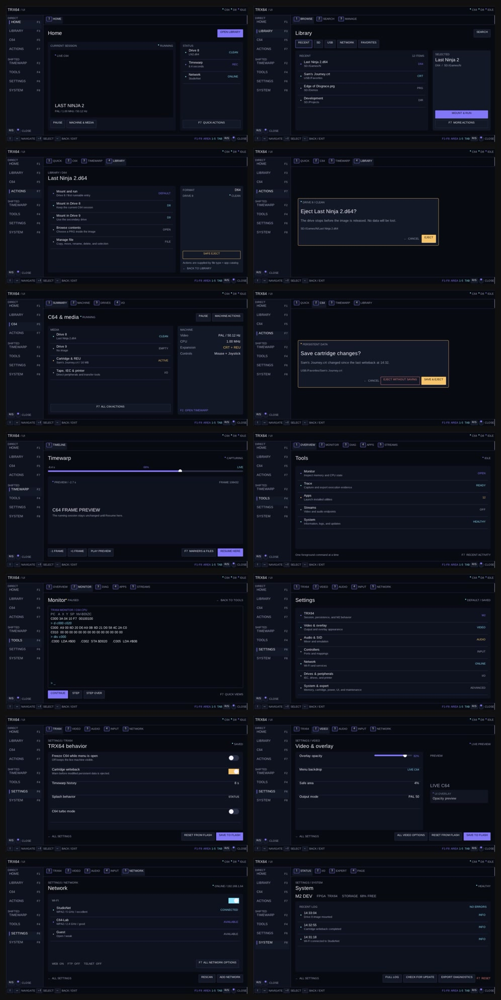

## Controls

- The `↕` and `↔` cursor keycaps move focus.
- The `↵` keycap selects; `←` goes back and exits at the root.
- `F1`, `F3`, `F5`, and `F7` select the frequent areas; `F2`, `F4`, `F6`, and
  `F8` select the shifted secondary areas.
- Number keys `1`–`5` select the labeled tab inside the current area.
- `R/S` closes the UI; the physical Freeze/Menu button toggles it open or
  closed.

## 1. Orientation

### Home

The running C64 is the dominant surface. Drive, Timewarp, and network state are
reduced to three quiet rows; everything else is contextual.

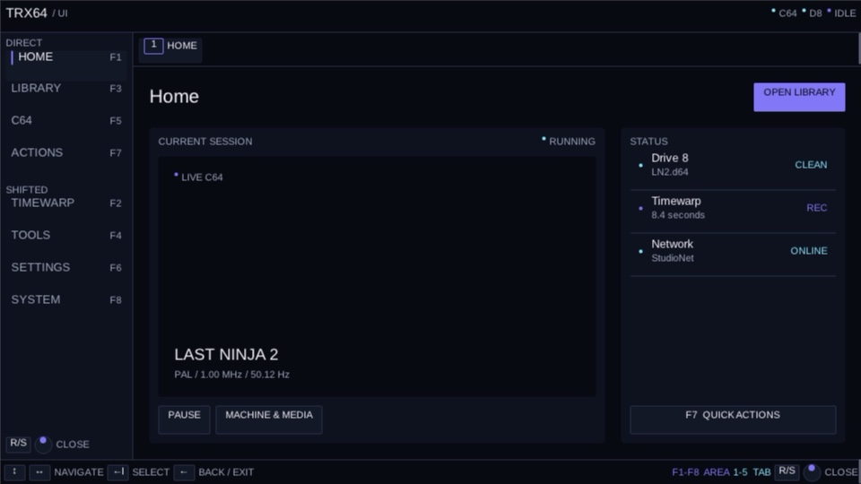

[Open the screen XML](screens/home.xml)

## 2. Media journey

### Library

One browser covers recent items, SD card, USB, network sources, and favorites.
The selected item remains visible beside the list, together with the primary
action.

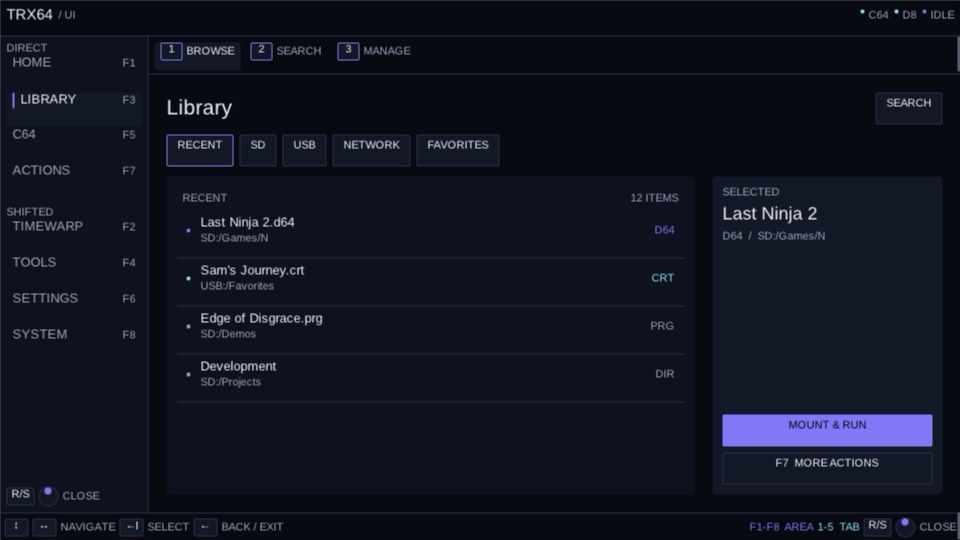

[Open the screen XML](screens/library.xml)

### Library actions

The selected item gets one flat action list. Only format, drive state, and safe
eject remain in the supporting rail.

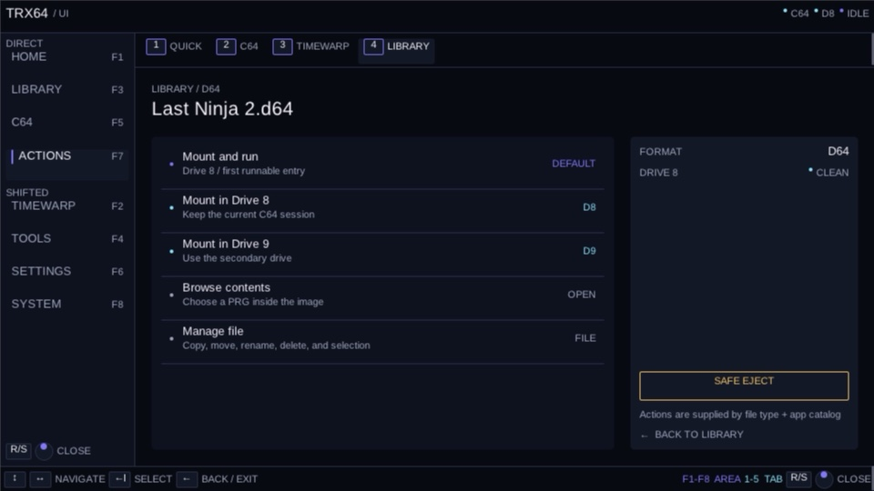

[Open the screen XML](screens/library_actions.xml)

### Safe eject

Eject is a deliberate, state-aware step. The dialog explains what will happen
and shows whether pending data needs attention before the action is confirmed.

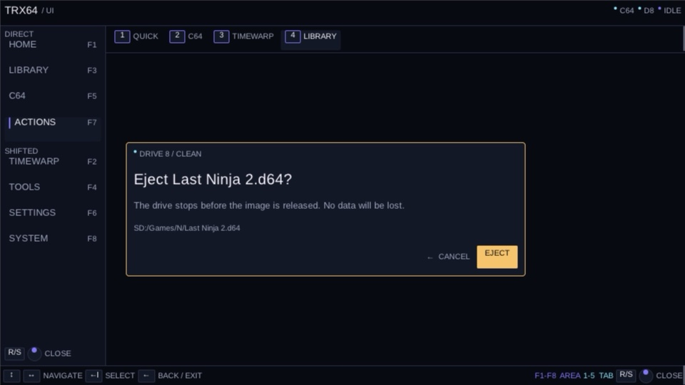

[Open the screen XML](screens/media_eject.xml)

## 3. Machine and data safety

### C64 and media

Mounted media and essential machine state share one operational screen. Hard
reset, power, and peripheral details stay behind `F7` instead of competing with
routine controls.

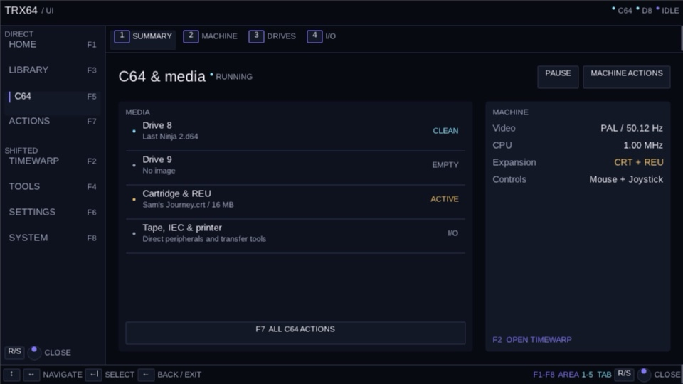

[Open the screen XML](screens/c64.xml)

### Cartridge writeback warning

Modified persistent cartridge data gets a short decision surface: `←`
cancels; the two visible actions discard or save before ejecting.

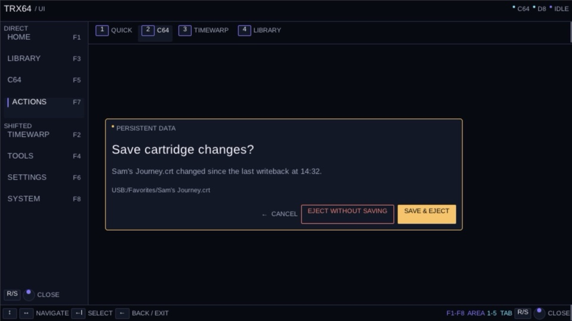

[Open the screen XML](screens/writeback_warning.xml)

## 4. Reversible session

### Timewarp

The history can be scrubbed and previewed first. The running session changes
only after `RESUME HERE`, which keeps exploration reversible and explicit.

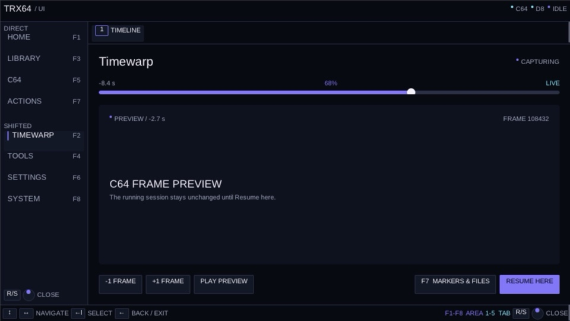

[Open the screen XML](screens/timewarp.xml)

## 5. Tools

### Tools overview

Diagnostics, trace capture, apps, streams, and system information form one flat
list. Activity history stays behind `F7` and appears only when requested.

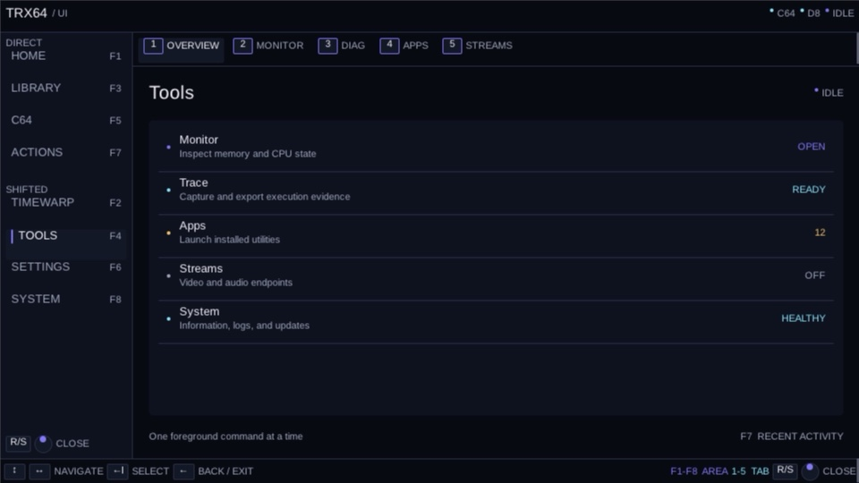

[Open the screen XML](screens/tools.xml)

### Monitor

The terminal owns nearly the entire workspace. Continue, step, and step-over
remain visible; secondary quick views move to `F7`.

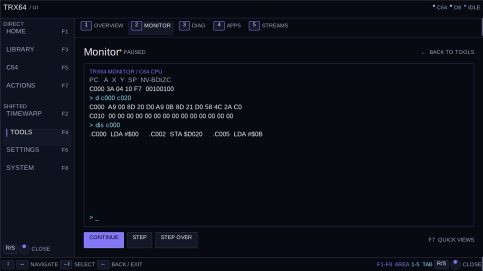

[Open the screen XML](screens/monitor.xml)

## 6. Configuration

### Settings overview

Settings are one clean category list. Profile and saved state fit into the
header instead of occupying a permanent explanatory rail.

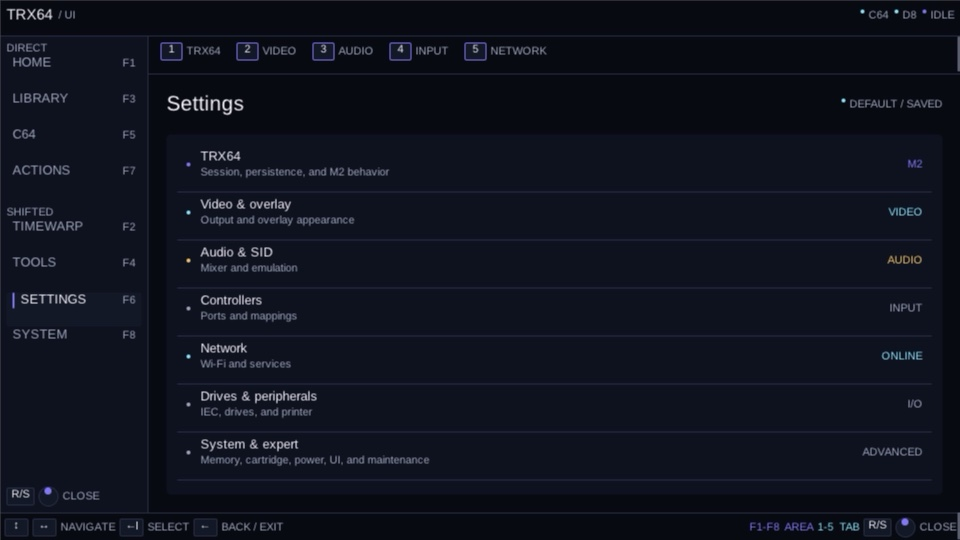

[Open the screen XML](screens/settings.xml)

### TRX64 behavior

M2 behavior and persistence controls are presented as live settings. `SAVE TO
FLASH` persists the current values; `RESET FROM FLASH` restores the stored
values.

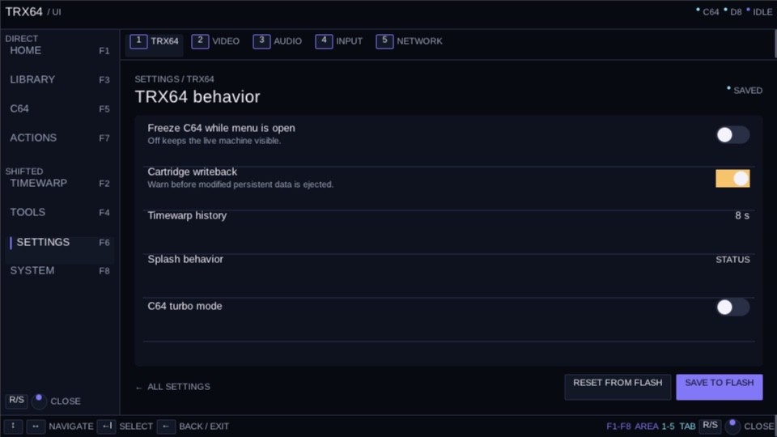

[Open the screen XML](screens/settings_trx64.xml)

### Video and overlay

Overlay appearance is tuned beside a live preview. This keeps visual changes
immediate and understandable without a separate apply transaction.

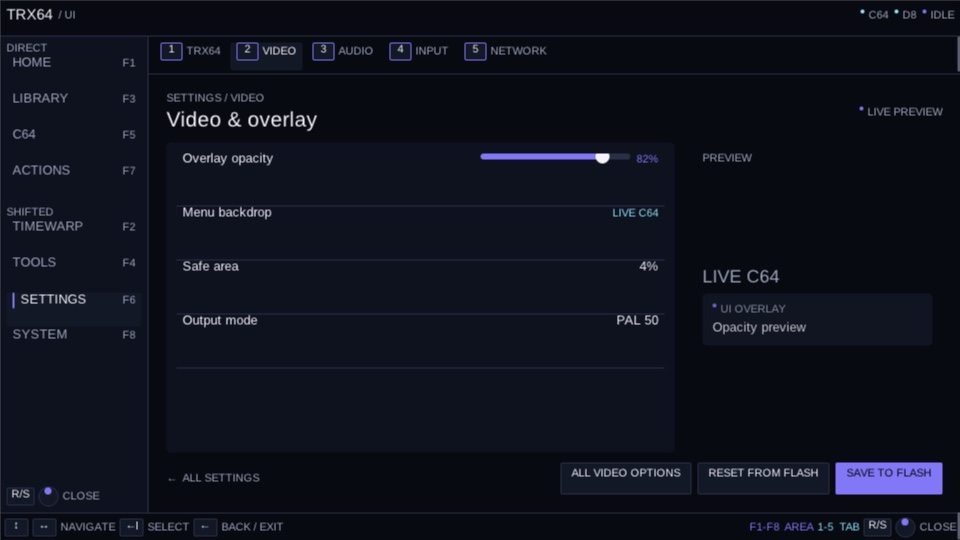

[Open the screen XML](screens/settings_video.xml)

### Network

Available networks own the page. Address and common service states are compact
status lines; detailed services move to `F7`.

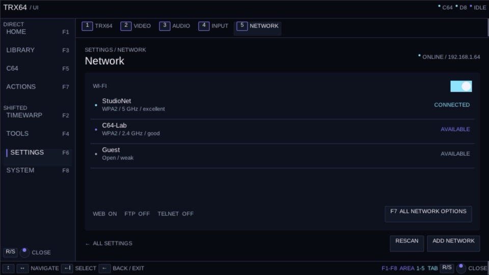

[Open the screen XML](screens/settings_network.xml)

### System information

Firmware, FPGA, and storage become one status line above a short event list.
Maintenance stays at the bottom; reset remains a contextual danger action.

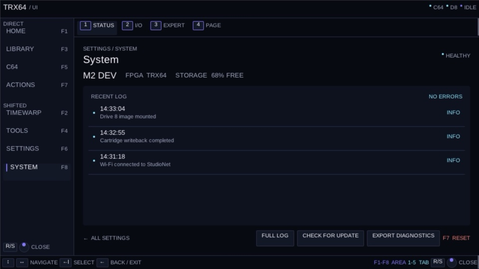

[Open the screen XML](screens/system.xml)

## Navigation map

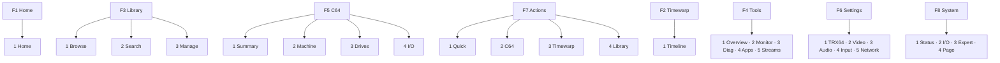

`←` returns from a detail or confirmation screen and exits at the root. The
complete stable sequence and automation contract is in
[`NAVIGATION.md`](NAVIGATION.md).

## Design references

- [`../gideon-menu-tree.md`](../gideon-menu-tree.md) — source feature and menu inventory
- [`../specs/T24-lvgl-ui.md`](../specs/T24-lvgl-ui.md) — UI scope and architecture
- [`../specs/T24-ui-wiring.md`](../specs/T24-ui-wiring.md) — later firmware adapter work
