# TRX64 M2 terminal UI — Screenshot tour

This is the visual walkthrough of the narrow, text-first LVGL variant. Every
image below is cropped from the actual 960 x 540 LVGL Pro editor preview; these
are not reconstructed mockups. The screenshots were captured on 10 October
2026.

The prototype uses preview data and currently documents hierarchy, focus,
status, navigation, and confirmation flows. Firmware actions are connected in
step 2 through the adapters in
[`../specs/T24-ui-wiring.md`](../specs/T24-ui-wiring.md).

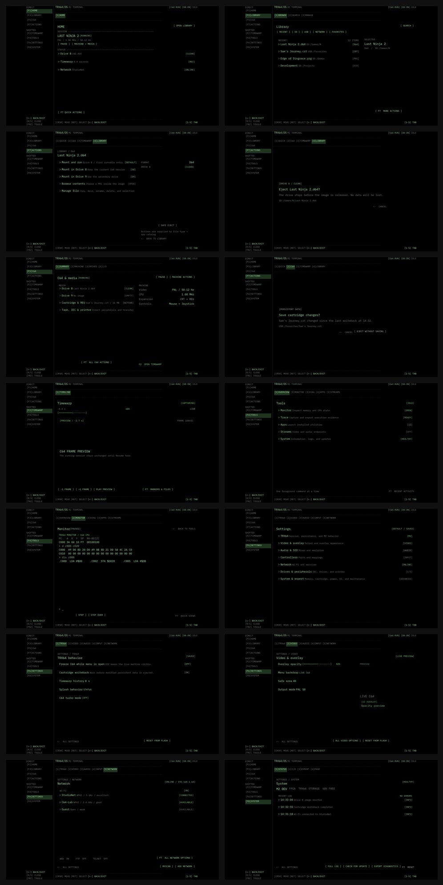

## Interaction contract

- `[CRSR]` moves focus, `[RET]` selects, and `[<-]` goes back or exits at root.
- `[F1]`, `[F3]`, `[F5]`, and `[F7]` select the direct areas; `[F2]`, `[F4]`,
  `[F6]`, and `[F8]` select the shifted areas.
- `[1]`–`[5]` select the labeled tab inside the current area.
- `[R/S]` closes the UI; the physical Freeze/Menu button toggles it.

## 1. Orientation

### Home

The running C64 session stays dominant. Drive, Timewarp, and network state are
reduced to three scan-friendly lines, while the left rail establishes the
global routes and the numbered row establishes the local route.

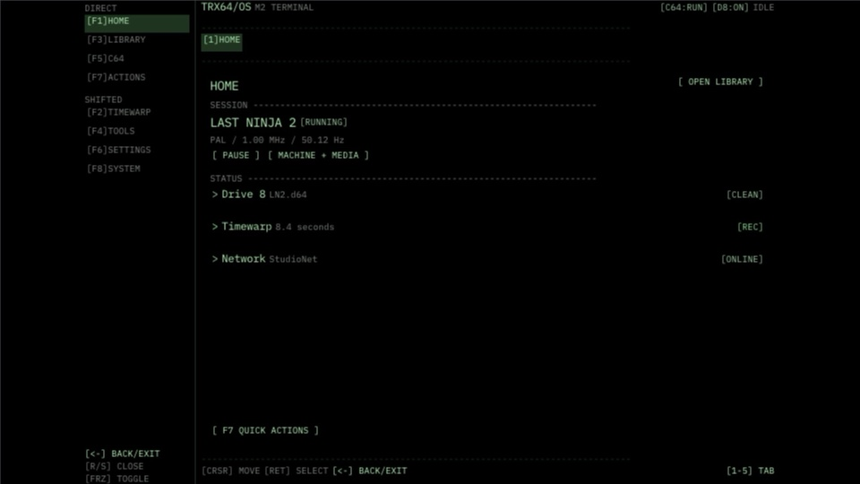

[Open the screen XML](screens/home.xml)

## 2. Media journey

### Library

One browser combines recent items, SD, USB, network sources, and favorites.
The current selection and its type remain visible without introducing a card
layout.

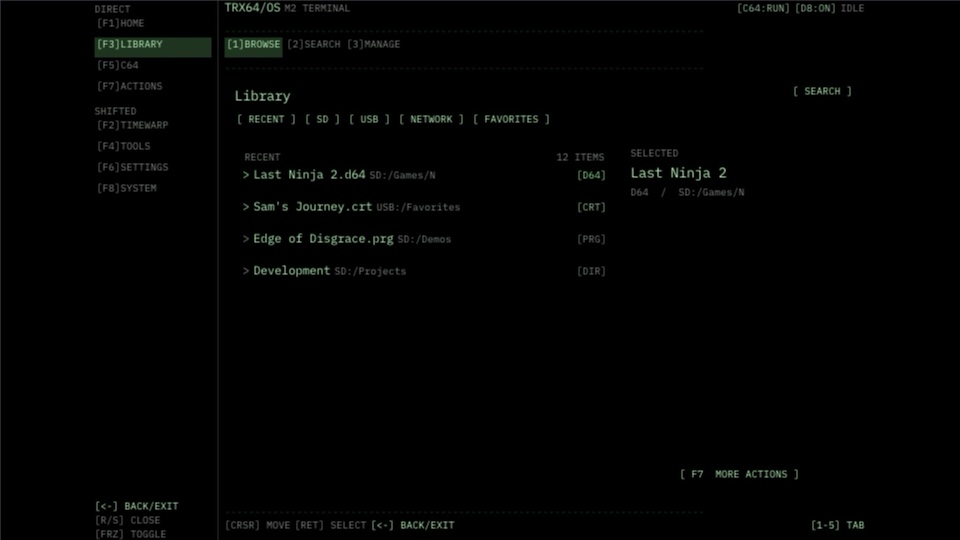

[Open the screen XML](screens/library.xml)

### Library actions

The selected file receives one flat action list. Format, drive state, and safe
eject are kept as supporting information instead of separate panels.

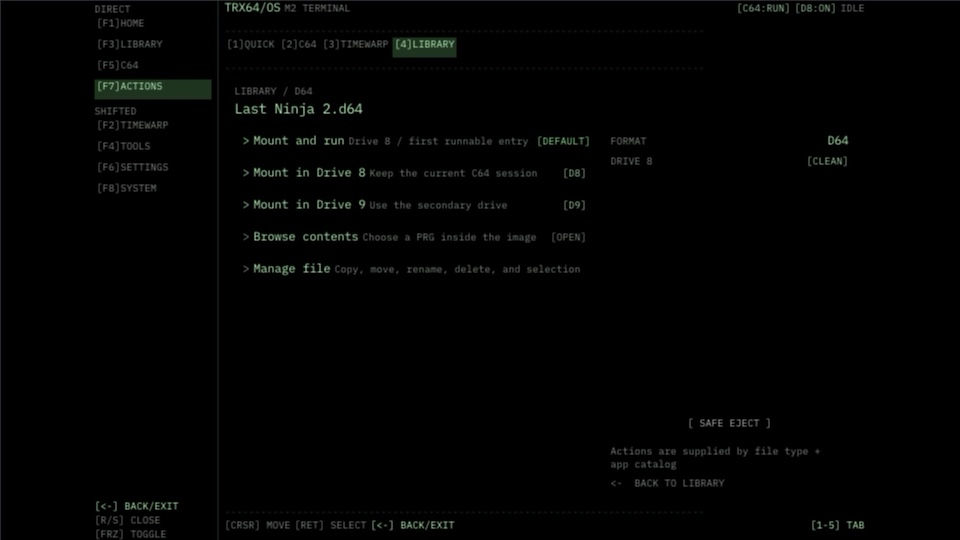

[Open the screen XML](screens/library_actions.xml)

### Safe eject

The confirmation names the affected drive and image and states the data-safety
result before the user commits the action.

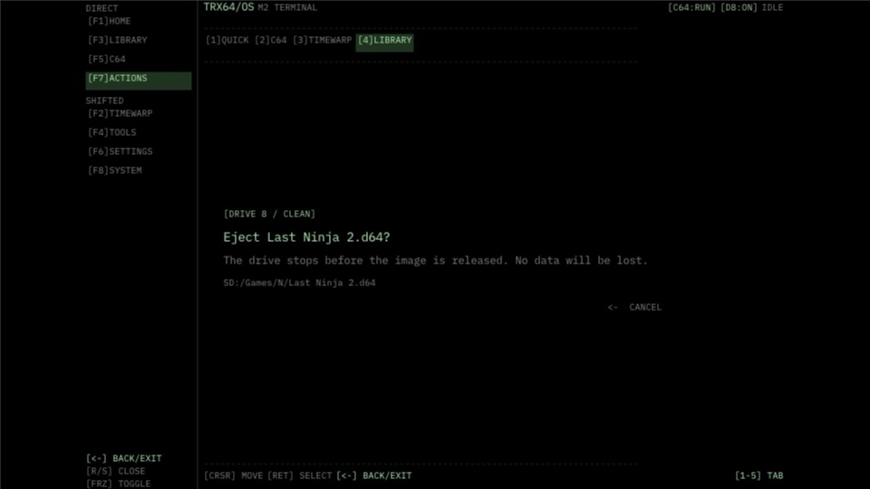

[Open the screen XML](screens/media_eject.xml)

## 3. Machine and data safety

### C64 and media

Mounted media and essential machine state share one operational view. Routine
actions stay visible; the longer action catalogue remains behind `[F7]`.

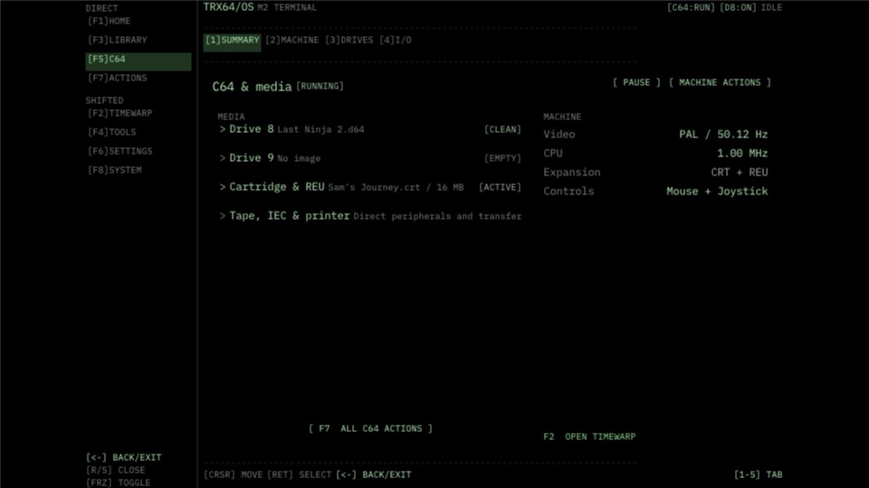

[Open the screen XML](screens/c64.xml)

### Cartridge writeback warning

Modified persistent cartridge data gets a deliberately small decision surface:
go back, eject without saving, or save and eject.

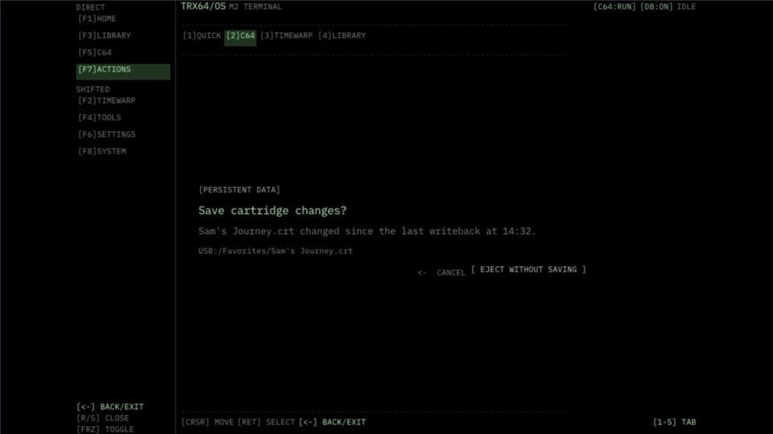

[Open the screen XML](screens/writeback_warning.xml)

## 4. Reversible session

### Timewarp

The history position, preview state, and capture state are readable at a glance.
Frame stepping and previewing do not alter the running session until the user
chooses to resume from a point.

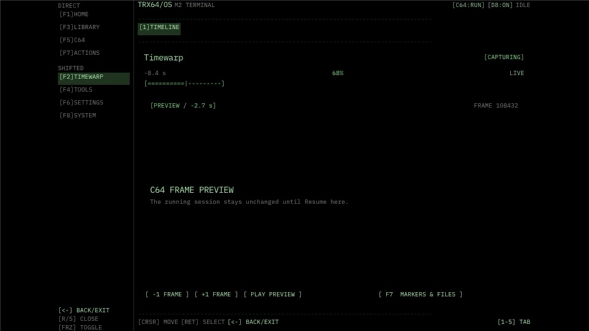

[Open the screen XML](screens/timewarp.xml)

## 5. Tools

### Tools overview

Monitor, trace, apps, streams, and system information form one flat command
list. Each line combines the action, a short explanation, and current state.

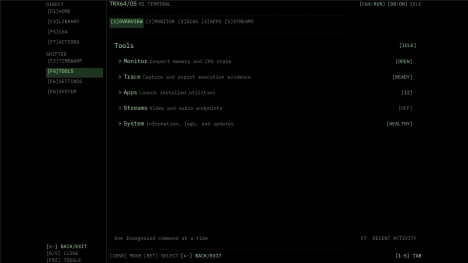

[Open the screen XML](screens/tools.xml)

### Monitor

The monitor uses the terminal language directly: registers, memory, commands,
and disassembly share the workspace without decorative containers.

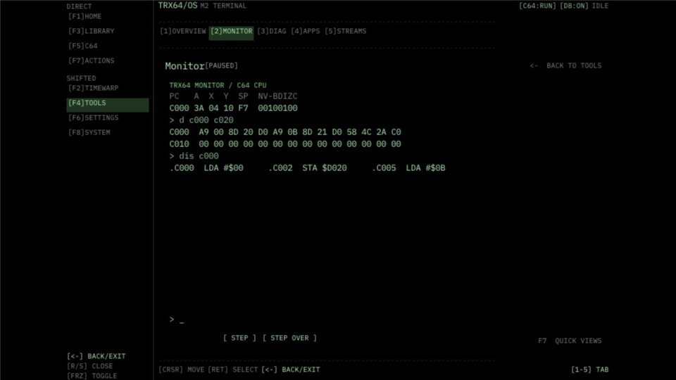

[Open the screen XML](screens/monitor.xml)

## 6. Configuration

### Settings overview

All settings families remain visible as a compact category list. The rightmost
tokens communicate saved state or the type of settings inside each route.

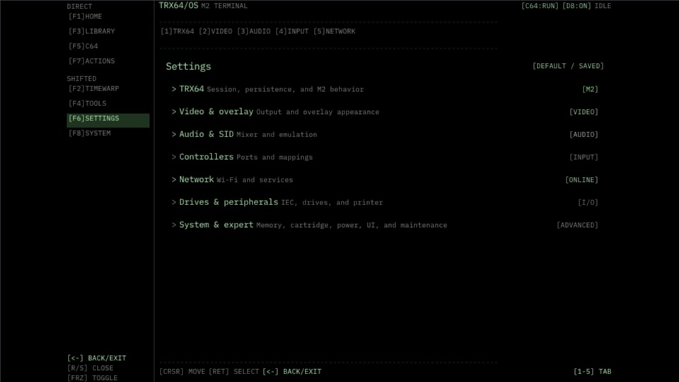

[Open the screen XML](screens/settings.xml)

### TRX64 behavior

Session, persistence, Timewarp, splash, and turbo behavior are shown as concise
parameter lines. Explicit `[ON]` and `[OFF]` values replace graphical switches.

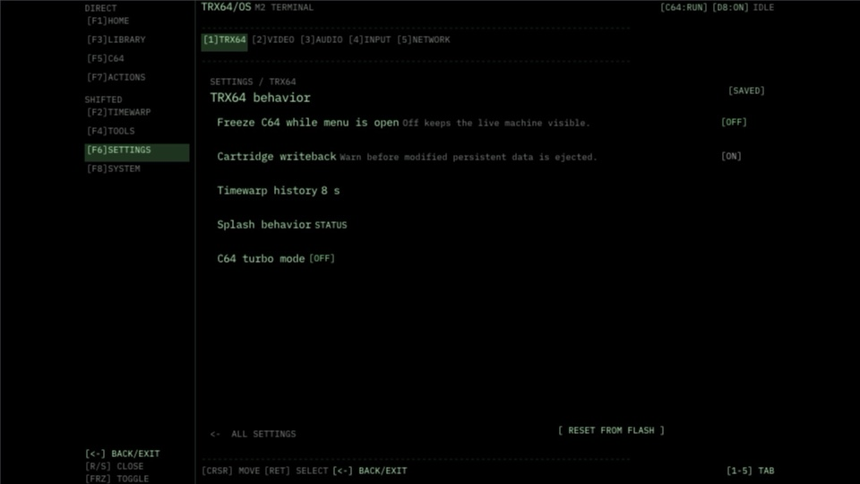

[Open the screen XML](screens/settings_trx64.xml)

### Video and overlay

The opacity is represented as an ASCII meter with a numeric value. The preview
area stays intentionally quiet so the effect remains the only visual subject.

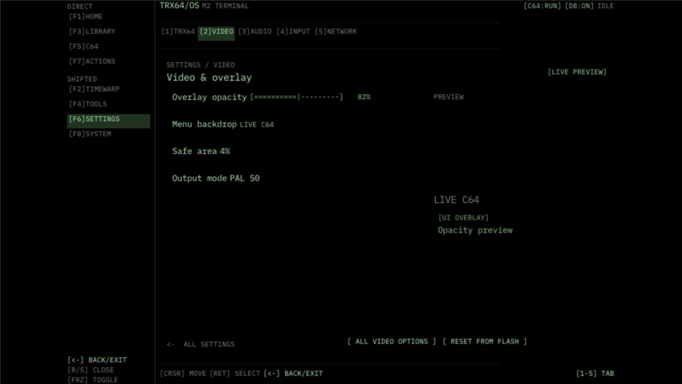

[Open the screen XML](screens/settings_video.xml)

### Network

Signal quality, security, connection state, address, and common services fit
into a single page without hiding operational status in submenus.

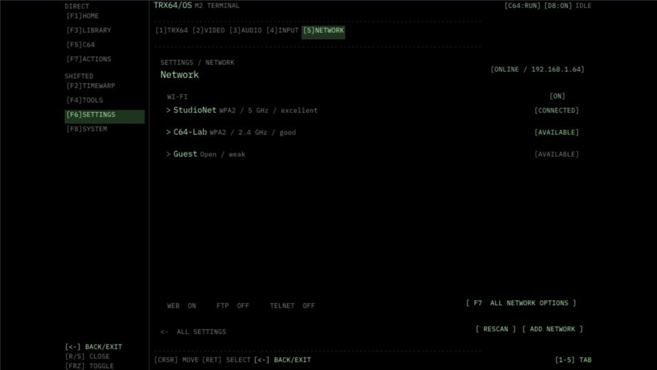

[Open the screen XML](screens/settings_network.xml)

### System information

Firmware, FPGA, storage, health, and the recent event log create a compact
diagnostic summary. Maintenance actions stay on the final command line.

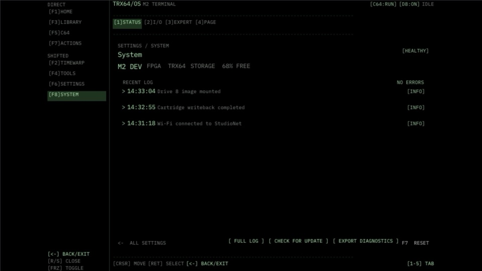

[Open the screen XML](screens/system.xml)

## Navigation map

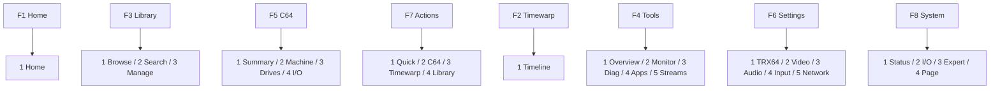

`[<-]` returns from a detail or confirmation screen and exits at the root. The
complete stable sequence and automation contract is in
[`../lvgl_ui_project/NAVIGATION.md`](../lvgl_ui_project/NAVIGATION.md).

## Related documents

- [`TERMINAL-UI.md`](TERMINAL-UI.md) — visual grammar and layout rules
- [`UI-COVERAGE.md`](UI-COVERAGE.md) — coverage of all 30 XML routes
- [`../gideon-menu-tree.md`](../gideon-menu-tree.md) — source feature inventory
- [`../specs/T24-lvgl-ui.md`](../specs/T24-lvgl-ui.md) — UI scope and architecture
- [`../specs/T24-ui-wiring.md`](../specs/T24-ui-wiring.md) — later firmware adapter work
