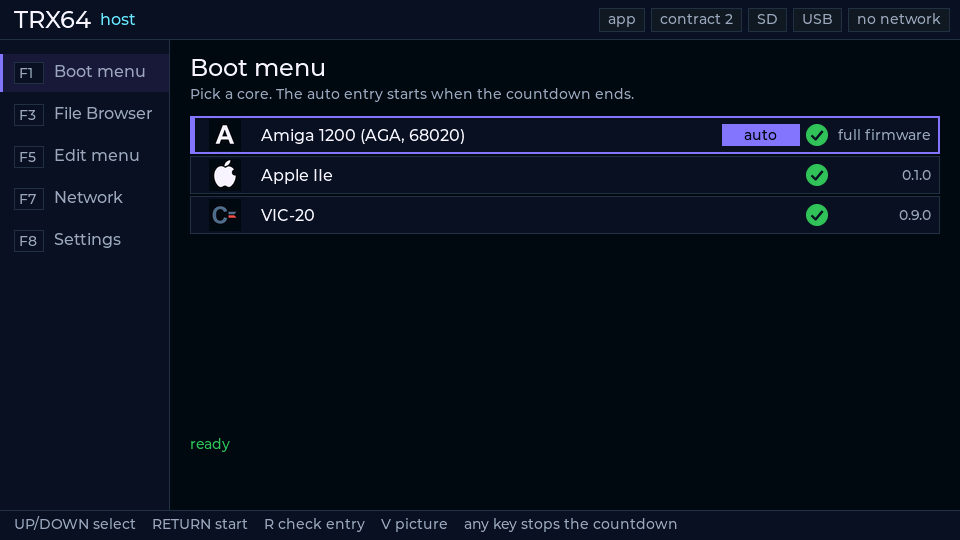

# 3. First start

## 3.1 Before you start

3.1.1 The host is installed (chapter 2). The medium holds the `.cor` files, normally in `/cores` (2.7).

3.1.2 The ROMs of the core that you want are in the folder of the core (chapter 12). The C64 cores need no ROM from you.

## 3.2 Open the host menu

3.2.1 After the install, the board starts the old firmware (2.6.2). To open the host menu, hold **C=** (or the fire button of joystick
port 1) from the power-on until the menu shows (4.7.3).

3.2.2 The host has five views. Each has a key on the C64 keyboard and on a USB keyboard:

| Key | View | Chapter |
|---|---|---|
| **F1** | Boot menu | 4 |
| **F3** | File Browser | 5 |
| **F5** | Edit menu | 6 |
| **F7** | Network | 7 |
| **F8** (**SHIFT** + **F7**) | Settings | 8 |

3.2.3 The header shows the address of the board (`LAN <address>` or `WiFi <address>`, the cable first; `no network` without an address), whether a USB stick (`USB`) and an SD card (`SD`) are present, the host
contract (`contract`), the key of the host bitstream (`host <key>`) and the version of the host application (`app`, for example `0.2.0+1a2b3c4d`; a test build shows `<branch>@<commit>`) (4.1.5).

*Figure 3-1. F1 Boot menu with three entries. The first has the tag `auto`: direct boot starts it at power-on. The header chips (here from the emulator, which has no version stamp and no host key: `app` shows no text, `host` is absent) are explained in 3.2.3.*

## 3.3 Add a core

3.3.1 The installer has added the cores that it copied (2.4.6). If a core is not in the menu, add it:

1. Press **F3**. The File Browser opens.
2. Press **RETURN** on a medium. Press **RETURN** on the folder `cores`. **LEFT** goes up one folder.
3. Select the `.cor` or `.cfw`. The right panel shows the manifest of the file (5.3).
4. Press **A**.

3.3.2 The host checks the bundle (SHA-256 and host contract). The note line reads `<name> is in the boot menu`. The menu holds up to 16
entries.

3.3.3 The host refuses a bundle that is built for another host contract or routed against another host. The note line says why (5.4.5).
The file cannot be added. Use the `.cor` files of the release that you installed.

## 3.4 Set the default and the delay

3.4.1 Press **F5**. Select the entry that should start by itself. Press **D** (6.2).

3.4.2 To start the default without the menu at power-on, keep direct boot `on` (8.2). To show the menu first and start the default after a
countdown, set direct boot `off` and the autostart on (8.3).

## 3.5 Start a core

3.5.1 Press **F1**. Select a core. Press **RETURN**.

3.5.2 The host shows the steps of the start (4.9). The core starts.

3.5.3 A core that misses a required ROM stays held. After about 10 seconds the screen names the missing file and its folder. Put the file
there (chapter 12). The core looks again and starts by itself.

## 3.6 No picture

3.6.1 The host asks the screen for its modes (EDID) at the start and puts up the stored mode if the screen names it, else the best mode that the screen names (8.4.3). If the screen shows nothing, press **V**:
the Picture page of **F8** opens. It lists `Auto` and the modes that the screen names, or the standard television modes (576p / 480p, 1280 x 720, 1920 x 1080 and the others of the host) when the screen gives no EDID.
The cursor starts on the mode in force. **UP** and **DOWN** move the cursor and change nothing. **RETURN** or **SPACE** puts up the mode under the cursor. Without a picture, press **V**, **DOWN**, **RETURN**.

3.6.2 After a new mode comes up, the host waits 8 s for a key. Any key keeps the mode (the first key is spent on that). **LEFT**, **ESC** or no key within 8 s puts the previous mode back (8.4.8).

3.6.3 A mode that you keep is stored in `/Flash/trx/host.cfg` (8.4.1). Without a stored mode, the host asks the screen what it can do (8.4.3).
When you connect another screen, the host follows within about a second (8.4.7).

3.6.4 A mode that is narrower than 960 pixels (576p / 480p and 800 x 600) gets a compact layout of the host menu and of the menu of every core:
the same pages, narrower side bar, a footer of two lines where the key list is long, a shorter list. Nothing is cut at the right (4.10).

3.6.5 The host menu is HDMI only. The C128 core has an analogue output (S-video and composite, T140). It is built and benched. Its board check is open: the colours and the picture position are not confirmed. The core menu
of `trx64u` has the row `Analog video mode`. With every other core the analogue output stays black.

## 3.7 Back to the host

3.7.1 In the menu of a core on the common application: **F8** System (on the C64 keyboard **SHIFT** + **F7**), `Return to host menu`. No power
cycle is needed. The core first writes its media back; a medium that cannot be written back keeps the core. The entry is there only when the core application finds the ICAP loader of the host (the board has the loader for it). If it is not on the System page, use 3.7.2.

3.7.2 A core without this entry (the TRX64 cores `trx64u` and `trx64g`): switch the power off and on (11.2.4). Hold **C=** to get the menu.

3.7.3 A full firmware (`.cfw`) replaces the host until the next power cycle (13.2).
