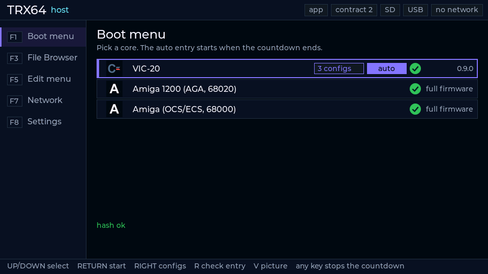
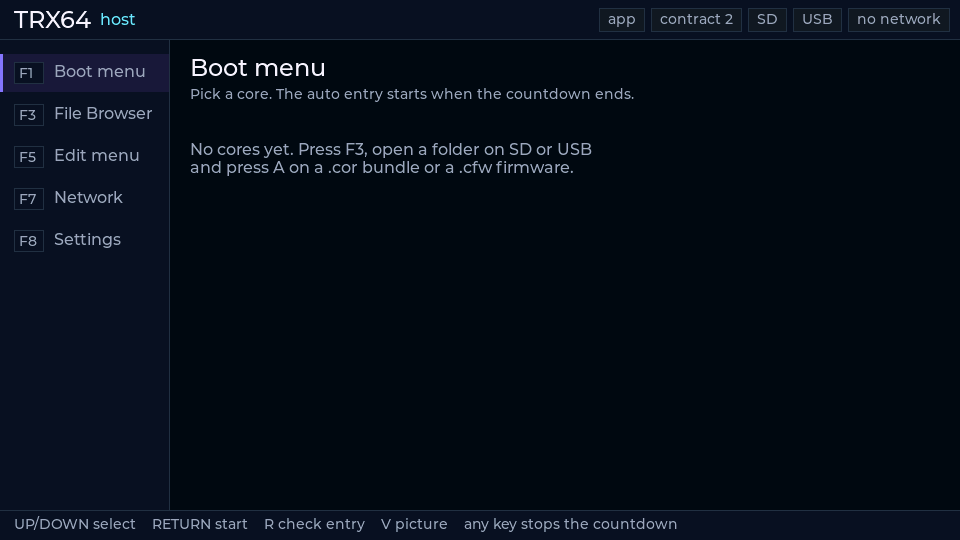
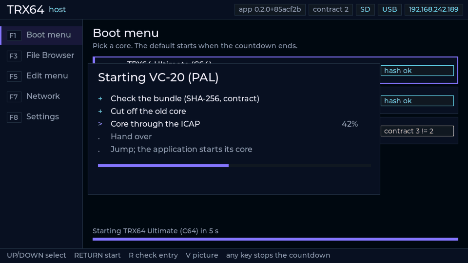
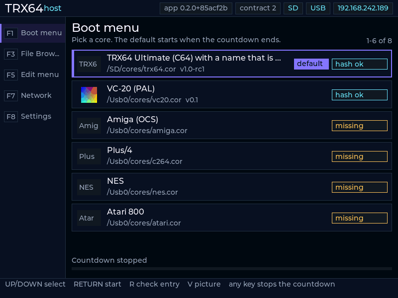
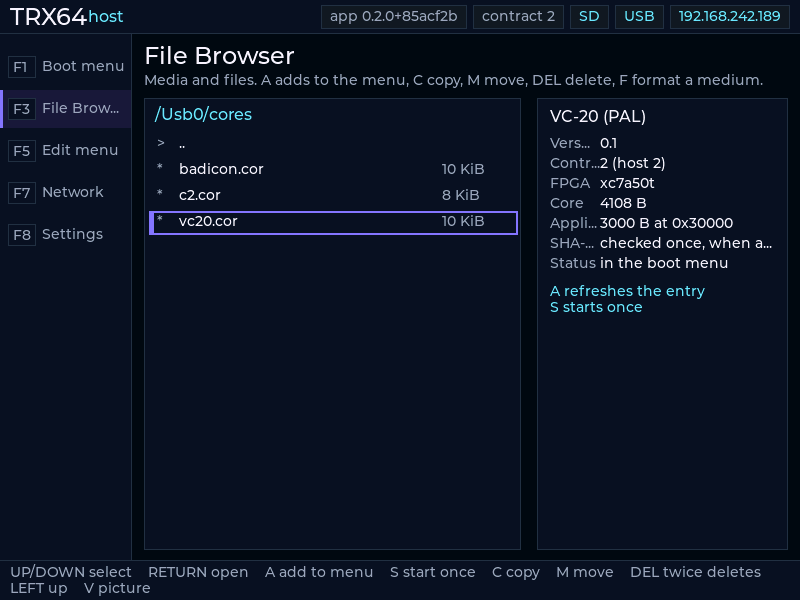
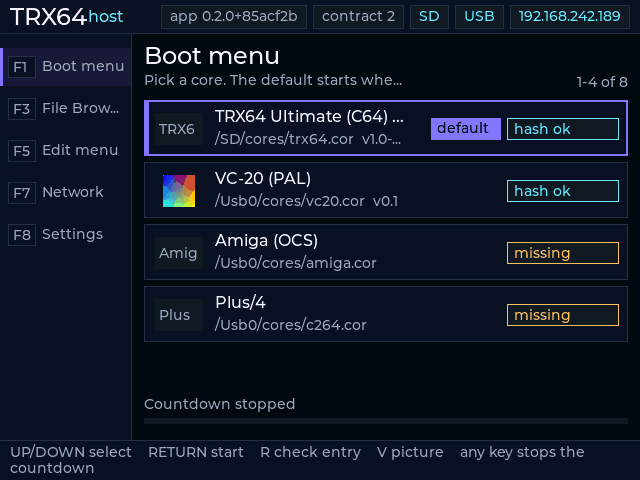
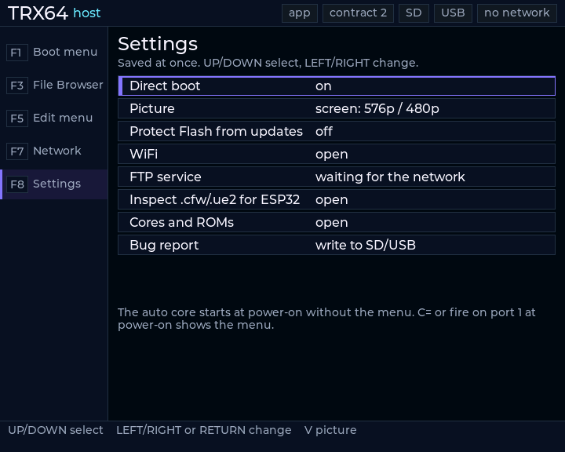

# 4. Boot menu (F1)

## 4.1 General

4.1.1 The host application is the program in the board's flash that runs after power-on. It has five views. Each view has
a key on the C64 keyboard and in the navigation bar on the left of the screen:

| Key | View | Chapter |
|---|---|---|
| **F1** | Boot menu | 4 |
| **F3** | File Browser | 5 |
| **F5** | Edit menu | 6 |
| **F7** | Network | 7 |
| **F8** (**SHIFT** + **F7**) | Settings | 8 |

4.1.2 The footer line names the keys of the selected view. The footer changes with the selection in the File Browser.

4.1.3 The key **V** works in every view. It opens the Picture page (8.4, 4.4.3).

4.1.4 The host application starts without the menu when direct boot is on and an auto core is set (8.2, 4.7). The menu
shows when direct boot is off, when you hold **C=** or the fire button of joystick port 1 during the start, when a core
asks for it, or when the auto core cannot start.

4.1.5 The header shows six chips. Left to right:

| Chip | Meaning |
|---|---|
| `app <version>` | Version of the host application: `0.2.0+<commit>` for a build of `main` (SemVer from the file `VERSION`), `<branch>@<commit>` for a test build, `0.2.0` for a release (T172) |
| `host <8 digits>` | Host key of the running host bitstream. Not shown when the bitstream has none |
| `contract <n>` | Host contract. A `.cor` for another contract does not start (4.3.4) |
| `SD` | Green when an SD card is present |
| `USB` | Green when a USB medium is present |
| `LAN <address>`, `WiFi <address>` or `no network` | The address of the cable (first) or of the WiFi. Green with an address |

## 4.2 Page layout

4.2.1 The page shows as many entries as fit (7 at 960 x 540, 4.10); **+** pages down and **-** pages up through a longer list. The page has the sub line `Pick a core. The auto entry starts when the countdown ends.` The title bar shows the position (`1-5 of 12`) when the list is longer than
the window.

*Figure 4-1. F1 Boot menu with three entries. The countdown runs (`Starting ... in 5 s`).*

4.2.2 Each entry is one line. From the left:

| Part | Content |
|---|---|
| Picture | The 32 x 32 logo of the core. Without a logo: the core's short name (`short` in its `core.toml`, at most 4 characters), else the first four letters and digits of the name, or `FW` for a full firmware |
| Name | The name stored in `boot.cfg` (6.3). A name that does not fit is cut in the middle with `...` |
| `1 config`, `<n> configs` | The core has configs (the **RIGHT** key opens them, 4.11) |
| `auto` | The entry that starts at the end of the countdown and in direct boot. Only that row shows it |
| Pictogram | The state of the file (4.3): a green circle with a check mark, a yellow circle with a question mark, or a red circle with a cross |
| Version | The version of a `.cor` (`0.9.0`, without a leading `v`) or `full firmware`. The pictogram stands directly beside it |

4.2.2a The word of the state of the selected entry (4.3) shows in the status line under the list. The path of an entry shows in
the Edit menu (6.1), not here.

4.2.3 The note line shows the result of the last action. The countdown line and its bar are below it (4.6).

4.2.4 With no entries, the page shows `No cores yet. Press F3, open a folder on SD or USB and press A on a .cor bundle or a .cfw firmware.` (Figure 4-2).

*Figure 4-2. F1 Boot menu with no entry.*

## 4.3 Badges

4.3.1 The state of the file of the entry shows as a pictogram in the row (green: `hash ok`, `ready`, `backup`, `foreign`; yellow: `changed` and `?`, check it with **R**; red: every other badge, including `missing`) and as the word below in the status line. The word is the badge. The host checks the files one entry at a time, in the
background. A badge shows `?` until the host has looked at the entry.

| Badge | Colour | Meaning | Starts |
|---|---|---|---|
| `hash ok` | green | A `.cor` bundle. The file is the one that was checked when it was added | Yes |
| `ready` | green | A full firmware (`.cfw`, `.ue2`, or a large `.cor` made by this project) that the host can start | Yes |
| `backup` | green | A large `.cor` that is a backup of this board's flash | Yes |
| `foreign` | amber | A large `.cor` made on this board from a vendor firmware (13.5) | Yes |
| `changed` | amber | The file differs from the file that was added (size, date or header). The host checks the file during the start | Yes |
| `missing` | amber | The medium or the file is not there | No |
| `unusable` | amber | The host refused the `.cfw` or `.ue2`. The File Browser says why (5.4) | No |
| `contract <n> != <m>` | amber | The `.cor` is for host contract `<n>`. This host has `<m>` | No |
| `other host` | amber | The `.cor` was routed against another host bitstream | No |
| `damaged` | red | The file is not a usable bundle | No |
| `?` | grey | Not looked at yet | Yes |

4.3.2 Press **R** on an entry to run the full check again (4.4.2). A `changed` entry is accepted again by **R**.

4.3.3 An entry that does not start shows the note `this entry cannot be started (see its badge)` when you press
**RETURN**.

4.3.4 A `.cor` of one release fits only the host of that release. Replace such a `.cor` with the file of the matching
release. Remove the old entry (6.2).

4.3.5 The host looks at a `missing` entry again when a medium appears.

## 4.4 Keys

4.4.1 Keys of the Boot menu:

| Key | Action |
|---|---|
| **UP**, **DOWN** | Select an entry |
| **RETURN** | Start the selected entry (4.5) |
| **R** | Check the selected entry again (4.4.2) |
| **RIGHT** | Open the configs of the core (4.11). Only when the core has configs |
| **+**, **-** | One page down, one page up |
| **V** | Open the Picture page (4.4.3) |
| **F3**, **F5**, **F7**, **F8** | Other view |
| Any key | Stops the countdown (4.6) |

4.4.2 **R** reads the whole file, calculates the SHA-256 and stores the size, date and header of the file again in
`boot.cfg`. The result shows in the note line and in the badge.

4.4.3 **V** opens the Picture page (`Settings > Picture`, 8.4) from every view. The page lists `Auto` and the modes that the screen names, each with its refresh rate and the tags `now` and `native`. Browsing applies nothing. **RETURN** on a mode puts it up and starts the question `Keep this picture?`: **RETURN** or any key keeps the mode and stores it as the default, **LEFT** or **ESC** goes back at once, 8 s without a key goes back (8.4.8). **LEFT** or **ESC** closes the page.

## 4.5 Start an entry

4.5.1 To start an entry:

1. Press **UP** or **DOWN** to select the entry.
2. Press **RETURN**.

4.5.2 For a `.cfw` or `.ue2` entry, the host asks `Start full firmware?`. Press **RETURN** to start. Any other key
cancels. A `.cor` and a large `.cor` start without a question.

> **WARNING** A full firmware replaces the host. The way back is to switch the power off and on. The board then starts
> the host again.

4.5.3 The start screen shows five steps with a percentage for the step that runs:

| Step | `.cor` | Full firmware |
|---|---|---|
| 1 | Check the bundle (SHA-256, contract) | Check the firmware image, stage it |
| 2 | Cut off the old core | Bitstream into the flash drive |
| 3 | Core through the ICAP | Check the flash file (one run, equal) |
| 4 | Hand over | Hand over |
| 5 | Jump; the application starts its core | Reload the FPGA; the firmware starts |

*Figure 4-3. Start of a core. Step 1 runs.*

4.5.4 Press **ESC** or **RUN/STOP** to stop the start. A stop works until the jump (step 5). The host does not jump
after a stop.

4.5.5 If a step fails, the screen shows the reason and `Any key returns to the menu.` For an entry that was refused while the host
read the file (missing, changed, damaged), the text adds `Press R on the entry in the menu to check it again.`

4.5.6 Before the handover to a full firmware, the host protects the first 4 MiB of the flash when `Protect Flash from
updates` is on (8.5). If the protection does not take, the start is refused and the text reads `the flash could not be
protected (...); nothing was started`.

## 4.6 Countdown

4.6.1 The countdown starts the auto entry after the delay set in the Settings (8.3). It runs only when:

- direct boot is off, or `boot.cfg` could not be read at the start (4.7),
- autostart is on (the delay is not 0),
- an auto entry is set and its file can be started.

4.6.2 The countdown line shows:

| Text | Meaning |
|---|---|
| `Starting <name> in <n> s` | The countdown runs. The bar shows the time left |
| `Waiting for the auto core's medium` | The auto file is not there yet. The host waits up to 30 s after the start of the application |
| `No countdown` | The countdown has not begun and none is set or no auto entry exists |
| `Countdown stopped` | You pressed a key, or the delay is 0, or no auto entry is set, or the auto entry cannot start, or the host waited 30 s |

4.6.3 Any key in any view stops the countdown. The countdown line and its bar show only while direct boot is off (8.2).

4.6.4 A countdown start has no question. A `.cfw` or `.ue2` auto entry starts without `Start full firmware?`.

## 4.7 Direct boot

4.7.1 With direct boot on (default), the host decides before it builds the menu. It reads `boot.cfg` (it waits up to
1.5 s for the flash disk), then checks in this order. The first rule that applies wins:

| Order | Condition | Result |
|---|---|---|
| 1 | `boot.cfg` cannot be read | Menu with countdown. With **C=** or fire held: menu, no countdown |
| 2 | A core asked for the menu (`Return to host menu`) | Menu, no countdown |
| 3 | **C=** held | Menu, no countdown |
| 4 | Fire on joystick port 1 held | Menu, no countdown |
| 5 | Direct boot is off | Menu with countdown |
| 6 | No auto entry | Menu, no countdown |
| 7 | The auto file is missing | Menu, no countdown |
| 8 | The auto file changed | Menu, no countdown |
| 9 | The auto entry is refused (contract, host, no bundle) | Menu, no countdown |
| 10 | None of the above | The auto entry starts at once |

4.7.2 The menu shows a note for the rules 6 to 9:

| Rule | Note |
|---|---|
| 6 | `No auto core is set` |
| 7 | `Auto core: file missing` |
| 8 | `Auto core: file changed (press R to check it)` |
| 9 | `Auto core: refused (see its badge)` |

The rules 1 to 5 show no note, except the keys of rules 3 and 4 during the staging. If **C=** or fire stops a start during the staging, the note reads `Menu: C= was held` or
`Menu: fire on port 1 was held`. If a direct start fails, the note reads `Direct start failed: <reason>`.

4.7.3 The keys are read for 500 ms from the start of the decision. Hold **C=** or the fire button from power-on. The keys
are read again during the staging up to the jump. A key then stops the start before anything is loaded.

4.7.4 While the host decides, the screen shows the line `Starting <name> - hold C= for the menu` (two lines when the name is long). While the host waits for the medium of the auto file the line reads `Waiting for <medium> - hold C= for the menu`. A direct start
does not start the graphics of the menu. An auto file on SD or USB that is not there yet is waited for up to 30 s
(a USB stick can take that long).

4.7.5 A direct start does not check the file again (SHA-256 and flash compare). It uses the check made when the entry was
added.

## 4.8 Menu picture

4.8.1 The host saves the picture of the settled menu in `/Flash/menu.snap`. At the next start into the menu, it shows the
saved picture at once, while the menu is built. Keys pressed meanwhile are kept and handled in order.

4.8.2 The host saves the picture when all of these are true for 2 s without change:

- the Boot menu is open,
- no countdown runs and the countdown is stopped,
- the note line is empty and no entry is being checked,
- the first entry is at the top and the auto (or the first) entry is selected.

4.8.3 The host shows the saved picture only if it matches the current state: the text of `boot.cfg`, the picture mode and
the build of the host application. Otherwise the host ignores the file. A picture of more than 1 MiB is not saved.
The picture is the 960 x 540 canvas: in the compact modes (4.10) it is not saved, and the first picture at the start is the splash.

4.8.4 The file is not a setting. You can delete it.

## 4.9 What the host does when it starts a core

4.9.1 For a `.cor` the host checks the bundle (SHA-256, contract), switches the old core off, sends the partial bitstream
of the core through the ICAP, hands over and jumps to the application of the core.

4.9.2 For a full firmware the host copies the image into the flash drive area, checks it, hands over and reloads the FPGA.

## 4.10 Compact layout (modes narrower than 960 px)

4.10.1 The menu is a canvas of 960 x 540 pixels. A mode that is 960 or more pixels wide shows it at a whole factor, centred in the mode: factor 2 at
1920 x 1080, factor 1 at 1280 x 720, 1024 x 768 and 1280 x 1024. A mode that is narrower than 960 pixels gets a layout of its own, drawn at the size of
the mode and never cut: **576p** (720 x 576), **480p** (640 x 480) and **800 x 600**. The core menus follow the same rule (11.1.8).

4.10.2 What changes in the compact layout:

| Part | Compact |
|---|---|
| Side bar | Narrower, with shorter names (`File Brow...`) |
| Header | A chip that would run into the title is left out |
| Footer | Two lines where the key list is long. The list of keys is not cut |
| Lists | Boot menu 6 entries (480p), 7 (576p) or 9 (800 x 600), 7 at 960 x 540; File Browser 11, 13 or 15 rows, 13 at 960 x 540. Long names are cut in the middle |
| File Browser | The list and the panel have half of the width each. A long value ends in dots |
| Pages (start, question, rename) | Centred in the mode |

4.10.3 Pick a mode on the Picture page (4.4.3). The host draws the menu again for the new mode; the selection, the open page and the note stay.

*Figure 4-4. F1 Boot menu at 800 x 600. The list holds six entries; the first name is cut with dots.*

*Figure 4-5. F3 File Browser at 800 x 600. The footer has two lines.*

*Figure 4-6. F1 Boot menu at 480p. The footer wraps at the key `any key stops the countdown`.*

*Figure 4-7. F8 Settings at 576p (720 x 576). A name or a value that does not fit ends in dots.*

## 4.11 Configs of a core

4.11.1 A core can have configs: files `<core folder>/configs/<name>.cfg` (the old media sets `<core folder>/media/<name>.mnt` count too). A name has 1 to 32 characters and no `/ \ : * ? " < > |`, no leading dot and no trailing blank. A core has up to 16 configs. A row that has configs shows `1 config` or `<n> configs`.

4.11.2 Press **RIGHT** on a row of the Boot menu, or on a `.cor` in the File Browser, to open the list `<name> - start with`. The first row is `Plain start`; the cursor opens on the auto config of the entry, else on `Plain start`. Without configs nothing happens.

| Key | Action |
|---|---|
| **UP**, **DOWN** | Pick a row |
| **RETURN** | Start the core with the config (`Plain start`: without) |
| **D** | Make the config the auto config of the entry. **D** again clears it. The countdown and direct boot use it. Not for a core that is not in the menu |
| **R** | Rename the config |
| **DEL**, **DEL** | Delete the config file |
| **LEFT**, **ESC** | Close the list |

4.11.3 The Edit menu shows the auto config (6.1.3) and sets it with **LEFT** and **RIGHT** (6.2).
