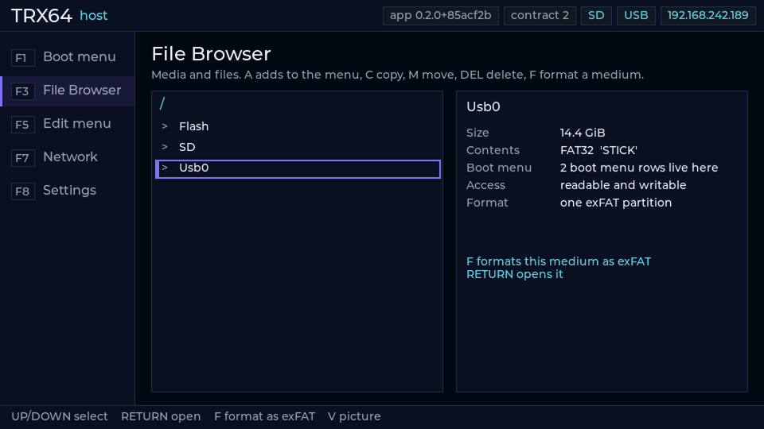
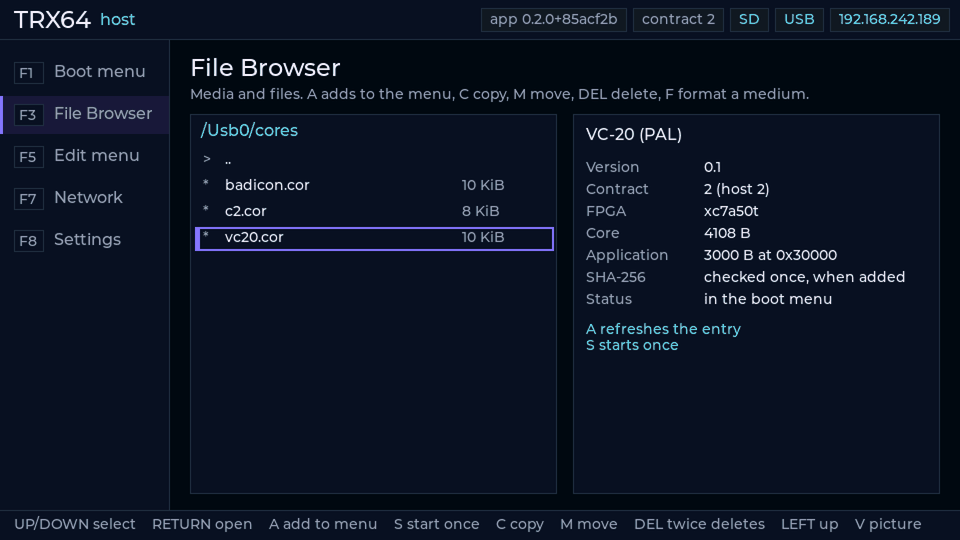
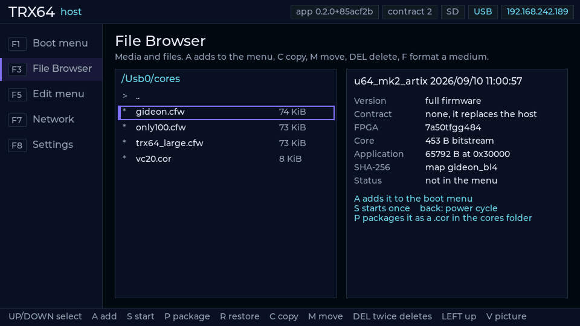
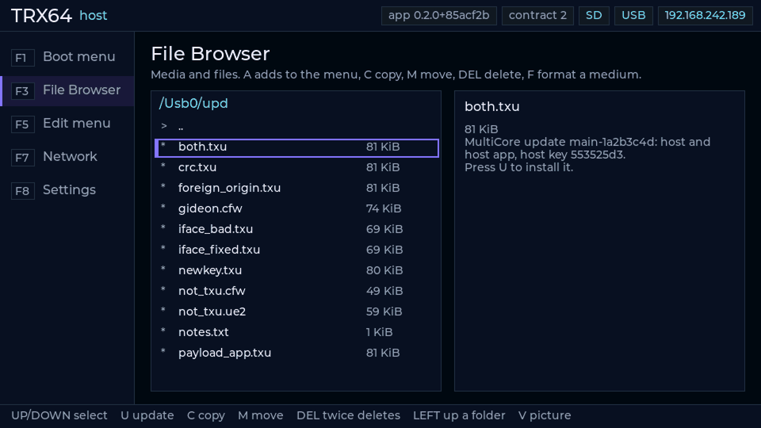
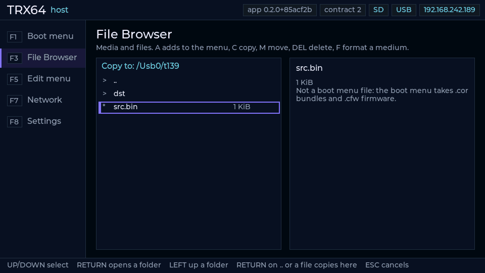
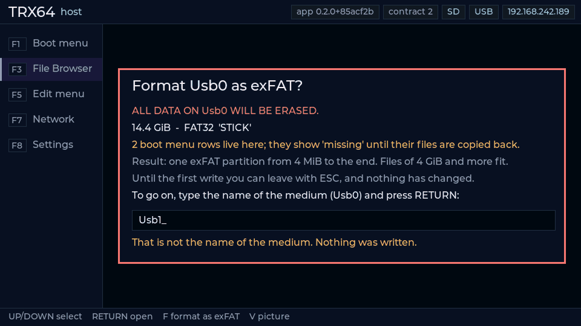
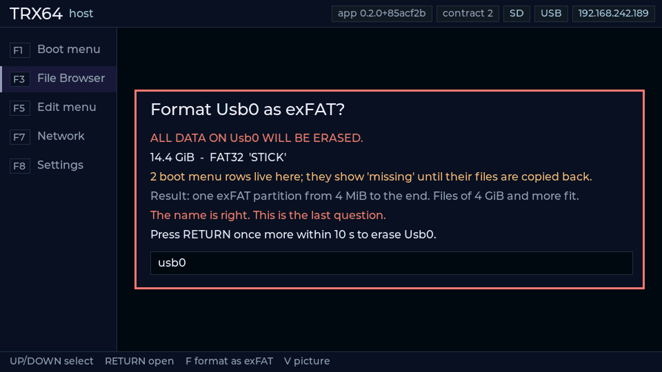

# 5. File Browser (F3)

## 5.1 General

5.1.1 The File Browser shows the media and the files on them. It adds `.cor` bundles and full firmwares to the boot menu,
starts them once, copies, moves and deletes files, formats a medium, and starts the update (U), the restore (R) and the
package (P) functions (chapter 9).

5.1.2 The page has two panels. The left panel shows the path and the list: folders first, then files, each sorted as the
file system returns them. A folder has the mark `>`. A file has the mark `*` and its size. The first entry of a folder is
`..` (one folder up). The list holds up to 200 entries. The right panel shows facts about the selected entry (5.3).

5.1.3 The first level (path `/`) lists the media that the host has mounted, for example `SD`, `Flash`, `Usb0`. Open a medium
with **RETURN**.

5.1.4 The File Browser lists every file. Only `.cor`, `.cfw` and `.ue2` files can be added to the boot menu or started.

*Figure 5-1. F3 File Browser, first level. The panel shows the medium `Usb0`.*

## 5.2 Keys

5.2.1 Keys that work on every selection:

| Key | Action |
|---|---|
| **UP**, **DOWN** | Select |
| **RETURN** | Open the selected folder or medium |
| **LEFT** | One folder up. No action at `/` |
| **V** | Next HDMI mode (4.4.3) |

5.2.2 Keys that depend on the selection:

| Key | Selection | Action |
|---|---|---|
| **A** | `.cor`, `.cfw`, `.ue2` | Add the file to the boot menu (5.4) |
| **S** | `.cor`, `.cfw`, `.ue2` | Start the file once, without adding it (5.5) |
| **C** | A file | Copy (5.6) |
| **M** | A file | Move (5.6) |
| **DEL**, **DEL** | A file, or an empty folder | Delete (5.7) |
| **F** | A medium (first level) | Format as exFAT (5.8) |
| **P** | `.cfw`, `.ue2` | Package as a `.cor` (9.5) |
| **R** | `.cfw`, `.ue2`, a backup `.cor` | Restore the firmware of the board (9.4) |
| **U** | `.txu` | Update the host (9.3) |

5.2.3 The footer line shows the keys that work for the selection:

| Selection | Footer |
|---|---|
| A medium | `RETURN open    F format as exFAT` |
| A folder | `RETURN open folder    DEL twice deletes an empty folder    LEFT up a folder` |
| A `.cor` | `A add to menu    S start once    C copy    M move    DEL twice deletes    LEFT up` |
| A `.cfw` or `.ue2` | `A add    S start    P package    R restore    C copy    M move    DEL twice deletes    LEFT up` |
| A backup `.cor` | `A add    S start    R restore    C copy    M move    DEL twice deletes    LEFT up` |
| A `.txu` | `U update    C copy    M move    DEL twice deletes    LEFT up a folder` |
| Another file | `RETURN open folder    C copy    M move    DEL twice deletes    LEFT up a folder` |

## 5.3 Right panel

5.3.1 For a `.cor` bundle the panel shows the manifest of the bundle:

| Item | Content |
|---|---|
| Title | Name of the core |
| Version | Version of the core |
| Contract | Host contract of the bundle, then `(host <n>)` for the host contract. With a host key: the host key of the bundle |
| FPGA | FPGA part of the bundle (`xc7a50t`) |
| Core | Size of the partial bitstream |
| Application | Size of the core application and the load address |
| SHA-256 | `checked once, when added` |
| Status | `in the boot menu` or `not in the menu` |

The panel then shows `A adds it to the boot menu` (or `A refreshes the entry`) and `S starts once`.

*Figure 5-2. F3 File Browser with a `.cor` selected.*

5.3.2 A bundle for another host contract or another host bitstream shows its manifest. The panel then replaces the last
lines with the reason, for example `Built for host contract 1; this host has 2. Cannot be added.` or `Routed against host <key>;
this host is <key>. Cannot be added.`. **A** and **S** refuse it.

5.3.3 A file that is not a usable bundle shows `Not a usable bundle` and the reason.

5.3.4 For a `.cfw`, `.ue2` or a large `.cor` the panel shows:

| Item | Content |
|---|---|
| Title | Name inside the firmware image |
| Version | `full firmware`, `packaged firmware` or `backup of this board` |
| Contract | `none, it replaces the host` |
| FPGA | Part of the firmware image |
| Core | Size of the bitstream |
| Application | Size and load address of the application |
| SHA-256 | The bitstream map: `map identity` or `map gideon_bl4` (the row label stays `SHA-256`) |
| Status | `in the boot menu` or `not in the menu` |

The panel then shows `A adds it to the boot menu`, `S starts once    back: power cycle` and, for a `.cfw` or `.ue2`,
`P packages it as a .cor in the cores folder`. A file that is not a usable firmware shows `Not a usable firmware image` and the reason.

*Figure 5-3. F3 File Browser with a `.cfw` selected. The footer shows A, S, P and R.*

5.3.5 For other files the panel shows the size and a text:

| File | Text |
|---|---|
| `.txu` | `MultiCore update <version>: host, host app, or host and host app` and `Press U to install it.` For an update with a host: the host key. A file that is not usable: `Not a usable update: <reason>.` |
| Another file | `Not a boot menu file: the boot menu takes .cor bundles and .cfw firmware.` |
| A folder, or no file | `Select a .cor bundle or a .cfw firmware to see its manifest.` |

*Figure 5-3a. F3 File Browser with a `.txu` selected. The footer shows `U update`. The other files in the folder are test files.*

5.3.6 For a medium the panel shows:

| Item | Content |
|---|---|
| Size | Size of the medium |
| Contents | File system and volume label, or `no volume` |
| Boot menu | The number of boot menu rows with a file on this medium |
| Access | `readable and writable` |
| Format | `one exFAT partition` (the medium can be formatted), `never (internal drive)` for `Flash`, or the reason why the medium cannot be formatted |

## 5.4 Add to the boot menu

5.4.1 To add a file:

1. Open the folder with the file.
2. Select the file.
3. Press **A**.

5.4.2 For a `.cor` the host reads the whole file and calculates the SHA-256 of each part. The note line shows
`checking the bundle (SHA-256)...`. At the end it shows `<name> is in the boot menu`. The host stores the name, path, SHA-256,
size, date and header of the file in `boot.cfg`. The first entry becomes the default entry.

5.4.3 For a large `.cor` the host runs the same check. For a `.cfw` or `.ue2` the host checks the image and stores size and
date. The host compares the bitstream with the flash file at every start.

5.4.4 If the file is already in the menu, **A** refreshes the entry.

5.4.5 Refusals in the note line:

| Note | Cause |
|---|---|
| `refused: built for another host contract` | The contract of the `.cor` differs from the contract of the host |
| `refused: routed against host <key>, this host is <key>` | The `.cor` was built for another host bitstream |
| `refused: not a usable bundle` | The file is damaged or not a bundle |
| `refused: <reason>` | The firmware image is not usable, or a large `.cor` failed the check |
| `cannot add: the menu is full or the name has a '|'` | The menu holds 16 entries, or the name has the character `\|` |

## 5.5 Start once

5.5.1 Press **S** on a `.cor`, `.cfw`, `.ue2` or large `.cor`. The host starts the file without adding it. The start runs
as in 4.5. A `.cfw` or `.ue2` asks `Start full firmware?` first. A refused file shows its reason in the note line.

## 5.6 Copy and move

5.6.1 The host copies and moves files. It does not copy or move folders.

5.6.2 To copy or move a file:

1. Select the file.
2. Press **C** (copy) or **M** (move). The path line shows `Copy to: <folder>` or `Move to: <folder>`. The footer shows the keys of the
   target pick.
3. Select the target medium and folder: **RIGHT** opens a folder, **LEFT** goes up. At the first level, open a medium
   with **RIGHT** first.
4. Press **RETURN** in the target folder.

5.6.3 Keys in the target pick:

| Key | Action |
|---|---|
| **UP**, **DOWN** | Select |
| **RIGHT** | Open the selected folder |
| **LEFT** | One folder up |
| **RETURN** | Copy or move into the folder shown in the path line |
| **ESC**, **RUN/STOP** | Cancel. Nothing changes |

*Figure 5-4. Target pick for a copy. The path line shows `Copy to: /Usb0/t139`.*

5.6.4 The host writes the data to `<name>.part`, reads it back, compares the SHA-256 of both files, and renames the file.
The note line shows `Copying <name>: <n>%    ESC cancels` and then `Reading back <name>: <n>%    ESC cancels`. A move to the same medium renames the file. A move to
another medium copies the file as above, then deletes the original.

> **NOTE** The percent sign shows twice (`39%%`). This is a known defect of the display. The copy is not affected.

5.6.5 Results in the note line:

| Note | Meaning |
|---|---|
| `Copied <name> to <folder> (read back, SHA-256 equal)` | Done |
| `Moved <name> to <folder>` | Done |
| `Moved <name> to <folder>. <n> menu entr(y/ies) now point(s) at a file that is not there.` | A move of a file that boot menu entries use. Add the file again in the new folder |
| `<name> is already in <folder>. RETURN replaces it, any other key cancels.` | A file of that name exists. **RETURN** replaces it. The new file is written and checked first |
| `Not replaced. Nothing was changed.` | You cancelled the replace question |
| `Cancelled. The source is untouched; no half copy is left.` | You pressed **ESC** while the host wrote |
| `No room for <name>: <free> free, <needed> needed. Nothing was written.` | The target medium is too small |

5.6.6 Other refusals: `source and target are the same file`, `the target is not a folder`, `cannot read the source`,
`cannot write the target`, `the copy does not read back equal`, `copied, but the original could not be removed` (a move: both
files exist), `the file system refused`.

5.6.7 `Flash:/boot.cfg` is the boot menu. The host does not copy, move or delete it here. The note reads
`Flash:/boot.cfg is the boot menu itself and is not copied or moved here`.

## 5.7 Delete

5.7.1 To delete a file or an empty folder:

1. Select the file or folder.
2. Press **DEL**. The note line shows `DEL again deletes <name>. Any other key cancels.`
3. Press **DEL** again.

5.7.2 If boot menu entries use the file, the question names them: `Menu entry <name> points at this file.` or
`<n> menu entries point at this file (<name>, ...).` After the delete, these entries show `missing`.

5.7.3 The host deletes only empty folders. A folder with content shows `The folder is not empty: only empty folders are deleted`.

5.7.4 Any other key between the two **DEL** keys cancels the question.

## 5.8 Format a medium

5.8.1 The format erases a medium and writes one exFAT partition. It works on SD cards and USB media. It does not work on
`Flash` (the note reads `<name> is the internal drive and is never formatted from here`).

> **WARNING** The format erases all data on the medium. Files of the boot menu on this medium show `missing`
> afterwards. Copy the cores back to make them start again.

5.8.2 The host refuses a medium that is not present (`no medium in <name>`), write protected, smaller than 64 MiB, larger
than 2 TiB, or without 512-byte sectors. The note reads `cannot format <name>: <reason>`.

5.8.3 To format a medium:

1. Go to the first level (path `/`). Select the medium.
2. Press **F**. The red page `Format <name> as exFAT?` shows the size, the file system, the number of boot menu rows on the medium
   and the result: `one exFAT partition from 4 MiB to the end`.
3. Type the name of the medium as the list shows it (for example `Usb0`). Letter case does not matter.
4. Press **RETURN**. A wrong name shows `That is not the name of the medium. Nothing was written.`
5. The page shows `The name is right. This is the last question.` Press **RETURN** again within 10 s. The second **RETURN**
   counts only 1 s after the first.

*Figure 5-5. Format, first question. The medium name typed here is wrong (`Usb1`); the page says so and writes nothing.*

*Figure 5-6. Format, last question. The page shows the seconds that remain.*

5.8.4 Any other key at the last question cancels the format. The format also stops when you press **ESC** or **RUN/STOP**
while you type, when you press no key for 60 s, or when you remove the medium. The note reads
`format of <name> cancelled, nothing was written`.

5.8.5 The page shows the progress (steps, bytes written) and `Do not remove the medium.` **ESC** or **RUN/STOP** cancels until the partition
table is written. Then the medium is blank. When the table is written, the format cannot be stopped.

5.8.6 The result page shows `<name> is formatted` with the size, the file system and the free space, or the reason for a
refusal or failure. Press any key to return.

5.8.7 The cluster size follows the size of the medium: 4 KiB up to 256 MiB, 32 KiB up to 32 GiB, 128 KiB above.

## 5.9 Notes

5.9.1 The list holds 200 entries. A folder with more files shows the first 200.

5.9.2 While a copy, a format, a package, a restore or an update runs, the host reads no key except the stop keys named on the page.
