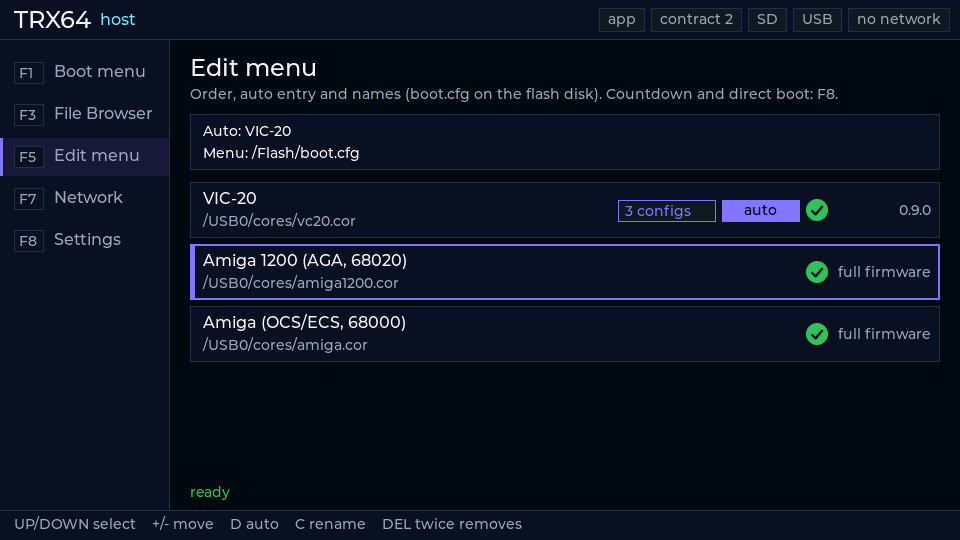
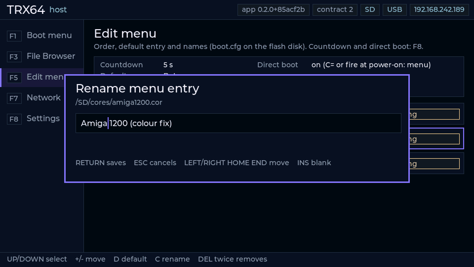

# 6. Edit menu (F5)

## 6.1 General

6.1.1 The Edit menu changes the order, the auto entry and the names of the boot menu entries, and removes entries. The
host writes every change to `Flash:/boot.cfg` at once.

6.1.2 The page does not change the countdown or direct boot. These are on the Settings page (8.2, 8.3).

6.1.3 The page shows an info box of two lines and the list of the entries. The title bar shows the position (`1-5 of 12`) when the
list is longer than the window. Each entry shows its name, under it its path, and at the right the `N configs` and `auto`
markers, the pictogram of its state (4.3) and its version (without a leading `v`), the pictogram directly beside the version. The word of the
state of the selected entry shows in the status line.

| Info line | Content |
|---|---|
| `Auto: <core> (<config>)` | The auto entry and its auto config. Without a config: `Auto: <core>`. Without an auto entry: `Auto: (none)` |
| `Menu: /Flash/boot.cfg` | The file of the menu |

*Figure 6-1. F5 Edit menu.*

## 6.2 Keys

| Key | Action |
|---|---|
| **UP**, **DOWN** | Select an entry |
| **+** (or **=**) | Move the entry up one place |
| **-** | Move the entry down one place |
| **D** | Make the selected entry the auto entry |
| **C** | Rename the entry (6.3) |
| **DEL**, **DEL** | Remove the entry from the menu (6.4) |
| **V** | Next HDMI mode (4.4.3) |

6.2.1 A moved auto entry stays the auto entry.

6.2.2 The first entry that is added to an empty menu becomes the auto entry.

## 6.3 Rename an entry

6.3.1 To rename an entry:

1. Select the entry.
2. Press **C**. The page `Rename menu entry` opens. It shows the path of the entry and the name in an input field.
3. Edit the name. Press **RETURN** to save, or **ESC** or **RUN/STOP** to cancel.

*Figure 6-2. Rename of the entry `Amiga 1200 (colour fix)`.*

6.3.2 Keys in the input field:

| Key | Action |
|---|---|
| A character (letters, digits, signs) | Insert at the cursor. The character `\|` is not accepted |
| **LEFT**, **RIGHT** | Move the cursor |
| **HOME** or **UP** | Cursor to the start |
| **END** or **DOWN** | Cursor to the end |
| **DEL** (C64 key) | Delete the character before the cursor |
| **DELETE** (USB keyboard) | Delete the character at the cursor |
| **INS** (**SHIFT** + **DEL**) | Insert a blank at the cursor |
| **CLR** (**SHIFT** + **CLR/HOME**) | Clear the field |
| **RETURN** | Save |
| **ESC**, **RUN/STOP** | Cancel. The note reads `Name unchanged` |

6.3.3 The name holds up to 47 characters. A blank name is refused (`A name cannot be empty.`). The name cannot hold the character `|`
(`That name cannot be used`).

6.3.4 After the save the host reads `boot.cfg` back. The note reads `Renamed to <name> (boot.cfg read back)`. If the
file does not hold the name, the note reads `Renamed to <name>, but boot.cfg does not hold it`.

6.3.5 The rename changes the name in the menu only. The file and the name inside the bundle stay as they are.

## 6.4 Remove an entry

6.4.1 To remove an entry:

1. Select the entry.
2. Press **DEL**. The note reads `DEL again to remove <name> (any other key cancels)`.
3. Press **DEL** again.

6.4.2 Any other key cancels the question.

6.4.3 The remove changes `boot.cfg` only. The file stays on the medium. Add it again in the File Browser (5.4).

6.4.4 If the removed entry was the auto entry, the first entry of the menu becomes the auto entry. If the menu is then
empty, no auto entry is set.

## 6.5 Notes

6.5.1 The menu holds up to 16 entries.

6.5.2 `Flash:/boot.cfg` can be edited over FTP (7.2). The host reads the file once at the start. A change over FTP while the
host application runs shows after the next start.
