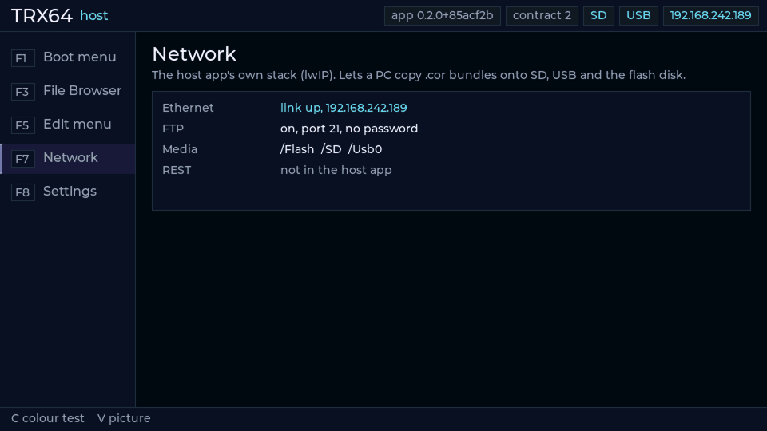

# 7. Network, web page and colour test (F7)

## 7.1 Network page

7.1.1 The Network page shows the state of the Ethernet link and the services of the host application. The services run in
the host application only. A core has its own network functions.

| Row | Content |
|---|---|
| Ethernet | `link up, <address>` (green), or `no link or no address yet` (amber) |
| FTP | `on, port 21, no password`, or `waiting for the network` |
| Media | The media that the host has mounted, for example `/SD  /Flash  /Usb0`, or `(none)` |
| REST | `on, port 80, token required` (or `... token required, none granted yet`), `waiting for the network`, or `off` |

*Figure 7-1. F7 Network with the link up. The footer shows `C colour test` and `V picture`.*

7.1.2 The footer shows the keys of the page:

| Key | Action |
|---|---|
| **C** | Open the colour test (7.5) |
| **V** | Next HDMI mode (4.4.3) |

7.1.3 The address shows on this page and in the header chip.

> **WARNING** FTP, the web page and the JSON status ask for no password. Use them in a network that you trust only.

## 7.2 FTP

7.2.1 The FTP server runs on port 21 when the network is up. It gives access to the media that the Network page lists.

7.2.2 Use FTP to copy `.cor` bundles, `.cfw` and `.ue2` files and `.txu` update files to a medium, and to read or write `Flash:/boot.cfg`.
Then add the file to the boot menu in the File Browser (5.4) or start it from the web page (7.3).

7.2.3 The host application reads `boot.cfg` once at the start. A change over FTP while the host application runs shows after the next
start.

## 7.3 Web page

7.3.1 With an address, the host serves a web page on port 80. Open `http://<address>/` in a browser. Any path that is not a
`/v1/` route shows the page. If port 80 is not free, the host tries again.

7.3.2 The page has these parts:

| Part | Content |
|---|---|
| Header | Build of the host application, host key, address |
| Boot menu | One row per entry with name, path and state. The button `start` starts the entry (for a startable entry). The button `remove` removes the entry. A field `countdown` and the button `set` set the countdown |
| Picture | One list (`from the screen` and the HDMI modes that the screen names) and the button `apply`. A change goes back after 8 s unless a key is pressed on the host (8.4.8) |
| Media | `USB`, `SD` and the media text |
| Also | A link to `/v1/status` |

7.3.3 The page cannot add an entry and cannot make an entry the default entry. It cannot format, copy or update.

7.3.4 After a command the page shows `accepted - the menu applies it in a moment`. The host applies the command when the
menu is idle. During a format, a copy, a package, a restore or an update, the host answers `busy` and drops the command.

7.3.5 A start from the web page has no question and no countdown. A `.cfw` or `.ue2` entry starts without `Start full firmware?`.

> **WARNING** A start of a full firmware from the web page replaces the host at once. The way back is a power cycle.

## 7.4 JSON routes

7.4.1 The host answers these routes. A POST takes the fields in the body or in the query string.

| Route | Method | Fields | Effect |
|---|---|---|---|
| `/v1/status` | GET | none | The state as JSON: app, host key, network, address, picture (the mode that is up, the stored default, the list of the modes the screen names), media, countdown, default, note, and the menu with name, path, state, startable |
| `/v1/report` | GET | none | The text of the bug report (10.4) |
| `/v1/video` | POST | `hdmi` -1 to 5 | Set the picture. -1 is `from the screen`. A mode that the screen does not name is refused. A change goes back after 8 s unless a key is pressed on the host (8.4.8); the answer says so |
| `/v1/boot` | POST | `index` | Start the entry |
| `/v1/menu/remove` | POST | `index` | Remove the entry |
| `/v1/default` | POST | `index` | Make the entry the default entry |
| `/v1/countdown` | POST | `seconds` 0 to 60 | Set the countdown. 0 switches autostart off |

7.4.2 Answers of a POST:

| Code | Meaning |
|---|---|
| 200 | The page, with the note `accepted - the menu applies it in a moment` |
| 400 | A field is missing or out of range (`{"error":400}`) |
| 409 | `/v1/boot`: the entry is in the menu but cannot be started (`{"error":409}`) |
| 404 | Unknown route |

7.4.3 The HDMI modes in `hdmi`: 0 `576p / 480p`, 1 `1280 x 720`, 2 `1920 x 1080`, 3 `800 x 600`, 4 `1024 x 768`, 5 `1280 x 1024`.

## 7.5 Colour test

7.5.1 The colour test shows the colours that the host draws, to check the HDMI path and the screen. Press **C** on the Network page to
open it. The page shows 19 colour fields with their RGB values.

> **NOTE** Known defect (open in the code of 2026-11-02): the colour page does not appear on the screen after **C**. The host enters the
> page (`view = V_COLORS`) but does not show its layer, so the screen stays on the Network page, and the patterns of 7.5.2 stay hidden.
> **ESC** or **RETURN** leaves the page. The text below describes what the code draws.

7.5.2 Keys:

| Key | Action |
|---|---|
| **R**, **G**, **B**, **K** | Full screen red, green, blue, black |
| **H** | Full screen of horizontal red lines (one line in two) |
| **P** | Write the state of the two screen buffers to the serial console |
| **x** | Use one screen buffer |
| **X** (**SHIFT** + **X**) | Use two screen buffers |
| **ESC**, **RUN/STOP**, **RETURN** | Back to the Network page. The full screen pattern ends |
| **F1** to **F8** | Other view |

7.5.3 A pattern stays until you press another key of the table. A key repeat does not end the page.

> **NOTE** The key **V** does not show the pattern of vertical lines. **V** steps the HDMI mode in every view (4.4.3), and the
> host takes the key before the colour test sees it. This is a known defect.

> **NOTE** The keys **P**, **x** and **X** are for service. They change nothing that is stored.
