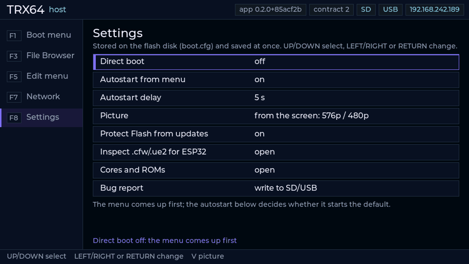
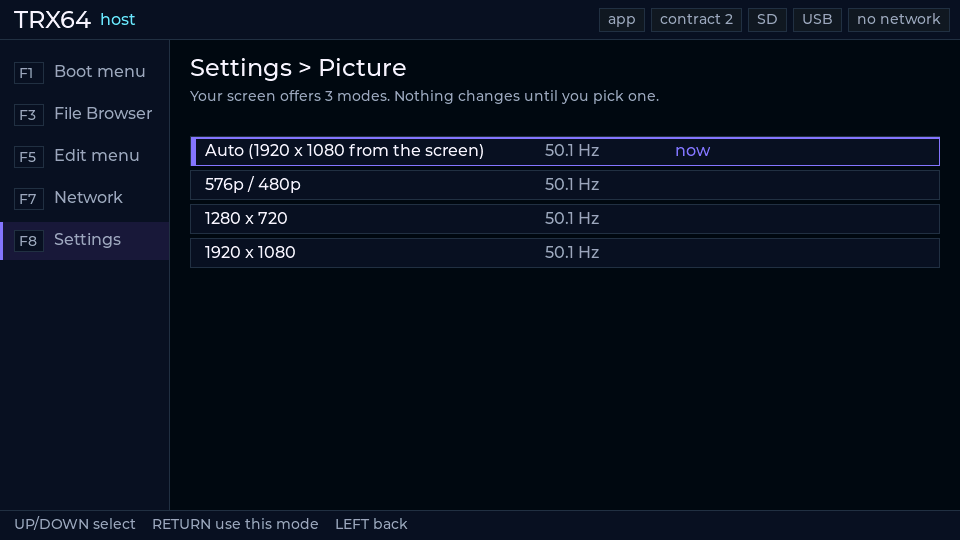
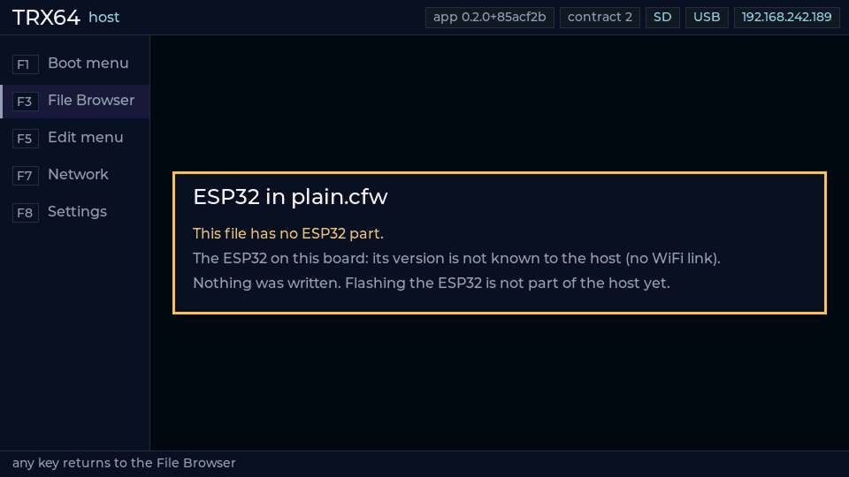
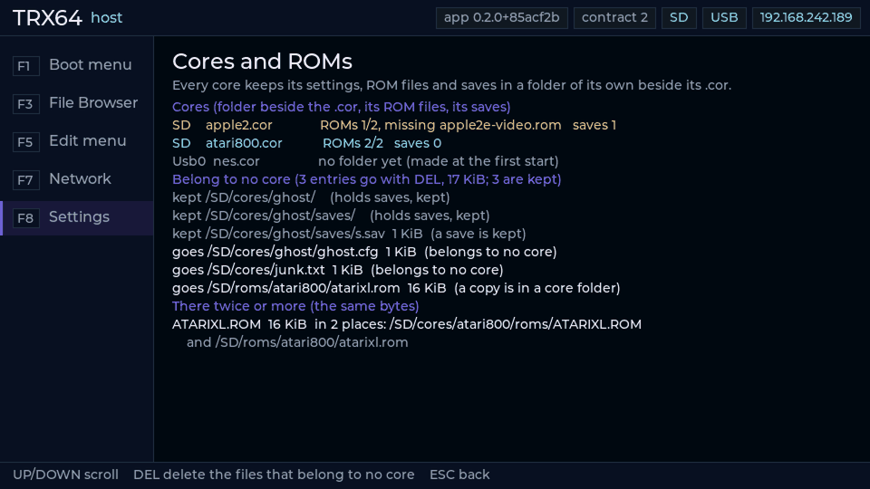
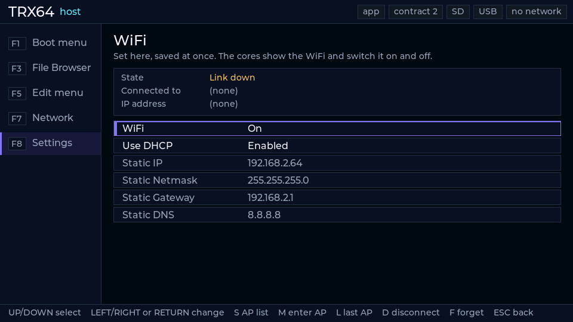

# 8. Settings (F8)

## 8.1 General

8.1.1 The Settings page sets direct boot, the autostart, the picture, the flash protection and the FTP service. It opens the pages `WiFi`, `Inspect
.cfw/.ue2 for ESP32` and `Cores and ROMs`, and writes the bug report.

8.1.2 On the C64 keyboard, **F8** is **SHIFT** + **F7**.

8.1.3 The page shows one row per setting: name and value. A help text for the selected row is at the bottom of the page.
The host applies every change at once. The note line shows the result.

8.1.4 Keys:

| Key | Action |
|---|---|
| **UP**, **DOWN** | Select a row |
| **LEFT**, **RIGHT**, **RETURN**, **SPACE** | Change the value. On the rows `WiFi`, `Inspect .cfw/.ue2 for ESP32`, `Cores and ROMs` and `Bug report` only **RIGHT**, **RETURN** and **SPACE** act. On `Picture` only **RETURN** acts: it opens the Picture page |
| **V** | Open the Picture page (4.4.3) |

*Figure 8-1. F8 Settings with direct boot on. The row `Protect Flash from updates` exists only in a build with the flash lock.*

8.1.5 Rows:

| Row | Values | Default | Effect |
|---|---|---|---|
| `Direct boot` | `on`, `off` | `on` | 8.2 |
| `Autostart from menu` | `on`, `off` | `on` | 8.3. Shown only with direct boot `off` |
| `Autostart delay` | `1 s` to `60 s` | `5 s` | 8.3. Shown only with direct boot `off` and autostart `on` |
| `Picture` | `from the screen: <mode>` or a mode that the screen names; **RETURN** opens the Picture page | `from the screen` | 8.4 |
| `Protect Flash from updates` | `on`, `off` | `off` | 8.5 |
| `WiFi` | `open` | none | 8.10 |
| `FTP service` | the state of the FTP row of the Network page (`on, port 21, no password`, `waiting for the network`, `off`); every change key toggles it. The note reads `FTP service on` or `FTP service off` | on | 7.2 |
| `Inspect .cfw/.ue2 for ESP32` | `open` | none | 8.6 |
| `Cores and ROMs` | `open` | none | 8.7 |
| `Bug report` | `write to SD/USB`, or the name of the last report file | none | 8.8 |

8.1.6 The host stores the settings of 8.2 and 8.3 in `Flash:/boot.cfg` (8.9). It stores `Picture` (8.4), `Protect Flash from updates` and `FTP service` in its own
settings store, `Flash:/trx/host.cfg`, not in `boot.cfg`.

*Figure 8-2. F8 Settings with direct boot off. The rows for the autostart show.*

## 8.2 Direct boot

8.2.1 With direct boot `on`, the host starts the default core at power-on without the menu. Hold **C=** or the fire button of
joystick port 1 during the start to get the menu. The rules of the decision are in 4.7.

8.2.2 With direct boot `off`, the menu comes up first. The autostart (8.3) decides whether the menu starts the default core.

8.2.3 The note reads `Direct boot on: the auto core starts at power-on` or `Direct boot off: the menu comes up first`.

8.2.4 A core can ask for the menu with `Return to host menu`. The menu then shows, whatever the setting is.

## 8.3 Autostart from menu and delay

8.3.1 The autostart starts the default entry when the countdown ends (4.6). The rows exist only while direct boot is `off`.

8.3.2 `Autostart from menu`: `on` runs the countdown, `off` waits for a key. The note reads `Autostart on` or `Autostart off: the menu waits for a key`.

8.3.3 `Autostart delay`: **LEFT** and **RIGHT** change the delay by 1 s. The range is 1 s to 60 s. The default is 5 s. To
switch the countdown off, set `Autostart from menu` to `off`.

8.3.4 The host keeps the last delay when the autostart is `off`. It uses it when the autostart is `on` again.

## 8.4 Picture

8.4.1 The row `Picture` is the host's default picture. The host puts it up on its own screen, stores it in `Flash:/trx/host.cfg` (section
`[Video]`, items `Mode` and `System`) and hands it to the core it starts. The note reads `Picture: <mode> (saved)`.

8.4.2 The row lists only the modes that the screen names in its EDID (the screen's own list of the modes it takes). A mode that the screen
does not name is neither listed nor applied: the Picture page does not list it, and the web page and the REST route refuse it. The
possible modes are, in this order:

| Mode | Name on the page |
|---|---|
| 0 | `576p / 480p` |
| 1 | `1280 x 720` |
| 2 | `1920 x 1080` |
| 3 | `800 x 600` |
| 4 | `1024 x 768` |
| 5 | `1280 x 1024` |

8.4.3 **RETURN** on the row `Picture` (or **V**) opens the page `Settings > Picture`. The first row is `Auto (<mode> from the screen)`: the host selects the best mode of the screen: `1920 x 1080`, else `1280 x 720`, else `576p / 480p`, else a PC mode (`1024 x 768` first). The other rows are the modes that the screen names, each with its refresh rate (`50.1 Hz`) and the tags `now` (the mode that is chosen) and `native`. The line under the title reads `Your screen offers <n> modes. Nothing changes until you pick one.` **UP**, **DOWN** select and apply nothing. **RETURN** or **SPACE** uses the mode under the cursor and asks as in 8.4.8. **LEFT** or **ESC** closes the page. The row `Picture` shows the mode, or `from the screen: <mode>`.

*Figure 8-2a. Settings > Picture (the same page opens with V from every view).*

8.4.4 There is no choice of 50 Hz or 60 Hz. The host uses 50 Hz modes (PAL). Only when the screen names no 50 Hz mode does the host use
the 60 Hz modes of the screen, without a message. A host that started with a `video=` line in `boot.cfg` keeps the system of that
line (8.9.5).

8.4.5 If the screen gives no EDID or an EDID with errors (wrong header or a block whose checksum is wrong), the host lists `576p / 480p`, `1280 x 720` and `1920 x 1080` and
selects `576p / 480p`. The same list and choice apply to a good EDID with a CEA block that names none of the six modes. A good EDID
without a CEA block (a DVI screen) lists the PC modes that its EDID names (`800 x 600`, `1024 x 768`, `1280 x 1024`), or only `1024 x 768` if it names none.

8.4.6 When the stored mode is not in the list of the screen, the host keeps the stored mode, shows `<mode> (not offered, <mode> up)`
and puts up the best mode of the screen. When a screen that names the stored mode is connected, the host puts it up again.

8.4.7 The host checks the HDMI plug and the EDID about every 500 ms, and only while the plug is in and no `Keep this picture?` question is open. If the mode that is up is not in the list of a new screen, the host
puts up the stored mode if the screen names it, else the best mode. It does this once for each EDID. The note reads `The screen
changed: Picture <mode>`.

8.4.8 A change from the Picture page or the web page is not final at once. A box `Keep this picture?` shows the mode, `In <n> s <mode> comes back.` and `RETURN keeps it      LEFT or ESC goes back now`. Any key but **LEFT** and **ESC** keeps the mode and stores it; the key does nothing else. **LEFT** or **ESC** goes back at once. If no key is pressed for 8 s, the host goes back to the last mode that was kept, and stores nothing. The question
exists only on a host that drives the mode itself; on an older host the host stores the change at once.

> **CAUTION** A core starts in the stored mode, or in the best mode of the screen when the choice is `from the screen`. If the screen cannot take the mode, the
> core's picture stays black: return to the host menu (3.7) or switch the power off and on, and select another mode with **V** (the page opens at once). A mode that
> you change in the menu of a core (`Picture`) is asked for 8 s as in 8.4.8 (11.1.8).

## 8.5 Protect Flash from updates

8.5.1 The setting protects the first 4 MiB of the flash (`0x000000` to `0x3FFFFF`: the host and the host application) against
writes while a full firmware runs. The default is `off` (the row exists only in a build with the flash lock).

8.5.2 With `on`, the host sets the write protection of the flash chip before the handover to a full firmware (a `.cfw`, a
`.ue2`, or a large `.cor`). The lock holds until the power is switched off. A full firmware cannot change the host or the host
application. It can write the rest of the flash.

8.5.3 With `off`, the host sets nothing. A full firmware can write the whole flash, the host and the host application
included.

8.5.4 The protection is for the start of a full firmware only. It is not set for a core (`.cor`) and not for the menu. The update
(9.3) and the restore (9.4) run in the host, which never sets the protection.

8.5.5 The host reads the status registers back. If the protection did not take, the host refuses the start. The note reads
`the flash could not be protected (<reason>); nothing was started`. This also applies to a direct start.

8.5.6 The host sets the protection only on a Winbond W25Q128JV (JEDEC ID `EF 40 18`). On another chip the host does not touch the
status registers, and the firmware starts without protection.

8.5.7 The help text of the row shows the state of the status registers (`Flash chip <id>: status registers SR1 <xx>, SR2 <xx> now.`) or, on another chip, `Flash chip <id>: not a W25Q128JV, its status registers are not touched.` The note after a change reads `Flash protection on: a large core cannot write the host or its app` or `Flash protection off: a large core can write the whole flash`. The reasons in the refusal of 8.5.5 are `status register protect bit would not clear: lock-down not attempted` and `the flash status registers do not read back as set`.

> **NOTE** The setting never sets the one-time-programmable lock of the chip. The host clears the bit for it in every write.

## 8.6 Inspect .cfw/.ue2 for ESP32

8.6.1 The function reads a firmware file, shows the ESP32 image set in it and its version, and can write that image set into the ESP32 of the board (8.6.5). The inspection writes nothing.

8.6.2 To inspect a file:

1. Select the row `Inspect .cfw/.ue2 for ESP32`. Press **RETURN**. The File Browser opens in the pick mode. The note reads
   `Pick a .cfw or .ue2 and press RETURN. ESC goes back to the settings.`
2. Select the file. **RIGHT** opens a folder, **LEFT** goes up.
3. Press **RETURN** on the file. A file of another type shows `That is not a .cfw or .ue2 file`. While the host reads the file the page `Looking into <file>` shows `Searching the file for an ESP32 image set`.
4. Read the result page `ESP32 in <file>`. For a file without a whole image set any key returns to the File Browser. Press **ESC** there to go back to the Settings page.

*Figure 8-3. Result for a file without an ESP32 part (the file is `plain.cfw`). The page is titled `ESP32 in <file>`.*

8.6.3 Results:

| Line | Meaning |
|---|---|
| `ESP32 firmware <version>` and `Bootloader, partition table and the application <name>; its SHA-256 matches.` | A complete image set. The hint reads `U writes it into the ESP32    any other key returns` |
| `An ESP32 application is in this file, but not a whole image set.` and `ESP32 firmware <version>; the bootloader or the partition table is missing.` | The bootloader or the partition table is missing |
| `The ESP32 application in this file is damaged (SHA-256 differs).` | The file is damaged |
| `This file has no ESP32 part.` | The file has no ESP32 image |
| `Cancelled while reading the file.` | You stopped the read |
| `The file cannot be read.` | The file could not be opened or read |

8.6.4 Every result page ends with the line `Nothing was written.`

8.6.5 On the page of a complete image set, **U** writes the image set into the ESP32. Any other key returns. The write:

1. The host asks `Update the ESP32?`: `Writes ESP32 firmware <version> from <file>.`, `Bootloader, partition table and application. The board's flash is not touched.`, `WiFi and the control module are off while it runs, up to a minute.` and `Do not switch the power off.` **Y** writes. Any other key cancels (`ESP32 not updated. Nothing was written.`).
2. The page `Updating the ESP32` shows the stage (`Starting the ESP32's ROM loader`, `Connecting to the ROM loader`, `Setting up the ESP32's flash`, `Writing the bootloader`, `Writing the partition table`, `Writing the application`, `Starting the new firmware and asking its version`), the blocks of 1 KiB written and a bar. No key stops it.
3. The result page: `ESP32 updated` (the module reports the version of the file: `The module reports V<major>.<minor>, the version in the file.`), `ESP32 written` (the module did not report its version yet, or the file has no version text), `Nothing was written` (the write could not start: `The ESP32's flash is as it was.`) or `The ESP32 may not start` / `The ESP32 reports another version` (the write began and failed or the version differs: `The ESP32's flash holds a part of the firmware. Writing it again repairs that:`). After such a failure **RETURN** writes again and **ESC** or **LEFT** leaves. The chip's ROM loader cannot be damaged by a failed write. A successful write ends with `The board's flash was not touched.`

8.6.6 The note after the write reads `ESP32 updated.` or `ESP32 written. It did not report its version yet.`

## 8.7 Cores and ROMs

8.7.1 The page lists the folders of the cores, the ROM files and saves in them, files that belong to no core, and files that are
there twice. It deletes the files that belong to no core.

8.7.2 Press **RETURN** on the row `Cores and ROMs`. The host reads the `cores` folders of the SD card and the USB media (not `Flash`). The page opens.

*Figure 8-4. Cores and ROMs. The folder `ghost` holds a save and stays. `junk.txt` and `old-notes.txt` belong to no core. `/USB0/cores/roms/kernal.bin` is an old copy of a file that the folder of `vc20.cor` holds.*

8.7.3 The list has up to three blocks:

| Block | Content |
|---|---|
| `Cores` | One line per `.cor` or `.cfw`: the medium, the file name, then `ROMs <have>/<need>` (with `missing <names>`) and `saves <n>`. `ROMs: none needed` for a core without ROMs. `no folder yet (made at the first start)` when the folder of the core does not exist. Green: all ROMs are there. Amber: a ROM is missing |
| `Belong to no core` | The files and folders in `cores` that no `.cor` or `.cfw` accounts for. `goes` marks an entry that the delete removes. `kept` marks an entry that stays |
| `There twice or more (the same bytes)` | Files with the same content and their places |

8.7.4 A core owns the folder with the name of its `.cor` beside the `.cor` (`cores/<name>/`), and the `.cfg` and `.icon` files with that name. The host
keeps files in a folder `saves` and the folders that hold them (`kept`, reason `saves are kept`). The old places of the ROMs are listed too:
the folder `roms` beside the cores (`cores/roms/`) and the folders `/<medium>/roms/<core>/` (for example `/SD/roms/atari800/`). The host deletes a file in
them only when a core folder holds a copy with the same bytes (12.2.3).

8.7.5 Keys:

| Key | Action |
|---|---|
| **UP**, **DOWN** | Scroll |
| **DEL** | Delete the files that belong to no core (8.7.6). Without such files the note reads `Nothing belongs to no core: nothing to delete.` |
| **ESC**, **RUN/STOP**, **LEFT** | Close the page |

8.7.6 To delete the files that belong to no core:

1. Press **DEL**. The page lists the entries that go, and asks `Delete these <n> entries? Press Y. RETURN or any other key is No.`
2. Press **Y**. The page asks `Really delete <n> entries? This cannot be undone. Press Y once more; any other key is No.`
3. Press **Y**.

*Figure 8-5. First question of the delete: `junk.txt`, `old-notes.txt` and the old copy `kernal.bin` go.*

8.7.7 Any other key at a question cancels (`Cancelled. Nothing was deleted.`). After the delete the note reads `Deleted <n> entries
(<size>)`, with `, some could not be deleted` when a delete failed.

8.7.8 The page shows 200 lines at most. A longer list is cut and the page shows `More than this page holds: the lists are cut.`

## 8.8 Bug report

8.8.1 Press **RETURN** on the row `Bug report`. The host writes the report (chapter 10). The row shows the file name, and the note reads
`Bug report written: <folder>/<file>` or `Bug report not written: <reason>`.

## 8.9 The file boot.cfg

8.9.1 The host stores the boot menu and its settings in `Flash:/boot.cfg`. The file is text. The host writes it at every change.

8.9.2 Lines:

| Line | Meaning | Default |
|---|---|---|
| `# TRX64 boot menu` | Comment. The host writes it | |
| `countdown=<n>` | Seconds before the menu starts the default. 0 is autostart `off`. Range 0 to 60 | 5 |
| `autostart_s=<n>` | The delay that the countdown takes when the autostart is switched on again. Range 1 to 60 | 5 |
| `direct=<0\|1>` | Direct boot. A line that is missing means 1 | 1 |
| `default=<n>` | Index of the default entry, from 0. -1 is none. An index above the last entry counts as -1 | -1 |
| `video=<system>,<hdmi>` | Read once (8.9.5). System 0 PAL 50 Hz, 1 NTSC 60 Hz (0 to 5 are read). HDMI 0 to 5 as in 8.4.2. -1 is not chosen. A value out of range counts as -1 | `-1,-1` |
| `lib_attempt=<n>` | A counter of the host. The host writes the line only when n is above 0. Do not edit | 0 |
| `core=<path>\|<name>\|<sha256>\|<size>\|<date>\|<header>\|<config>` | One entry. The last four fields are optional. The file stores the SHA-256 of the first part for a `.cor` and nothing for a firmware. `<header>` is 8 hex digits. `<config>` is the auto config of the entry (4.11, 6.1.3); it is read only when it is a valid config name (4.11.1) | |

8.9.3 The menu holds up to 16 `core=` lines. A name holds up to 47 characters and no `|`.

8.9.4 The host reads the file once at the start. You can edit it over FTP (7.2) when the host application does not run.

8.9.5 The host reads the line `video=` once. When it finds a choice there (not `-1,-1`) and `host.cfg` holds no mode (`Mode=From the screen`),
it copies the system and the mode to `[Video]` in `Flash:/trx/host.cfg` and writes `video=-1,-1` to `boot.cfg`. After that the line has no effect.

## 8.10 WiFi

8.10.1 **RETURN** on the row `WiFi` opens the WiFi page. It shows `State`, `Connected to`, `IP address` and the rows `WiFi` (radio), `Use DHCP`, `Static IP`, `Static Netmask`, `Static Gateway` and `Static DNS` (the static rows count with DHCP off). Keys: **UP**, **DOWN** select, **LEFT**, **RIGHT**, **RETURN**, **SPACE** change a row, **S** list of access points, **M** enter an access point, **L** connect to the last access point, **D** disconnect, **F** **F** forget the stored access points, **ESC** back.

*Figure 8-6. F8 WiFi. The radio is on, DHCP is on, the board has no link yet.*
