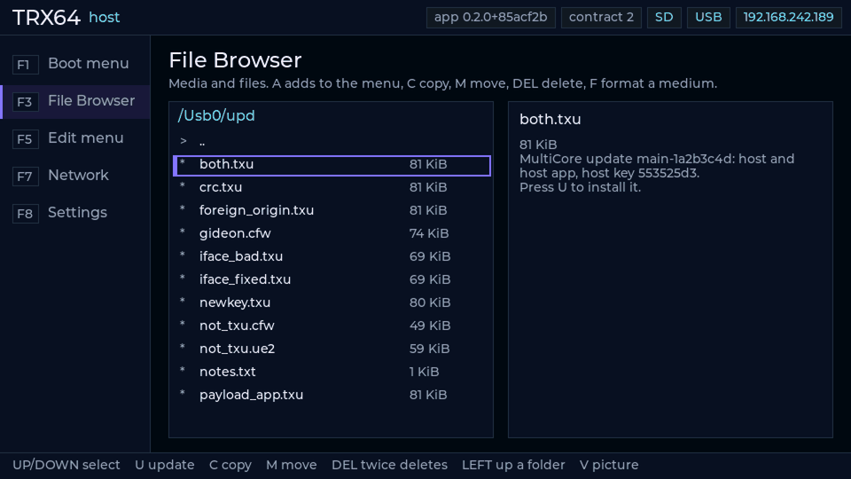
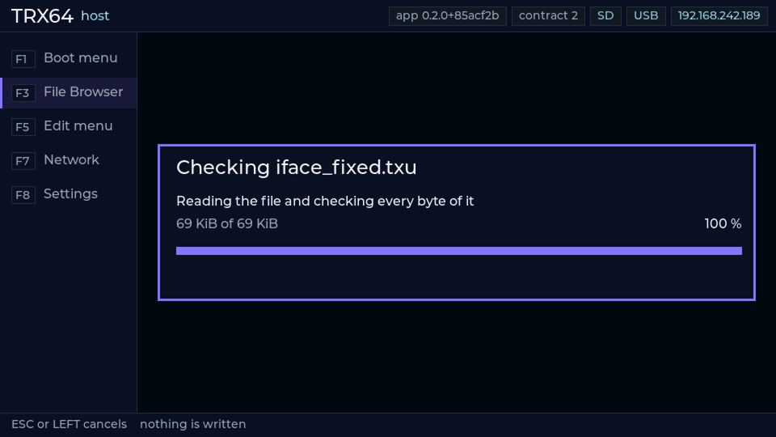
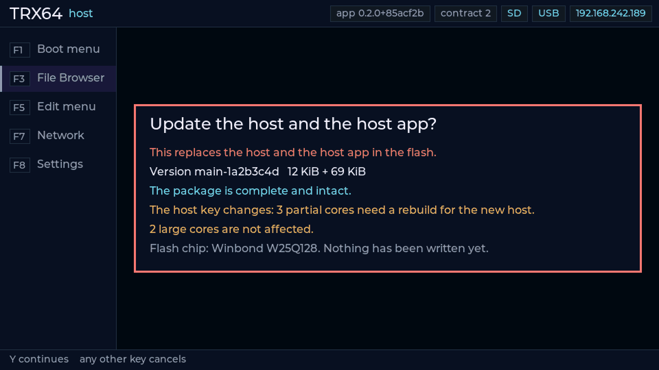
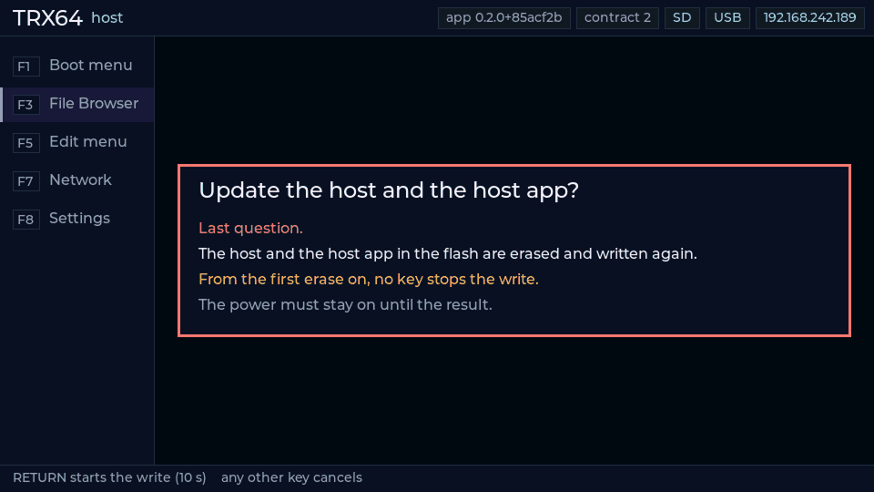
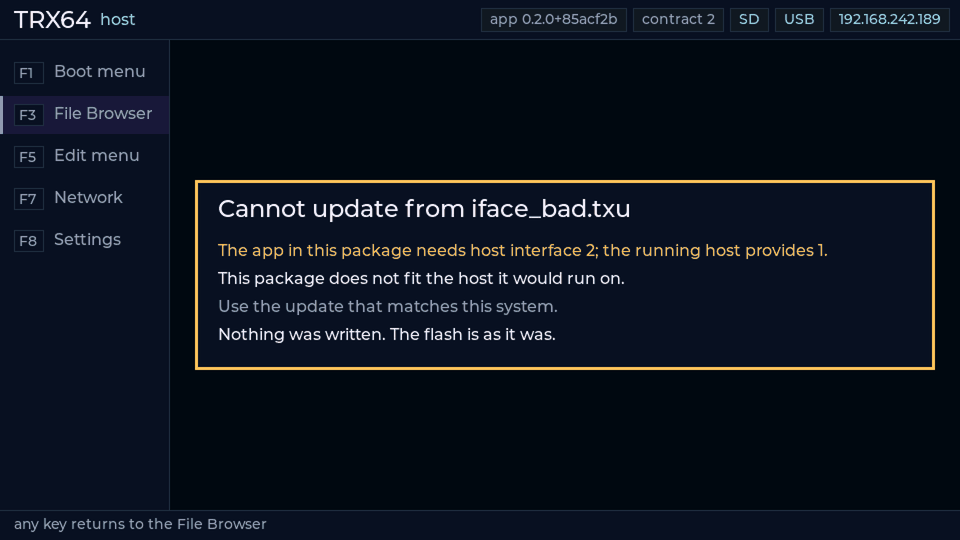
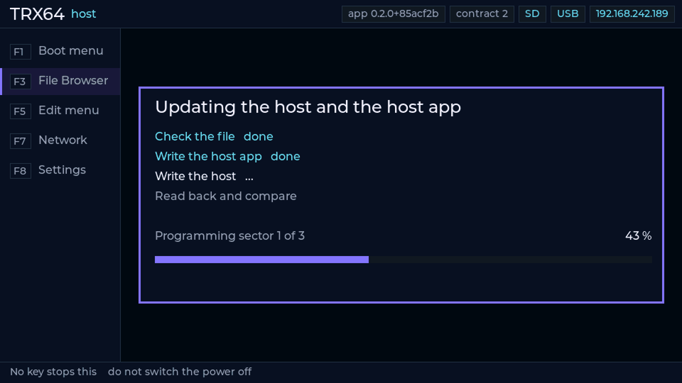
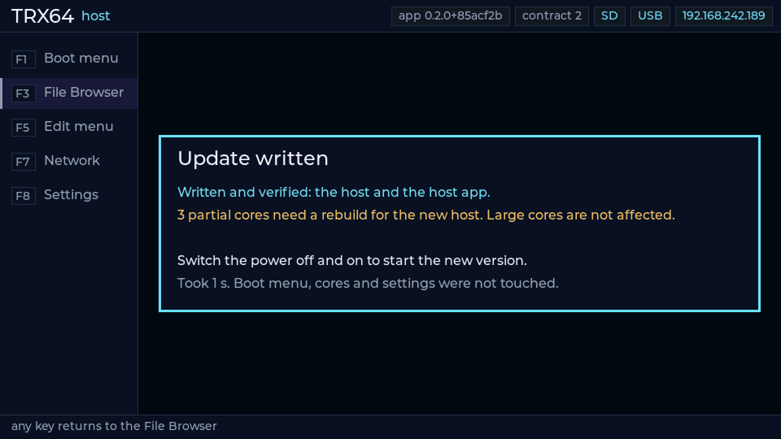
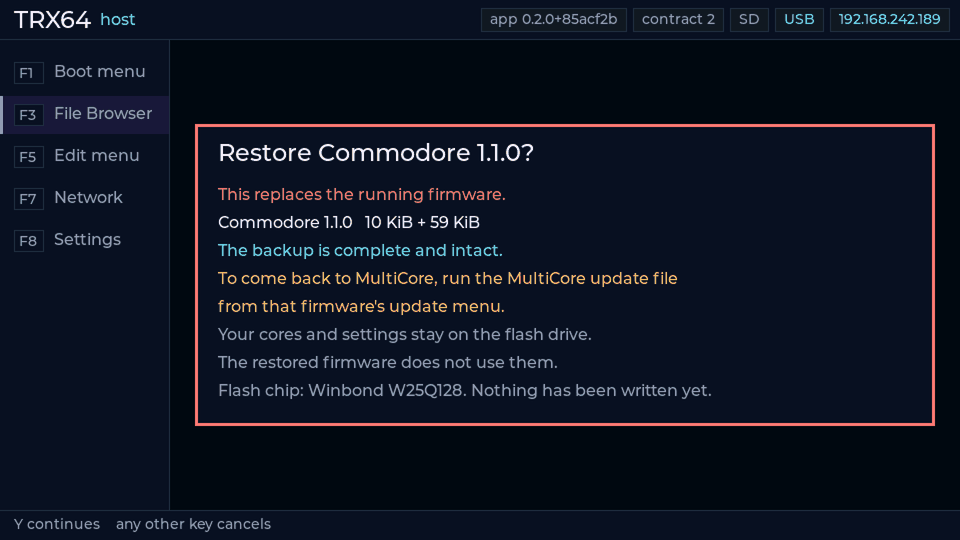
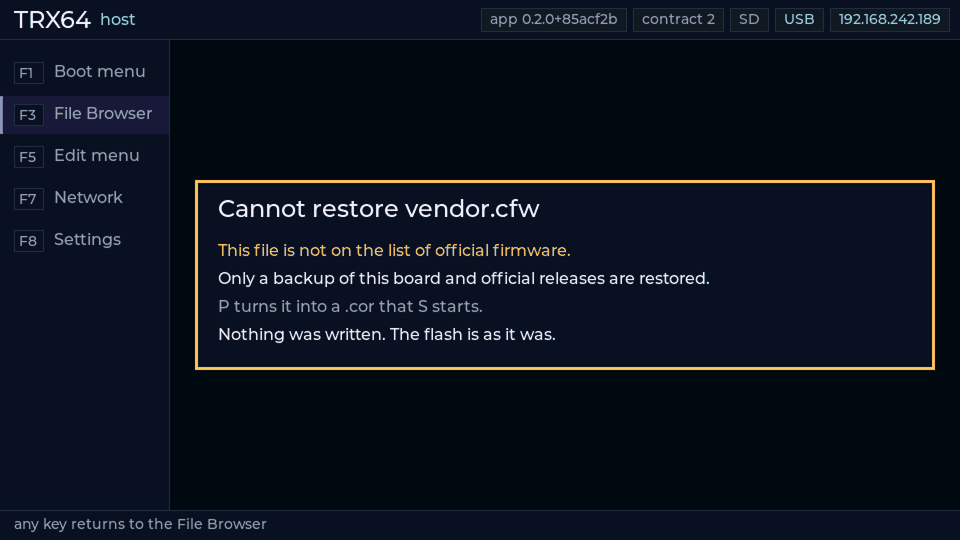
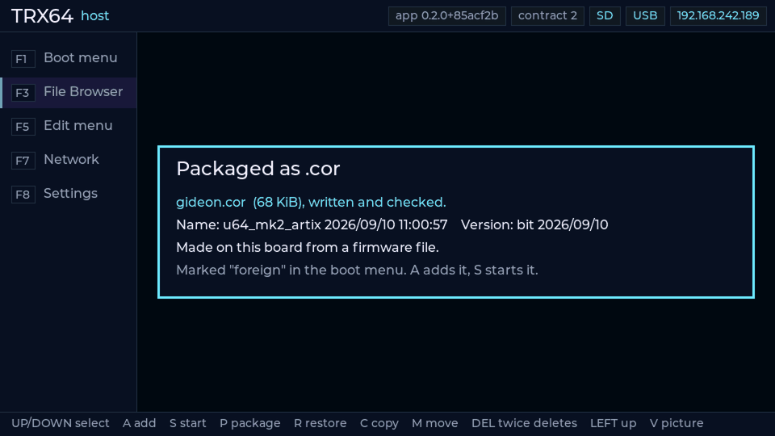

# 9. Update, restore and package (U, R, P)

## 9.1 General

9.1.1 Three functions of the File Browser (chapter 5) work on firmware files. Each function is a key on the selected file:

| Key | File | Function | Writes the flash |
|---|---|---|---|
| **U** | `.txu` | Update: install the host and the host application of a MultiCore update (9.3) | Yes |
| **R** | `.cfw`, `.ue2` on the list of official firmware, or a backup `.cor` of this board | Restore: write the original firmware of the board (9.4) | Yes |
| **P** | `.cfw`, `.ue2` | Package: make a `.cor` from a firmware file (9.5) | No |

9.1.2 The flash of the board holds the host (bitstream) at `0x000000` and the host application at `0x220000`. The update and the
restore write these two areas. They do not write the boot menu, the cores or the settings.

9.1.3 The update and the restore run in the host. They work with `Protect Flash from updates` `on` (8.5).

> **WARNING** The update and the restore erase and write the flash of the board. Keep the power on until the result page shows.
> A power failure during the write can leave the board without a working firmware. The way back then is the cable (14.5).

## 9.2 Rules of the update and the restore

9.2.1 The update and the restore use the same order of pages. Nothing is written before the last question.

| Step | Page | Keys |
|---|---|---|
| 1 | Check page: the host reads the file into memory and checks every part. Title `Checking <file>`, a progress bar | **ESC** or **LEFT** cancels. Nothing is written |
| 2 | Question 1. A red page shows what the write replaces, the version, the effect on the cores and the flash chip | **Y** continues. **RETURN**, **ESC** or any other key cancels. No key for 60 s cancels |
| 3 | Question 2: `Last question.` The footer shows the seconds that remain | **RETURN** starts the write. The host ignores every key in the first second. After that, any other key cancels. No **RETURN** within 10 s cancels |
| 4 | Write page: `Check the file   done`, then the phases | No key stops the write (9.2.3) |
| 5 | Read back: the host reads the flash and compares it with the file | |
| 6 | Result page | Any key returns to the File Browser |

9.2.2 The host refuses the function before step 1 or at step 1 when:

| Page title | Reason |
|---|---|
| `Cannot update from <file>` or `Cannot restore <file>` | See 9.3.4 and 9.4.4 |
| `Update check failed` or `Firmware check failed` | The file is damaged or is not what it says. The page shows the reason |
| `Nothing to write` | The flash holds exactly this file already. Nothing is written |

Each refusal page, except `Nothing to write`, ends with `Nothing was written. The flash is as it was.`

9.2.3 From the first erase on, the host reads and drops every key. **ESC**, **RUN/STOP** and **LEFT** show `Cannot stop now. Wait for the
result.` The footer reads `No key stops this    do not switch the power off`.

9.2.4 The host writes only the parts that differ from the flash. A part that is equal shows `not needed, unchanged`.

9.2.5 The host writes only to a Winbond W25Q128 flash chip. For another chip the host refuses and shows `This firmware is for a Winbond
W25Q128 flash chip. This board has <chip>.` or, for an update, `The update is written for a Winbond W25Q128 flash chip. This board
has <chip>.`

9.2.6 A power cycle is needed after a successful write. The host does not restart by itself. The board does not start a new
firmware before the power is switched off and on.

> **WARNING** If the write or the read-back fails after the first erase, the result page shows `The flash may not boot` and
> `Do not switch the power off.` Press **RETURN** to write the file again from the copy in memory. **ESC** or **LEFT** leaves the page. The board
> then needs a JTAG cable (14.5).

9.2.7 While a page is up, it stands alone on the dark content area (the File Browser and its note are not visible), is as high as its lines and
stands in the middle. The footer shows the keys of that page and nothing else. Every page has at most eight lines. A refusal has an amber frame; red is for the
two questions and for the failed write.

## 9.3 Update (U)

9.3.1 The update installs a `.txu` file, a MultiCore update. It writes the host (bitstream), the host application, or both. The
file says which.

9.3.2 To install an update:

1. Copy the `.txu` file to a medium (SD, USB).
2. Open the File Browser (**F3**). Select the file. The panel shows the size, `MultiCore update <version>: host, host app, or host and host app`
   and `Press U to install it.` For an update with a host, the panel shows the host key.
3. Press **U**.
4. Wait for the check page (step 1 of 9.2.1).
5. Read question 1. Press **Y**.
6. Read question 2. Press **RETURN** after 1 s and within 10 s.
7. Wait for the result page `Update written`. Press any key.
8. Switch the power off and on.

*Figure 9-1. F3 File Browser with a `.txu` selected. The footer shows `U update`.*

*Figure 9-2. The host checks every byte of the file.*

9.3.3 Question 1 shows:

| Line | Content |
|---|---|
| Title | `Update the host?`, `Update the host app?` or `Update the host and the host app?` |
| Red line | `This replaces <part> in the flash.` |
| Version | `Version <version>   <size> + <size>`: the parts that are written |
| Check | `The package is complete and intact.` |
| Effect on the cores | See 9.3.5 |
| Not written again | `Not written again, the flash holds it already: <part>.` |
| Flash chip | `Flash chip: <chip>. Nothing has been written yet.` |

*Figure 9-3. Question 1 of an update of the host and the host app. The page names the effect on the cores. The footer holds the keys of the page.*

*Figure 9-4. Question 2. The footer shows the seconds that remain.*

9.3.4 The host refuses the file at the page `Cannot update from <file>`:

| Reason on the page | Cause |
|---|---|
| `The file cannot be read.` | The medium or the file is not readable |
| `not a MultiCore update file` | The file is not a `.txu`. The page adds `Only a .txu from the MultiCore update is installed here.` |
| `the update file is damaged or incomplete` | The file is cut or changed |
| `the header of the update file does not match its checksum` | The header is damaged |
| `the update file does not come from TRX` | The file has another origin |
| `The app in this package needs host interface <n>; the running host provides <m>.` (and similar) | The host application and the host do not fit. The page adds `This package does not fit the host it would run on.` and `Use the update that matches this system.` |

*Figure 9-5. Refusal of a package with a wrong host interface.*

9.3.5 The lines of question 1 for the cores:

| Line | Meaning |
|---|---|
| `Only the app changes: no core is affected.` | The update writes the host application only |
| `The host key stays the same: no core is affected.` | The update writes the host, and the host key does not change |
| `The host key changes: <n> partial core(s) need(s) a rebuild for the new host.` | The new host has another host key. A partial `.cor` (4.3.4) of the old host does not start. Replace it with the `.cor` of the new release |
| `The host key changes; no partial core on the media is affected.` | No partial `.cor` on the media is routed against the old host |
| `<n> large core(s) is/are not affected.` | Large cores do not depend on the host key. The line adds `Some cores that are off now start again.` when a `.cor` fits the new host |

9.3.6 The write page shows the phases (`Check the file`, `Write the host app`, `Write the host`, `Read back and compare`) with `done` for those that are over, one
number and one bar. The footer reads `No key stops this    do not switch the power off`.

*Figure 9-5a. The write page. The host app is written; the host is being programmed.*

9.3.7 The result page `Update written` shows `Written and verified: <part>.`, `Switch the power off and on to start the new version.`
and `Took <n> s. Boot menu, cores and settings were not touched.` After a host update it adds the effect on the cores.

*Figure 9-6. Result of an update of the host and the host app.*

## 9.4 Restore (R)

9.4.1 The restore writes the original firmware of the board: the host and the host application are replaced by the firmware of the
vendor.

> **WARNING** The restore removes the TRX host from the flash. The board starts the vendor firmware after the power cycle. The way back to
> the host is the MultiCore update file, run from the menu of the vendor firmware (14.4). Cores and settings stay on the media.

9.4.2 The host restores only:

| Source | Condition |
|---|---|
| A backup `.cor` | The file is a large `.cor` that was made as a backup of this board (the boot menu shows the badge `backup`), and its flash chip is the chip of this board |
| A `.cfw` or `.ue2` | The SHA-256 of the whole file is on the list of the host (9.4.3) |

9.4.3 The list of official firmware:

| Name on the page | Version |
|---|---|
| Commodore 64 Ultimate | 1.1.0 |
| Gideon Ultimate firmware | 3.12a |
| Gideon Ultimate firmware | 3.14 |
| Gideon Ultimate firmware | 3.14d |

9.4.4 To restore the firmware:

1. Open the File Browser. Select the file.
2. Press **R**. The host compares the SHA-256 of the file with the list (page `Checking <file>`).
3. Do the steps of the update from 9.3.2 step 4: check page, question 1 (**Y**), question 2 (**RETURN**), write, read back.
4. Read the result page `Firmware restored`: `Firmware written and verified (<size> + <size>).` and `Switch the power off and on to start the restored
   firmware.` The page adds `Took <n> s. Cores, boot menu and settings were not touched.`
5. Switch the power off and on.

*Figure 9-6a. Question 1 of a restore of `Commodore 1.1.0`.*

Question 1 shows `Restore <name>?`, the name and the sizes, `Official release. The file is complete and intact.` (or `The backup is complete and intact.`),
`To come back to MultiCore, run the MultiCore update file from that firmware's update menu.`, `Your cores and settings stay on the flash drive.` and
`The restored firmware does not use them.`

9.4.5 The write order is: the application (`0x220000`), the bitstream (`0x000000`), the read-back of both.

9.4.6 The host refuses with the page `Cannot restore <file>`:

| Reason on the page | Cause |
|---|---|
| `This file is not on the list of official firmware.` | The SHA-256 is not on the list. The page adds `Only a backup of this board and official releases are restored.` and `P turns it into a .cor that S starts.` |
| `This backup was read from another flash chip.` | The backup is from another board. The page shows both chips |
| `A converted .cor cannot be restored.` | The `.cor` was made with **P** (badge `foreign`). Use the original `.cfw` or `.ue2` or a backup |
| `This is a TRX64 firmware, not a backup of the original.` | The `.cor` is a firmware of this project |
| `This is not a firmware file.` | The file is not a firmware |
| `The file cannot be read.` | The medium or the file is not readable |
| The reason of the image check | The image is damaged. The page title is `Cannot restore <file>` |

*Figure 9-7. Refusal of a `.ue2` that is not on the list.*

## 9.5 Package (P)

9.5.1 The package makes a `.cor` from a `.cfw` or `.ue2`. The `.cor` starts like a core and can be added to the boot menu. The
function reads the firmware file and writes one new file. It writes no flash. The firmware file stays as it is.

9.5.2 To package a firmware:

1. Open the File Browser. Select the `.cfw` or `.ue2`. The panel shows `P packages it as a .cor in the cores folder`.
2. Press **P**.
3. The page `Checking <file>` compares the file with the list of official firmware (9.4.3). **ESC** or **LEFT** cancels.
4. If a `.cor` with that name exists, the page `Replace the .cor that is there?` shows. **RETURN** replaces it after the new file is
   written and checked. Any other key cancels.
5. The page `Packaging <name>.cor` shows three steps: `Reading the firmware and hashing both parts`, `Writing the .cor`, `Reading it back
   and comparing`. **ESC** or **LEFT** cancels. No half-written file stays.
6. The page `Packaged as .cor` shows the file, the name and the version. Press any key.

*Figure 9-8. A `.cfw` packaged as a `.cor`.*

9.5.3 The new file is `<medium>/cores/<name>.cor`. It goes to the medium that holds the firmware file. The name is the name of the
firmware file without its extension.

9.5.4 The name and the version in the `.cor`: for an official file, the name and version of the list (for example `Commodore 64 Ultimate`,
`1.1.0`). For another file, the name from the image and a version made from its date. The `.cor` shows as `foreign` in the boot menu.

9.5.5 The host refuses with a page `Cannot package <file>` and `Nothing was packaged.`:

| Reason on the page | Cause |
|---|---|
| `The file is not a usable firmware image.` | The image is damaged |
| `The file cannot be read.` | The medium or the file is not readable |
| `The file name is not that of a .cfw or .ue2.` | Wrong extension |
| `This firmware lies on the internal drive; the .cor is too large for it.` | The file is on `Flash`. Copy it to a card or stick with **C** (5.6), then package it there |
| `The name of the .cor does not fit.` | The path is too long |
| `There is no room for it on that medium.` | The medium is full. The page shows the size that is needed and the free space |
| `Cancelled while reading the file.` | You cancelled |
