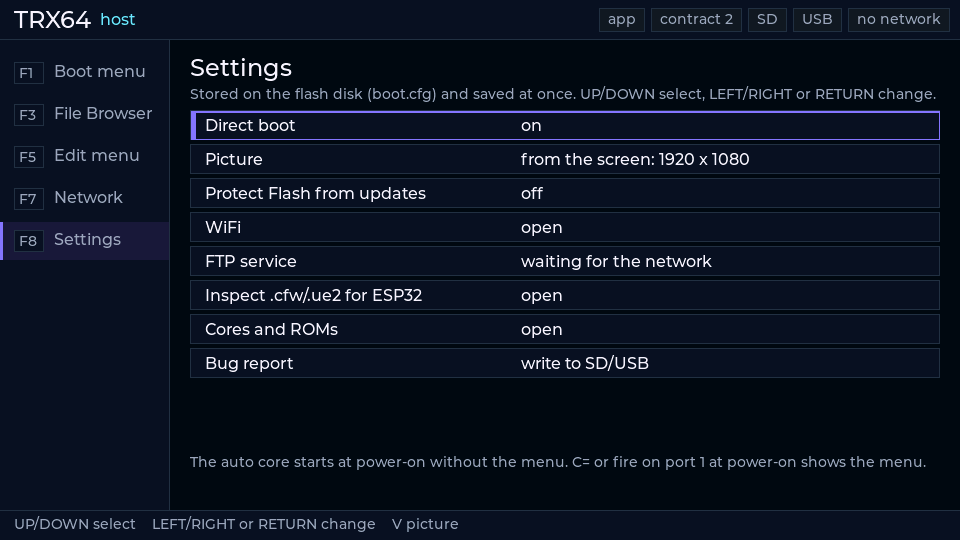

# 10. Bug report

## 10.1 General

10.1.1 The host application writes a text file that describes the state of the board. Attach the file to a report of a problem
(15.4).

10.1.2 The report of the host application shows `Core: none running (the host menu is open)`. A core on the common application writes its own report (10.7).

## 10.2 Write the report

10.2.1 To write the report on the board:

1. Put an SD card or a USB stick in the board.
2. Open the Settings (**F8**). Select the row `Bug report`.
3. Press **RETURN**. The help text of the row shows what the report holds.
4. Read the note line: `Bug report written: <folder>/<file>`. The row shows the file name.

*Figure 10-1. F8 Settings after the report. The row `Bug report` shows the file name. Without a clock the name starts with `nodate`.*

10.2.2 If the report cannot be written, the note reads `Bug report not written: <reason>`:

| Reason | Cause |
|---|---|
| `no SD card or USB stick` | No medium is present |
| `no SD card or USB stick takes a folder` | A medium is listed but takes no folder |
| `another report is being made` | The host builds another report (for example for the network) |

## 10.3 Folder and file name

10.3.1 The host writes the file to the folder `report` of the SD card (`/SD/report`). If there is no SD card, or it takes no folder, the host
uses the folder `report` of the first USB medium (`/Usb0/report` to `/Usb3/report`) that takes a folder. The host makes the folder.

10.3.2 The file name is `<year><month><day>-<hour><minute><second>.txt`, for example `20261031-142530.txt`. If a file of that name exists, the host
adds `-1`, `-2` and so on (up to 99). If the clock of the board is not set, the name is `nodate-<n>.txt` and the date line of the
report reads `clock not set`. The host never replaces an older report.

## 10.4 Read the report over the network

10.4.1 With a network address, the browser or `curl` gets the same text at `http://<address>/v1/report` (7.4). The text is not stored on a medium.

## 10.5 Content

10.5.1 The report is text. It has these sections:

| Section | Content |
|---|---|
| Header | `TRX64 bug report (host app)`, the date |
| Versions | Host application and build date, host key of the bitstream, board, core (`none running`) |
| Network and storage | Network state and address, SD card, USB, the media text |
| Settings | `Direct boot`, `Autostart countdown` and its state, `Auto entry` (index), `Picture`, `Library attempt under way`, then the stored settings (the text of `boot.cfg`) |
| Boot menu | One line per entry: index, `(auto)`, name, path and state; then size and SHA-256 as stored when the entry was added |
| Start log | The text of `startlog.txt` on the SD card (the last starts and what the host saw), or `(no startlog.txt on the SD card)` |
| Log | The last lines that the host application printed: up to 200 lines or 16 KB, whichever is smaller |

10.5.2 The report holds up to 32 KB. A report that does not fit ends with `[report cut: it did not fit]`.

## 10.6 Withheld data

10.6.1 The report does not hold passwords or keys:

| Item | Handling |
|---|---|
| A setting whose name contains `pass`, `pwd`, `psk`, `secret`, `token`, `wpa` or `credential`, or ends in `key` | The value reads `<withheld>` |
| A line of the log that holds a word such as `password`, `passphrase`, `psk`, `secret`, `token`, `network key`, `api key` | The line reads `[line withheld: it holds a credential word]` |
| A URL with `user:password@` | The user information is replaced by `***` |

10.6.2 Read the file before you send it. The report holds file paths, names of cores and the IP address.

## 10.7 Bug report of a core

10.7.1 The menu of a core on the common application has the row `Bug report` on the **F8** System page (on the C64 core in the Diagnostics
page of the F4 Tools). **RETURN** writes the report of the core. It goes to `report/` of the SD card, else of the first USB medium that takes a folder
(10.3), with the same file names. The same text is at `http://<address>/v1/report` of the core application.

10.7.2 The report of a core holds the versions, the settings of the core, the state of its media (the name and the size
of each mounted file, no hash), the last lines of the log (up to 200 lines or 16 KB), and the values of the registers that the core names. The cores
that name registers are the Amiga, the Amiga 1200, the Apple IIe and the C64 core. The other cores print `declares no register list`. Passwords and keys are withheld as in 10.6.

> **NOTE** The report of a core is built and tested in the bench. It has not been written on a real board yet.
