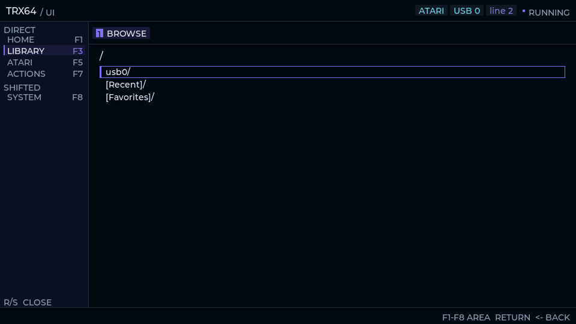
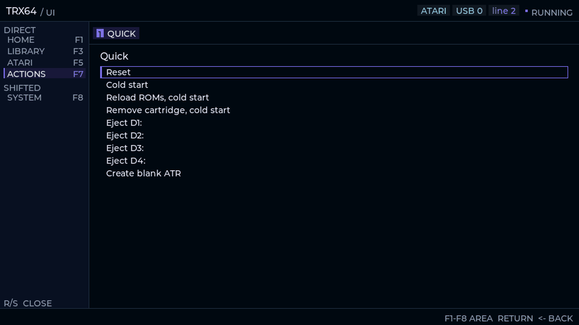
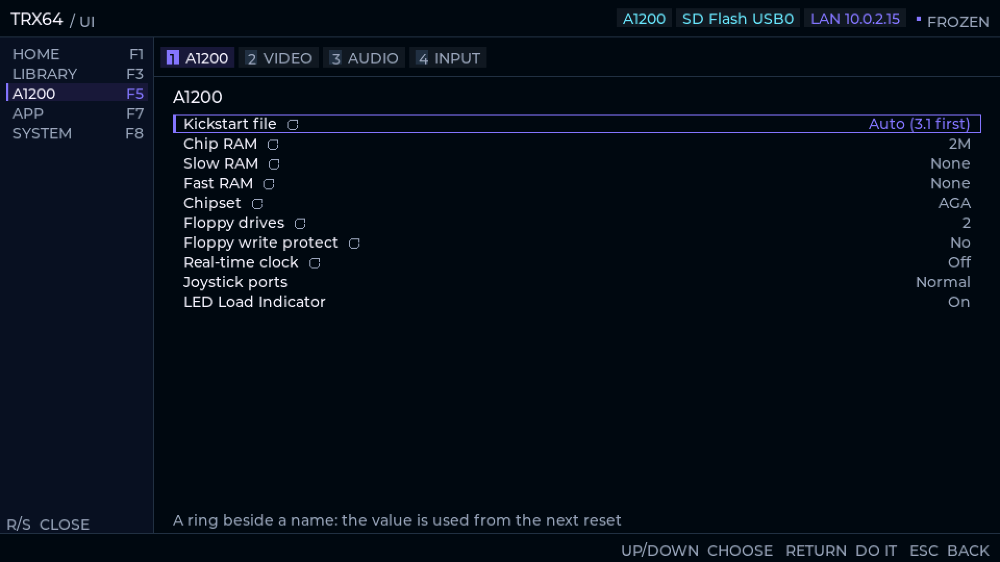
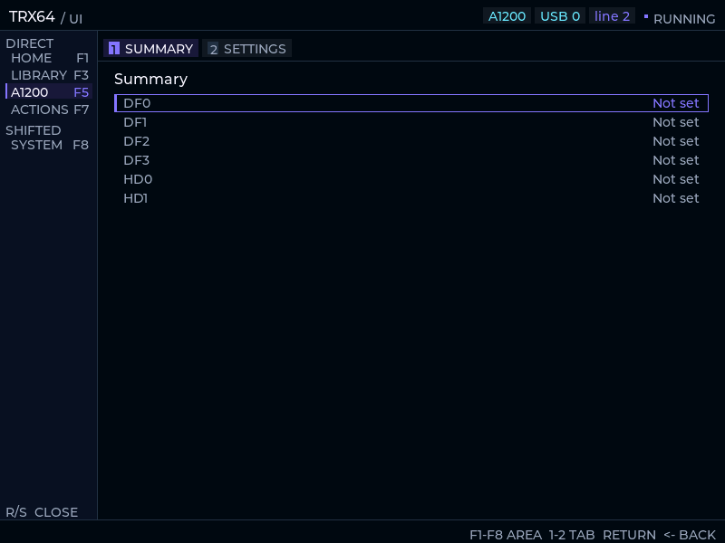
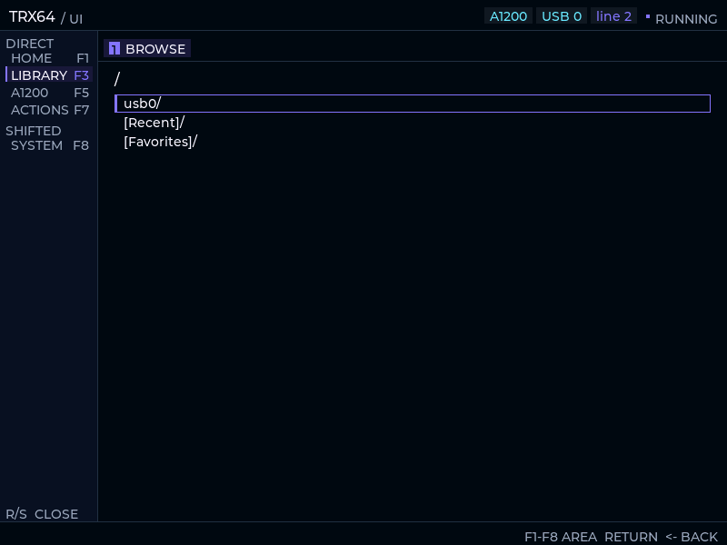
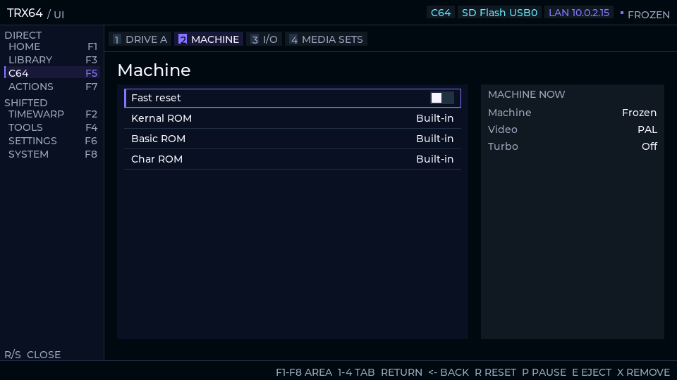
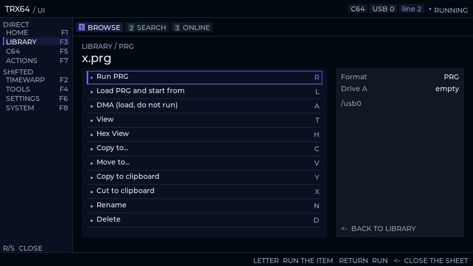

# 11. Cores

## 11.1 General

11.1.1 This chapter lists each core: the machine, the ROMs it needs, the media it takes, and its state. The states and
the evidence are in the README (section 5). Every core except TRX64 is experimental: it is built and benched, and some have been seen on the board.

11.1.2 **Open the menu.** `trx64g.cor` shows the Ultimate menu: press the Menu button on the board, pick a
file, press **ENTER**. All other cores, `trx64u.cor` included, use the common core menu. Open it with the Menu button on the board, or with
**F10**, **Scroll Lock** or the **Menu** key of a USB keyboard. Close it with **Esc** or **F10**. The machine stands
still while the menu is open.

11.1.3 **The common menu.**

| Key | Page | Content |
|---|---|---|
| **F1** | Home | Core and version, application build, IP address, media, ROM names |
| **F3** | Library | The file browser. **ENTER** on a file offers what to do with it |
| **F5** | The machine (the page carries the name of the core: `ATARI`, `A1200`, `C64`) | What is in the drives (tab 1, Summary). The settings (tab 2) |
| **F7** | Actions | Reset and the other tasks |
| **F8** | System | `Reset to host defaults`, `Return to host menu` |

11.1.4 **Number keys.** The keys **1** to **6** pick a tab of the open page.

*Figure 11-1. F3 Library: the file browser of the core. **ENTER** on a file offers what to do with it (Figure 11-8).*

*Figure 11-2. F7 Actions of the Atari 800 XL core. The side bar names the pages and their keys.*

*Figure 11-3. F8 System. `Return to host menu` is there when the core can give the FPGA back to the host (3.7.1).*

11.1.5 **Media.** No core mounts a disk, an `.adf` or an `.hdf` by itself. Mount what you want from the menu.

11.1.6 **Settings.** A core on the common application keeps its settings in `<name>.cfg` in its own folder, `cores/<name>/<name>.cfg`.

11.1.7 **ROMs.** A core that misses a required ROM stays held and says so on the screen after about 10 seconds. The
core looks again twice a second, so you can plug the stick in late. A file of the wrong size is reported at once with
its size. Every core has its own folder `cores/<id>/roms/` beside its `.cor` (for `/SD/cores/apple2.cor`: `/SD/cores/apple2/roms/`); a file that lies in an
old place (`/SD/roms/<id>/`, `cores/roms/`) is copied there once (12.2). The ROM folders are in chapter 12.

11.1.8 **Picture.** The core menu is drawn at the size of the mode, like the host menu (4.10): at 576p, 480p and 800 x 600 it has a compact layout that is not cut. A core
that has a mode of its own offers the settings `Picture` (`Auto` takes the mode the host is set to and says which: `Auto (1280 x 720 from host)`; when the host is set to "From the screen" it reads `Auto (1920 x 1080 from screen)`; or a mode), `Scale` (`Integer`, `Fit`, `Fill`) and `Smoothing`. A change of the picture is
asked for 8 s: `Keep this picture?`. Any key keeps it. Without a key the core goes back to the last mode (8.4.8).

*Figure 11-4. F5 Settings tab of the Amiga 1200.*

*Figure 11-5. F5 machine page of the Amiga 1200 at 800 x 600 (compact layout). The Library in the same mode is on the next figure.*

*Figure 11-6. F3 Library at 800 x 600.*

11.1.9 **Floppy LED.** Case LED 1 of the board can follow the drive of the machine, like a floppy LED: it lights while the drive motor runs and flickers with the access
(and with the hard disk). On the Amiga 1200 it works: Alex judged it on the board on 2026-10-31. On the board of 2026-11-02 only the Amiga 1200 lit the LED: the other cores did not have its setting row or its selector.
The row `LED Load Indicator` (`On`, `Off`) is now in the menu of every core with a drive (Amiga 500, Atari, Apple II, CPC, VC-20, C264, C128), but this has not been checked on the board again.
Do not rely on the LED in those cores yet.

11.1.10 **USB gamepads.** NES, SNES and Neo Geo take a USB gamepad (T156): two pads in the order they are plugged in (the first is player 1), the stick counts as the D-pad.
The default map follows the SNES layout that is printed on most pads. The setting `Pad map` (`Default`, `Custom`) and the tasks `Map buttons, pad 1` and `Map buttons, pad 2` let you press each
button once to map it; the map is kept in the `.cfg` of the core. On the board of 2026-11-02 the pads worked in the NES, the SNES and the Neo Geo core (Alex). A pad with an unusual report may not be
understood: the dump of its report is still open (T156). The C64 joysticks and the keyboard stay as they were.

11.1.11 **Master volume.** In the open menu **SHIFT** + `+` makes the sound louder, **SHIFT** + `-` quieter. The host applies the gain and shows the value for a moment. It worked on the Amiga 1200
on the board; the other cores are still to be checked.

11.1.12 **USB mouse.** The Amiga 500 and the Amiga 1200 take a USB mouse (T104). Two settings in the Input group scale it, as the Ultimate's own menu does (T190, GitHub #51): `Mouse sensitivity` (1 to 16,
default 8 = 1:1; 1 is an eighth of the movement, 16 is twice) and `Mouse acceleration` (`Off`, `Adaptive`). A change acts at once and is kept in the `.cfg` of the core. The defaults are what the cores did before.
A high-resolution mouse (1000 DPI and more) that moves the pointer too far wants a sensitivity below 8.

## 11.2 TRX64 (C64)

11.2.1 The C64 reference core, the gateware of TRX64 Ultimate. It comes as two `.cor` files with the same gateware: `trx64u.cor` runs our common application (the menu of 11.1.3 with the extra pages
**F2** Timewarp, **F4** Tools and **F6** Settings), `trx64g.cor` runs Gideon's Ultimate application (11.3).

*Figure 11-7. The Machine page of the C64 core on the common application (tab 2 of **F5**).*

*Figure 11-8. **RETURN** on a file in the Library of the C64 core opens the sheet of what to do with it.*

11.2.2 ROMs: those in the board's flash (`/Flash/roms`). Nothing to bring. In the C64 settings the items Kernal ROM,
Basic ROM and Char ROM pick the file. The defaults are `kernal.bin`, `basic.bin`, `chars.bin`. A Kernal that is
missing or not exactly 8,192 bytes is replaced by the built-in one. So is a missing Char ROM. Basic has no built-in
copy.

11.2.3 Media: `.d64` `.d71` `.d81` `.dnp` `.g64` (drive), `.prg`, `.crt`, `.tap`, `.t64`, `.reu`, `.sid`, from the file browser of the core application.

11.2.4 Back to the host: switch the power off and on.

## 11.3 TRX64 with the Ultimate application (`trx64g.cor`)

11.3.1 The same gateware as 11.2 with Gideon's Ultimate application and its menu (the Menu button, a file, **ENTER**). It writes
its settings to `cores/trx64g/trx64g.cfg` when the host hands over the path of its `.cor` (11.1.6). Without the hand-over it uses the flash configuration pages, as the original firmware does.

11.3.2 ROMs, media and the way back to the host are the same as for `trx64u.cor`. Switch the power off and on to return to the host.

11.3.3 There is no separate C64U core with the feature set of the original firmware. That plan (T103) was dropped: for a C64 with the original firmware, start the original (a `.cfw` or a
backup `.cor`, chapter 13).

## 11.4 VIC-20

11.4.1 ROMs in `cores/vc20/roms/`: `kernal.bin` (8,192 bytes, PAL), `basic.bin` (8,192), `char.bin` (4,096). All three are
needed. The core is PAL only.

11.4.2 The application reads only this folder; a file that lies in an old place (12.2.3) is copied there once. It keeps trying while
the stick mounts. After about 10 seconds the screen says what is missing.

11.4.3 Media: `.prg` and `.p00`. **Run PRG** resets and runs. **Load PRG** loads into the running machine without typing.
The RAM expansion is a setting on **F5**. Drive A is a 1541 on the IEC bus: it takes `.d64` and `.g64` (a `.prg` inside a `.d64` can be run), and the menu can
create a blank `.d64` or `.g64` (`Create blank D64`). The 1541 ROM (`1541.rom`, 16,384 or 32,768 bytes, 12.2.7) is optional: without it the machine runs without a drive.

## 11.5 Commodore 264 (C16, Plus/4)

11.5.1 ROMs in `cores/c264/roms/`: `kernal.bin` and `basic.bin` (16,384 bytes each, PAL). The
Plus/4 model also takes `3plus1lo.bin` and `3plus1hi.bin` (16,384 each). Without the two function ROMs the Plus/4
model has BASIC and no built-in programs.

11.5.2 Media: `.prg` and `.p00` (**Run PRG**, **Load PRG**). A `.bin` of 16 or 32 KB loads as a cartridge on the Plus/4
model. Drive A is a 1541 as in 11.4.3 (`.d64`, `.g64`, optional `1541.rom`).

## 11.6 Amiga (OCS/ECS, 68000)

11.6.1 ROM: **one Kickstart** as a `.rom` file of exactly 262,144 or 524,288 bytes in `cores/amiga/roms/` (the Amiga 1200: `cores/amiga1200/roms/`). The file name does not
matter.

11.6.2 The core reads the version from the image. The setting **Auto** takes Kickstart 1.3 first, else an older one, else
any Kickstart. The setting **Kickstart file (at reload)** lists up to eight files by name so that you can pick one.

11.6.3 The core needs a plain image. A file that does not begin with `1111` or `1114` is not recognised. A file that needs
a `rom.key` of the package maker must be converted by you first.

11.6.4 A plain reset reloads the Kickstart when you picked another file. **Reload Kickstart, Reset** (**F7**) always does.

11.6.5 Media from the **F3** Library: `.adf` (Mount DF0 to DF3), `.hdf` (Mount HD0, HD1). The drive is empty after start.

11.6.6 **Real-time clock (at next reset)**, `Off` or `On` (default `Off`; Amiga 500 and Amiga 1200). `On` puts a battery-backed clock (MSM6242B) at `$DC0000`; the core app sets it to the board's time at core start, and it keeps counting. Amiga Test Kit, `SetClock` and the file stamps use it. A `SetClock SAVE` on the Amiga does not change the board's clock. `Off` is the stock machine: Test Kit says "No Clock Detected". Not checked on the board yet.

## 11.7 Amiga 1200 (AGA, 68020)

11.7.1 The same folder and files as the Amiga. **Auto** takes Kickstart 3.1 first (version 40, the 512 KB A1200 image), else
any 3.0 or later, else any Kickstart.

11.7.2 Media: `.adf` and `.hdf`, as the Amiga.

## 11.8 Atari 800 XL

11.8.1 ROMs in `cores/atari800/roms/`, both required: `ATARIXL.ROM` (exactly 16,384 bytes) and `BASIC.ROM` or `ATARIBAS.ROM`
(exactly 8,192 bytes). Upper or lower case does not matter. The core checks the size, not the content.

11.8.2 Media: `.atr` and `.xfd` (Mount D1: to D4:; the first entry also cold-starts), `.xex` `.obx` `.com` (Run), `.car`
`.rom` `.bin` (cartridge).

## 11.9 Nintendo Entertainment System

11.9.1 No ROM needed. A `.nes` file carries its program. Start it from the file browser (**Run**).

11.9.2 The pad is the hardware of the C64: a joystick on each port and the keyboard. A USB gamepad works as well (11.1.10): the default map takes the pad's bottom button as B and the right one as A.

| NES | Port 1 | Port 2 |
|---|---|---|
| Up, Down, Left, Right | Joystick 1 | Joystick 2 |
| A | Fire | Fire |
| B | **Space** | **Right shift** |
| Select | **F3** | **F7** |
| Start | **F1** | **F5** |

## 11.10 Apple IIe

11.10.1 ROMs in `cores/apple2/roms/`: `apple2e.rom` (16,384 bytes; a file whose reset vector is not `$FA62` is refused),
`apple2e-video.rom` (8,192), and `diskii.rom` (256 bytes). The first two start the machine. **Mounting any disk image needs
`diskii.rom`.** Without it the mount is refused with a message. The ROM is picked up at the next ROM reload.

11.10.2 Media: `.dsk` `.do` `.po` `.nib`. **Mount D1: and cold start** starts the machine from the disk. **Mount D1:**
swaps the disk without a reset. **Mount D2:** only mounts.

## 11.11 ZX Spectrum 48K / 128K

11.11.1 ROMs in `cores/zx/roms/`: `48.rom` (16,384 bytes) for the 48K, `128.rom` (32,768 bytes) for the 128K. One of the two is
enough. If the **Model** setting names the model whose file is missing, the other model runs and the screen says so.

11.11.2 Media: `.sna` and `.z80` (**Run snapshot**: the machine starts where the snapshot was taken). `.tap` and `.tzx` (**Insert
tape**, then **Tape: Play** on **F7**; real speed). Tapes with pulses shorter than 16 T-states are refused. There is no
tape SAVE.

## 11.12 ZX Spectrum Next

11.12.1 One SD card image with the default name `next.img` in `cores/zxnext/roms/` (or, as the first place the core looks after its own folder, in `roms/zxnext/` of a medium). It is the whole card as the Next reads it (the partition table, the
FAT with the operating system files). Another name is not found by itself: pick the file in the **F3** Library (11.12.2). The machine's own boot ROM is in the core and loads `TBBLUE.FW` from the image.
Nothing of the Next's system is shipped here.

11.12.2 Alternative: pick an `.img` in the **F3** Library and use **Mount SD image and reset**. What the machine writes to
its card goes back into the file.

11.12.3 Without an image the boot ROM stops with `Error initializing SD card!`. The core looks for the image again once a second, so a stick that mounts late is found and the machine starts over with it.

11.12.3a **Board issue.** The setting `Board issue` (`Issue 2`, `Issue 4`, `Issue 5`; default `Issue 5`) names the board revision that the machine reports to the Next's firmware. A card image whose older `TBBLUE.FW` stops with `wrong board revision` at `Issue 5` needs a lower issue. A value `Auto` is coming (T116 D11): the application will take the issue from the firmware on the image and use `Issue 5` when it cannot tell. Until then pick the issue by hand; it takes effect at the next reset.

11.12.4 The speed of a program that does not fit the cache is below the real machine's. The 128K, +3 and Pentagon timing
run 1.5 to 2.7 % fast. There is no Sega 6-button pad and no SD pass-through.

## 11.13 Amstrad CPC 464 / 664 / 6128

11.13.1 ROMs in `cores/cpc/roms/` (16,384 bytes each). 464: `os464.rom`, `basic464.rom`. 664: `os664.rom`, `basic664.rom`,
`amsdos.rom`. 6128: `os6128.rom`, `basic6128.rom`, `amsdos.rom`. The files of one model are enough. If the **Model**
setting names a model whose files are not all there, the highest complete model runs and the screen says so. Without
`amsdos.rom` no disk can be mounted (the 464 has no drive).

11.13.2 Media: `.dsk` (**Mount A: and reset**, **Mount A:**, **Mount B:**; what the drive writes goes back into the file). `.cdt` (**Insert
tape**, then **Tape: Play** on **F7**; real speed). There is no tape SAVE and no snapshot.

11.13.3 The picture position (720 x 540 at scale 2) is an estimate.

11.13.4 The core reads the separate files of 11.13.1 only. The MiSTer Amstrad core keeps its ROMs together in one `boot.rom`; this core does not read that file. Cut the pieces of 16,384 bytes
out of it and name them as in 11.13.1 (12.4.6).

## 11.14 Commodore 128

11.14.1 One system ROM image of 72 KiB, the layout of MiSTer's `boot0.rom`, in `cores/c128/roms/`. The names that the core takes: `boot0.rom`, `c128.rom`, `c128-system.rom`, `c128_system.rom`. The 1541 and 1581 ROMs are optional (12.2.7). So are the JiffyDOS files of your kit; you select each one yourself, the core never looks for them by name (11.14.4; sizes and what each replaces in 12.4.7).

11.14.2 Drive A is the 1541 and the 1581: `.d64`, `.g64` and `.d81`; the menu creates blank images. Settings: the 40/80 column switch (taken at the reset) and the picture that is shown
(the VIC-IIe through the scaler, or the VDC at 640 x 400). Sound and the picture worked in C128 and C64 mode on the board of 2026-10-26. On the board of 2026-11-02 (package `t164-c83a83c2`) the picture was black; this is open. The analogue output (S-video and composite) is in development (3.6.4).

11.14.3 Not in this core yet: the cartridge port, the REU, the PRG library, and the extra keys of the C128 keyboard from a USB keyboard (T141).

11.14.4 The setting "ROM set" on the F5 Settings tab: Standard or JiffyDOS, taken at the next reset. The machine always starts Standard; JiffyDOS is only used when you set "ROM set" to JiffyDOS and have selected its files. Below it are four rows, "JiffyDOS C128 ROM", "JiffyDOS C64 ROM", "JiffyDOS 1541 ROM" and "JiffyDOS 1581 ROM". Each shows the selected file or "Not selected"; RETURN opens a file selector (the first row, "No file", clears the selection), or use **F3**, the file's action sheet, "Use as JiffyDOS ... ROM" (on `.rom` and `.bin` files). The file is checked when you choose it; a refused file is not taken and the status line says why. With JiffyDOS the machine starts on the C128 KERNAL you selected and, when selected, the C64 KERNAL; drive A takes the JiffyDOS ROM of its type (1541 or 1581) when selected, the stock ROM otherwise. With nothing selected the machine starts Standard and says so; a part without a selected file simply stays standard; if a selected file is missing or no longer readable, that part stays standard and the notice says why. A selected file is read again at every start.

## 11.15 Super Nintendo

11.15.1 No ROM and no BIOS: the 64-byte boot ROM of the sound processor is part of the core. A game is a `.sfc` or `.smc` file from the **F3** Library (**Run**). The core reads the header, refuses what it cannot run, and puts the
image into the memory of the board. Battery RAM is written back to `cores/snes/saves/<image name>.srm` when it has changed.

11.15.2 The controllers are the C64 joysticks and the keyboard, or USB gamepads (11.1.10). State: games run on the board (2026-10-29 to 10-31). On 2026-11-02 the sound was correct after the fix of the sign in the sound processor, and the USB pad worked. Open: the verdict text of the menu.

11.15.3 **DSP-n cartridges** (DSP-1/1B, DSP-2, DSP-3, DSP-4; T218): these run when the chip's firmware is found, for example Super Mario Kart and Pilotwings (DSP-1). The firmware is not part of the core; you supply it (files and places in 12.4.9). The setting `DSP firmware` (F5, taken at the next reset) chooses the chip: `Auto` (default) takes it from the header's title (Dungeon Master is a DSP-2, SD Gundam GX a DSP-3, Top Gear 3000 a DSP-4, every other DSP cartridge a DSP-1); `DSP-1` to `DSP-4` force that chip for every DSP cartridge (other cartridges are not affected). Without the firmware the game is refused and the message names the chip, the file(s) and the folder, for example `"SUPER MARIO KART" needs the DSP-1 coprocessor and its firmware (8192 bytes) is missing: put dsp1b.bin or dsp1.bin in <core folder>/roms/ (or roms/snes/ on a drive), or append it to the .sfc.` A DSP-n cartridge in ExHiROM is refused. The other chips (SA-1, Super FX, Cx4, S-DD1, SPC7110, ST010/ST011) are still refused. State: built and proved in simulation with a firmware of our own; not yet run on the board with a real firmware.

## 11.16 SNK Neo Geo

11.16.1 Files in `cores/neogeo/roms/`: a BIOS (`sp-s2.sp1` for the MVS, `neo-epo.sp1` for the AES, or `uni-bios.rom`, 131,072 bytes each), the zoom table `000-lo.lo` (65,536 or 131,072 bytes) and the fix ROM
`sfix.sfix` (131,072 bytes). The BIOS is chosen by a setting (the Universe BIOS or the original). A game is a `.neo` file, or a folder with the files of a cartridge and an entry in the `romsets.xml` that you provide. No ROM, BIOS or game is part of the firmware.

11.16.2 Save data (the backup RAM and the memory card, 72 KB) goes to `cores/neogeo/saves/<game>.sav`.

11.16.3 USB gamepad (11.1.10): the default map is by **position**, as on the Neo Geo CD pad: the pad's bottom button is A, right B, left C, top D; the shoulder `L` is Coin; Start and Select as printed. The alternative (by name: SNES A = A) is a table change that has not been
made. State: the core plays on the board (2026-10-31); the pad worked on the board on 2026-11-02 (Alex). Dark stripes in the sprites were fixed in the bench and need a new look on the board.

## 11.17 Showcase: mandelbrUlt and Look Ma, No VIC

11.17.1 Two C64U demos by DDT as cores that show their picture over the HDMI of the host: `DDT Mandelbrot (mandelbrUlt)` and `DDT Look Ma, No VIC`. No ROM and no media. The menu has the pages Home and Actions only.
Both ran on the board on 2026-10-31. They are experimental.

## 11.18 Port Diagnostics (coming)

11.18.1 A core with the id `diag` is being built (T175): it measures the joystick and paddle ports with the test files that you put on the SD card (TOML files) and writes the result to the card.
It is for development and for testers: whether a paddle, a second fire button or a CD32 pad can work on this board is not known yet. The core has no machine, and it is experimental.
It is not available yet.
