# 11. Cores

## 11.1 General

11.1.1 This chapter lists each core that is built into a release set: the machine, the ROMs it needs, the media it takes, the rows of its menu, and its state. The state of a core is the `experimental` flag of its `core.toml`: every core except TRX64 and the Apple IIe is `experimental = true`. The levels and the evidence are in the README (section 5) and in `CORES.md`. A core with `build_only = true` (the C64 with SuperCPU, 11.19) is built for the board but never packed into a release.

11.1.2 **Open the menu.** `trx64g.cor` shows the Ultimate menu: press the Menu button on the board, pick a
file, press **ENTER**. All other cores, `trx64u.cor` included, use the common core menu. Open it with the Menu button on the board, with
**F10** (not in a core that takes the whole keyboard, the Amiga cores and the C128), **Scroll Lock** or the **Menu** key of a USB keyboard, or with the menu hotkey (11.1.14). Close it with **RUN/STOP**, **F10**, **Scroll Lock**,
the **Menu** key or the menu hotkey. **Esc** (the left arrow on the C64 keyboard) goes back one step: out of a folder, to the first tab, to Home; on Home it closes the menu. The machine stands
still while the menu is open (the top bar says `FROZEN`).

11.1.3 **The common menu.** The rail at the left names the areas and their keys: Home **F1**, Library **F3**, the machine **F5**, App **F7**, System **F8**. On the C64 keyboard **F8** is **SHIFT** + **F7**; a USB keyboard has the keys themselves. The foot line reads `UP/DOWN CHOOSE`, `RETURN DO IT`, `ESC BACK`, plus the letters of the list and `+/- PAGE` where a list has pages; it does not repeat the keys of the areas and tabs, the rail and the tab strip show them. The top bar shows chips for the core, the media (`SD Flash USB0`) and the network (`LAN` and the address), and `FROZEN` while the menu is open.

| Key | Area | Content |
|---|---|---|
| **F1** | Home | The session: the reset rows of the core (`Reset`, `Reload ROMs, reset`, ...), the media slots (**RETURN** opens the page of the slot: mount from the Library, eject, and the tasks of that medium, 11.1.16), the tasks that no slot owns, `Save as config...` and `Load config...` (11.1.13). The button `F3 Library` is drawn where the rows leave room; **F3** works either way |
| **F3** | Library | The file browser. **RETURN** on a file opens the sheet of what to do with it (11.1.5) |
| **F5** | The machine (the area carries the short name of the core: `ATARI`, `A1200`, `C64`) | Tab 1: the settings of the machine (named after the core), then the tabs `Video`, `Audio`, `Input` (11.1.10) |
| **F7** | App | One page, `Settings`: the headings `Storage` and `Menu` with the generic rows (11.1.10), `Hotkeys` (a row that opens the page of 11.1.14), and, where the core has apps, the heading `Apps` |
| **F8** | System | One tab with the headings `Actions` (`Restart core`, in a partial core `Reload core`; `Return to host menu`, 11.1.4), `Network` (`WiFi`), `Support` (`Bug report`, `Keys and help`), `Reset` (`Reset to host defaults`) and `Status` (`Build`, `ROMs`, `Libraries`) |

TRX64 (`trx64u.cor`) uses the same five areas with more rows and tabs (11.2.1). A tab is picked with the number keys **1** to **8**, or with the cursor keys and **RETURN**; an area that has one tab shows no tab strip beside its heading. There are no areas F2, F4 and F6. Where a core declares tasks (reset, eject, create a blank disk, map buttons), they stand where they belong: the resets and the tasks of no slot on Home, the tasks of a medium on the page of its slot, and the tasks that are settings of the machine (`Map buttons`, 11.1.12) in the tabs of F5.

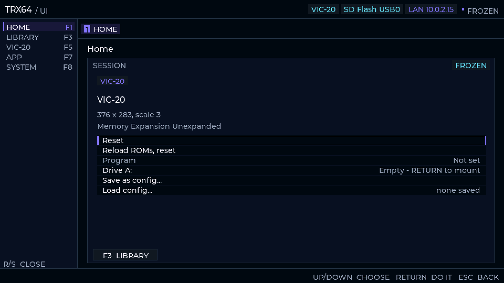

*Figure 11-1. F1 Home of the VIC-20 core in ue2emu at 1920 x 1080. The rail names the areas and their keys; the chips in the top bar show the core, the media and the network of the emulator, not of your board.*

*Figure 11-2. F3 Library (shown in TRX64): the file browser opens on the list of the media. **RETURN** opens a medium; on a file it offers what to do with it (Figure 11-8).*

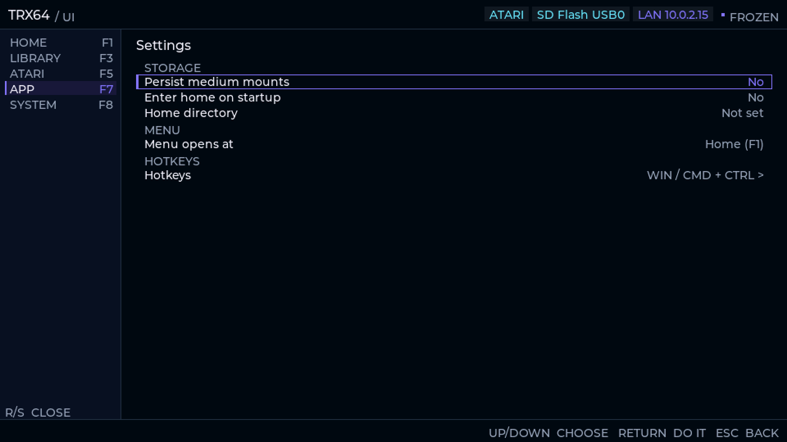

*Figure 11-3. F7 App of the Atari 800 XL core: the page `Settings` with the generic rows and the row `Hotkeys`.*

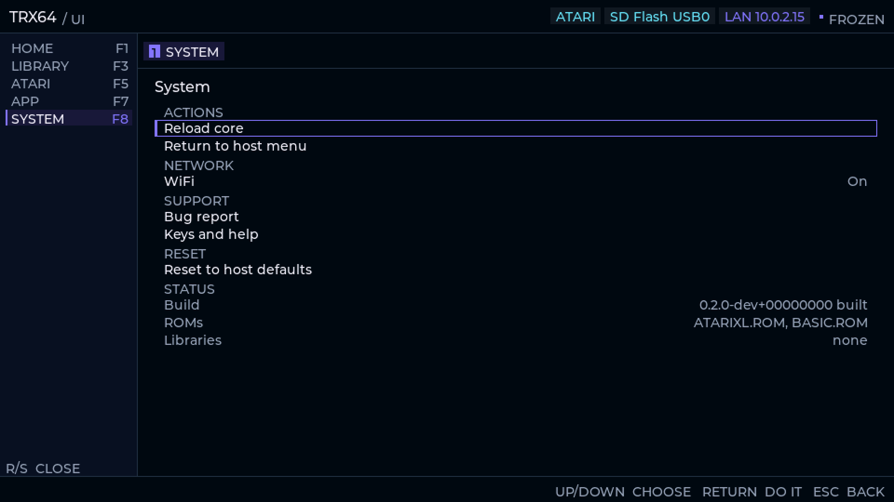

*Figure 11-4. F8 System of the Atari 800 XL core. `Return to host menu` is there when the core can give the FPGA back to the host (11.1.4).*

11.1.4 **Return to the host.** `Return to host menu` exists where the board answers as a MultiCore host with its loader (`board.cc`: the ID byte `0x7A`); every core on the common application has it except TRX64 (`trx64u.cor`, `trx64g.cor`, 11.2.4).

11.1.5 **The file sheet.** **RETURN** on a file opens its sheet: the actions of its file type (they are listed per core below), then the actions of every file, each with a letter that runs it: `View` (**T**), `Hex View` (**H**), `Copy to...` (**C**), `Move to...` (**V**), `Copy to clipboard` (**Y**), `Cut to clipboard` (**X**), `Rename` (**N**), `Delete` (**D**). The folder rows have their own sheet (**RIGHT** on a folder): `Open`, `Create folder here`, `Paste here`, `Mark all`, `Mark none`, `Set as home folder`. **CTRL** + **A** marks all, **CTRL** + **N** none, **CTRL** + **C** and **CTRL** + **V** copy and paste. In the Library the bare **+** and **-** page the list. With `Enter home on startup` (11.1.10) the Library opens on the home directory.

11.1.6 **Zip files.** A `.zip` in the Library offers `Unzip to folder`, `Unzip here` and `Extract one file`. They are done by the application `unzip.u2a`, which the release carries with the library `miniz.u2a` in `cores/apps/` beside the `.cor` files (the updater copies both). A core finds the applications of that folder at every start.

11.1.7 **ROMs.** A core that misses a required ROM stays held and says so on the screen after about 10 seconds. The
core looks again twice a second, so you can plug the stick in late. A file of the wrong size is reported at once with
its size. Every core has its own folder beside its `.cor`, named like it (for `/SD/cores/apple2.cor`: `/SD/cores/apple2/roms/`); a file that lies in an
old place (`/SD/roms/<id>/`, `cores/roms/`) is copied there once (12.2.3). The ROM folders are in chapter 12.

11.1.8 **Picture.** The core menu is drawn at the size of the mode, like the host menu (4.10). A core that has a mode of its own offers the settings `Picture` (`Auto` takes the mode the host is set to and says which: `Auto (1280 x 720 from host)`; when the host is set to "From the screen" it reads `Auto (1920 x 1080 from screen)`; or a mode), and, where the host gateware scales the core's picture, `Scale` (`Integer`, `Fit`, `Fill`) and `Smoothing` (`Off`, `On`). They are in the `Video` tab of **F5**. **RETURN** on `Picture` opens the Picture page: `Auto` and every resolution of the host's mode table at 50 Hz and at 60 Hz (`576p`, `480p`, `1280 x 720`, `1920 x 1080` and, at 60 Hz only, the PC modes), each with its refresh rate. A `*` stands beside the rate of the modes that the screen names; the others are not named by the screen but may work, and **RETURN** tries them. A screen that gives no EDID has no `*`. A core whose picture is the VIC's (the C64 family, where the host scales the VIC picture) keeps the shorter list: `Auto` and the resolutions the screen names (`576p / 480p`, `1280 x 720`, `1920 x 1080`, `800 x 600`) at the machine's rate, no `*`. A change of the picture is
asked for 8 s: `Keep this picture?`. Any key keeps it. Without a key the core goes back to the last mode (8.4.8).

11.1.9 **Floppy LED.** Case LED 1 of the board can follow the drive of the machine, like a floppy LED: it lights while the drive runs and flickers with the access. The row `LED Load Indicator` (`On`, `Off`; default `On`) is in the menu of the Amiga 500, the Amiga 1200, the Atari 800 XL, the Apple IIe, the VIC-20, the C264, the C128 and the C64 with SuperCPU (not in the NES, SNES, Neo Geo, ZX Spectrum, PET, ZX Spectrum Next and the demo cores). Whether the LED follows the drive has been checked on the board for the Amiga 1200 only.

11.1.10 **The settings.** The first tab of **F5** holds the settings of the machine (listed per core below). The settings are kept in `<name>.cfg` in the core's own folder (`cores/<name>/<name>.cfg`). A ring beside a name says that the value is used from the next reset; a row without a ring acts at once. Every core has the same generic rows on **F7** (App), so that the page `Settings` reads:

| Heading | Row | Values (default) |
|---|---|---|
| `Storage` | `Persist medium mounts` | `No`, `Yes` (`No`): the mounted media come back at the next start of the core. Only in a core that has media slots |
| `Storage` | `Enter home on startup` | `No`, `Yes` (`No`): the Library opens on the home directory |
| `Storage` | `Home directory` | a folder name, up to 60 characters (not set) |
| `Menu` | `Menu opens at` | `Home (F1)`, `Last screen` (`Home (F1)`) |

The tab `Audio` holds `Volume` (0 % to 200 % in steps of 5 %, default 100 %) where the core takes the generic volume. The tab `Input` holds, for a core that has them, the mouse rows and the rows `Map buttons` (11.1.12). The hotkeys are on **F7** (11.1.14).

*Figure 11-5. F5, the first tab of the Amiga 1200: its machine settings. The tabs `Video`, `Audio` and `Input` follow; the generic rows `Storage` and `Menu` are on F7 (Figure 11-3).*

11.1.11 **Compact layout.** At 576p, 480p and 800 x 600 the core menu has a compact layout that is not cut. The pictures of the compact layout of the core menu are *picture pending*: ue2emu shows the 960 x 540 canvas of the core menu at 1080p only, so the compact layout cannot be photographed there.

11.1.12 **USB gamepads and mouse.** NES, SNES and Neo Geo take USB gamepads (T156): two pads in the order they are plugged in (the first is player 1), the stick counts as the D-pad. HID gamepads work, and so do Xbox 360 and Xbox One pads (XInput, T196). The default map follows the SNES layout that is printed on most pads. The setting `Pad map` (`Default`, `Custom`; first tab of **F5**) and the rows `Map buttons, pad 1` and `Map buttons, pad 2` (tab `Input` of **F5**) let you press each
button once to map it; the map is kept in the `.cfg` of the core. A pad with an unusual report may not be
understood. The other cores keep the keyboard and the joystick ports. The Amiga 500 and the Amiga 1200 take a USB mouse (T104). Two settings in the Input group scale it, as the Ultimate's own menu does (T190, GitHub #51): `Mouse sensitivity` (1 to 16,
default 8 = 1:1; 1 is an eighth of the movement, 16 is twice) and `Mouse acceleration` (`Off`, `Adaptive`; default `Off`). A change acts at once and is kept in the `.cfg` of the core.
A high-resolution mouse (1000 DPI and more) that moves the pointer too far wants a sensitivity below 8.

11.1.13 **Configs.** `Save as config...` (F1 Home) asks for a name and writes `<core folder>/configs/<name>.cfg`: a full copy of the settings and one line for each mounted medium. `Load config...` lists them (the row shows how many are saved) and applies one. A set of media made before the configs (`<core folder>/media/<name>.mnt`) is listed as a config. The host's boot menu lists the configs of a core too.

11.1.14 **Hotkeys and volume.** The row `Hotkeys` on **F7** (App; its value names the modifier) opens the page `Hotkeys`: a `Modifier` (`Off` and seven key pairs: `CTRL`, `C=`, `C= + CTRL`, `C= + L SHIFT`, `C= + RUN/STOP`, `CTRL + L SHIFT`, `CTRL + RUN/STOP`) and six keys, each of which runs its action while the machine runs, with the modifier held: `Menu open / close`, `Volume up`, `Volume down`, `Reset`, `Swap joystick ports`, `Picture mode`. A core can name one more key (the C128: `Picture 40 / 80`, **CTRL** + **D**). **RETURN** on a row learns the key you press. The defaults are the modifier **CTRL** and **RESTORE** (menu), **+**, **-**, **R**, **J**, **P** in TRX64, the VIC-20, the C264, the C128, the SuperCPU, the PET, the NES, the SNES and the Neo Geo; in the Apple IIe, the Atari, the ZX Spectrum, and the ZX Spectrum Next the modifier is `C= + CTRL`; in the Amiga cores `C= + RUN/STOP`. On a USB keyboard the C64 keys read **WIN** / **CMD** (C=), **ESC** (RUN/STOP) and **F12** (RESTORE).
In the open menu **SHIFT** + **+** makes the sound louder, **SHIFT** + **-** quieter; the host applies the gain and shows the value for a moment. In the Library the bare **+** and **-** page the list, so there the volume is on **SHIFT** only.

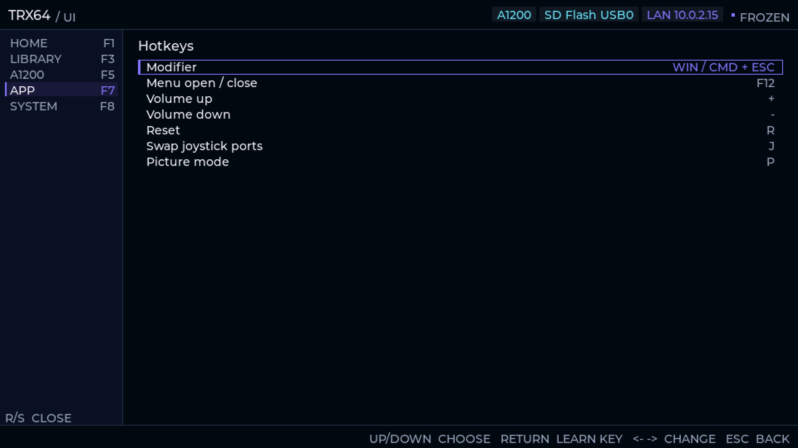

*Figure 11-6. The page `Hotkeys` (**F7** > `Hotkeys`) of the Amiga 1200: the keys are the ones of a USB keyboard (**WIN** / **CMD** + **ESC** is the modifier).*

11.1.15 **Datasette.** The VIC-20, the C264, the PET, the C128 and the C64 with SuperCPU have the setting `Datasette port` (`Off (file only)`, `External datasette`; default `Off (file only)`, live): with `External datasette` a real Commodore datasette on the cassette port of the board is driven (motor, read, sense). The PET also takes a `.tap` file (11.18). Saving to a real tape is not proven.

11.1.16 **Drives of the C64 family.** The VIC-20, the C264, the C128 and the C64 with SuperCPU have drive A as a 1541 (the C128 and the SuperCPU also a 1581) on the IEC bus, with the same rows: `Drive` (`Disabled`, `Enabled`; default `Enabled`), `Drive Bus ID` (8 to 11; default 8), `Extra RAM` (`Disabled`, `Enabled`; default `Disabled`), `Disk swap delay` (100 ms to 1000 ms; default 100 ms). A disk image has the actions `Mount Disk`, `Mount Disk Read Only`, `Mount Disk Unlinked`, `Run Disk`, `Browse Disk` (a `.prg` inside a `.d64` or `.d81`: `Mount & Run`, `Real Run`); `.g64` has the first four. A `.rom` has `Set as 1541 ROM`. **RETURN** on the row `Drive A:` of Home opens the page of the drive. Empty it lists `Mount from Library...`, `Create blank D64`, `Create blank G64` (and `Create blank D81` in the C128 and the SuperCPU); with a disk in it, `Eject`, `Replace from Library...`, `Swap disk`, `Reset drive`, `Unlink disk`, `Save Disk as D64`, `Save Disk as G64`. The rows that make or save a file ask a name. The 1541 ROM (`1541.rom`, 16,384 or 32,768 bytes, 12.2.7) is optional: without it the machine runs without a drive.

## 11.2 TRX64 (C64)

11.2.1 The C64 reference core, the gateware of TRX64 Ultimate. It comes as two `.cor` files with the same gateware: `trx64u.cor` runs our common application (the menu of 11.1.3), `trx64g.cor` runs Gideon's Ultimate application (11.3). `trx64u.cor` has the five areas of 11.1.3 and no others; what the common menu does not have as an area is a row:

- **F1** Home (Figure 11-7): `Reset`, `Reload ROMs, reset`, `Timewarp...` and `Monitor...` (they open the Timewarp overlay and the monitor), the slots `Drive A:` and `Cartridge port`, `Program`, `Save as config...`, `Load config...`. The hotkeys **CTRL** + **T** (Timewarp) and **CTRL** + **O** (Monitor) open the same two screens; both are rows on the page `Hotkeys` of **F7** and can be learned anew there (11.1.14).
- **F3** Library: the tabs `Browse`, `Search` and `Online` (Assembly64 and CommoServe).
- **F5** (named `C64`), six tabs: `C64` (headings `Machine`: `Fast reset`, `Kernal ROM`, `Basic ROM`, `Char ROM`; `Drive A`; `Drive extras`; `Hardware`: `DMA load mimics ID`, `Bus operation mode`, `Badline timing`, `SuperCPU detect (D0BC)`; Figure 11-9), `TRX` (`TRX64`: `Freeze mode`, `Turbo control`, `CPU speed`; `Recording`: `Timewarp ring`, `Instruction trace`, `Save frame`, `Save the ring`; Figure 11-10), `Expansion` (`Cartridge`, `REU` and `Ultimate`: `Ultimate audio at $DF20-$DFFF`, `Command interface (UCI)`; Figure 11-11), `Video` (`Picture`: `System mode`, `Picture`; `Output`), `Audio` (`Volumes` with `Volume`, `Pan`, `Speaker`, and the heading `reDIP:SID` with the rows `SID sockets >` and `Emulated SIDs >`, each of which opens a page with the settings of that group; Figure 11-12) and `Input` (`Joystick input`, the mouse rows, `USB controller as joystick` and `Map USB controller buttons >`; Figure 11-13). The REU rows are listed only while the REU is on. The names of the rows about the UltiSID's I/O interface at `$DE00` to `$DFFF` keep the name UltiSID.
- **F7** App: the generic page of 11.1.3 with the rows of TRX64 on it: `Overlay transparency`, `Splash`, `Leave menu on mount` and `Filename overflow squeeze` under `Application`, and under `Apps` `Cartridge dumper`, `Cartridge inspector`, `Flash cartridge` and `Softboot` (not under the MultiCore host). The page `Hotkeys` (Figure 11-14) lists, after the six keys of 11.1.14, `Timewarp` and `Monitor`.
- **F8** System: the page of 11.1.3 with `Restart core`, `Power cycle` and `Power off` under `Actions`, `Network settings >` (DHCP, address, host name, services, time), `Streams >` and `FTP hosts >` under `Network`, and `Board` under `Status` (Figure 11-15). `Restart core` clears the C64's RAM. `Bug report` also writes the heap and the EDID of the screen.

The USB gamepad service of 11.1.12 drives the joystick lines of TRX64: `USB controller as joystick` makes a USB pad or controller joystick port 1 or 2, and `Map USB controller buttons` lets you press each button once to map it. The WASD keys keep working as before. The Device rows of the Ultimate firmware (power on after power loss, LED select, colour scheme) and the debug-log, heap and EDID rows are not in this menu.

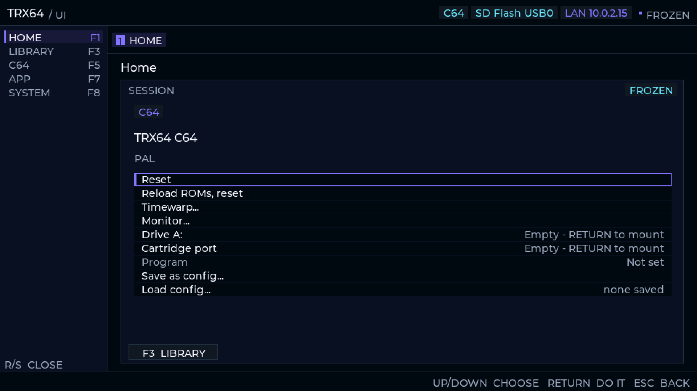

*Figure 11-7. F1 Home of `trx64u.cor` in ue2emu at 1920 x 1080.*

*Figure 11-8. **RETURN** on a file in the Library of the C64 core opens the sheet of what to do with it.*

*Figure 11-9. F5, tab 1 `C64` of `trx64u.cor`; the list goes on to `Drive extras` and `Hardware` (`+/-` page it).*

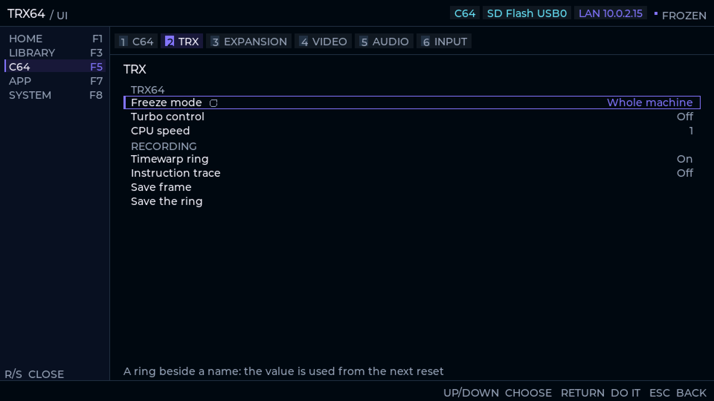

*Figure 11-10. F5, tab 2 `TRX`.*

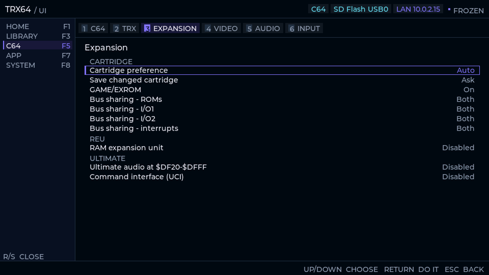

*Figure 11-11. F5, tab 3 `Expansion`. The REU is off, so its rows are not listed.*

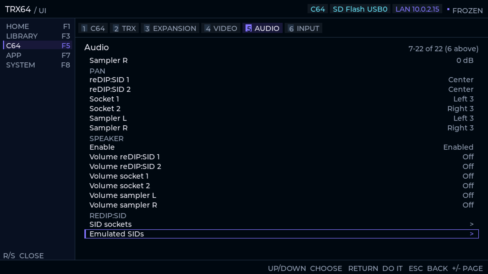

*Figure 11-12. F5, tab 5 `Audio`, scrolled to its end: the heading `reDIP:SID` (drawn in capitals like every heading) over `SID sockets >` and `Emulated SIDs >`.*

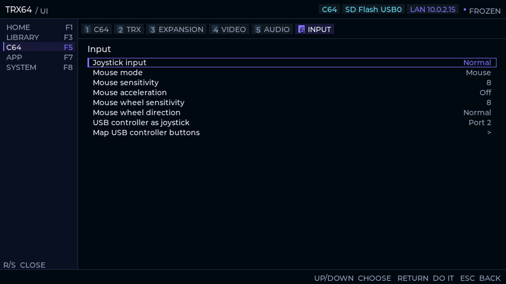

*Figure 11-13. F5, tab 6 `Input`.*

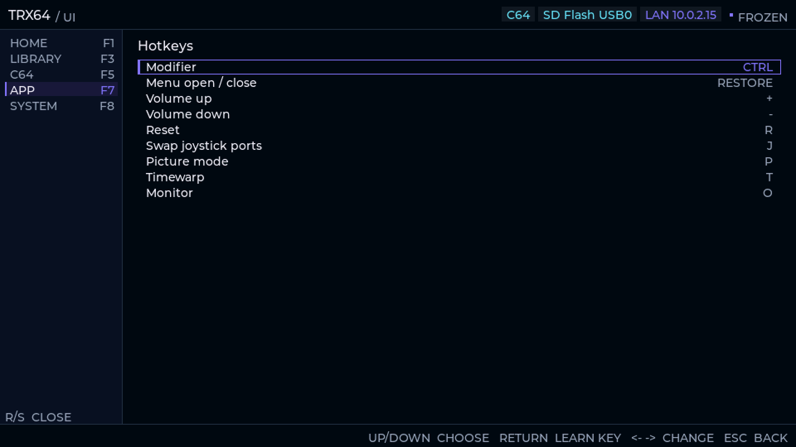

*Figure 11-14. **F7** > `Hotkeys`: the modifier **CTRL**, the keys of 11.1.14 and the keys of Timewarp (**T**) and the monitor (**O**).*

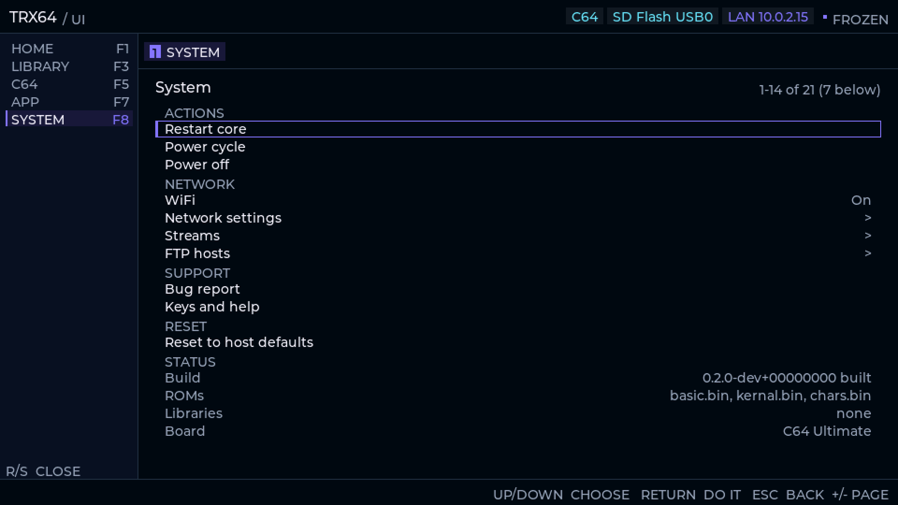

*Figure 11-15. F8 System of `trx64u.cor`.*

11.2.2 ROMs. The core needs BASIC (`basic-901226-01.bin` or `basic.bin`, 8,192 bytes), KERNAL (`kernal-901227-03.bin` or `kernal.bin`, 8,192) and the character ROM (`chargen-901225-01.bin` or `chars.bin`, 4,096); at its first start the core copies them from the board's flash (`/flash/roms`) into its own folder (12.1.2). The 1541 ROM is optional. In the C64 settings the items `Kernal ROM`, `Basic ROM` and `Char ROM` (tab 1 of **F5**) name another file: the default is empty and reads `Built-in` (the files above); a name is read from `/flash/roms` (or a full path with a leading `/`) and must be exactly 8,192, 8,192 and 4,096 bytes, else the setting is refused with a message. A `.bin` in the Library has `Set as Kernal ROM`, `Set as BASIC ROM`, `Set as Char ROM`, a `.64c` has `Set as Kernal ROM`.
`trx64g.cor` (the Ultimate application) uses the flash as the original firmware does: a Kernal that is missing or not exactly 8,192 bytes is replaced by the built-in one; so is a missing Char ROM; Basic has no built-in copy.

11.2.3 Media of `trx64u.cor` (the file types of the Library): `.d64` and `.g64` (drive A; a `.prg` inside a `.d64`), `.prg` and `.p00` (`Run PRG`, `Load PRG and start from`, `DMA (load, do not run)`), `.crt` (`Run Cartridge`), `.reu` (`Load into REU`, `Preload on Startup`), `.t64` (`Enter`), `.rom` (`Set as 1541 ROM`), `.cfg` (`Load Settings`), `.vpl` (`Apply Palette`, `Set as Default`), `.c64re` (`Load Timewarp state`), `.u2a` (`Run app`), `.cfw` (`Run Update`). `trx64g.cor` takes what the Ultimate application takes (`.d64` `.d71` `.d81` `.dnp` `.g64`, `.prg`, `.crt`, `.tap`, `.t64`, `.reu`, `.sid`).

11.2.4 Back to the host: switch the power off and on (`trx64u.cor` has no `Return to host menu`: its bitstream is the monolith of TRX64 Ultimate, which does not answer as the host's loader, 11.1.4). **F8** System > `Actions` has `Power cycle` and `Power off`.

## 11.3 TRX64 with the Ultimate application (`trx64g.cor`)

11.3.1 The same gateware as 11.2 with Gideon's Ultimate application and its menu (the Menu button, a file, **ENTER**). It writes
its settings to `cores/trx64g/trx64g.cfg` when the host hands over the path of its `.cor` (11.1.10). Without the hand-over it uses the flash configuration pages, as the original firmware does.

11.3.2 ROMs, media and the way back to the host are the same as for `trx64u.cor` (11.2.2 to 11.2.4). Switch the power off and on to return to the host.

11.3.3 There is no separate C64U core with the feature set of the original firmware. That plan (T103) was dropped: for a C64 with the original firmware, start the original (a `.cfw` or a
backup `.cor`, chapter 13).

## 11.4 VIC-20

11.4.1 ROMs in `cores/vc20/roms/`: `kernal.bin` (8,192 bytes, PAL), `basic.bin` (8,192), `char.bin` (4,096). All three are
needed. The core is PAL only. Other names that it takes are in 12.4.4.

11.4.2 The application reads only this folder; a file that lies in an old place (12.2.3) is copied there once. It keeps trying while
the stick mounts. After about 10 seconds the screen says what is missing.

11.4.3 Media: `.prg` and `.p00`: `Run PRG` resets and runs, `Load PRG (no reset, no start)` loads into the running machine without typing. Drive A is a 1541 on the IEC bus (11.1.16): `.d64` and `.g64`. Home slots: `Program` and `Drive A:`.

11.4.4 Settings (F5): `Memory Expansion` (`Unexpanded`, `+3K`, `+8K`, `+16K`, `+24K`, `+3K +24K`, `+3K +24K +8K at $A000`; default `Unexpanded`, at next reset), `Block 5 ($A000), when expanded` (`RAM`, `ROM (read only)`; default `RAM`, at next reset), `JiffyDOS` (`Off`, `On`; default `Off`, at next reset), `Datasette port` (11.1.15) and the drive rows (11.1.16). F7: `Reset`, `Reload ROMs, reset`, and the drive tasks.

11.4.5 JiffyDOS (T199): two optional files in `cores/vc20/roms/`, used only by the setting `JiffyDOS` and only as a pair: the VC-20 KERNAL (`jiffydos-vc20.bin`, 8,192 bytes; also `jiffydos_vc20.bin`, `jiffydos-vic20.bin`, `jiffydos_vic20.bin`, `jiffydos-kernal-vc20.bin`) and the 1541 ROM (`jiffydos-1541.bin`, 16,384 or 32,768 bytes; also `jiffydos1541.bin`, `jiffydos_1541.bin`, `jiffydos-1541-ii.bin`, `jiffydos1541-ii.bin`, `jiffydos.bin`).

## 11.5 Commodore 264 (C16, Plus/4)

11.5.1 ROMs in `cores/c264/roms/`: `kernal.bin` and `basic.bin` (16,384 bytes each, PAL). The
Plus/4 model also takes `3plus1lo.bin` and `3plus1hi.bin` (16,384 each). Without the two function ROMs the Plus/4
model has BASIC and no built-in programs.

11.5.2 Media: `.prg` and `.p00` (`Run PRG`, `Load PRG (no reset, no start)`). A `.bin` of 16 or 32 KB has `Load as cartridge (Plus/4)`. Drive A is a 1541 as in 11.1.16 (`.d64`, `.g64`, optional `1541.rom`).

11.5.3 Settings (F5): `Model` (`C16 / C116`, `Plus/4`; default `Plus/4`, at next reset), `RAM` (`16 KB (C16, C116)`, `64 KB`; default `64 KB`, at next reset), `Joystick ports` (`Joystick 1 = port 1`, `Swapped`; at next reset), `Datasette port`, and the drive rows. F7: `Reset`, `Reload ROMs, reset`, `Eject cartridge and reset`, and the drive tasks.

## 11.6 Amiga (OCS/ECS, 68000)

11.6.1 ROM: **one Kickstart** as a `.rom` file of exactly 262,144 or 524,288 bytes in `cores/amiga/roms/` (the Amiga 1200: `cores/amiga1200/roms/`). The file name does not
matter.

11.6.2 The core reads the version from the image. The setting **Kickstart file** (`Auto (1.3 first)`, then up to eight files by name; at next reset) with `Auto` takes Kickstart 1.3 first, else an older one, else
any Kickstart.

11.6.3 The core needs a plain image. A file whose first two bytes are not `11 11` or `11 14`, or whose version word (offset 12) is not between 30 and 60, is not recognised. A file that needs
a `rom.key` of the package maker must be converted by you first.

11.6.4 A plain reset reloads the Kickstart when you picked another file. **Reload Kickstart, Reset** (on Home) always does.

11.6.5 Media from the **F3** Library: `.adf` (`Mount DF0`, `Mount DF0 and reset`, `Mount DF1` to `Mount DF3`), `.hdf` (`Mount HD0`, `Mount HD1`). The drive is empty after start. Tasks (11.1.3): `Reset Amiga`, `Reload Kickstart, Reset`, `Eject DF0` to `Eject HD1`, `Create blank ADF`, `Mount folder as HD0`, `Mount folder as HD1` (each asks a name; a folder of the card as a hard disk).

11.6.6 Settings (F5), all at next reset unless noted: `Chip RAM` (`512K`, `1M`, `1.5M`, `2M`; default `512K`), `Slow RAM` (`None`, `512K`, `1M`, `1.5M`; default `512K`), `Fast RAM` (`None`, `2M`, `4M`; default `None`), `Chipset` (`OCS`, `ECS`; default `OCS`), `Floppy drives` (1 to 4; default 2), `Floppy write protect` (`No`, `Yes`; default `No`), `Real-time clock`, `Joystick ports` (`Normal`, `Swapped`; live), `LED Load Indicator` (live), and in the tab `Input` the mouse rows (11.1.12).

11.6.7 **Real-time clock (at next reset)**, `Off` or `On` (default `Off`; Amiga 500 and Amiga 1200). `On` puts a battery-backed clock (MSM6242B) at `$DC0000`; the core app sets it to the board's time at core start, and it keeps counting. Amiga Test Kit, `SetClock` and the file stamps use it. A `SetClock SAVE` on the Amiga does not change the board's clock. `Off` is the stock machine: Test Kit says "No Clock Detected". Not checked on the board yet.

## 11.7 Amiga 1200 (AGA, 68020)

11.7.1 The same folder and files as the Amiga. **Auto** takes Kickstart 3.1 first (version 40, the 512 KB A1200 image), else
any 3.0 or later, else any Kickstart (`Auto (3.1 first)`).

11.7.2 Media: `.adf` and `.hdf`, as the Amiga. The settings differ in the defaults and values: `Chip RAM` default `2M`, `Slow RAM` default `None`, `Fast RAM` (`None`, `2M`, `4M`, `5.5M`, `32M (Zorro III)`; default `None`), `Chipset` (`OCS`, `ECS`, `AGA`; default `AGA`).

## 11.8 Atari 800 XL

11.8.1 ROMs in `cores/atari800/roms/`, both required: `ATARIXL.ROM` (exactly 16,384 bytes) and `BASIC.ROM` or `ATARIBAS.ROM`
(exactly 8,192 bytes). Upper or lower case does not matter. The core checks the size, not the content.

11.8.2 Media: `.atr` and `.xfd` (`Mount D1: and cold start`, `Mount D1:`, `Mount D2:` to `Mount D4:`), `.xex` `.obx` `.com` (`Run (boot disk in D1:, cold start)`), `.car`
`.rom` `.bin` (`Insert cartridge, cold start`). Home slots: `D1:` to `D4:` and `Cartridge`.

11.8.3 Settings (F5): `RAM size` (`64 KB`, `128 KB`, `320 KB Compy Shop`, `320 KB Rambo`, `576 KB Compy Shop`, `576 KB Rambo`, `1088 KB Rambo`; default `64 KB`, at next reset), `Video standard` (`PAL`, `NTSC`; default `PAL`, at next reset), `Joystick ports`, `CPU speed` (`1x`, `2x`, `4x`, `8x`; default `1x`), `LED Load Indicator`. F7: `Reset`, `Cold start`, `Reload ROMs, cold start`, `Remove cartridge, cold start`, `Eject D1:` to `Eject D4:`, `Create blank ATR`.

## 11.9 Nintendo Entertainment System

11.9.1 No ROM needed. A `.nes` file carries its program. Start it from the file browser (`Run`).

11.9.2 The pad is the hardware of the C64: a joystick on each port and the keyboard. A USB gamepad works as well (11.1.12): the default map takes the pad's bottom button as B and the right one as A.

| NES | Port 1 | Port 2 |
|---|---|---|
| Up, Down, Left, Right | Joystick 1 | Joystick 2 |
| A | Fire | Fire |
| B | **Space** | **Right shift** |
| Select | **F3** | **F7** |
| Start | **F1** | **F5** |

11.9.3 Settings (F5): `Console type` (`NTSC`, `PAL`, `Dendy`; default `NTSC`, at next reset), `Joystick ports` (`Normal`, `Swapped`; live), `Pad map`. Home: `Reset`; tab `Input` of F5: `Map buttons, pad 1`, `Map buttons, pad 2`. Home slot: `Cartridge`.

## 11.10 Apple IIe

11.10.1 ROMs in `cores/apple2/roms/`: `apple2e.rom` (16,384 bytes; a file whose reset vector is not `$FA62` is refused),
`apple2e-video.rom` (8,192), and `diskii.rom` (256 bytes). The first two start the machine. **Mounting any disk image needs
`diskii.rom`.** Without it the mount is refused with a message. The ROM is picked up at the next ROM reload.

11.10.2 Media: `.dsk` `.do` `.nib` `.woz` (floppy: `Mount D1: and cold start` starts the machine from the disk, `Mount D1:`
swaps the disk without a reset, `Mount D2:` only mounts). `.po` and `.2mg` take the floppy actions and the hard disk actions, `.hdv` the hard disk actions only: the ProDOS hard disk of slot 7 (`Mount S7 unit 1 and cold start`, `Mount S7 unit 1`, `Mount S7 unit 2`). Home slots: `D1:`, `D2:`, `S7.1`, `S7.2`.

11.10.3 Settings (F5), all live: `Display` (`Colour`, `Black and white`, `Green`, `Amber`; default `Colour`), `Palette` (`Original`, `IIgs`, `AppleWin`; default `Original`), `Scanlines` (`Off`, `On`), `Character ROM set` (`First 4 KB`, `Second 4 KB`), `Joystick ports`, `CAPS LOCK` (`On`, `Off`, `Follow SHIFT LOCK`; default `Follow SHIFT LOCK`), `LED Load Indicator`. F7: `Reset (Ctrl-Reset)`, `Cold start`, `Reload ROMs, cold start`, `Eject D1:`, `Eject D2:`, `Eject S7 unit 1`, `Eject S7 unit 2`, `Create blank DSK`.

## 11.11 ZX Spectrum 48K / 128K

11.11.1 ROMs in `cores/zx/roms/`: `48.rom` (16,384 bytes) for the 48K, `128.rom` (32,768 bytes) for the 128K. One of the two is
enough. If the **Model** setting names the model whose file is missing, the other model runs and the screen says so.

11.11.2 Media: `.sna` and `.z80` (`Run snapshot`: the machine starts where the snapshot was taken). `.tap` and `.tzx` (`Insert tape`, `Insert tape and play`, or the task **Tape: Play**; real speed). Tapes with pulses shorter than 16 T-states are refused. There is no
tape SAVE. The tasks also include `Tape: Stop`, `Tape: Rewind`, `Tape: Previous block`, `Tape: Next block`, `Tape: Eject`, `Reset`, `Reload ROMs, reset`.

11.11.3 Settings (F5): `Model` (`48K`, `128K`; default `48K`, at next reset), `Joystick port 1` (`None`, `Kempston`, `Sinclair 1 (keys 6-0)`, `Sinclair 2 (keys 1-5)`, `Cursor (5 6 7 8 0)`; default `None`), `Joystick port 2` (same values; default `Kempston`), `Tape sound` (`Off`, `On`; default `Off`).

## 11.12 ZX Spectrum Next

11.12.1 One SD card image with the default name `next.img` in `cores/zxnext/roms/` (or, as the first place the core looks after its own folder, in `roms/zxnext/` of a medium). It is the whole card as the Next reads it (the partition table, the
FAT with the operating system files). Another name is not found by itself: pick the file in the **F3** Library (11.12.2). The machine's own boot ROM is in the core and loads `TBBLUE.FW` from the image.
Nothing of the Next's system is shipped here.

11.12.2 Alternative: pick an `.img` in the **F3** Library and use `Mount SD image and reset` (or `Mount SD image`). What the machine writes to
its card goes back into the file. Tasks (11.1.3): `Reset`, `Eject the SD image`, `F3: 50 / 60 Hz`, `F8: CPU speed`, `NMI: Multiface (M1 button)`.

11.12.3 Without an image the boot ROM stops with `Error initializing SD card!`. The core looks for the image again once a second, so a stick that mounts late is found and the machine starts over with it.

11.12.3a **Board issue.** The setting `Board issue` (`Auto`, `Issue 2`, `Issue 4`, `Issue 5`; default `Auto`, at next reset) names the board revision that the machine reports to the Next's firmware. `Auto` takes the issue from the firmware on the image and reports `Issue 5` with a notice when it cannot tell. A card image whose older `TBBLUE.FW` stops with `wrong board revision` needs a lower issue by hand. The other settings are `Frame lock to 50 Hz` (`On`, `Off`; default `On`) and `Joystick ports`.

11.12.4 The speed of a program that does not fit the cache is below the real machine's. The 128K, +3 and Pentagon timing
run 1.5 to 2.7 % fast. There is no Sega 6-button pad and no SD pass-through.

## 11.13 Commodore 128

11.13.1 One system ROM image of 72 KiB (73,728 bytes), the layout of MiSTer's `boot0.rom`, in `cores/c128/roms/`. The names that the core takes: `boot0.rom`, `c128.rom`, `c128-system.rom`, `c128_system.rom`. The 1541 and 1581 ROMs are optional (12.2.7). So are the JiffyDOS files of your kit; you select each one yourself, the core never looks for them by name (11.13.4; sizes and what each replaces in 12.4.6). A `.rom` in the Library has `Load as system ROM image (72 KiB)` and `Set as 1541 ROM`.

11.13.2 Drive A is the 1541 and the 1581 (11.1.16): `.d64`, `.g64` and `.d81`; the menu creates blank images. Settings (F5): `40/80 DISPLAY` (`40 columns`, `80 columns`; at the reset), `Picture shown` (`40 columns (VIC-IIe)`, `80 columns (VDC)`; live; the VIC-IIe through the scaler, or the VDC at 640 x 400), `Auto switch` (`Off`, `On`; default `On`) with `Auto switch time` (`0.5 s`, `1 s`, `2 s`, `3 s`; default `1 s`), `Joystick ports`, `Datasette port`, `System Mode` (`PAL`, `NTSC`, `PAL-60`, `NTSC-50`; default `PAL`), `ROM set` and the four JiffyDOS rows (11.13.4), and the drive rows. The analogue output (S-video and composite) is in development (3.6.5).

11.13.3 Not in this core: the cartridge port, the REU and the PRG library (the Library offers no `.prg`, `.crt` or `.reu` action). The extra keys of the C128 keyboard work from a USB keyboard (T141).

11.13.4 The setting "ROM set" on the F5 Settings tab: Standard or JiffyDOS, taken at the next reset. The machine always starts Standard; JiffyDOS is only used when you set "ROM set" to JiffyDOS and have selected its files. Below it are four rows, "JiffyDOS C128 ROM", "JiffyDOS C64 ROM", "JiffyDOS 1541 ROM" and "JiffyDOS 1581 ROM". Each shows the selected file or "Not selected"; RETURN opens a file selector (the first row, "No file", clears the selection), or use **F3**, the file's action sheet, "Use as JiffyDOS ... ROM" (on `.rom` and `.bin` files). The file is checked when you choose it; a refused file is not taken and the status line says why. With JiffyDOS the machine starts on the C128 KERNAL you selected and, when selected, the C64 KERNAL; drive A takes the JiffyDOS ROM of its type (1541 or 1581) when selected, the stock ROM otherwise. With nothing selected the machine starts Standard and says so; a part without a selected file simply stays standard; if a selected file is missing or no longer readable, that part stays standard and the notice says why. A selected file is read again at every start.

## 11.14 Super Nintendo

11.14.1 No ROM and no BIOS: the 64-byte boot ROM of the sound processor is part of the core. A game is a `.sfc` or `.smc` file from the **F3** Library (`Run`). The core reads the header, refuses what it cannot run, and puts the
image into the memory of the board. Battery RAM is written back to `cores/snes/saves/<image name>.srm` when it has changed (task `Save the battery RAM now`).

11.14.2 The controllers are the C64 joysticks and the keyboard, or USB gamepads (11.1.12). Settings (F5): `Video standard` (`Auto (cartridge)`, `NTSC`, `PAL`; default `Auto (cartridge)`, at next reset), `Pseudo high resolution` (`Blend`, `512 wide`; default `Blend`, at next reset), `Pad map`, `DSP firmware` (`Auto`, `DSP-1` to `DSP-4`; default `Auto`, at next reset; 11.14.3). F7: `Reset`, `Save the battery RAM now`, `Sound check`, `Map buttons, pad 1`, `Map buttons, pad 2`.

11.14.3 **DSP-n cartridges** (DSP-1/1B, DSP-2, DSP-3, DSP-4; T218): these run when the chip's firmware is found, for example Super Mario Kart and Pilotwings (DSP-1). The firmware is not part of the core; you supply it (files and places in 12.4.8). The setting `DSP firmware` (F5, taken at the next reset) chooses the chip: `Auto` (default) takes it from the header's title (Dungeon Master is a DSP-2, SD Gundam GX a DSP-3, Top Gear 3000 a DSP-4, every other DSP cartridge a DSP-1); `DSP-1` to `DSP-4` force that chip for every DSP cartridge (other cartridges are not affected). Without the firmware the game is refused and the message names the chip, the file(s) and the folder, for example `"SUPER MARIO KART" needs the DSP-1 coprocessor and its firmware (8192 bytes) is missing: put dsp1b.bin or dsp1.bin in <core folder>/roms/ (or roms/snes/ on a drive), or append it to the .sfc.` A DSP-n cartridge in ExHiROM is refused. The other chips (SA-1, Super FX, Cx4, S-DD1, SPC7110, ST010/ST011) are still refused. State: built and proved in simulation with a firmware of our own; not yet run on the board with a real firmware.

## 11.15 SNK Neo Geo

11.15.1 Files in `cores/neogeo/roms/`: a BIOS (`sp-s2.sp1` or `sp-s1.sp1` for the MVS, `neo-epo.sp1` or `neo-po.sp1` for the AES, or `uni-bios.rom`, 131,072 bytes each), the zoom table `000-lo.lo` (65,536 or 131,072 bytes) and the fix ROM
`sfix.sfix` (131,072 bytes). The BIOS is chosen by a setting. A game is a `.neo` file (`Run`), or a folder with the files of a cartridge and an entry in the `romsets.xml` that you provide (task `Load a ROM set from a folder`, asks a name). No ROM, BIOS or game is part of the firmware.

11.15.2 Save data (the backup RAM and the memory card, 72 KB) goes to `cores/neogeo/saves/<game>.sav` (task `Save the memory card and backup RAM now`).

11.15.3 Settings (F5): `System type` (`Console (AES)`, `Arcade (MVS)`; default `Console (AES)`, at next reset), `BIOS` (`Universe BIOS`, `Original BIOS`; default `Universe BIOS`, at next reset), `Video mode` (`NTSC`, `PAL`; at next reset), `Memory card` (`Plugged`, `Unplugged`; at next reset), the DIP switches `[DIP] Settings menu`, `[DIP] Free play`, `[DIP] Freeze` (`Off`, `On`; live), `Joystick ports`, `Pad map`.

11.15.4 USB gamepad (11.1.12): the default map is by **position**, as on the Neo Geo CD pad: the pad's bottom button is A, right B, left C, top D; the shoulder `L` is Coin; Start and Select as printed. The alternative (by name: SNES A = A) is a table change that has not been
made.

## 11.16 Showcase: mandelbrUlt and Look Ma, No VIC

11.16.1 Two C64U demos by DDT as cores that show their picture over the HDMI of the host: `DDT Mandelbrot (mandelbrUlt)` and `DDT Look Ma, No VIC`. No ROM and no media. The menu has the areas of 11.1.3; its task is `Reset`. Both are experimental.

## 11.17 Port Diagnostics

11.17.1 The core `diag` (T175) has no machine. It measures the joystick and paddle ports with test files that are `.toml` files in the folder `tests/` of its core folder, and writes the result (`<test>_<date>.toml` and `.txt`) to `results/` there. It is for development and for testers. It is a large core (packed as a `.cor` like the other large cores) and experimental.

11.17.2 Library: a `.toml` has `Run test` and `Load A/V preset`. Tasks (11.1.3): `Pick a test and run it`, `Write the example tests` (writes the example tests into `tests/`), `Save A/V preset` (asks a name). Home slots: `Port 1`, `Port 2`, `Comparators`, `Last test`. The settings of **F5** (tab `DIAG`) are those of the A/V test picture, all live: `Standard` (`PAL 50 Hz`, `NTSC 60 Hz`, `PAL 60 Hz`, `NTSC 50 Hz`), `Groups`, `Bits A`, `Bits B`, `Bits C`, `V sign`, `Subcarrier trim`, `Burst start`, `Burst end`, `Burst level`, `Chroma gain`, `Sync level`, `Blank level`, `White level`, `Equalizing`, `Vsync length`, `Vsync position`, `Lines 60 Hz`.

## 11.18 Commodore PET

11.18.1 The Commodore PET (2001, 3032, 4032, 8032, 8096 and SuperPET) as a large core, experimental. Its ROMs are those of the model; none is shipped. They go into `cores/pet/roms/`, with the names of the VICE distribution (each model takes the files of its own row only: with one missing the model does not start and the screen names the missing file; generic names such as `basic.bin` are not taken). The setting `Picture rate` chooses the 60 Hz or the 50 Hz editor ROM.

| Model | BASIC | Editor 60 Hz | Editor 50 Hz | KERNAL | Characters |
|---|---|---|---|---|---|
| 2001 | `basic-1.901439-09-05-02-06.bin` | `edit-1-n.901439-03.bin` | the same | `kernal-1.901439-04-07.bin` | `characters-1.901447-08.bin` |
| 3032 | `basic-2.901465-01-02.bin` | `edit-2-n.901447-24.bin` | the same | `kernal-2.901465-03.bin` | `characters-2.901447-10.bin` |
| 4032 | `basic-4.901465-23-20-21.bin` | `edit-4-40-n-60Hz.901499-01.bin` | `edit-4-40-n-50Hz.901498-01.bin` | `kernal-4.901465-22.bin` | `characters-2.901447-10.bin` |
| 2001 + BASIC 2 | `basic-2.901465-01-02.bin` | `edit-2-n.901447-24.bin` | same | `kernal-2.901465-03.bin` | `characters-1.901447-08.bin` |
| 8032, 8096 | `basic-4.901465-23-20-21.bin` | `edit-4-80-b-60Hz.901474-03.bin` | `edit-4-80-b-50Hz.901474-04.bin` (or `edit-4-80-b-50Hz.901474-04_.bin`) | `kernal-4.901465-22.bin` | `characters.901640-01.bin` (or `characters-2.901447-10.bin`) |
| SuperPET | `basic-4.901465-23-20-21.bin` | `edit-4-80-b-60Hz.901474-03.bin` | `edit-4-80-b-50Hz.901474-04.bin` (or `edit-4-80-b-50Hz.901474-04_.bin`) | `kernal-4.901465-22.bin` | `characters.901640-01.bin` (4,096 bytes; the upper half is the Waterloo set of the 6809) |

11.18.2 Sizes: BASIC 8,192 bytes (12,288 for BASIC 4, the models 4032 and up), editor 2,048, KERNAL 4,096, characters 2,048 (a 4,096-byte file gives its first 2,048). The core holds until a file of each role is there; the file of the chosen model is looked up again at the start and a missing one is named.

11.18.3 The disk drive (setting `Drive`: `Off`, `4040 (D64)`, `8250 (D80, D82)`; default `Off`, at next reset) needs its ROMs in the same folder, none shipped: for the 4040 `dos4040.bin` (12,288 bytes; also `dos4040-901468-14-16.bin`) and `ctl4040.bin` (2,048 bytes: the controller ROM `901466-04.bin` written twice into one file, one copy after the other); for the 8250 `dos8250.bin` (16,384 bytes; also `dos1001-901887+8-01.bin`, `dos1001.bin`) and `ctl8250.bin` (2,048). The SuperPET's 6809 side takes six optional files (`waterloo-a000.901898-01.bin`, `waterloo-b000.901898-02.bin`, `waterloo-c000.901898-03.bin`, `waterloo-d000.901898-04.bin`, `waterloo-e000.901897-01.bin`, `waterloo-f000.901898-05.bin`); the 6502 runs without them.

11.18.4 Media: `.prg` and `.p00` (`Load`, `Load + run`), `.d64` (4040), `.d80` and `.d82` (8250) (`Mount in Drive 8`, `Mount in Drive 8.1`, `Run Disk`), `.tap` (`Insert tape`, `Insert tape and play`). Home slots: `Program`, `Drive 8`, `Drive 8.1`, `Tape`.

11.18.5 Settings (F5): `Model` (`2001`, `3032`, `4032`, `8032`, `8096`, `SuperPET`, `2001 + BASIC 2`; default `4032`, at next reset; the plain 2001 keeps BASIC 1 and cannot use the disk drive, as the original), `CPU speed` (`x1` to `x8`; live), `Diag jumper` (`Off`, `On`; at next reset; the .cfg key stays `Diag (at next reset)`, an old `On (DIAG jumper)` still reads as On), `Picture rate` (`60 Hz`, `50 Hz`; live), `Phosphor` (`Green`, `Amber`, `White`; live), `RAM` (`8 KiB`, `16 KiB`, `32 KiB`; default `32 KiB`, at next reset; listed for the 2001, 3032 and 4032 only), `Drive`, `Datasette port` (11.1.15) and, only while the model is the SuperPET, `SuperPET CPU` (`6502`, `6809`, `Program ($EFF8)`; default `6502`, at next reset) and `SuperPET RAM` (`32 KiB`, `96 KiB`: the 64 KiB bank RAM beside the 32 KiB; default 96 KiB, at next reset). In the Input tab: `Keyboard mapping` (`Symbolic`: the key legend counts, `Positional`: the PET key at the same place; default Symbolic; live), `Pad / joystick up`, `down`, `left`, `right`, `fire` (the C64 key a USB pad or joystick button presses; default 8, 2, 4, 6, Space; live) and `Pad map` (`Default`, `Custom`). F7: `Reset`, `Reload ROMs, reset`, `Tape: Play`, `Tape: Stop`, `Tape: Rewind`, `Tape: Eject`, `Map buttons, pad 1`, `Map buttons, pad 2`.

## 11.19 C64 with SuperCPU (not in a release)

11.19.1 The core `c64scpu` is `build_only = true` in its `core.toml`: it is built and packed for the board (`.cfw`) but never goes into a release or the bug-report form, and it is experimental. It needs your own SuperCPU ROM and the C64 ROMs in `cores/c64scpu/roms/`: `scpu64.rom` (131,072, 65,536 or 262,144 bytes; also `scpu.rom`, `supercpu.rom`, `scpu64-v2.04.rom`), `basic-901226-01.bin` (8,192), `kernal-901227-03.bin` (8,192), `chargen-901225-01.bin` (4,096); optional the 1541 ROM, the 1581 ROM and the JiffyDOS 1541 and 1581 ROMs (12.2.7).

11.19.2 Library: `.d64`, `.g64`, `.d81` as in 11.1.16 (no `.prg` action). Settings (F5): `SuperCPU speed` (`20 MHz`, `1 MHz`; default `20 MHz`), `JiffyDOS` (`Off`, `On`; default `Off`), `Joystick ports`, `Datasette port`, `System Mode` (`PAL`, `NTSC`, `PAL-60`, `NTSC-50`; default `PAL`) and the drive rows. F7: `Reset`, `Reload ROMs, reset` and the drive tasks.
