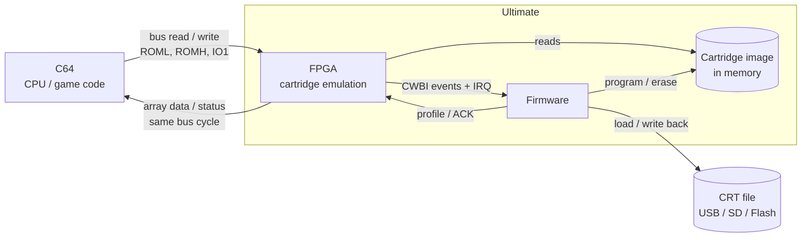
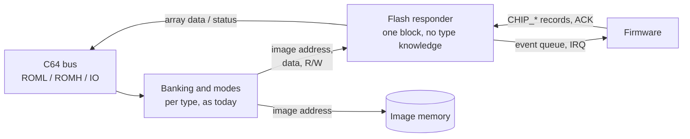
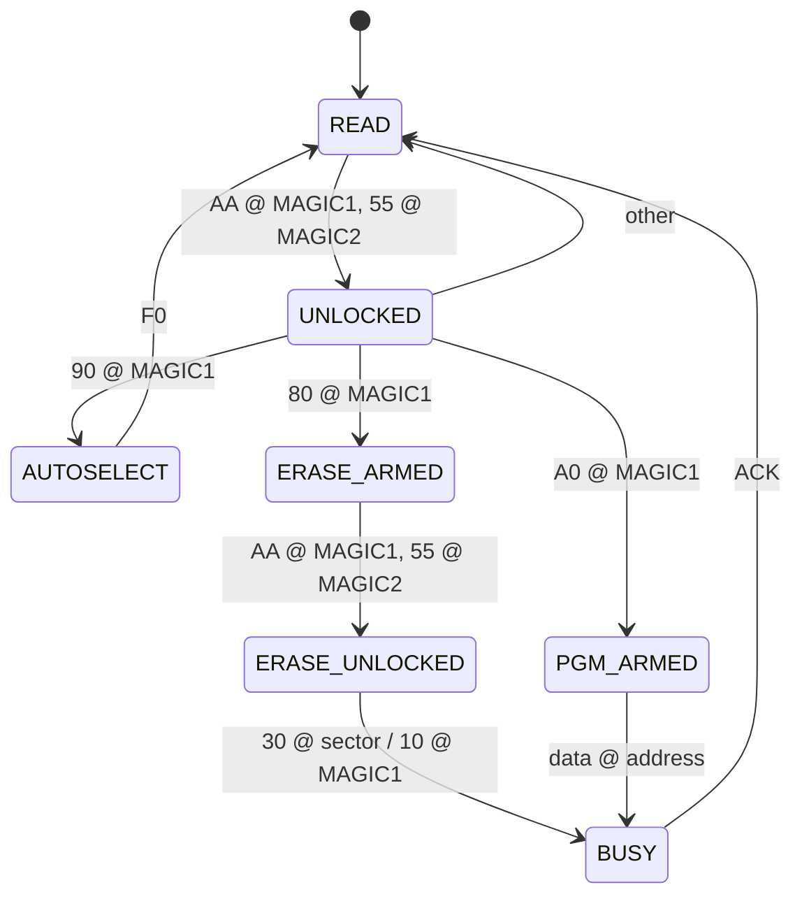
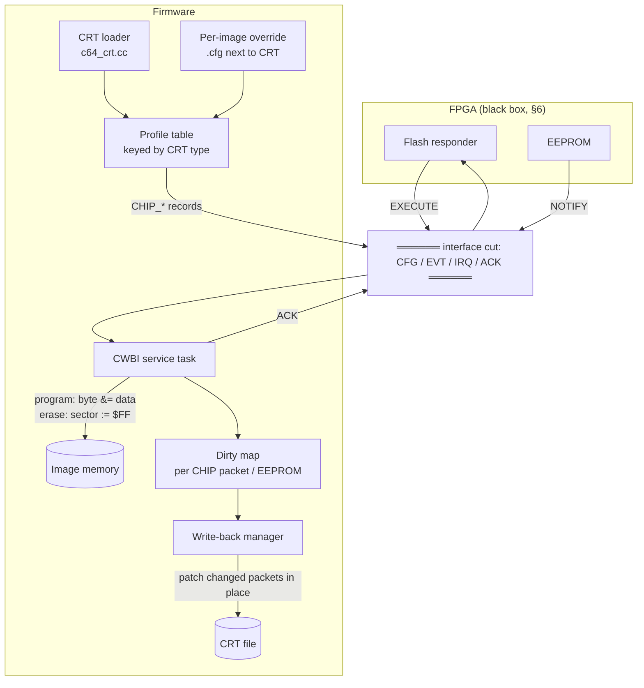
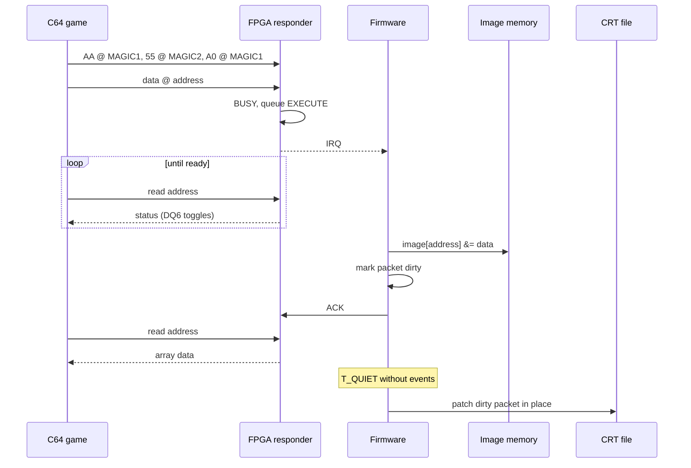
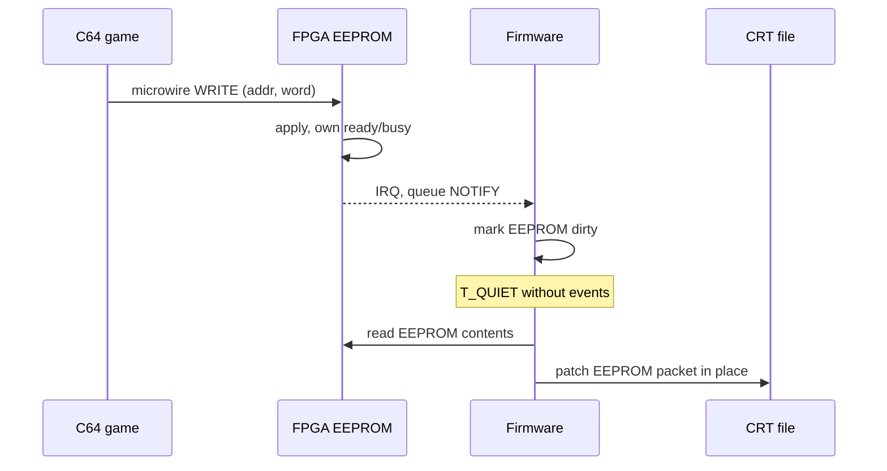

# PROPOSAL — Cartridge Write-Back Interface (CWBI)

| | |
|---|---|
| Doc | TREX-PROP-001 |
| Rev | D (draft) |
| Date | 2026-09-30 |
| Scope | Cartridge emulation with persistent storage. U2+ / U2+L / U64 / U64-II / C64U |
| Status | Proposal for review |

---

## 1. Purpose

1.1 Define one contract between FPGA and firmware for every write a C64
program makes to persistent cartridge storage.

1.2 The contract covers: accepting the write, keeping the C64 view consistent,
and returning the change to the CRT file.

## 2. Current state

2.1 Write support is implemented per cartridge in
`fpga/cart_slot/vhdl_source/all_carts_v5.vhd`. References are to upstream
`master` 37feecfa (2026-09-29) and name the function or signal, so they survive
line shifts.

2.2 **EasyFlash (type 32).** `$DE09 := $65` arms `ef_write`; ROM becomes plain
writable memory in Ultimax mode (`all_carts_v5.vhd`, `c_easy_flash`,
`ef_write`). The EAPI in the image is replaced at load by `_eapi_65`, which uses
that path (`c64_crt.cc`, `patch_easyflash_eapi`). No AMD command decoding.

2.3 **Megabyter (type 86/87).** Bank register `$DE00` and mode register `$DE02`
only (`all_carts_v5.vhd`, `c_megabyter`). No write path. Type 87 (TwoMegabyter, variant 1)
drives `GAME` from bit 0 and `EXROM` from bit 1; the Protovision guide and API
(R7) define bit 0 = `EXROM`, bit 1 = `GAME`, i.e. `$DE02 = $01` is Ultimax. The
current decode makes `$01` an 8K mode, so the flash mode is unreachable.

2.4 **GMod2 EEPROM (type 60).** Emulated in the FPGA
(`fpga/devices/vhdl_source/microwire_eeprom.vhd`), with its own storage. The
FPGA applies writes itself. Firmware is not told.

2.5 **Write-back.** Firmware cannot see when the image changes.

| Where | How a change reaches the CRT file |
|---|---|
| Upstream `master` | Only by hand: task menu "Save Cartridge" (`c64_subsys.cc`, `MENU_C64_SAVE_CARTRIDGE`, `C64_CRT::save_crt`) |
| PR #929 (open) | Hash of the writable chunks at load, compared when the menu opens (`content_hash`) |
| TREX fork | As #929, plus a task that writes back after 2 s without change, without the menu; PR #944 keeps the UCI at `$DE1C` for every EasyFlash, so the swapped EAPI's sector erase reaches the firmware |

All three depend on the EAPI swap (2.2) and see nothing a game writes with its
own flash code.

2.6 **Measured** on C64U, core 1.50, firmware 3.15. Type 86 image; the
sequence runs on the C64 in mode 3:

| Access | Result | MX29F800CB (real part) |
|---|---|---|
| Read `$8000/$8001` | `09 80` | `09 80` |
| Autoselect `$AA/$55/$90`, read `$8000/$8001` | `09 80` | `C2 58` |
| Program `$00` → `$8100`, read after 0.3 s | `40` (unchanged) | `00` |

Reference result from ue2emu cart slot (TRX64 flash model): `C2 58`, `00`.

2.7 **Reference implementation.** IcePi Zero C64 core (ECP5, LiteX firmware),
branch `easyflash-writable`, implements §6 and §7 for types 32/33, 60 (flash and
EEPROM), 86 and 88. Verified on hardware with C64 code (not DMA): autoselect,
program, 0→1 program, sector erase incl. boot-block sectors and their
neighbours, interleaved autoselect on both EasyFlash chips, stock EAPI,
write-back and reload, and an in-game save (Wasteland EF 1.0.1). Findings that
changed this document are marked *(IcePi)*.

## 3. Problem

3.1 Driver substitution requires a replaceable driver. Games that carry their
own flash code (all Megabyter titles, any EasyFlash title not using EAPI) have
none. Their saves are silently lost.

3.2 Each additional writable cartridge requires FPGA work: the write path is
built per type (2.2, 2.3).

3.3 The original EAPI is modified in the image and must be restored before
write-back (`c64_crt.cc:165`, `original_eapi`).

3.4 Change detection costs a full hash (80 ms for 1 MiB, measured on U64), per
menu open or per poll. Without the TREX task a change is lost if the machine is
switched off before the menu is opened.

## 4. Concept

4.1 The FPGA **reports** every change to persistent cartridge storage as an
event. The firmware **owns** the image and the CRT file.

4.2 Two event classes, one queue:

| Class | Producer | FPGA does | Firmware does |
|---|---|---|---|
| `EXECUTE` | Flash responder (AMD command set) | Detects command, holds chip status on the bus | Applies change to image, then `ACK` |
| `NOTIFY` | Storage the FPGA writes itself (EEPROM) | Applies change | Records the change |

4.3 Chip differences are data (a profile per flash chip, §7.1), not logic.

4.4 **The signal is the write itself.** In 8K and 16K mode a CPU write to
`$8000-$BFFF` goes to C64 RAM. A write reaches ROML or ROMH only in Ultimax
mode, directly (EasyFlash, Megabyter, TwoMegabyter) or through `$E000` (GMod2,
C64MegaCart). A program that does this means the flash. The AMD unlock sequence
(`AA` at the first unlock address, `55` at the second, then the command) makes
it unambiguous; a write without it changes nothing (6.3.5).

4.5 **One responder behind the existing banking, for every type.** The
cartridge emulation already turns each ROML/ROMH access into an address in the
image, per type, with the bank and mode registers it has today. The flash
responder sits after that step and sees only image address, data and
read/write. It does not know the cartridge type, its registers or its modes.
Adding a writable cartridge type adds a profile record in firmware, not FPGA
logic. How a board banks is out of scope here; a data-driven version of that
is a separate proposal (TREX-PROP-002, `PROP-002-cartridge-mapping-descriptor.md`).

4.6 Rationale for `EXECUTE`: the AMD protocol is asynchronous by design.
Software polls status until the part reports ready. Firmware latency is
absorbed by the busy phase that a real part also has.

4.7 Write-back is driven by events. Hashing is not required.

## 5. Context view

## 6. FPGA — functional specification (black box)

6.1 Implementation is not specified. Only observable behaviour and the
register interface are specified.

### 6.2 Interface

One chip record per flash chip in the image (EasyFlash: two), up to four:

| Register | Dir | Content |
|---|---|---|
| `CHIP_BASE`, `CHIP_SIZE` | FW→FPGA | Region of the image this chip occupies |
| `CHIP_ENABLE` | FW→FPGA | Responder on/off for this chip |
| `CHIP_MAGIC1`, `CHIP_MAGIC2` | FW→FPGA | Unlock addresses, chip-relative |
| `CHIP_MASK` | FW→FPGA | Address bits compared for unlock |
| `CHIP_ID_MFR`, `CHIP_ID_DEV`, `CHIP_ID_OFS` | FW→FPGA | Autoselect answer; offset of device ID (1 or 2) |

Shared:

| Register | Dir | Content |
|---|---|---|
| `EVT_*` | FPGA→FW | Head of event queue (§6.4) |
| `EVT_POP` | FW→FPGA | Remove head of queue |
| `ACK` | FW→FPGA | `EXECUTE` request complete; chip leaves `BUSY` |

There is no register for the cartridge type or its modes.

### 6.3 Flash responder

6.3.1 The responder **shall** see every write cycle that the cartridge
emulation maps into the image, as image address and data, whatever the type and
mode. The write belongs to the chip whose region contains the address; writes
outside every enabled region are ignored. Reads **shall** be answered in every
mode in which the chip is visible: the TwoMegabyter API (R7) issues the command
in Ultimax, switches back to 16K mode and polls DQ7 there. The banking and mode
logic of each type is unchanged.

6.3.2 The responder **shall** decode the AMD command set, one state per chip.
The chips of a two-chip board are independent: EAPIInit interleaves the unlock
cycles (`AA` ROMH, `AA` ROML, `55` ROMH, `55` ROML, `90`, `90`) before reading
both IDs. A shared state, or one that drops a sequence when the other chip is
written, fails there *(IcePi)*. The decode logic itself may be shared; only the
state is per chip.

6.3.3 Read response by state:

| State | Read returns |
|---|---|
| `READ` | Array data (unchanged path) |
| `AUTOSELECT` | `CHIP_ID_MFR` at offset 0, `CHIP_ID_DEV` at `CHIP_ID_OFS` |
| `BUSY` | Status: DQ7 = complement of programmed bit (program) / 0 (erase); DQ6 toggles on every read; DQ3 = 1 during erase |

6.3.4 On entry to `BUSY` the responder **shall** queue an `EXECUTE` event,
raise IRQ, and remain `BUSY` until `ACK`.

6.3.5 Writes in `READ` state **shall not** modify the image.

6.3.6 The byte after `A0` is always program data, also when it is `$F0`.
`F0` resets from every other non-busy state.

6.3.7 One operation may be pending per board. While it is, reads of the other
chip return array data *(IcePi; EAPI never programs both chips at once)*.

6.3.8 Every completed unlock (`AA`, `55`) **shall** queue an `OBSERVE` event with
the chip and the chip-relative addresses it was seen at, also for an unlock that
matches no configured pair. The firmware checks the profile against it (7.1.4).
Unlock cycles are rare (one per command), so this does not load the queue.

### 6.4 Event record

| Field | `EXECUTE` (flash) | `OBSERVE` (flash) | `NOTIFY` (EEPROM) |
|---|---|---|---|
| `EVT_CLASS` | `EXECUTE` | `OBSERVE` | `NOTIFY` |
| `EVT_SOURCE` | chip record 0-3 | chip record 0-3, or `NONE` | `EEPROM` |
| `EVT_OP` | `PROGRAM`, `SECTOR_ERASE`, `CHIP_ERASE` | `UNLOCK` | `WRITE`, `ERASE`, `WRITE_ALL`, `ERASE_ALL` |
| `EVT_ADDR` | Image address | Chip-relative address of the `AA` and of the `55` | Word address (n/a for `_ALL`) |
| `EVT_DATA` | Byte to program | Whether the pair matched `CHIP_MAGIC1/2` | Word written |

6.4.1 The EEPROM **shall** keep applying writes itself, including its own
ready/busy signalling. It **shall** additionally queue a `NOTIFY` event per
completed write.

6.4.2 Queue overflow **shall** be reported as a `NOTIFY` event with
`EVT_OP = OVERFLOW`. Firmware then treats the whole source as changed.

### 6.5 Timing

6.5.1 Every bus read **shall** be answered within the C64 bus cycle, in every
state. This is the only reason the function resides in the FPGA.

6.5.2 While `BUSY`, the C64 is not stalled. IRQs and raster code keep running.

6.5.3 Data written by the responder's own sources (EEPROM) **shall not** be
taken from the C64 data bus when the bus also carries memory read data. On the
IcePi this created a combinational read-data → write-data path that failed
timing *(IcePi)*.

## 7. Firmware — functional specification with interface cut

### 7.1 Profile table

7.1.1 Extend the existing type table (`c64_crt.cc`, `c_recognized_c64_carts`)
with a profile reference. Values from the reference implementation
(TRX_CRT_cli `docs/CART_SYSTEMS.md`):

| CRT type | Part | MAGIC1 / MAGIC2 | Mask | ID | ID ofs | Size | Sectors | Chips |
|---|---|---|---|---|---|---|---|---|
| 32/33 EasyFlash | AM29F040B | `$555` / `$2AA` | `$7FF` | `$01` / `$A4` | 1 | 2 × 512 KiB | 8 × 64 KiB | ROML + ROMH |
| 60 GMod2 | AM29F040 | `$5555` / `$2AAA` | `$7FFF` | `$01` / `$A4` | 1 | 512 KiB | 8 × 64 KiB | 1 + EEPROM |
| 86 Megabyter | MX29F800CB (byte mode) | `$AAA` / `$555` | `$FFF` | `$C2` / `$58` | 2 | 1 MiB | bottom boot: 16K, 8K, 8K, 32K, 15 × 64K | 1 |
| 87 TwoMegabyter | MX29F016 | `$555` / `$2AA` | `$7FF` | `$C2` / `$AD` ¹ | 1 | 2 MiB | 32 × 64 KiB | 1 |
| 88 ² C64MegaCart | M29F160FT (byte mode) | `$AAA` / `$555` | `$FFF` | `$01` / `$D2` | 2 | 2 MiB | top boot: 31 × 64K, 32K, 8K, 8K, 16K | 1 |

¹ Datasheet value, not yet checked against the part; the Protovision API (R7)
does not read the ID.
² Not assigned by VICE (86 is the last VICE type; 87 is used by the Ultimate
for the TwoMegabyter). Martin Piper's VICE fork uses 61, which mainline VICE
assigns to MAX Basic. Provisional until an official type exists.

The device ID of the byte-mode x16 parts is at byte address 2 *(IcePi, from the
datasheets; the Rev B table said 1 for the MX29F800CB)*.

7.1.2 Sector geometry is part of the profile. Non-uniform (boot-block) parts
**shall** use the datasheet layout. A uniform approximation is not acceptable.
Affected: MX29F800CB, M29F160FT.

7.1.3 A `.cfg` next to the CRT (`ConfigIO::S_load_associated_config`) **may**
override the profile. Required where one CRT type exists with different parts.

7.1.4 **Selection.** The chip records are written when the CRT is loaded, from
the CRT type (7.1.1) or its `.cfg` (7.1.3). This cannot wait for the first
command: EAPIInit reads the autoselect ID right after `90`, inside the bus
cycle, before the firmware could answer. The `OBSERVE` events (6.3.8) are the
check on that choice:

| Event | Firmware does |
|---|---|
| Unlock on the configured pair | Nothing |
| Unlock on another known pair (`$555/$2AA`, `$5555/$2AAA`, `$AAA/$555`) | Logs the mismatch with the CRT type; switches the chip record to a profile with that pair for the following commands |
| Unlock on an unknown pair | Logs it; the chip stays in `READ` for that sequence |

A type without a profile (new or unknown) therefore still gets program and
erase once the game's first unlock has been seen, since both wait in `BUSY` for
the firmware; only its autoselect reads before that return array data.

### 7.2 CWBI service task

7.2.1 On IRQ, drain the event queue.

| Event | Action |
|---|---|
| `EXECUTE / PROGRAM` | `image[a] &= data` (flash clears bits only); mark packet dirty; `ACK` |
| `EXECUTE / SECTOR_ERASE` | Fill sector range with `$FF`; mark affected packets dirty; `ACK` |
| `EXECUTE / CHIP_ERASE` | Fill chip range with `$FF`; mark all packets of the chip dirty; `ACK` |
| `NOTIFY / *` | Mark EEPROM dirty |
| `NOTIFY / OVERFLOW` | Mark whole source dirty |

### 7.3 Write-back manager

7.3.1 Write-back **shall** be triggered by events, not by the menu.

| Trigger | Action |
|---|---|
| No new event for `T_QUIET` (default 2 s) | Write back dirty packets |
| C64 reset, image unmount or replace | Write back before the change takes effect |
| Controlled power-off / reboot | Write back before shutdown |

7.3.2 Write-back **shall** patch only dirty `CHIP` packets in place. Packet
offsets are fixed after load. The EEPROM packet is patched the same way.

7.3.3 Data at risk on uncontrolled power loss: changes of the last `T_QUIET`.
A real part has none. `T_QUIET` is the tuning point.

7.3.4 Source not writable (read-only medium, network path): existing notice
path, unchanged.

### 7.4 Removed

| Item | Location |
|---|---|
| `$DE09` arming, `ef_write` | `all_carts_v5.vhd`, `c_easy_flash` |
| EAPI substitution, `_eapi_65`, `original_eapi` | `c64_crt.cc`, `patch_easyflash_eapi` |
| Hash at load, compare on menu open, write-back task | PR #929, TREX fork (2.5) |

The image's own EAPI runs unchanged.

## 8. Sequences

### 8.1 Flash byte program (`EXECUTE`)

### 8.2 EEPROM write (`NOTIFY`)

## 9. Acceptance

9.1 Test image per profile. Sequence executed by C64 code, not by REST DMA
(see 9.3).

| Step | Expected |
|---|---|
| Autoselect | Profile ID |
| Unlock on another pair than the profile's | `OBSERVE` logged; the next command is accepted with the switched profile |
| Byte program | DQ6 toggles while `BUSY`; programmed value afterwards |
| Sector erase | Sector reads `$FF`; neighbours unchanged |
| EEPROM write | `NOTIFY` received; value readable |
| Write-back after `T_QUIET` | CRT file contains the change; only dirty packets rewritten |
| Power-off after `T_QUIET`, reload | Change present without opening the menu |

9.2 Reference behaviour: ue2emu cart slot, TRX64 flash model. Same image, same
results expected.

9.3 `machine:pause` + `machine:readmem` does not see the cartridge while the
CPU is stopped unless `SERVE_WHILE_STOPPED` is set. Measure from C64 code; read
results from RAM.

## 10. References

| Ref | Item |
|---|---|
| R1 | `fpga/cart_slot/vhdl_source/all_carts_v5.vhd` — `c_easy_flash`, `ef_write`, `c_megabyter` (upstream 37feecfa) |
| R2 | `fpga/devices/vhdl_source/microwire_eeprom.vhd` |
| R3 | `software/io/c64/c64_crt.cc` — `c_recognized_c64_carts`, `patch_easyflash_eapi`, `original_eapi`, `save_crt` |
| R4 | `software/io/c64/c64_subsys.cc` — `MENU_C64_SAVE_CARTRIDGE` |
| R5 | TRX_CRT_cli `docs/CART_SYSTEMS.md` — AMD command set, part table |
| R6 | MX29F800CB, AM29F040B, M29F160FT, MX29F016 datasheets |
| R7 | Protovision *TwoMegabyter Development Guide* v1.0 (2026-07-30) and `twomegabyter-code-1.0.0` (`twomegabyter.ca65.s`, C. Kollschen) |
| R8 | Protovision *MegaByter Technical Reference Manual*; *C64MegaCart Technical Reference Manual* |
| R9 | IcePi Zero C64, branch `easyflash-writable`: `gateware/c64_flash_amd.v`, `gateware/c64_eeprom_93c86.v`, `firmware/c64_cart.c`, `tests/e2e/cart/` |

## 11. Related upstream issues

11.1 Addressed by this proposal.

| Issue | Title | Effect of CWBI |
|---|---|---|
| #52 | support Easyflash save feature (2018) | Solved. The image's own EAPI runs unchanged, so no patch per "non-compliant" CRT is needed. Write-back is event-driven; no manual "Save EasyFlash" step. |
| #588 | Soul Force easyflash not working (2025) | Probably solved. Freezes when the game saves; consistent with flash access that bypasses the standard EAPI. Unverified without the image. |
| #18 | Easyflash bindiff save (2018) | Enabled. The dirty map (§7.2) is the diff; writing it to a separate file is an alternative write-back target. |

11.2 Not addressed here. The missing part is banking or mapping, not a write
path; TREX-PROP-002 (`PROP-002-cartridge-mapping-descriptor.md`) covers the first three.

| Issue | Type | Missing |
|---|---|---|
| #516 | Magic Desk 2, 2 MB | Wider bank register |
| #428 | ROSS, type 23 | Bank switch on *read* of `$DE00` / `$DF00` |
| #337 | Black Box 8, 32K, ID `$40` | Mapping for the 32K variant |
| #126 | Trilogic Expert | Type not implemented |
| #560 | Megabit 128 (C128 external ROM) | Type not implemented |

## 12. Mapping descriptor

Moved to its own proposal, TREX-PROP-002 (`PROP-002-cartridge-mapping-descriptor.md`).
CWBI does not depend on it: the responder works behind whatever banking the
cartridge emulation has (4.5).
