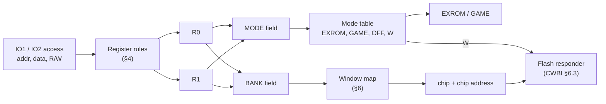

# PROPOSAL — Cartridge Mapping Descriptor

> **Rev C (2026-10-03): common CRT IDs** agreed with the TRX64 session (Alex: count upwards): 87 = GMod4 (VICE patch #368, TRX64/TRX_CRT_cli already use it), **88 = C64MegaCart** (was 61 in Piper's fork, TRX64, TRX_CRT_cli and C64RE; 61 is officially MAX Basic), **89 = TwoMegabyter**. 232 = EasyFlashXl is TRX64-internal and not a hardware type. No .crt file on disk uses 61/87/88/89.

| | |
|---|---|
| Doc | TREX-PROP-002 |
| Rev | D (draft; Rev A was split from TREX-PROP-001 Rev C §12; Rev D 2026-10-07: descriptor v2, §10) |
| Date | 2026-09-30, Rev B 2026-10-03 |
| Scope | Bank and mode decoding of cartridge types as data. U2+ / U2+L / U64 / U64-II / C64U, IcePi, TRX64 |
| Status | Proposal for review; independent of CWBI |

> **Rev D (2026-10-07): descriptor v2** (T51, Alex: EasyFlash 3 goes into the generic decoder). The descriptor grows from 37 to 43 bytes: a third register `R2`, rules and fields that can name it, a 9-bit bank, an IO1 read of `R2`, the flash chip address with ROMH above bank bit 3 (§10). **Compatibility: bytes 37-42 = 0 is exactly the v1 descriptor**; every existing entry is unchanged and the bench `cart_equiv` shows the same behaviour. §8.5 is the EasyFlash 3 entry; §8.4's "not yet specified" is answered there.
>
> **Rev B (2026-10-03): settled against VICE** (`vice/src/c64/cart/`, code only; reviewed by Alex pending). What changed:
> - §4.4 new: a rule's `mask` says which address bits are decoded; Magic Desk, Magic Desk 16K, Ocean, GMod2 decode **no** address bit (`mask 0x00`), EasyFlash and Megabyter decode A1 only (`mask 0x02`).
> - §5.3 / §8: `H` is **not** the CRT header. Header EXROM/GAME are not read by VICE for any of these types. Reset values are constants (all registers 0); the EasyFlash mode-0 GAME level is the EasyFlash jumper (default off = GAME low), written into the table as a constant.
> - §6.2 new: per-area **IO fields** (`io1`/`io2`: `read` = `OPEN`/`REG`/`RAM`/`DEV`, `write` = `NONE`/`RULES`/`RAM`) replace the single `IO2_RAM` flag. Only EasyFlash has IO2 RAM; every other type of §8 answers IO1/IO2 reads with open bus.
> - §8 row 85 Magic Desk 2: `L16`, 7-bit bank, `R0.7` 0 = 16K / 1 = `OFF` (was: "as 19", 8 bit bank).
> - §8 row 5 Ocean: ROMH shows the same bank as ROML (confirmed); EXROM/GAME depend on the image size (512 KiB: 8K, else 16K), not on the header.
> - §8 row 86 Megabyter: `R1 = 01` is 16K lines (only ROML populated), not 8K.
> - §8 row 88 C64MegaCart: **settled (2026-10-03)** against Martin Piper's VICE patch (`c64megacart.c`, `c64cartmem.c`), TRX64 (`cart.rs`) and his hardware repo (footnote 8): both registers decode the whole page (`mask 0x00`, was `0xFF`), no IO2 RAM, entry `01` = hold (was: 16K), entry `11` = write window only, flash profile added. Two new mode-table fields (`HOLD`, `GAMEW`, §5.3); a BANK wider than 8 bit is still missing (only the 8 MiB board needs it).
> - §8 row 89 TwoMegabyter: **settled for modes 00/01/11, bank, windows and flash commands** from Protovision's API code (`twomegabyter.ca65.s`, footnote 7). Mode 10 is written by no code.
> - §8.2 new: JSON entries for the corrected types.

---

## 1. Purpose

1.1 CWBI (TREX-PROP-001) makes the flash chip data. The board is still logic:
every CRT type has its own bank and mode decode. This proposal makes the board
data as well, so that a new cartridge type of the common kind is a table entry in
firmware, not FPGA work (CWBI §3.2). The same descriptor is meant to drive every
implementation (Ultimate, IcePi, TRX64 / ue2emu).

## 2. Scope

2.1 Cartridges whose behaviour is fully described by: registers
written or read in IO1/IO2, bank and mode fields in those registers, and a fixed
mapping of ROML/ROMH onto chip addresses. Not in scope, kept as dedicated logic:

| Kind | Examples | Why |
|---|---|---|
| Freezers | Action Replay, Retro Replay, Final Cartridge, Super Snapshot | NMI, RAM overlays, ROM in I/O, freeze state |
| Timing | Epyx FastLoad | Capacitor timeout |
| Not a C64 mapping | Megabit 128 (#560) | C128 external ROM |

## 3. Model



## 4. Registers and rules

4.1 Two registers `R0`, `R1` (8 bit), reset values in the descriptor.

4.2 Up to four rules. A rule fires on an IO1/IO2 access and loads a register:

| Field | Values |
|---|---|
| `area` | `IO1`, `IO2` |
| `match`, `mask` | Address bits A7–A0 compared |
| `on` | `WRITE`, `READ` |
| `target` | `R0`, `R1` |
| `src` | `DATA` (bus data), `ADDR` (A7–A0), `CONST` |
| `value` | Constant for `CONST` |

4.3 Reads that trigger a rule return open bus unless the descriptor maps
readable data there (none of the types in §8 do, apart from the EEPROM).
The `io1`/`io2` fields (§6.2) say what a read of the area answers.

4.4 `mask` selects the decoded address bits: a rule with `mask 0x00` matches
every address of its area (Magic Desk, Magic Desk 16K, Ocean, GMod2:
`$DE00-$DEFF` all write the one register; VICE `magicdesk.c:106`,
`magicdesk16.c:111`, `ocean.c:127`, `gmod2.c:118`); `mask 0x02` decodes A1 only
(EasyFlash `easyflash.c:215`, Megabyter `megabyter.c:146`: `$DE00`/`$DE01`/`$DE04`
... are the first register, `$DE02`/`$DE03`/`$DE06` ... the second). Every
row of §8 states its rules with `match`/`mask`.

## 5. Fields and mode table

5.1 `BANK` = up to two segments `{reg, lsb, width}`, concatenated high to
low. Width up to 8 bits in total. (Not expressible: the 14 bit bank
`{R1[5:0], R0[7:0]}` of Piper's C64MegaCart model and of its 8 MiB board,
§8 footnote 8. The 2 MiB board needs 8 bits and fits.)

5.2 `MODE` = one segment `{reg, lsb, width}`, width 0–3. Index into the mode
table. Width 0 = one fixed entry.

5.3 Mode table, up to 8 entries:

| Field | Values | Meaning |
|---|---|---|
| `EXROM`, `GAME` | `0`, `1`, `H` | Line level; `H` = value supplied by the app for the whole entry. VICE reads no header EXROM/GAME for any type of §8 (`crt.c:171-172` parses them, only the GTK preview uses them): the descriptors of §8 use constants. `H` stays for type 0 (normal cartridge, where the app takes the header) |
| `OFF` | 0/1 | Cartridge invisible (ROM and RAM) |
| `W` | 0/1 | Informational: the mode in which the board lets writes in ROML/ROMH through (Ultimax). The CWBI responder needs no flag; it acts on any write that reaches the image |
| `HOLD` | 0/1 | The entry changes no line: EXROM and GAME keep the levels of the previous mode write; the registers still load (bank bits too). C64MegaCart `01` (§8 footnote 8) |
| `GAMEW` | 0/1 | GAME level during a CPU write cycle to `$8000-$FFFF` (PHI2, R/W low); absent = same as `GAME`. Reads and the VIC see `GAME`. C64MegaCart `11`: GAME 1 for reads, 0 for writes, so Ultimax exists only while the CPU writes |

## 6. Window map

6.1 Chip address of a ROML/ROMH access:

| `layout` | ROML | ROMH (`$A000` or `$E000`) | Types |
|---|---|---|---|
| `L8` | chip 0, `{BANK, A12..A0}` | — | Magic Desk, Megabyter (ROMH not populated) |
| `L8_MIRROR` | chip 0, `{BANK, A12..A0}` | same address as ROML | Ocean, GMod2, C64MegaCart (write through `$E000`) |
| `L16` | chip 0, `{BANK, 0, A12..A0}` | chip 0, `{BANK, 1, A12..A0}` | TwoMegabyter, Magic Desk 16K, normal 16K |
| `SPLIT` | chip 0, `{BANK, A12..A0}` | chip 1, `{BANK, A12..A0}` | EasyFlash |

6.2 IO fields, per area (`io1` = `$DE00-$DEFF`, `io2` = `$DF00-$DFFF`). The
decode block has no knowledge of cartridge types: what a read or write of an
area does is data.

| Field | Values | Meaning |
|---|---|---|
| `read` | `OPEN` | open bus (the VIC's last data, VICE `c64io.c:353-354`), nothing drives the data lines |
| | `REG` | `R0` at A0 = 0, `R1` at A0 = 1 (no type of §8 uses it) |
| | `RAM` | 256 bytes cartridge RAM, address A7-A0 |
| | `DEV` | the bound device (§6.3) answers, else open bus (GMod2: EEPROM data out in bit 7 while CS = 1, bits 6-0 open bus; `gmod2.c:139-149`) |
| `write` | `NONE` | ignored |
| | `RULES` | the rules of §4 fire (area is the rule's `area`) |
| | `RAM` | stored in the 256 bytes RAM (a set: `RULES` and `RAM` may both apply) |

Defaults when the entry has no `io1`/`io2`: `read OPEN`, `write NONE` (`io1`
`write RULES` as soon as a rule names `IO1`). VICE gives only EasyFlash an IO2
device (`easyflash.c:280-295`: read always valid, 256 bytes RAM); Magic Desk,
Magic Desk 16K, Ocean, GMod2 and Megabyter register none at `$DF00` and none of
the five has a readable IO1 register (`io_source_valid` 0 and no read function,
`magicdesk.c:107`, `magicdesk16.c:112`, `ocean.c:128`, `megabyter.c:126`; GMod2
reads valid only while CS is set, `gmod2.c:144`).

6.3 Devices bound to register bits, e.g. the GMod2 EEPROM (CS, CLK, DI from
`R0` bits 6/5/4, DO read at bit 7 of `$DE00`). Device kinds are fixed logic
(CWBI §6.4); the descriptor only names the bits.

6.4 The flash profile (CWBI §7.1) binds a part to chip 0 and, for `SPLIT`, chip 1.

## 7. Constraints from implementations

7.1 Every field **shall** be decodable within the bus cycle; there is no
firmware in this path.

7.2 The generic decode is a fixed block (compare, mask, shift, 8-entry
table). Its size does not grow with the number of types. On the IcePi (ECP5-25,
99 % LUTs with per-type decode) this is the only way to add types *(IcePi,
not yet measured)*.

## 8. Descriptors

| Type | Rules | BANK | MODE → table | Layout |
|---|---|---|---|---|
| 0 normal | — | — | width 0: `H`/`H` | `L8` / `L16` |
| 4 Simons Basic | IO1 R → R0 := 0; IO1 W → R0 := 1 | — | R0.0: 0 = 8K, 1 = 16K | `L16` |
| 5 Ocean | IO1 W `DATA` → R0 (match 0x00, mask 0x00) | R0[5:0] ³ | width 0: 512 KiB image 8K, other sizes 16K ³ | `L8_MIRROR` ³ |
| 15 C64GS | IO1 W `ADDR` → R0; IO1 R → R0 := 0 | R0[5:0] | width 0: 8K | `L8` |
| 17 Dinamic | IO1 R `ADDR` → R0 | R0[3:0] | width 0: 8K | `L8` |
| 19 Magic Desk | IO1 W `DATA` → R0 (mask 0x00) | R0[6:0] | R0.7: 0 = 8K, 1 = `OFF` | `L8` |
| 23 ROSS (#428) | IO1 R → R0 := 1; IO2 R → R1 := 1 | R0[0] | R1.0: 0 = 16K, 1 = `OFF` | `L16` |
| 32/33 EasyFlash | IO1 W A1 = 0 (match 0x00, mask 0x02) `DATA` → R0; IO1 W A1 = 1 (match 0x02, mask 0x02) `DATA` → R1 | R0[5:0] | R1[2:0]: GAME = bit 2 ? ¬bit 0 : 0 ⁶, EXROM = ¬bit 1; `W` in Ultimax | `SPLIT`, `io2` RAM |
| 60 GMod2 | IO1 W `DATA` → R0 (mask 0x00; reset 0) | R0[5:0] | R0[7:6]: 00 8K, 01 `OFF`, 10 8K, 11 Ultimax `W` (write through `$E000`) | `L8_MIRROR`, EEPROM |
| 85 Magic Desk 2 (#516) | IO1 W `DATA` → R0 (mask 0x00) | R0[6:0] ⁴ | R0.7: 0 = 16K, 1 = `OFF` ⁴ | `L16` |
| 86 Megabyter | IO1 W A1 = 0 (match 0x00, mask 0x02) → R0; A1 = 1 (match 0x02, mask 0x02) → R1 | R0[6:0] | R1[1:0]: 00 8K, 01 16K lines ⁵, 10 `OFF`, 11 Ultimax `W` | `L8` |
| 89 TwoMegabyter ⁷ | IO1 W A1 = 0 (match 0x00, mask 0x02) → R0; A1 = 1 (match 0x02, mask 0x02) → R1 | R0[6:0] | R1[1:0]: 00 16K, 01 Ultimax `W`, 10 8K ⁷, 11 `OFF` | `L16` |
| 88 C64MegaCart ⁸ | IO1 W (match 0x00, mask 0x00) → R0; IO2 W (match 0x00, mask 0x00) → R1 | R0[7:0] ⁸ | R1[7:6]: 00 8K, 01 `HOLD`, 10 `OFF`, 11 GAME 1 for reads, `GAMEW` 0, `W` ⁸ | `L8_MIRROR` (write through `$E000`), flash M29F160FT |

³ Ocean, settled against VICE: ROMH (`$A000`, and `$E000`) shows the **same
bank as ROML** (`ocean.c:148-152`, called from `c64cartmem.c:940` and `:1082`),
so the IcePi decode (`bank_hi = bank_lo`) is right and `L8_MIRROR` stays. The
lines are 8K (EXROM low, GAME high) only for a 512 KiB image, 16K for every
other size (`ocean.c:161-166`, `:178-184`); the header is not consulted. One
entry per variant, the app picks by image size (§8.2). The register is every
`$DE00-$DEFF` address (`ocean.c:127`), bank = value AND mask AND 0x3F with
mask = image size / 8 KiB - 1 (`ocean.c:104`, `:211`, `:243`): banks beyond the
image wrap.
⁴ Magic Desk 2 = CRT type 85, VICE name "Magic Desk 16K" (`cartridge.h:276`,
`:351`; `magicdesk16.c`). ROML = first 8 KiB, ROMH = second 8 KiB of a 16 KiB
bank (`magicdesk16.c:137-142`, `:195`); bank = value AND mask, up to 128 banks
(2 MiB; `magicdesk16.c:70`, `:77`); bit 7 = 0: EXROM and GAME low (16K), bit 7 = 1:
both high (`OFF`) (`magicdesk16.c:80-88`). CRT type 19 is the 8K Magic Desk
(`magicdesk.c:61`, `:77-84`: ROML only, GAME high).
⁵ Megabyter, settled: `01` = EXROM low, GAME low = 16K lines
(`megabyter.c:103-108`: 00 8K, 01 16K, 10 RAM = off, 11 Ultimax; bit 1 = EXROM
level, bit 0 = GAME **low** when 1, `megabyter.c:69-74`). Only ROML is
populated: VICE has no ROMH read for the type (`c64cartmem.c:968-969` falls to
the generic ROMH array that `megabyter.c` never fills), so `$A000` is not a
mirror of ROML.
⁶ EasyFlash mode 0 (`R1.2 = 0`) forces GAME to the **jumper** level, a user
setting, not the CRT header (`easyflash.c:63-64`, `:76-96`, `:223`; resource
default off, `:342`). Jumper off: GAME low (the Ultimax boot of a normal EF
CRT). Jumper on makes bit 2 irrelevant (mode 0 behaves as mode 1, `:88-95`);
that is a second entry, not `H`. Reset: both registers 0 (`:479-480`), so EXROM
starts high, independent of the header. Register values are masked: `R0 AND 0x3F`
(`:57`, `:218`), `R1 AND 0x87` (`:222`).
⁷ TwoMegabyter = CRT type 89, ours (no VICE file: `cartridge.h:278`
`CARTRIDGE_LAST` = 86; 87 = GMod4 per VICE patch #368, as TRX64 `cart.rs:578`; 88 = C64MegaCart). Settled from
Protovision's flash API (`twomegabyter-code-1.0.0/twomegabyter.ca65.s`, C.
Kollschen; boot block `boot.ca65.s`); file:line is in those files:
- Bank: `$DE00` = 16 KiB bank, 7 bits: `(A AND $1F) << 2 | Y >> 6` (`:65-73`), `inc` at the window wrap (`:116-118`).
- Windows: reads at `$8000-$BFFF` (`:75-77`, `:36`); in Ultimax the second 8 KiB is written at `$E000-$FFFF` (`:78-82`, `:108-110`), the first at `$8000-$9FFF` → ROML = first, ROMH = second half of the bank: `L16`.
- Mode `$DE02`: `$01` = Ultimax for the flash commands (`:147-148`), `$00` = back to 16K (`:167-168`), `$03` = cart off (`boot.ca65.s:43-44`). EXROM = bit 0, GAME = bit 1 as levels gives 16K (0,0), Ultimax (1,0), off (1,1). The swapped assignment would make `$01` an 8K mode and the API, which must run from RAM `$0000-$0FFF` because of Ultimax (`:12-13`), could not work. Lines are static: the VIC sees them (`:186`, `:266`), unlike row 88.
- Entry `10` (8K) is written by no code; it follows from the same bit levels and stays unobserved.
- Register decode: the code writes only `$DE00` and `$DE02`. That A1 alone selects (`mask 0x02`) is the Megabyter decode (`megabyter.c:146`), not proven by the API.
- Flash commands: `$AA` → `$8555`, `$55` → `$82AA` (`:152-155`), i.e. `0x555`/`0x2AA` in the 8 KiB window (mask `0x7FF`); program `$A0` (`:194-195`); sector erase `$80`, the pair, `$30` at the sector (`:272-278`); chip erase `$10` (`:303-304`); done = DQ7 poll (`:214-216`, `:320-321`); 32 sectors of 64 KiB (`:231-262`). No code reads the device ID: `$C2`/`$AD` stay from R7.
⁸ C64MegaCart = CRT type 88, ours. Martin Piper's own fork writes CRT type 61
(`martinpiper/Vice-3.1-with-C64MegaCart`, `vice-3.1/src/cartridge.h:210`;
TRX64 `cart.rs:62`, `:580`; TRX_CRT_cli `examples/c64megacart.toml:1`); mainline
VICE's 61 is MAX Basic. Sources: `c64megacart.c` of that fork (byte-identical to
`C64ReverseEngineeringMCP/vice-refs/c64megacart/c64megacart.c`, compared
2026-10-03) and its glue `vice-3.1/src/c64/cart/c64cartmem.c`; TRX64
`crates/trx64-core/src/cart.rs` (checkout `ae5ea2d`) follows it; the hardware repo
`martinpiper/C64MegaCart` (V4.3 BOM: one M29F160FT55N3E2, two 74LS273, two
74S139; the schematics are Proteus binaries and were **not** read) and his demos
`FlashWriteTest.a`, `WriteCartTest.a`. File:line is `c64megacart.c` unless named.
- Registers: IO1 `$DE00-$DEFF` and IO2 `$DF00-$DFFF` are one register each, every address of the page writes it (device ranges `:125`, `:141`; the store functions never look at the address, `:171-177`, `:191-216`) → `mask 0x00` on both rules. The old row's `mask 0xFF` would have meant `$DE00` alone. Reads of either page have no valid source, open bus (`:159-164`, `:179-184`); VICE has no IO2 RAM for this type and the board has latches only → `io1`/`io2` `read OPEN`, `write RULES` (the old `io2` `RAM` was the IcePi model's and is wrong). Reset: both registers 0, bank 0, 8K (`:297-302`, `:310-315`).
- Bank: `R0` = bank bits 7-0, the whole `$DE00` byte (`:175`); `R1[5:0]` = bank bits 13-8 (`:197`). The 2 MiB board (V4.3, 256 banks) needs `R0` alone: `bank R0[7:0]` fits §5.1. Piper's model (and TRX64 `cart.rs:1914`, `:1918`) and the 8 MiB board (V5.1 BOM: four M29F160FT, 1024 banks) use `{R1[5:0], R0[7:0]}`: **needed field: BANK wider than 8 bit** (and a 10-bit variant entry for V5.1).
- Windows: ROML read `$8000-$9FFF` = flash at `(addr & $1FFF) + (bank << 13)` (`:220-223`; `c64cartmem.c:576-577`); the write window `$E000-$FFFF` uses the same function (`:225-231`; `c64cartmem.c:998-999`) → `L8_MIRROR`. Only `$E000` writes reach the flash (Piper's demos write `$E000-$FFFF` only: `FlashWriteTest.a:67-72`, `:118-123`). The CWBI responder has to take writes through ROMH only for this layout.
- Mode = `R1[7:6]` (`:198-207`): 00 → 8K (EXROM 0, GAME 1); 10 → `CMODE_RAM`, cart off; 11 → `CMODE_ULTIMAX`; **01 → no branch, the CPU-side mode is not changed** (bank bits still load, `:197`) → `HOLD`. TRX64 does the same (`cart.rs:1919-1924`).
- Ultimax is a write window only: `c64cartmem.c` answers every Ultimax read of this type with the normal C64 memory: `$E000` (`:919-921`), `$1000-$7FFF` (`:1237-1243`), `$A000-$BFFF` (`:1352-1357`), `$C000-$CFFF` (`:1451-1459`); writes to `$E000-$FFFF` reach the flash (`:998-999`). Descriptor: mode 11 = EXROM 1, GAME 1 for reads, `GAMEW` 0 for CPU writes. The hardware notes say the same (`TODO.txt:4-6`: GAME low only with A15 set, R/W low, PHI2 high; `Done.txt:86`; both are text notes, not the schematic). Not covered by this entry: VICE still serves flash at `$8000` in mode 11 (`c64cartmem.c:576`) and TRX64 serves it at `$E000` as well, with static EXROM 1/GAME 0 lines (`cart.rs:1893`, `:1896-1903`). Nothing in the repo reads either while `$DF00` = `$C0` (demos set `$00` before reading status: `WriteCartTest.a:114`; `FlashWriteTest.a:74-80`).
- VIC side: `cmodeVIC` = 8K when R1.7 = 0, `CMODE_RAM` otherwise (`:208-214`), never Ultimax: the VIC never sees cart ROM. With `GAMEW` no VIC field is needed (GAME is low only in a PHI2 write cycle; the VIC reads in PHI1). TwoMegabyter is the opposite (fn 7).
- Mode `01` is used by no software at hand: Piper's demos write `$00`, `$80`, `$C0` (`FlashWriteTest.a:47`, `:52`, `:66`; `WriteCartTest.a:48`; `$40` is only the flash-write bit OR'd with kill, `FlashWriteTest.a:17`), the test image stores `$00`, `$80`, `$C0` (T33 §4.2 B5). `HOLD` is the code model; the board (two 74LS273, no state besides the latches) cannot hold a mode: `$DF00` bit 7 drives EXROM directly (`Done.txt:72-74`), so on the cart `01` should be 8K like `00` (`{"exrom": 0, "game": 1}`, no `HOLD` field needed) and differs from `HOLD` only after `10`/`11`. Open for Alex; not measurable here. (The old line `Done.txt:79`, "`$40`: EXROM 0 and REQFLASH 1", is the V2.0 plan before the demos used `$C0`.)
- Flash: AMD command set, `$AA`@`0xAAA`, `$55`@`0x555`, mask `0xFFF` (`flash040core.c:110` in Piper's tree; datasheet Table 6, x8 mode; `FlashWriteTest.a:67-72`), ID `0x01`/`0xD2` at offsets 0 and 2 (`flash040core.c:106`; datasheet p.1), 2 MiB (`:107`). Top boot block: 31 × 64 KiB, 32 KiB, 8 KiB, 8 KiB, 16 KiB (datasheet block map; bank `$FD` = the 8 KiB block at `$1FA000`, `Done.txt:91-92`). **VICE and TRX64 model uniform 64 KiB sectors** (`flash040core.c:109`; TRX64 `flash040.rs:125-127`): an erase of the top blocks differs, the profile below follows the datasheet.
- Image: 8 KiB chips at `$8000`, bank < 256, everything else rejected, missing banks `$FF` (`:416`, `:421-433`); raw `.bin` = 8 KiB banks filled with `$FF` (`:399-402`).

8.1 Values for 89 are from R7: `$DE00` selects 16 KiB bank 0–127, `$DE02`
bit 0 = `EXROM`, bit 1 = `GAME`, reset 0; the API writes with `$DE02 = $01`
and polls in 16K mode.

8.2 Entries settled in Rev B (VICE-verified; 88 from Piper's VICE fork and hardware repo, footnote 8; 89 from the Protovision API code, footnote 7, entry in §9.2). The core carries no
per-type behaviour: IO read/write, reset values and mode tables are all fields.
`io1`/`io2` omitted = defaults of §6.2. Reset values are constants (`regs`);
no entry uses `H`.

```json
{"crt_type": 19, "name": "Magic Desk", "regs": {"R0": 0, "R1": 0},
 "rules": [{"area": "IO1", "match": "0x00", "mask": "0x00", "on": "WRITE", "target": "R0", "src": "DATA"}],
 "bank": [{"reg": "R0", "lsb": 0, "width": 7}], "mode": {"reg": "R0", "lsb": 7, "width": 1},
 "table": [{"exrom": 0, "game": 1}, {"off": 1}],
 "layout": "L8", "io1": {"read": "OPEN", "write": ["RULES"]}, "io2": {"read": "OPEN", "write": []}}

{"crt_type": 85, "name": "Magic Desk 2 (Magic Desk 16K)", "regs": {"R0": 0, "R1": 0},
 "rules": [{"area": "IO1", "match": "0x00", "mask": "0x00", "on": "WRITE", "target": "R0", "src": "DATA"}],
 "bank": [{"reg": "R0", "lsb": 0, "width": 7}], "mode": {"reg": "R0", "lsb": 7, "width": 1},
 "table": [{"exrom": 0, "game": 0}, {"off": 1}],
 "layout": "L16", "io1": {"read": "OPEN", "write": ["RULES"]}, "io2": {"read": "OPEN", "write": []}}

{"crt_type": 5, "name": "Ocean, image 512 KiB", "regs": {"R0": 0, "R1": 0},
 "rules": [{"area": "IO1", "match": "0x00", "mask": "0x00", "on": "WRITE", "target": "R0", "src": "DATA"}],
 "bank": [{"reg": "R0", "lsb": 0, "width": 6}], "mode": {"reg": "R0", "lsb": 0, "width": 0},
 "table": [{"exrom": 0, "game": 1}],
 "layout": "L8_MIRROR", "io1": {"read": "OPEN", "write": ["RULES"]}, "io2": {"read": "OPEN", "write": []}}
(crt_type 5 for every other image size: the same entry with "table": [{"exrom": 0, "game": 0}];
 the app also narrows "bank".width to log2(image size / 8 KiB), VICE masks the register that way)

{"crt_type": 32, "name": "EasyFlash, jumper off", "regs": {"R0": 0, "R1": 0},
 "rules": [
   {"area": "IO1", "match": "0x00", "mask": "0x02", "on": "WRITE", "target": "R0", "src": "DATA"},
   {"area": "IO1", "match": "0x02", "mask": "0x02", "on": "WRITE", "target": "R1", "src": "DATA"}],
 "bank": [{"reg": "R0", "lsb": 0, "width": 6}], "mode": {"reg": "R1", "lsb": 0, "width": 3},
 "table": [
   {"exrom": 1, "game": 0, "w": 1}, {"exrom": 1, "game": 0, "w": 1},
   {"exrom": 0, "game": 0},         {"exrom": 0, "game": 0},
   {"off": 1},                      {"exrom": 1, "game": 0, "w": 1},
   {"exrom": 0, "game": 1},         {"exrom": 0, "game": 0}],
 "layout": "SPLIT", "io1": {"read": "OPEN", "write": ["RULES"]}, "io2": {"read": "RAM", "write": ["RAM"]}}
(jumper on, VICE `easyflash.c:88-95`: entries 0-3 become off, Ultimax, 8K, 16K)

{"crt_type": 86, "name": "Megabyter", "regs": {"R0": 0, "R1": 0},
 "rules": [
   {"area": "IO1", "match": "0x00", "mask": "0x02", "on": "WRITE", "target": "R0", "src": "DATA"},
   {"area": "IO1", "match": "0x02", "mask": "0x02", "on": "WRITE", "target": "R1", "src": "DATA"}],
 "bank": [{"reg": "R0", "lsb": 0, "width": 7}], "mode": {"reg": "R1", "lsb": 0, "width": 2},
 "table": [{"exrom": 0, "game": 1}, {"exrom": 0, "game": 0}, {"off": 1}, {"exrom": 1, "game": 0, "w": 1}],
 "layout": "L8", "io1": {"read": "OPEN", "write": ["RULES"]}, "io2": {"read": "OPEN", "write": []}}

{"crt_type": 60, "name": "GMod2", "regs": {"R0": 0, "R1": 0},
 "rules": [{"area": "IO1", "match": "0x00", "mask": "0x00", "on": "WRITE", "target": "R0", "src": "DATA"}],
 "bank": [{"reg": "R0", "lsb": 0, "width": 6}], "mode": {"reg": "R0", "lsb": 6, "width": 2},
 "table": [{"exrom": 0, "game": 1}, {"off": 1}, {"exrom": 0, "game": 1}, {"exrom": 1, "game": 0, "w": 1}],
 "layout": "L8_MIRROR", "io1": {"read": "DEV", "write": ["RULES"]}, "io2": {"read": "OPEN", "write": []}}

{"crt_type": 88, "name": "C64MegaCart (2 MiB board V4.3)", "regs": {"R0": 0, "R1": 0},
 "rules": [
   {"area": "IO1", "match": "0x00", "mask": "0x00", "on": "WRITE", "target": "R0", "src": "DATA"},
   {"area": "IO2", "match": "0x00", "mask": "0x00", "on": "WRITE", "target": "R1", "src": "DATA"}],
 "bank": [{"reg": "R0", "lsb": 0, "width": 8}], "mode": {"reg": "R1", "lsb": 6, "width": 2},
 "table": [{"exrom": 0, "game": 1}, {"hold": 1}, {"off": 1}, {"exrom": 1, "game": 1, "gamew": 0, "w": 1}],
 "layout": "L8_MIRROR", "io1": {"read": "OPEN", "write": ["RULES"]}, "io2": {"read": "OPEN", "write": ["RULES"]},
 "flash": {"part": "M29F160FT", "magic1": "0xAAA", "magic2": "0x555", "mask": "0xFFF",
           "id": ["0x01", "0xD2"], "id_ofs": 2, "size": "2M",
           "sectors": [{"count": 31, "size": "64K"}, {"count": 1, "size": "32K"},
                       {"count": 2, "size": "8K"}, {"count": 1, "size": "16K"}]}}
(8 MiB board V5.1 / Piper's VICE model: "bank" = [{"reg": "R1", "lsb": 0, "width": 6},
 {"reg": "R0", "lsb": 0, "width": 8}], 14 bit, wider than §5.1 allows; four chips, part and
 sector list per chip. Alternative for entry `01` without `HOLD`: {"exrom": 0, "game": 1}, footnote 8.)
```

88: reads in mode 11 are the normal C64 map, writes to `$E000-$FFFF` reach the flash, so
`gamew` 0 with `game` 1; `io2` has no RAM (the old entry took it from the IcePi model).
VICE's `$8000` flash read in mode 11 is not reproduced. GMod2 shares every `case` of
C64MegaCart in the Ultimax read functions (`c64cartmem.c:919-921`, `:1237-1243`,
`:1352-1357`, `:1451-1459`): its mode-11 entry above (`exrom 1, game 0`, static) may need the
same `gamew` treatment; not checked here.
GMod2 reset: VICE boots 8K whatever the header says (`gmod2.c:246-249`), hence `R0 = 0`.

### 8.3 EasyFlashXl (CRT type 232, TRX64-internal, 2026-10-03)

Not hardware: TRX64's 4 MB development vehicle for LN_Engine (~95 .crt files exist; no tool but the LN_Engine tools
writes 232). Source: TRX64 `crates/trx64-core/src/cart.rs` (`new_xl` :1204-1209, writes :1337-1345, banks
:1252-1261, reset :1365-1369, CRT parse :686-717) and `flash040.rs` `FLASH040B_XL` :100-116. It is the EasyFlash
entry (type 32, jumper off) with these differences only:

| Field | EasyFlash (32) | EasyFlashXl (232) |
|---|---|---|
| bank register | `$DE00` A1 = 0, bits 5:0 (64 banks) | `$DE00` A1 = 0, bits **7:0 (256 banks)** |
| mode register | `$DE02` (A1 = 1), `& 0x87` | same |
| chips | 2 × 512 KB (ROML lo, ROMH hi; hi also at `$E000` in Ultimax) | **2 × 2 MB**, same windows |
| io2 | 256 B RAM, read RAM / write RAM | same |
| reset | bank 0, mode $00 (Ultimax, jumper 0) | same; IO2 RAM and flash kept |
| flash | AM29F040B, $01/$A4, $555/$2AA mask $7FF, 8 sectors × 64 KB per chip (sector mask 0x70000) | same ID and commands, **32 sectors × 64 KB per chip (sector mask 0x1F0000)** |
| CRT CHIP bank field | 16-bit, banks 0-63 | 16-bit, banks 0-255 |

Image: 4 MB, exactly the cart window in DDR2 (0x1000000-0x13FFFFF, the expansion-port block shared with the REU, since T60 §7 with trx_io ROM_SEL 1; 0x3C00000-0x3FFFFF is Gideon's, ROM_SEL 0). The app's flash write-back (T16.2) must take
the sector mask from the type's entry, not assume EF's 0x70000 (an erase in bank 200 would otherwise hit bank 8).

### 8.4 EasyFlash 3 (CRT type 90, agreed with TRX64, 2026-10-03)

Full 8 MB EF3 image (8 slots × 1 MB, slot 0 = system area: KERNAL0+boot, KERNALs 1-7, menu/EasyProg/USB tool,
directory at bank $10, freezer areas). CRT layout: **slot-major CHIP packets, bank field = slot*64 + bank (0..511)**,
8 KB each as type 32 (load $8000 = ROML, $A000 = ROMH, $E000 accepted as ROMH); header EXROM = 1, GAME = 0. Banks
slot*64 … slot*64+63 are exactly a type-32 EasyFlash, so slots can be cut out or replaced as plain bank ranges; the
flash's linear order (slot:bank_hi:ROML/ROMH:bank_lo:offset) is computed by the loader, not stored. Hardware facts
(registers $DE00/$DE01/$DE02/$DE08/$DE0E/$DE0F, MX29LV640EBT $C2/$CB, unlock $AAA/$555): skoe's ef3.vhdl
(github.com/FrankBuss/kerberos, skoe-easyflash/). Descriptor entry, KERNAL-replacement mode, flash handler and the
8 MB DDR2 placement: §8.5 (descriptor v2, T51).

### 8.5 EasyFlash 3 (CRT type 90, T51, descriptor v2)

Banking and EasyFlash behaviour only (Alex 2026-10-07): no menu, no `$DE0F` modes, no KERNAL replacement. Registers (skoe's `cart_easyflash.vhdl`):
`$DE00` bank, `bank_hi = D5:3`, `bank_lo = D2:0` (6 bit, `R0`, mask `0x3F`); `$DE01` slot (3 bit, `R2`, mask `0x07`, **readable**); `$DE02` control
(`R1`, mask `0x87`, EasyFlash mode table); each decoded on the whole low byte (`mask 0xFF`: the CPLD decodes `$DE00`-`$DE0F` exactly, no mirrors).
Bank = `{R2[2:0], R0[5:0]}`, 9 bits (`BANK9`), image offset `{slot, bank_hi, bank_lo, ROMH, A12-A0}` = `{bank, ROMH, A12-A0}`, 8 MiB
(`L16`). IO2: 256 bytes RAM as the EasyFlash. Flash: one MX29LV640EBT (bottom boot, 8 x 8 KiB + 127 x 64 KiB, `$AAA`/`$555`, IDs `$C2`/`$CB` at 0/2)
with the chip's own address order `{slot, bank_hi, ROMH, bank_lo, A12-A0}` (`FSPLIT3`). The slot after a reset is `R2`'s reset value
(descriptor byte 38; 0 in the app's entry). Entry: `tools/cart_descriptors/12_easyflash3.json`. Not in the entry (T51 scope): `$DE08/$DE09/$DE0A`,
the no-VIC bit of `$DE02` (the EasyFlash entry ignores it too), `$DE0E`, `$DE0F`.


## 9. Transport

9.1 The descriptor and the flash profile are one record keyed by CRT type,
stored in firmware. A `.cfg` next to the CRT **may** override it (CWBI §7.1.3).

9.2 The record **should** also exist as a portable data file (one JSON
object per type) so that the same description is loaded by the Ultimate, the
IcePi and TRX64. Example:

```json
{
  "crt_type": 89, "name": "TwoMegabyter", "provisional": false,
  "regs": {"R0": 0, "R1": 0},
  "rules": [
    {"area": "IO1", "match": "0x00", "mask": "0x02", "on": "WRITE", "target": "R0", "src": "DATA"},
    {"area": "IO1", "match": "0x02", "mask": "0x02", "on": "WRITE", "target": "R1", "src": "DATA"}
  ],
  "bank": [{"reg": "R0", "lsb": 0, "width": 7}],
  "mode": {"reg": "R1", "lsb": 0, "width": 2},
  "table": [
    {"exrom": 0, "game": 0},
    {"exrom": 1, "game": 0, "w": 1},
    {"exrom": 0, "game": 1},
    {"off": 1}
  ],
  "layout": "L16",
  "flash": {"part": "MX29F016", "magic1": "0x555", "magic2": "0x2AA", "mask": "0x7FF",
            "id": ["0xC2", "0xAD"], "id_ofs": 1, "size": "2M",
            "sectors": [{"count": 32, "size": "64K"}]}
}
```

## 10. Acceptance

10.1 Per descriptor, with C64 code: every bank reachable (marker per bank
read back), every mode table entry shows the expected lines and windows, and
the flash test of CWBI §9.1 in the `W` mode. The IcePi test
(`tests/e2e/cart/flash_amd_test.py`, R9) already checks bank markers around
erased sectors and can take a descriptor as its input.

## 10. Descriptor v2 (Rev D)

Bytes 0-36 as in `cores/icepi/c64_cartridge.v` (v1). New, offset `0x40 + n` in trx_io page 4 (window 0x040-0x06A, 43 bytes):

| Byte | Name | Meaning |
|---|---|---|
| 37 | `REGX` | b0 / b1 / b2: bit 1 of the register number of the `BANK_A` / `BANK_B` / `MODE` field (the field byte's b0 is bit 0; 0-2 = R0-R2); b7:4: bit 1 of the target register of rule 0-3 (the rule byte's b2 is bit 0) |
| 38 | `R2_INIT` | reset value of `R2` |
| 39 | `R2_WMASK` | bits a rule may set in `R2` (0: never loads) |
| 40, 41 | `RD_MATCH`, `RD_MASK` | an IO1 read with `(A7-A0 ^ match) & mask == 0` answers `R2` (needs `EXT` b0) |
| 42 | `EXT` | b0 IO1 read of `R2`; b1 `BANK9` (bank is 9 bits, else 8: bit 8 is forced 0); b2 `FSPLIT3` (flash chip address `{BANK[8:3], ROMH, BANK[2:0], A12-A0}`, with `LAYOUT` b1 or not; else the v1 addresses) |

Image offset (rom_addr) is `{BANK[8:0], ROMH, A12-A0}`; with `BANK9 = 0` bit 8 is 0 as in v1. The state-bus word `st_bank` is `{R1, R0}` as before, and
`{0, R2[2:0], R1[7], R1[2:0], R0}` with `EXT` b0. Register number 3 is not built. The generator `tools/gen_cart_descriptors.py` takes the JSON keys
`regs.R2`, `wmask.R2`, rule `target: "R2"`, field `reg: "R2"`, `bank9`, `read_r2`, `flash_split` (0 or 3).

Cost, yosys xc7 (`synth_xilinx -flatten`, `c64_cartridge` alone, no Vivado): v1 625 LUT / 161 FF; v2 with EasyFlash 3 as descriptor 686 LUT (+61) / 171 FF (+10),
including the 23-bit flash address (8 MiB) that the dedicated block of the parked build also needed (701 LUT there, with the menu modes and the KERNAL replacement).
